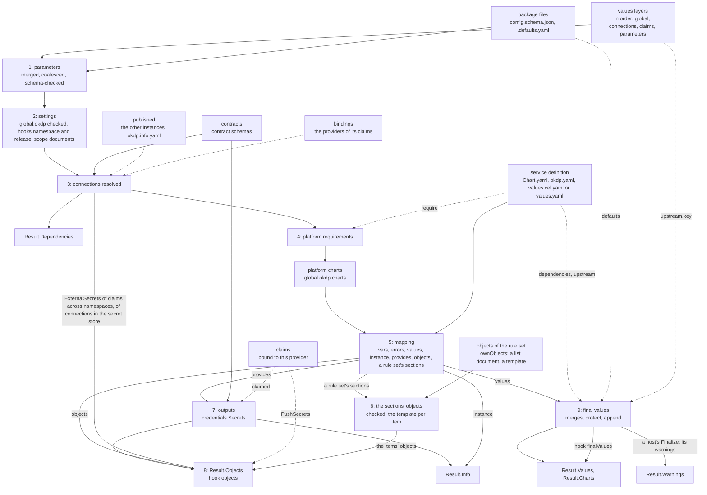

# Architecture

Describe how okdp-compiler works. The formats it reads and writes are
specified in [service definition](specs/02_service_definition.md) and
[inputs and outputs](specs/01_inputs_outputs.md).

The compiler's rules are data, in rule sets ([Rules](#rules)). The
mandatory set, embedded
([`internal/rules/mandatory`](../internal/rules/mandatory)), applied to
every compile, gives the schema of the platform's settings, the
namespaces OKDP keeps (the document of its namespace hook), the schema
of a mapping, the generated Secrets, the secret store's objects and the
charts the compiler adds. The rule sets added to
it, in order (`Inputs.Rules`, read by `LoadRules`), give a platform's own
rules, and replace none of the sets' before them: their functions,
sections, scope documents, tables, keys of the schemas and the documents
of the hooks the compiler calls, for every project. The security set,
which holds the platform's policy (the objects of the projects that are
not privileged, credentials in clear, the namespaces the platform
reserves), the groups of each role, the hosts, the OAuth clients, the
hardened pod and the policy on upstream values, is one
([okdp-compiler-security](https://github.com/OKDP/okdp-compiler-security/blob/main/docs/00_architecture.md)):
a compile without it refuses none of that.

## Position in OKDP

An OKDP service is a set of upstream Helm charts deployed together as one
instance, configured from a few parameters, the platform's and projects
settings and the connections to other instances. okdp-compiler is the compile
step: it computes, in Go, the values each upstream chart is then rendered with,
unchanged, by Helm, from the chart's own repository. A service is a package,
a directory in git, not a chart: OKDP publishes no chart of the service.

One compile is one instance. It reads the package (`LoadDefinition`:
`Chart.yaml`, `okdp.yaml` and the values file; then each compile, the
parameters and OKDP's defaults) and, in `Inputs`, the contracts, the
values layers (`Values`, merged in order as `helm -f` merges files, any
of them setting any key: parameters, `global`, `global.okdp`,
connections, claims), the host's own settings beside them (`Settings`,
which join `global.okdp` of the layers but reach no chart: the groups
of the namespace and their roles, a setting of the security set, say),
and the release and namespace,
shared by all the
instance's charts; what the other instances
of the namespace publish (`Published`), the outputs a connection reference
may name. It reads no upstream chart: a host may check the final values
against them in its Finalize
([Inputs and outputs](specs/01_inputs_outputs.md)).
It returns, in `Result`: `Values`, the final values each upstream chart is
rendered with by `helm template`; `Charts`, the upstream chart that renders
each, by repository, name and version
([Chart index](specs/01_inputs_outputs.md#chart-index));
`Objects`, OKDP's own objects for the cluster, which the `okdp-objects`
chart renders as written; `Info`, what the instance publishes, for a
control plane or a console that reads git; `Dependencies`, the instances
it depends on, for a deployer that orders the releases (a host may write
them as Flux's `dependsOn` or Argo CD's sync waves); `Warnings`, what does
not fail the
compile (a `values.yaml` that holds expressions)
([Outputs](specs/01_inputs_outputs.md#outputs)).

`LoadCatalog` reads the packages and the contracts of one or more
catalog directories, `LoadInputs` the instances of input documents,
`Settings`, `Project` and `Instance`, laid out in any files
([input documents](specs/01_inputs_outputs.md#input-documents)).
`CompileAll` compiles instances together, those of a namespace each
after the instances whose outputs it references, with what they publish
as `Published`: the order of the instances is the compiler's, not its
caller's. How a deployment's files are laid out, and the graph that
orders its releases from `Result.Dependencies`, are a host's.

Callers: a Go program embeds the package at the module's root
(`compiler`), compiles from a git tree, an embedded filesystem or memory,
and gets the files of a compile from one function (`Write`): `values.yaml`,
`okdp-objects.values.yaml` and `okdp.info.yaml`, which `helm install`
takes with the catalog's chart and the `okdp-objects` chart. A host that
deploys with Flux or Argo CD writes the single release each deploys, an
umbrella over both charts; `okdp-compile` runs the same code from
files, input documents and catalog directories, in CI or scripts
([input documents](01_usage.md#input-documents)), and writes the files
of `Write`.
The library depends on neither Helm nor the Kubernetes client libraries:
cel-go for expressions, `santhosh-tekuri/jsonschema/v6` for schemas,
`sigs.k8s.io/yaml` for values, `go.yaml.in/yaml/v3` for the mapping, the
rule set's templates, `Chart.yaml` and the package keys of `okdp.yaml`.

## Compile pipeline

No upstream chart is read: a host may check the final values against
the charts in its `Inputs.Finalize`, fetching them itself (their schemas,
the default lists an instance appended to).

`okdp.LoadDefinition` (`internal/okdp/load.go`) reads `Chart.yaml` into
`chart.Metadata` (`chart.ReadMetadata`, `chart/metadata.go`:
strictly, an unknown field refused by yaml.v3's `KnownFields`, one YAML
document; then `Metadata.Check`: `apiVersion: v2`, a name, a SemVer
version, an application chart, and each dependency's name, key, repository
and pinned version, the keys unique, Helm's `condition`, `tags`, `enabled`
and `import-values` refused). It decodes the package keys of `okdp.yaml`,
when present, into `okdp.Package`, strictly too (`require` a list of keys,
`roles`, `dependsOn`, `defaults`, and `upstream`, whose forms its
`UnmarshalYAML` decodes): a top-level key that is none of these nor of
the mapping's (`vars`, `errors`, the compiler's sections and the rule
set's) is refused before the decode, with yaml.v3's message, and
`output` with a message of its own. From both it builds the `Service`
(`Definition.service`, `internal/okdp/service.go`): the name and version
of `Chart.yaml`, the requirements and provisions of `okdp.yaml`, and
the charts by key (`chart.Specs`, `chart.NewSpecs`), one per dependency,
its source the dependency's chart, its OKDP defaults and upstream rules
those of `okdp.yaml`, whose keys must be dependencies', and the paths of
`protect` and `append` checked. The `Definition`
keeps the metadata, the package keys, `okdp.yaml` and the values file as
bytes (`Definition.Okdp`, `Definition.Values`, nil when absent), the
mapping's sources, and the package's filesystem as
`Definition.Files`: the mapping is parsed by each compile, so a YAML error
in it surfaces at `Compile`, and the other files of the package are read
by each compile.

`okdp.Compile` (`internal/okdp/pipeline.go`; a nil context, definition or
file system panics) checks the release, a name Helm accepts
(`chart.IsRelease`, `chart/ref.go`: a DNS-1123 label of 53
characters at most), and the namespace, a DNS-1123 label
(`chart.IsDNSLabel`), then builds the `Service` again
(`Definition.service`), for a `Definition` built in memory: a name and a
SemVer version, each dependency key a DNS label (it names its
dependency alias), unique, each dependency a repository URL, a chart name
and a pinned version (`Metadata.Check`, `chart.Ref.Check`,
`chart/ref.go`;
[Dependencies](specs/02_service_definition.md#dependencies)), and the
`protect` and `append` paths (`chart.NewSpecs`, `chart.Specs.Check`,
`chart/spec.go`). Then it runs the stages, one call each, in
order. The first three, one call (`newInstance`), build the compile's
`instance` (`internal/okdp/context.go`), the typed state the others read:
the release and namespace, the service's name and version, the merged
values, `global.okdp`, the dependencies, and what the mapping sees (its
`scope`):

1. **Parameters** (`newInstance`, `internal/okdp/context.go`, on
   `chart.Parameters`, `chart/parameters.go`).
   `config.schema.json` is read first, once for the compile, before the
   layers (`chart.ReadParameterSchema`; a missing one is the empty schema,
   `{}`), as any values schema is (`chart.ParseSchema`, a `chart.Schema`):
   decoded once, the validator keeping its numbers as written, its map
   view (`Schema.Doc`, `value.Normalize`) reading them as `float64`;
   compiled once (`compileSchema`). The defaults are the `default`
   of each property reached from the root through `properties`, the
   outermost on a path (`schemaDefaults`): a `default` anywhere else is
   not read. The map view gives the connection walk (stage 3); the
   requirement of each connection reference it declares, set or not, is
   compiled there (`requirements`, `readRequirement`,
   `internal/okdp/connections.go`), every one that fails reported, and
   one out of the walk's reach refused (`schemaRefs`: under a combinator,
   a definition, `additionalProperties`). The layers (`valuesLayers`,
   `internal/okdp/layers.go`) are all alike: any of them sets any key,
   parameters, upstream values, `global`, `global.okdp`, `connections`
   and `claims`, and the compiler does not know where one comes from.
   What each may set, when a host gives layers of several origins (which
   keys of `global` or `global.okdp`, no template code from a layer it
   does not review, no value it does not let change), is the host's to
   check before the compile. Each layer of `Inputs.Values`, in order, is
   normalized (`value.Normalize`: string keys, `[]any` lists, `float64`
   numbers, whatever the Go types; what values cannot hold fails, the
   layer and path named) and merged in that order by `value.Merge`, Helm's
   merge of `-f` files; the result is coalesced over the defaults by
   `coalesceValues`, `connections` and `claims` apart: not parameters,
   they are kept as merged, out of the defaults and the check. The
   coalesced values are checked against the compiled root (`validate`;
   both `Schema.Values`); every violation is reported at once, under the
   `name` of `Chart.yaml`. Nothing below runs on invalid parameters.
2. **Settings** (`newInstance`). The settings of
   `global.okdp` the compiler reads are described by the rule set's
   platform schema (`RuleSet.PlatformSchema`,
   `internal/rules/mandatory/schemas/platform.schema.json`, parsed once):
   their types, the maps on the way to
   them, the keys of `charts` and of the closed maps, the defaults, and
   the keys the added sets merge into it. The settings are read from the
   layers alone, never from the parameters, which a package schema's
   defaults reach (`valuesLayers`, `parameters`): `global.okdp` of every
   layer, merged in order, and `global.okdp` of the parameters is
   replaced by that view as written. The host's settings
   (`Inputs.Settings`, `hostSettings`) join that view for the settings
   alone, never for the parameters: a path that a layer gives too is
   refused, each named. `platformSettings` checks it
   against the schema as the parameters are checked (`Schema.Values`),
   every violation at once under a heading that names the values
   (`Inputs.Values`): a value of another type fails rather than reads as
   not set ([fields the compiler
   reads](specs/01_inputs_outputs.md#fields-the-compiler-reads)). Nulls
   are read as Helm reads them in a chart's values: a `null` deletes the
   setting's default, and is refused by its type where there is none; an
   empty string is a value. A platform whose `global.okdp.ruleSets`
   requires a rule set the compile was not given, or of a version out of
   its constraint, is refused there (`requiredRuleSets`), on the settings
   as written, before the schema.
   The mapping sees `global.okdp` as the layers wrote it (`global`),
   without the host's settings; the compiler reads the checked copy
   (`instance.okdp`: the store, the platform charts, the classes), and
   gives it the hooks' documents as `settings`. The rule sets' hooks
   `namespace` and `release` then run on the namespace and the release,
   with the settings (`CheckNamespace`,
   `checkRelease`, `internal/okdp/policy.go`, `release.go`): the
   mandatory set's refuses `platform` and `kube-*`, the security set's
   the namespaces the platform reserves, a host's set the namespaces of
   its engines and the releases named like the objects it writes. What
   the mapping sees as `platform` is the rule sets' scope documents
   (`RuleSet.Scope`: the mandatory `scope.cel.yaml`, then those of the
   added sets, merged), computed from the settings and the release: the
   proxy environment, and what an added
   set's scope documents give, the security set's groups of each role
   (`platform.access`) among them ([what a mapping sees as
   platform](specs/05_rules.md#what-a-mapping-sees-as-platform)).
3. **Connections** (`newInstance`; `resolver`, `internal/okdp/connections.go`).
   The map view of `config.schema.json` (stage 1) is walked
   (`refs`) together with a deep copy of the parameters, through
   `properties` (keys sorted) and `items`. A reference must be a string,
   `null` and `""` being not set. Each is resolved (`resolve`) to an
   external connection; else, a named claim of the values
   (`namedClaims`), to the output of `Inputs.Bindings`; else to the output
   of that name and contract one other instance of the namespace
   publishes (`output`, on `Inputs.Published`, the compiling release left
   out, two providers refused); a claim template to the output of
   `Inputs.Bindings`. No connection is
   computed from a name: what an instance is reached at, its provider
   publishes. It is completed
   against its contract (`contract.complete`). A contract is read by the
   first reference or output that names it (`readContract`), once for
   the compiles of a set (`contractCache`, `setMemo`): decoded once, the
   validator keeping its numbers as written, the keywords read from its
   map view (`value.Normalize`), and compiled once. An
   external connection or an output, its values a copy read as values
   (`value.Normalize`), holds fields of its contract only, none of them
   secret (`contract.fields`), and is validated against the contract's
   schema (`contract.check`). The reference's requirement, its `require`,
   names fields of the contract or `secretRef` (`contract.requires`, before
   the connection is looked for), and the connection, `secretRef`
   included, is validated against it (`requirement.check`): a claim bound
   to the provider of the default class says so, the compiler never binds it to
   another. An external connection whose credentials are in the platform's
   secret store (`secretRef: {remoteKey}`) resolves to the Secret of the
   instance's namespace the compiler reads them into,
   `<release>.<connection>-credentials` (`storeSecret`), as a claim across
   namespaces does; last, the connection must hold no `{{`
   (`chart.NoTemplate`)
   ([Connections](specs/01_inputs_outputs.md#connections)). The
   references that do not resolve are reported together, one line each,
   in the order of the walk (`refs`: keys sorted at each level, items in
   order). The references to an output or a claim are recorded as
   `Dependency`, the output named, sorted by parameter path.
   `global` and `connections` are then removed from the parameters; the
   instance's upstream values stay, `values.upstream.<key>`, so that an
   `errors` rule covers them; they are checked and applied at stage 9. The
   context is assembled (`instance.scope`): `release`, `values`, `global`
   (as written: `global.okdp`, the settings, and the other keys of
   `global`, such as `global.project`), `platform` (the proxy
   environment, and the keys of the added sets' scope documents),
   `service`, `labels`, `selectorLabels`
   ([Context](specs/02_service_definition.md#context)).
4. **Platform requirements** (`Compile`, on the instance). The `require`
   entries of `okdp.yaml`, in order, each a dotted path under
   `global.okdp` that must be set and not empty
   ([require](specs/02_service_definition.md#require)). A missing
   value is reported after the errors of stages 2 and 3. `Compile` then
   opens the compile's CEL session (`cel2yaml.NewSession`): its cost
   limit, OKDP's host functions for the instance (`functions`, built
   from the `instance` and the compile's context) and the CEL
   environments built with them, shared by the mapping and the
   compiler's templates, each evaluation cancelled with the context. It reads the
   platform's charts, `global.okdp.charts` (`platformCharts`,
   `internal/okdp/objects.go`): each chart of the rule set (`RuleSet.Charts`:
   in the mandatory set `objects`, the `okdp-objects` chart, 0.1.0), unless
   the platform sets it, checked as a source is ([Platform
   charts](specs/01_inputs_outputs.md#platform-charts)).
5. **Mapping** (`runMapping`, `internal/okdp/mapping.go`, on
   `compile.Eval`, `internal/compile/compile.go`, over `cel2yaml.Session`). The
   mapping, two sources (`compile.Source`, its name the first segment of
   its errors), each when present: `okdp.yaml`, its package keys skipped,
   and the values file, `values.cel.yaml` or `values.yaml` (its name
   `Definition.ValuesFile`), the section `output` whole. They are parsed
   into ordered maps (`parseDoc`), then built into one tree (`builder`),
   in every branch: the top-level keys of `okdp.yaml`, `vars`, `errors`
   and the sections OKDP names (another key fails), its directives
   checked, each string scanned and each expression compiled once, in the
   CEL environment of the names in scope at its place, with OKDP's host
   functions (`functions`) beside the language's. The tree is then
   evaluated in the compile's session, without compiling again. The `vars`
   bindings are evaluated in order, each seeing the previous ones; then
   the `errors` section, a list of messages (each the `$value` of an item
   kept by its `$if`), all collected, any message failing the compile
   (`bind`); then the sections: `output` (the values file), `instance`,
   `provides`, `objects` and those the rule sets add (`RuleSet.Sections`,
   none in the mandatory set), in that order, with the keys
   each writes at its top level, kept or not (`Doc.Written`: those of its
   map as written, not those its `$merge` or a `$for` gives). They are
   checked together against the rule set's mapping schema,
   `internal/rules/mandatory/schemas/mapping.schema.json`
   (`RuleSet.MappingSchema`, parsed once when the set is read), as
   `global.okdp` is (`ruleset.SchemaValues`; a
   null section is not set, another null refused where no default exists),
   every violation at once: the values a map of maps or nulls; `instance`
   a map, its `url` and `usage` strings; the others lists, an `objects`
   item a whole manifest, with a `kind` and a `metadata.name`, a
   `provides` item and a section's item of their keys and types; another
   shape fails rather than reads as empty or is printed
   ([sections](specs/02_service_definition.md#evaluation-order)).
6. **The objects of the rule set's sections** (`ownObjects`,
   `internal/okdp/objects.go`). For each of `RuleSet.OwnObjects`, its
   section is read by its list document, on the section's `items`, the
   release, `platform` and the platform's settings: its first
   message refuses the compile, and each item it gives, `of`, `client` and
   `names`, is rendered by the template, once per item, in the compile's
   session (`evalTemplate`), on the context plus `client` and `names`: the
   item's objects, among the mapping's, so that stage 8 checks them
   ([a rule set's sections](specs/02_service_definition.md#a-rule-sets-sections)).
   The mandatory set has none; the security set's `oidcClients` is one.
7. **Outputs and credentials Secrets** (`provided`,
   `internal/okdp/provides.go`). Each `provides` entry, of the form the
   mapping schema checks (stage 5), is
   checked against its contract, read again, as an external
   connection is: its fields (`contract.fields`), completed
   (`contract.complete`), validated against its schema
   (`contract.check`). An
   entry with a `secret` gets its credentials Secret
   (`credentialsSecret`; a generated one by the fragment
   `okdpGeneratedSecret`'s template, `generatedSecret`). Then two outputs
   of one contract and name
   fail (`twice`). The checked outputs and the mapping's `instance`, its
   `url` and `usage` trimmed (`published`), are `Result.Info`, which
   `compiler.Write` writes to `okdp.info.yaml` ([The info
   file](specs/01_inputs_outputs.md#the-info-file), [Credentials
   Secrets](specs/01_inputs_outputs.md#credentials-secrets)).
8. **Objects** (`Compile`).
   `Result.Objects` is the credentials Secrets, then the
   mapping's `objects`, then the PushSecrets and ExternalSecrets of the
   credentials of claims across namespaces, and the ExternalSecrets of the
   connections in the platform's secret store (`pushSecrets`, `pullSecret`)
   ([objects section](specs/01_inputs_outputs.md#objects-section)): in no
   chart, `compiler.Write` gives them as the values of the objects' chart,
   which renders them as written
   ([the objects chart](specs/01_inputs_outputs.md#the-objects-chart)).
   Then the rule sets' hook `objects` over them all, each object at a
   time, the items of a `List` alike, in every project (`CheckObjects`,
   `internal/okdp/policy.go`; `RuleSet.RunHook`, with the platform's
   settings and `Inputs.AllowPlainSecrets`); the first refused fails the
   compile. The mandatory set lists no document there. The security
   set's refuse, but in the platform's own projects (its
   `policy.privileged`), an object of another namespace, of a
   cluster-scoped kind or of an engine's API group, and, in every
   project unless `allowPlainSecrets`, a Secret holding values in clear,
   an ExternalSecret's template literal at a sensitive key, a Fake
   generator's values. Then no two objects share a group, kind,
   namespace and name (`checkDuplicateObjects`).
9. **Final values** (`Inputs.Finalize`, else `merge.FinalValues`,
   `internal/merge/merge.go`), for
   each dependency of `Chart.yaml` the values file does not leave out
   (`rendered`, `internal/okdp/pipeline.go`, Helm's rule: every one, but a
   key it writes, `Doc.Written` or a key of its values, left out by `$if`
   or null), its computed values `{}` when the file does not write its
   key. A key of the values file must
   be a dependency of `Chart.yaml`, null or not ([rendered
   dependencies](specs/02_service_definition.md#rendered-dependencies)).
   The key of the objects' chart is reserved
   (`checkObjectsChart`, `internal/okdp/objects.go`): neither
   `Chart.yaml` nor the values file may list it. The upstream chart is the
   key's source, its dependency's chart. The key's `defaults` file and the
   computed values are merged as `-f` files (`merged`, `keyValues`); the
   chart's own `values.yaml` is no layer: Helm coalesces the final values
   over it when it renders. When the chart accepts upstream values, the
   instance's `upstream.<key>` values go through `applyUpstream`: the `{{`
   check, `protect`, the caller's check (`chart.UpstreamCheck`), `append`,
   then the merge; the paths of the lists appended to are kept by key
   (`Final.Appended`). Last, `global` is set, left out when empty.
   `merge.FinalValues` returns a `merge.Final` (`compiler.FinalValuesOf`):
   the values, the source of each compiled key, which `Result.Charts`
   records, and the appended lists. The compiler reads no upstream chart.
   Then the documents of the rule sets' hook `finalValues` run on the
   final values of each chart key, keys in order, in every project
   (`CheckFinalValues`).
   A host's `Inputs.Finalize` wraps this merge (`compiler.FinalValues`);
   the compile runs the hook on what `Finalize` returns, after the host's
   own checks. A host may add the security set's policy on upstream
   values (its package `policy`, for a project that is not privileged,
   `policy.Privileged`),
   the warning of a literal of the upstream values at a sensitive key,
   and the checks against the upstream charts it fetched: the
   final values, coalesced over the chart's `values.yaml` by Helm's
   `chartutil.CoalesceValues`, against its `values.schema.json`, and a
   warning for an appended list whose final list lacks items of the
   chart's default list
   ([checks of the final values](specs/01_inputs_outputs.md#checks-of-the-final-values)).
   The layers and the rules: [Merge
   precedence](specs/01_inputs_outputs.md#merge-precedence), [Upstream
   values](specs/01_inputs_outputs.md#upstream-values).

Errors: a compile stops at its first error, except where the whole list
helps the author: the `errors` messages, the parameter schema violations,
the connection references that do not resolve. The first error is the
same from one compile to the next: a check over the keys of a map visits
them sorted, a list in its order
(`provides`, first error by position). A message says where: the chart, the
parameter path, the mapping's file and path (`values.cel.yaml: app:
env[2]: value: ...`, `okdp.yaml: vars host: ...`), the `vars` or `$vars`
binding, the item of a rule set's section, as its list document names
it. A path in values (a parameter, a layer's
value, an upstream value, a contract field) is written one way, as a
`protect` path is (`value.Key`, `value.Index`): plain keys joined by dots,
a key that holds a dot in brackets (`annotations["example.org/x"]`), a list
item `[i]`.

## Source map

The module's root is the public package, `compiler`: it gives callers the
types they name, as aliases, and wraps the functions of `okdp`,
`inputs`, `catalog`, `merge` and `chart`. Under `internal/`, the
packages each import only those below them: `compiler` -> `inputs` ->
`catalog` and `okdp` -> `merge`, `rules` -> `compile` and `chart` ->
`value`: the compile knows neither the input documents nor the catalog,
the catalog not the compile (`TestLayers`). A host holds the rest: the
layout of a deployment's files, the deployment graph, the files of the
deployer engines, a control plane's edits, the chart cache and the
checks against the upstream charts; `cmd/okdp-compile` reads `-f` and
`--catalog` and writes only the files of `Write`.
`compile` and `chart` do not import each other: the mapping language knows
nothing of Helm charts, the Helm code nothing of the mapping language, and
neither knows OKDP.

| Package | File | Owns | Relations |
|---|---|---|---|
| `value` | `value.go` | the data model (`M`) and its helpers: `Normalize` (a round trip through `encoding/json/v2`), `Copy`, `AsMap`, `AsList`, `Merge` (Helm's `MergeMaps`), `Truthy`, `Str`, `Dig`, `Short` (a value for a message, its sensitive keys redacted) | every package |
| | `redact.go` | what a message does not print: `Sensitive`, a key whose value may be a credential (`password`, `token`, `clientSecret`, `apiKey`, a key ending with one, or with `Key`), `SensitivePath`, the key of a path, a list item's its list's, `Redacted` (`<redacted>`), what a message prints in place of a sensitive value, `ShortAt`, a value of a key for a message | `Short`; `chart.Schema.Validate` |
| | `path.go` | the path of a value, as messages write it (`Key`, `Index`): plain keys joined by dots, a key that is empty or holds a special character in brackets, the form of the `protect` paths; read back as its keys and indexes (`Split`, `Join`), a JSON pointer (`Pointer`) | `formatPath` and `NoTemplate` (`chart`); the parameter paths of the connections and `Dependency.Field`, the fields of the contract violations (`okdp`) |
| `compile` | `compile.go` | the top level of a mapping, over the language of github.com/okdp/cel2yaml (`cel2yaml.Session`, opened with `cel2yaml.NewSession`: its CEL cost limit, the caller's host functions and the CEL environments built with them); documents read from one file or several (`Source`: a name, the first segment of its errors; a file of top-level keys, some skipped for another reader, or one section whole) with `cel2yaml.Parse`, each `vars` binding, `errors` and each section compiled to a `cel2yaml.Template` in the names in scope at its place, all before any is evaluated, then evaluated with the names of their sections: `vars` and `errors`, then the sections (`Eval`, a `Doc`: their values, and the keys each writes, `Written`), as one `cel2yaml.Session.Document` | `cel2yaml.Session.Template`, `cel2yaml.Template.Eval` |
| `chart` | `values.go` | Helm's reading (`ParseValues`) and coalescing of values (`coalesceValues`: the parameters over the defaults of `config.schema.json`) | stages 1 and 9; a host's checks against the upstream charts (`ParseValues`) |
| | `schema.go` | JSON Schema validation, reported as Helm reports it (sorted, for a stable report), the value of a sensitive key not printed (`redactCauses`: a pattern, a format, a numeric bound, `<redacted>` in its place), each violation apart too (`Violation`, `violations`: the leaves of the report); `compileSchema`, a schema compiled as Helm compiles it, fetching nothing | stages 1 and 2; the contracts (`internal/okdp/connections.go`); a host's checks against the upstream charts (`ParseSchema`) |
| | `ref.go` | `Ref`, an upstream chart, its check (`Check`: an `https://` or `oci://` repository whose path a chart cache can lay out, `repoPath`; the layout itself is a host's); SemVer precedence (`CompareVersions`); the names Kubernetes and Helm accept: `IsDNSLabel`, `IsRelease` (`ReleaseMax`) | the dependencies of `metadata.go`, the sources of `spec.go`, the platform's charts (`internal/okdp/objects.go`); the chart keys (`metadata.go`, `spec.go`); the release, the namespace and an internal reference (`okdp`) |
| | `metadata.go` | `Chart.yaml`: `Metadata`, Helm's fields in Helm's order, the order a host's umbrella may write them in; `Dependency`, its key (`Key`: the alias, else the name) and its upstream chart (`Ref`); `Maintainer`; `ReadMetadata`, the strict reader of one YAML document, and `Metadata.Check`: `apiVersion: v2`, a name, a SemVer version, an application chart, each dependency's name, key (a DNS label, unique), repository and pinned version, Helm's `condition`, `tags`, `enabled` and `import-values` refused | `ref.go` (`Ref.Check`, `IsDNSLabel`, `IsVersion`); read by `LoadDefinition`, `compiler.ChartMetadata`; written back by a host's umbrella |
| | `spec.go` | the charts of a package, by key: `Spec` (its source, its OKDP defaults, the instance upstream values it accepts, their `protect` and `append` paths), built from the dependencies of `Chart.yaml` and the `defaults` and `upstream` of `okdp.yaml` (`NewSpecs`; `Upstream`, the forms of `upstream`, decoded by its `UnmarshalYAML`); `Specs.Check` (the `protect` and `append` paths) | `metadata.go`, `paths.go`; built by `okdp.Definition.service` |
| | `paths.go` | the grammar of the `protect` and `append` paths (`parsePath`); `formatPath`, the keys a value was found at, written back | `spec.go`, `merge.go`; `value.Key` |
| | `parameters.go` | stage 1: `Schema`, a values schema decoded and compiled once, its defaults read (`ParseSchema`; `NewSchema`, from a document already decoded, at a URL of its own: a contract's, a requirement's), its values coalesced over them and checked (`Schema.Values`, `Schema.Validate`); the package's `config.schema.json`, read once per compile, `{}` when missing (`ReadParameterSchema`); `Parameters`, `connections` and `claims` apart, its violations a `ValuesError` | `values.go`, `schema.go`; read by `okdp` (`context.go`: the parameters, the platform schema; `connections.go`: the contracts, the requirements) |
| | `check.go` | what is checked of values whatever the chart: `NoTemplate`, the `{{` check; `UpstreamCheck`, the type of the caller's check of upstream values | `okdp` (`connections.go`), `merge` |
| `merge` | `merge.go` | stage 9 (`FinalValues`, a `Final`: the values by key from `keyValues`, the source of each, the paths appended to, `Appended`), the instance's upstream values, `protect`, the caller's check (`chart.UpstreamCheck`) and `append`; no upstream chart read | `chart`; `compiler.FinalValues` for a host's `Inputs.Finalize` |
| | `paths.go` | the paths the merge walks | `merge.go` |
| `rules` | `rules.go` | the rule sets (`LoadRules`, the sets given added to the mandatory one in order, `Mandatory`, it alone, embedded from `mandatory/`, `RuleSet`; its zero value holds no rule, its documents and hooks failing with `ErrNotLoaded`; a rule that refuses is a `*Failure`, `errors.Is(err, ErrRefused)`): its tables, its schemas, fragments and templates, labels, names and charts; the mapping schema and the objects chart required of the sets together, a rule a set read before gives refused, the error naming the set (`taken`); the schemas merged (`schemas.go`), the scope documents (`scopes.go`, `RuleSet.Scope`), the sets' names and versions and the constraints on them (`versions.go`, `Names`, `SetVersion`, `Require`) | `chart`, `compile`; the walkers of `okdp` |
| | `check.go` | its documents (`loadDocuments`), prepared once per set in free sessions (`checker`, `get`, `put`) on the inputs the compiler gives (`ruleInputs`) and those the sets declare (`inputs`), and evaluated (`Refuse`, `Values`), a document that fails to evaluate an error; the functions they call (`ruleFunctions`) | `compile.Prepare` |
| | `hooks.go` | the hooks (`HookNamespace`, `HookRelease`, `HookObjects`, `HookFinalValues`), the documents each set lists at each (`loadHooks`), run in order (`RunHook`, `Hooks`) | the walkers of `okdp` |
| | `rules.schema.json` | the form of `rules.yaml`, embedded | `LoadRules` |
| `okdp` | `doc.go` | the package doc | |
| | `service.go` | `Definition` (the `Chart.yaml` metadata, the package keys of `okdp.yaml`, `okdp.yaml` and the values file as bytes, the values file's name, the package's files, the warnings of its load); `Package`, the package keys of `okdp.yaml` (`require` a list of keys, `defaults`, `upstream`, `provisions`, each a `Provision`, a contract and its claimers, read from its name or `{contract, claimers}`; the mapping's sections held as `yaml.Node`, unread); `Service` (the name and version of `Chart.yaml`, the requirements and the provisions of `okdp.yaml`, the charts), built from a `Definition` and checked, at load and before every compile (`Definition.service`, its messages naming `Chart.yaml` or `okdp.yaml`); `platformValue`, the end of the error of a missing platform value, which names the input | `chart.Metadata.Check`, `chart.NewSpecs`; read by `LoadDefinition` and `Compile`; `platformValue` by `pipeline.go` |
| | `load.go` | `LoadDefinition`: `Chart.yaml`, read and checked (`chart.ReadMetadata`); `okdp.yaml`, its package keys decoded strictly (`output` refused), the keys of `defaults` and `upstream` those of dependencies; the values file, `values.cel.yaml` or `values.yaml` (both refused), a `values.yaml` checked for expressions and `$`-keys, a warning (`holdsExpressions`); the `Service` built from them and checked | `chart.ReadMetadata`, `Definition.service` |
| | `pipeline.go` | `Inputs`, `Result` (with the definition's warnings), `Compile`: the order of the stages, each a method of `run`, the state of one compile (`checkInputs`; `platformInstance`, stages 1 to 4, the platform requirements among them; `mapping`, stages 5 and 6, in the compile's CEL session; `provides`, stage 7; `objects`, stage 8; `finalValues`, stage 9, the dependencies rendered by `rendered`) | calls `newInstance`, `cel2yaml.NewSession` (with `functions`, the context given to each evaluation), `platformCharts`, `runMapping`, `ownObjects`, `provided`, `published`, `checkObjectsChart`, `Inputs.Finalize` or `merge.FinalValues` |
| | `memo.go` | `setMemo`: what the compiles of one `CompileAll` read once, an instance's parameters (`paramsMemo`), the contracts of a file system (`contractCache`) | `Compile`, `claimsOf`, `newInstance`, `resolver` |
| | `layers.go` | stage 1: the values layers of `Inputs.Values`, in order, normalized (`value.Normalize`), any of them setting any key; their `global.okdp`, merged, with the host's settings (`Inputs.Settings`, a path both give refused, `hostSettings`), the settings (`valuesLayers`) | called by `context.go`, `claims.go`, `connections.go`, `policy.go` |
| | `context.go` | stages 1 to 3: `instance`, the typed state of a compile, built by one function (`newInstance`): the parameters (`chart.ReadParameterSchema`, the references' requirements, `valuesLayers`, `chart.Parameters`), the settings (`global.okdp` of the layers alone, `valuesLayers`, checked against the rule set's platform schema, `platformSettings`, which refuses the rule sets `global.okdp.ruleSets` requires and the compile was not given) and the connections (`resolver`), which end with what the mapping sees (`instance.scope`); values checked against a schema of the rule set, the platform's or the mapping's (`ruleset.SchemaValues`) | `chart.ParseSchema`, `chart.Schema.Values`; `connections.go`, `labels.go`; the rule set's scope documents (`RuleSet.Scope`); the `instance` is read by `mapping.go`, `objects.go`, `provides.go` |
| | `connections.go` | the references of the parameters, visited (`refs`), resolved to a connection, a named claim's or a claim template's output of `Inputs.Bindings`, or an output of `Inputs.Published` (`resolver`: `resolve`, then one resolution per source, `resolveClaim`, `resolveExternal`, its contract's fields apart from its own keys (`connectionFields`), as written (`Connection`, `ParseConnection`), `resolveOutput`), `Dependency`; the outputs no instance publishes, said by the error (`missingOutputs`); the contracts: `contract`, read, decoded and compiled once for the compiles of a set (`readContract`, `contractCache`), its claim schema with it, `x-okdp-internal` refused, and the checks of values against one (`fields`, `validate`: `complete` then `check`), of a claim's request against its claim schema (`contract.request`); every connection of an instance's values checked at its declaration, referenced or not (`declaredConnections`, `checkDeclared`, `declared`, `declaration`, `CheckConnection`, `ConnectionEntry`); what a reference requires (`requirement`, `require`): compiled (`readRequirement`), once per compile (`resolver.requirement`), those of the parameter schema at stage 1, with the request each fixes (`requirements`), found as the walk finds them, one out of its reach refused (`schemaRefs`, `ConnectionRefs`), its fields against the contract (`contract.requires`), the connection against it (`requirement.check`) | used by `context.go` with the values' `connections`, recording dependencies; the contracts by `provides.go` |
| | `descriptor.go` | a contract as the compile reads it, for a caller that shows it (`ReadContract`, `ReadContracts`, `ContractDescriptor`, `ContractField`): `readContract`, its fields in the order of the file (`propertyOrder`) | `readContract` |
| | `accessors.go` | the errors of a field (`FieldError`, `atField`: the references, the claims bound, the named claims); the names of the claims (`NamedClaimID`, `IsClaimID`, `CheckProvider`) | `connections.go`, `namespace.go`, `claims.go` |
| | `claimid.go` | the form of a claim ID (`claimIDForm`): DNS-1123 labels joined by dots, 63 characters at most, a single label too | `IsClaimID`, `checkDotted`, `checkClaims` |
| | `mapping.go` | stage 5: OKDP's sections (`runMapping`: the sources `okdp.yaml`, its package keys skipped, and the values file, the section `output`, named by `Definition.ValuesFile`, `values.cel.yaml` by default), checked against the rule set's mapping schema, OKDP's host functions (`functions`: `okdpFullname`, those of `labels.go`, `fragmentFunctions` and `documentFunctions`, the rule set's, `okdpGeneratedSecret` among its fragments; `unary`, a function of one argument), built once per compile from its `instance`, for its session; `generatedSecret`, the objects of a generated credentials Secret, from the template of `okdpGeneratedSecret`, and `evalTemplate`, a template of the rule set evaluated in the session, its errors under its file's name | `compile.Eval`; `functions` by `pipeline.go`; `fullname` (`truncName`, a name cut as charts cut it, `trunc n \| trimSuffix "-"`) |
| | `fragments.go` | the fragments of the rule sets as CEL functions (`RuleSet.Fragments`, none in the mandatory set): the arguments checked against the mapping schema under the function's name, then the fragment evaluated on them (`fragment.call`) in the session of the call | `mapping.go: functions`, `evalTemplate` |
| | `labels.go` | the labels of OKDP's own objects, from the package's `name` and the release, the selector labels a subset (`labels`) | the context (`service`, `labels`, `selectorLabels`), the CEL functions, every object the compiler writes |
| | `provides.go` | stage 7: `Info`, `Output`, `SecretRef`, what the instance publishes (`published`); the outputs, each checked against its contract, two of one contract and name refused (`provided`, `twice`), the credentials Secrets (`credentialsSecret`), a plain one refused unless `Inputs.AllowPlainSecrets` | `connections.go` (the contracts, the resolver), `generatedSecret` (`mapping.go`) |
| | `objects.go` | the objects the rule set's sections add (`ownObjects`, stage 6), the key of the objects' chart reserved in `Chart.yaml` and the values file (`checkObjectsChart`), stage 9; the platform's charts, each of the rule set's unless the platform sets it (`platformCharts`, stage 4); `ObjectsChart`, `ObjectsValue` | `chart.Ref`; `RuleSet.OwnObjects`, `RuleSet.Charts` |
| | `claims.go` | `Claim`, a connection claimed of a provider's instance; `Binding`, the provider a reference's claim is bound to; a claim as written, a claim template or a named claim, its request among it (`ClaimSpec`, `parseClaim`), the named claims of the values (`namedClaims`), one of them as written, what it holds even when it fails (`ParseClaim`), those of an instance's parameters and values, a template's request merged over the package's (`claimsOf`), its ID (`claimID`); the provider a claim or a class names (`providerName`); the classes of the settings, `global.okdp.provisioning`, read from the merged values of `claimsOf` (`instanceClaims`); `provisions` checked (`checkProvisions`), and the claimers of a provider (`CheckClaimers`, `consents`), the claims bound to an instance checked (`checkClaims`), their outputs found among the provided ones (`claimed`), what the mapping sees of them (`claimsScope`) | `service.go` (`Service.Provisions`), `pipeline.go` (before the context, after stage 7), `context.go` (`claims`) |
| | `transfer.go` | the credentials of claims across namespaces, through the platform's secret store, and those of the connections kept in it (`secretRef.remoteKey`): the key of a claim's credentials (`storeKey`), the PushSecrets of the provider's namespace (`pushSecrets`), the ExternalSecrets of the claimer's and of a connection's referrer (`pullSecret`), the credentials a reference needs read (`transfer`) | `connections.go` (`resolveClaim`, `storeSecret`), `pipeline.go` |
| | `namespace.go` | `Instance`, `Outcome`, `Bound`, `CompileAll`: each instance whose values' connections hold at their declaration (`declaredConnections`), each claim bound to its provider, the one it names or the provider of its class, the one it names or the default one of its settings, the named claims of a namespace once, declared alike, each request, what its class fixes under it, checked against the contract's claim schema, its defaults applied (`compilation.bind`: one `binder` step each for the claims an instance reads, the named claims of a namespace, the references of an instance in parameter path order, the claims given to their providers and the outcomes, the errors in the order they come; `compilation.provider`, `choice`, `claimRequest`, each reading the claim's `claimSite`, its `claimRef` and its namespace; what `CompileAll` gathers for an instance in its `member`, its inputs read once), a provider of another namespace with its consent, whatever class routes the claim (`consent`, `Instance.Claimers`), then the instances compiled together, each published to its namespace (`compilation.compileAll`: Kahn's algorithm, its edges discovered by compiling, an instance waiting for the outputs its compile says it lacks, of its namespace or of its claims' providers), the outputs two instances of a namespace publish refused (`compilation.refuseShared`), two objects of a namespace that write one Secret refused (`compilation.refuseSecretTargets`, `secretTargets`, the items of a `List` walked as every rule on objects walks them, `eachObject`), after each, the instances that depend on an instance refused since, of any namespace, compiled again (`compilation.recompileDependents`); the instances that do not compile named in the refusals for an output (`compilation.notes`, `notCompiled`) | `Compile`, `missingOutputs` (`connections.go`), `claimsOf`, `claimID` (`claims.go`) |
| | `policy.go` | the walkers that call the rule sets' hooks, for every project: the namespace, a DNS label first (`checkNamespaceName`), then the hook `namespace` with the settings (`CheckNamespace`, stage 2, `compiler.CheckNamespace`'s); `SettingsOf`, the settings as a compile reads them, a `NamespaceError` for a refused namespace; the objects of an instance, the items of a `List` too, with `Inputs.AllowPlainSecrets` (`CheckObjects`, `eachObject`, stage 8); the final values (`CheckFinalValues`, stage 9); two objects of one name (`checkDuplicateObjects`) | called by `pipeline.go`, `context.go`; `Inputs.Rules` |
| | `release.go` | the hook `release` on the release, with the settings (`checkRelease`, stage 2) | `context.go` |
| | `rules.go` | `RuleSet` as this package reads it, `rulesOr`, the mandatory set for a compile that gives none | `rules` |
| `catalog` | `catalog.go`, `files.go` | the catalog of one or more directories, each read for `catalog/<service>/<version>/` and `contracts/<contract>.schema.json` alone (`Files`, `Load`, `Catalog`): a service in one directory with every version of it, a contract in several of the same bytes, the order of the directories changing nothing, every conflict at once; its services and their versions, highest first (`Services`, `Service`, `sortVersions`), a package (`Package`, `packageDir`, `PackagePath`), the contracts (`Contracts`, read from memory: `memFS`); `ErrNotInCatalog` | `chart.CompareVersions`, `chart.IsFileName`; read by `inputs` and `compiler.LoadCatalog` |
| `inputs` | `inputs.go` | the input documents (`Files`, `Load`): the `.yaml` and `.yml` files of a directory, or one file, each YAML document of a kind, `Settings`, `Project` or `Instance` (`documents`), read strictly (`check`, `required`, `readProject`, `readInstance`), a file a document's `valuesFiles` names read as a values file, not as documents (`resolve`, `values`, `chart.ParseValues`); the instances, sorted by project then name, each package loaded once (`definition`, its `Chart.yaml` of its directory's name and version), their values layers in order (the `Settings` document's, the `Project`'s, the instance's `connections`, its values), release, namespace and claimers; every problem at once, each at its document | `catalog.Catalog.Package`, `okdp.LoadDefinition`, `okdp.CheckClaimers` |
| `compiler` | `compiler.go`, `exports.go` | the public API: `LoadDefinition`, `Compile`, `CompileAll`, `LoadCatalog` (`CatalogFiles`, `Catalog`, `CatalogService`, `ErrNotInCatalog`), `LoadInputs` (`InputFiles`, `KindSettings`, `KindProject`, `KindInstance`), `LoadRules`, `Mandatory`, `ParseConnection`, `ParseClaim`, `DefaultCostLimit`, `CheckNamespace`, `FinalValues` (`FinalValuesOf`: `Values`, `Charts`, `Appended`), `ParseValues`; aliases of the types a caller names; the directories of a catalog (`ContractsDir`, `CatalogDir`) and the names (`IsName`); what a host reads of a rule set and of a namespace (`SettingsOf`, `NamespaceError`, `CheckObjects`, `CheckFinalValues`) | wraps `okdp`, `inputs`, `catalog`, `merge`, `chart` |
| | `write.go` | the files of a compile (`Write`: `ValuesFile`, `ObjectsValuesFile`, `InfoFile`), `ChartValues`, `ObjectsChartValues` | `okdp.Result` |
| | `accessors.go` | what the compile decides, for a caller that answers before it writes: `CheckConnection`, `FieldErrors`, a compile's error as the problems of its fields (`FieldError`: `Path`, `Pointer`, `Message`; `okdp.FieldError`, `chart.ValuesError`); `ConnectionRefs` (`ConnectionRef`); `ReadContracts` (`ContractDescriptor`, `ContractField`); `NamedClaimID`, `IsClaimID`, `CheckProvider` | `okdp`, `chart`, `value` |
| `dirfs` | `dirfs.go` | the files under a directory as an `fs.FS`, no symbolic link followed, nothing read out of the directory, what is read bounded (`MaxFileSize`, `MaxDirSize`) | `cmd/okdp-compile` |
| `outdir` | `outdir.go` | the output of `okdp-compile`: its `projects/`, owned by the command, marked (`MarkerFile`), checked before a write (`Check`, `--force`), written whole, every other file removed (`Write`), no file written or removed through a symbolic link | `cmd/okdp-compile` |
| `cmd/okdp-compile` | `main.go` | the command: `-f` (each file read in the directory that holds it), `--catalog`, `--rules` through `dirfs`, then `LoadCatalog`, `LoadInputs`, `CompileAll` and `Write`, the files under `<output>/projects/<namespace>/instances/<release>/`; the bindings, refusals, warnings and dependencies on stderr; `--check` writes nothing | `compiler`, `dirfs`, `outdir` |

Layers: `value`, `chart/values.go` and `chart/schema.go`
reproduce Helm and know nothing of OKDP; github.com/okdp/cel2yaml
reproduces Helm's and sprig's functions, bound to CEL;
`chart/ref.go` holds the names Kubernetes and Helm accept;
`internal/merge` applies the rules of the package's charts (`okdp.yaml`'s
`defaults` and `upstream`) and reads no upstream chart; `internal/okdp`
binds claims and resolves connections, its walkers running what the rule
set says, and `internal/okdp/pipeline.go` orders the stages. Each rule is
computed in one place and reused: the labels of the context, of
`okdpLabels` and of the credentials Secrets; one generated Secret for the
CEL function and for `provides[].secret`; one resolver for consumers and
for the provider check; one CEL session per compile for the mapping and
the rule set's templates.

### Rules

A rule set is a directory: `rules.yaml` and the files it names, read once
against `rules.schema.json`. A compile applies the mandatory set,
`internal/rules/mandatory`, embedded, and the sets it is given, if any
(`Inputs.Rules`, read by `LoadRules`), added to it in order. Each rule
is in one of them: a table, a document, a function, a template, a
section or a chart a set read before gives is refused in a later one,
and so are `names` and `labels`, each given whole. There is no
precedence to read: all apply. Their documents are prepared in one
session, each able to call any other with `rule`.

Four parts add up rather than stand beside each other. A set's `schemas`
are merged into those of the sets read before through `properties` and
`$defs`, a key added and none changed, and the merged document is
parsed once. Its `scopes`, documents evaluated after those of the sets
before it, add keys to what a mapping sees as `platform`, a value two of
them give refused. Its `hooks` list documents after those of the sets
before it. Its `tables` add values to the extensible tables of the sets
before it. Each set has a `name`, `core` for the mandatory one, unique:
a platform requires sets by name and version (`global.okdp.ruleSets`),
and a compile not given one is refused.

`LoadRules` fails closed: a rule a set read before gives refuses the
set, never a rule turned off or replaced; its error names the set. The
compiler requires of the sets together only what it reads itself, the
mapping schema and the objects chart: what they refuse is their
documents', through the hooks, and a document that reads a table no set
gives fails to evaluate, and refuses.

| Part of `rules.yaml` | Holds |
|---|---|
| `tables` | lists the documents read |
| `hooks` | the documents the compiler calls on a namespace, a release, each object and the final values, every set's, in order |
| `inputs` | the inputs the set's documents give one another through `rule` |
| `name`, `version` | the set's name, `core` for the mandatory one, and its version, which a platform's `global.okdp.ruleSets` constrains |
| `schemas` | the platform's settings, a mapping's sections and the arguments of its functions; an added set's merged into them |
| `scopes` | the documents that compute what a mapping sees as `platform`, every set's, merged |
| `functions` | the fragments and functions a mapping calls |
| `functions`, `templates`, `documents` | the objects and values the compiler has the rule set compute: a generated Secret (the fragment `okdpGeneratedSecret`), the secret store's objects, `scope` (what a mapping sees as `platform`), the hooks' documents |
| `sections`, `ownObjects`, `charts` | the sections of a mapping, those whose items add objects, the charts' defaults |
| `names`, `labels` | the names of credentials, the labels of OKDP's objects |

The documents run in a session of the rule set's own, prepared once and
kept in a free list: a compile pays neither to build them nor in its
cost, which bounds what a package's expressions compute.

`Inputs.Rules` nil is the mandatory set alone (`rules.Mandatory`): its
tables, hooks, schemas and the default of the objects chart apply, as in
any compile.

## Design decisions

### Helm fidelity

What Helm computes from the same values files, the compiler computes the
same way, and a host's fixtures check it against the helm binary ([Helm
fixtures](#helm-fixtures)). A values difference is silent: read as YAML
1.2, an upstream default `enabled: no` is the string `"no"`, which a
template's `if` takes as true.

- Reading: values files as Helm 3 reads them, the first document only
  (`ParseValues`, `sigs.k8s.io/yaml`, YAML 1.1); a host may read the
  upstream charts' `values.yaml` with it
  ([Values files](specs/01_inputs_outputs.md#values-files)).
- Merging: `value.Merge` is Helm's `MergeMaps`, `coalesceValues` Helm 4's
  `CoalesceValues`
  ([Layers and nulls](specs/01_inputs_outputs.md#layers-and-nulls)).
- Final values: OKDP's defaults, the computed and upstream values merged,
  none of the chart's defaults, so that Helm 3 or 4, coalescing them over
  the chart defaults, sees what it would see with these as `-f` files
  ([Equivalence with Helm](specs/01_inputs_outputs.md#equivalence-with-helm)),
  checked with Helm 4.3 and the 4.2 and 3.19 releases the deployers embed.
- Schemas: validated as Helm 4.3 validates them (`santhosh-tekuri/jsonschema`
  v6), on the coalesced values the templates see, reported in Helm's words
  (Helm 4.2 and 3.19 report the same),
  sorted by path since Helm's order varies between runs
  ([Schema check](specs/01_inputs_outputs.md#schema-check)).
- Functions: a host function that reproduces a Helm or sprig function is
  that function's Go code, in `hostFunctions`
  (`functions.go` of github.com/okdp/cel2yaml). Where Helm prints `""` for a
  value it
  cannot encode, the compile fails instead.
- Reproduced, not imported: the helm module pulls in client-go and requires
  newer Go and Kubernetes versions than the programs that embed this
  package. `coalesceValues` and `value.Merge` follow helm v4.3.0; the
  fixtures guard the copy.

### One data model

Values are `value.M` (`map[string]any`): string keys, `float64` numbers,
`[]any` lists, which is what Helm values are after their JSON round trip.
In-memory layers, of any Go type, are normalized to it (`value.Normalize`):
written by `encoding/json/v2` and read back, which names the path of what
fails as a JSON pointer and refuses text that is not UTF-8, two keys that
read as the same and a cycle
([values files](specs/01_inputs_outputs.md#values-files)). CEL
results are converted back to it as cel-go converts them to JSON
(`toData`: every number a float64, but an integer beyond 2^53, a NaN or
an infinity, which are text; a key that is not a string or an optional
without a value fails the expression), so a value
computed by CEL and the same value read from a file are equal. Stages work
on deep copies: the caller's inputs are never modified, and the mapping
sees a copy of the parameters while the merges use them as written.

### The mapping file

- Parsed with yaml.v3 nodes, not `sigs.k8s.io/yaml`: key order matters.
  `vars` and `$vars` bind in order, each binding seeing the previous ones,
  and map keys are evaluated in order, so the error reported is stable.
  `sigs.k8s.io/yaml` goes through JSON and loses the order.
- Aliases are refused (`fromNode`) rather than resolved as Helm's reader
  resolves them: a mapping reuses a value with `vars`.
- Scalars decoded as yaml.v3 decodes them, YAML 1.2, then as values hold
  them (`value.Normalize`); keys taken as written, the later of a key
  written twice winning; the first YAML document only, as `yaml.Unmarshal`
  reads it ([YAML reading](specs/02_service_definition.md#yaml-reading)).
  A snippet copied from an upstream `values.yaml` means the same in the
  mapping but for YAML 1.1's booleans and the keys Helm converts. A final
  line break is added, as Helm adds it: a block scalar ending the file
  keeps its newline.
- A document is compiled once, when loaded, into a tree of typed nodes
  (`tree.go` of github.com/okdp/cel2yaml), before any evaluation and in the
  whole document: a
  misspelled `$` key or top-level key fails rather than being written to
  the values or ignored, and an expression that does not compile (a
  syntax error, an undeclared name, an unknown function) fails, in the
  branches no case takes too. Building the tree is the check: a misplaced
  directive has no node to become, so no second walk must classify the
  maps as the evaluation does. Type errors stay evaluation errors
  ([Limitations](#limitations)).
- Expressions are CEL: no I/O, every variable dynamically typed. An
  environment is built per set of variable names in scope, and cached for
  the compile; each expression is compiled once, to a program each
  evaluation runs (once per element in a `$for`). Under a cost limit, an
  evaluation may cost the limit (CEL's limit of the program), and the
  session counts what each costs: the compile fails once the total passes
  the limit, which it can then pass by one evaluation's cost at most.
- `Chart.yaml` and the package keys of `okdp.yaml` are not values files:
  yaml.v3 decodes them into Go types, as YAML 1.2, strictly
  ([Chart.yaml](specs/02_service_definition.md#chartyaml),
  [okdp.yaml](specs/02_service_definition.md#okdpyaml)). `okdp.yaml` is
  then read again, whole, by the mapping reader, which skips its package
  keys: one file for OKDP's part of the package, two readers.

### The rule set's templates

The objects a rule set adds are templates in the mapping language, not
Go code: the objects of `okdpGeneratedSecret`, and those of the items of
a set's section (`ownObjects`):

- They are manifests, read as such. A change to them is to data,
  reviewed as such, not to code; and it is the rule set's, not a chart
  that a package could hold back or a registry could change.
- One engine: `compile.Eval` evaluates a template as it does a mapping,
  in the compile's session, with the same host functions (`functions`),
  so the template is read as a mapping is (YAML 1.2, ordered `vars`,
  `errors`), with the same directives, functions and error paths, under
  its own file's name. A field left out (`$if`) or one a caller's
  argument overrides (`$merge`) needs no Go of its own.
- In the rule set, not in the package: every service gets the same
  objects, a package declaring what it needs (a section's items, a
  function's arguments), not the objects. The objects join the
  instance's and are checked with them (`run.objects`). The rule set is
  read once, so the compile stays hermetic ([Everything through
  fs.FS](#everything-through-fsfs)).

A section's list document holds what a per-item template cannot
express, or what more than one reader needs: the checks across items,
with errors naming the item, and the names each item's objects take,
which the template receives as `names`. The objects that register an
OAuth client are the security set's such template ([its
architecture](https://github.com/OKDP/okdp-compiler-security/blob/main/docs/00_architecture.md)).

The objects of `okdpGeneratedSecret` are a template too, a fragment of
the mandatory set,
`internal/rules/mandatory/fragments/generated-secret.cel.yaml`, for the
same reasons: the
Password generators and the ExternalSecret are manifests, written as YAML,
their names and defaults as expressions. The function evaluates it at each
call (`callFragment`, as any fragment), in the session running the
expression that calls it: its cost is counted in the compile's total,
though the calling expression's own limit is not lowered while it runs,
and it is read and compiled at each call. A generated credentials Secret
of `provides` (`credentialsSecret`) comes from the same template
(`generatedSecret`).

### Values for unmodified upstream charts

The compiler stops at values:

- each upstream chart stays a standard chart, rendered as published, from
  its own repository, by Helm itself: hooks, `.Files`, `.Capabilities`,
  subcharts and the chart's schema behave as upstream intends. OKDP keeps
  no copy of it and publishes no chart of the service: a compile reads
  none of it, Helm applying its defaults when it renders; a host's check
  may read only the chart's `values.yaml` and `values.schema.json`, from
  a chart cache ([Chart cache](specs/01_inputs_outputs.md#chart-cache));
- the result is data, what OKDP decides of the chart's values and nothing
  of its defaults: a chart bump changes none of it, a pull request diffs
  only OKDP's decisions; checked against the upstream schema before it is
  committed (a host's Finalize), compared with a previous render;
- no Helm template code runs in the compiler: `{{` is refused in the
  upstream values of the layers and in every resolved connection;
  in the other keys of a layer it does not review, it is a host's to
  refuse.

The cost: what an upstream chart has no value for cannot be changed, and
neither can the chart itself ([Limitations](#limitations)). OKDP's own
objects are the compiler's manifests, which the `okdp-objects` chart
renders as written: Helm runs no template code on them
([OKDP's own objects](03_okdp_objects.md)). The objects of a rule set's
sections are among them, the same for every service.

### Stateless, hermetic, concurrent

- `Compile` keeps no state between calls: each call parses and compiles
  the mapping, a section's template once per item and the generated
  Secret template once per Secret, and opens its own CEL session
  (`cel2yaml.NewSession`), whose host functions and environments serve its
  mapping and templates, never another compile's (a session is
  not safe for concurrent use), and which counts their CEL cost, what the
  host functions build included, under the caller's limit. The
  package-level variables are read-only: tables, a regular expression, the
  rule set's schema. A rule set does not change once read, its documents
  prepared in sessions of its own. A `Definition` can be shared between
  goroutines, and is not changed (`TestConcurrentCompile` races it under
  `go test -race`). A compile
  reads no upstream chart: fetching and caching them is the host's
  (once per build, however many keys render with them), and a chart
  cache keyed by pinned versions never goes stale.
- No clock, random number, environment variable, network, or file outside
  the given filesystems: the same inputs give the same result. Deployer
  engines render on every sync (Argo CD with `helm template`), and a
  value that changes per render never converges. Random credentials are
  therefore generated in the cluster by External Secrets `Password`
  generators (`okdpGeneratedSecret`), never at compile time.
- Where an order shows, it is sorted: dependencies by parameter path,
  connection errors by the keys of each level, schema violations by path
  and by chart, the keys a
  check visits before its first error. The example's outputs rely on
  byte-identical results.

### Compiling instances together

An output's name is computed by its provider's mapping: the edges between
instances are only known by compiling them, so no graph can order the
compiles beforehand. `CompileAll` is Kahn's algorithm with its edges
discovered on the way: a compile that lacks outputs says which
(`missingOutputs`, the message unchanged), and the instance waits for
them. This holds because the outputs an instance references do not
depend on what is published: a connection is tried first, and depends
on the context and the contract only. Waiting
for those outputs, rather than compiling every refused instance again
each round until nothing changes, compiles an instance at most twice,
and a real failure once; every refusal comes from a compile that saw
every output it names. A successful compile is final: what it resolved
does not change when more is published, but for an output two instances
publish, which is refused, with what resolved through it, and with the
claimers of a refused provider, of any namespace, so that no outcome
depends on the order of the instances.

### Documents, not a layout

The compiler reads documents, not a tree. A platform, its catalogs and
its projects are often apart, a team writing its project's files, a
catalog shipping its packages and their contracts, and each host lays
them out its own way. `LoadInputs` reads YAML documents from any files,
each saying what it is by its `kind` (`Settings`, `Project`,
`Instance`), the values it gives in values files it names or inline,
so that the compiler depends on no directory structure, no file name
and no repository: a project, an instance given twice is refused, never
overridden, and so is a second `Settings`. `LoadCatalog` reads
`catalog/` and `contracts/` of each catalog directory, nothing else of
it, with no precedence: a service in two directories is refused, a
contract may be in several of the same bytes, so that their order never
changes what is compiled. Who may write which document, a project's or
the platform's, and fetching them at a revision, are a host's
([input documents](specs/01_inputs_outputs.md#input-documents)).

### Claims and providers

A consumer says what it needs, a connection of a contract; a provider's
package says what it provisions. `CompileAll` binds the two, so that a
database is written once, in its claimer's values, not in the provider's
values, a connection and the reference. A claim is known from the
claimer's parameters and settings alone (the parameter stage,
`claimsOf`), so binding precedes any compile, and a provider depends on
its claims, not on its claimers' compiles: no cycle, and the worklist,
over every instance, compiles each claimer after its provider. A claim
names a class, not a provider, or takes the default class of its
settings: the common case stays free of names, and a binding moves only
when a claim, a class or the default changes, never because an instance
was added, as binding to the only provider would (a second one would
refuse every such claim). Classes stand between a claim and its
provider, as StorageClasses between a claim and its driver: the settings
define the classes and the default (`global.okdp.provisioning`), so that
a claimer that wants another provider names another class, and a class
moves to another provider without touching a claim; which layer may add
or change a class is a host's to decide. A provider of another namespace
serves a claim with its consent (`consent`), whatever class routes the
claim or whether it names the provider: only when the provider lists the
claimer's namespace among its claimers (its `Instance` document's,
`Inputs.Claimers`, else its package's `provisions`), or `*`. A project
reaches no other project's database, nor its credentials, by naming its
provider or a class: the provider's owner decides who claims of it. The
binding is printed, the compiled output's diff showing any move. Claims
and their bindings are computed, never stored: the inputs stay the only
source.

The model is Kubernetes' claims of storage: `{}` is a claim template, as
a StatefulSet's `volumeClaimTemplates`, a claim of the reference's own; a
named claim is declared once, in its project's values (`claims.<name>`),
as a PersistentVolumeClaim of the namespace, and referenced by name, as
a pod mounts a claim. Declared once, a named claim needs no agreement between
its claimers, nobody checks that they say the same, and it exists
whether a reference names it or not. A contract has the two sides of a
claim: what a claim may request, its claim schema (`x-okdp-claim`), as a
PersistentVolumeClaim's `resources.requests`, and what the provider
publishes, its `properties`, as a volume's `capacity`. The request is
checked when the claim binds, its defaults applied, so that the provider
reads a request it can serve and a refusal names the claimer's field,
not the provider's mapping. Two divergences are kept on
purpose, both because the inputs are the only source: no selection by
matching, a claim never bound to a provider for what it publishes (what a
reference requires checks, it never selects), and no persisted binding,
a binding being a pure function of what is written, so that a reviewer
reads a move in the binding lines before it happens.

A claim's ID is its parts joined by dots, `<namespace>.<instance>.<field>`
or `<namespace>.<name>`, not by dashes. Each part is a DNS-1123 label, a
namespace, an instance and a name by their own rules and the field
normalized to one, so that the dots are the separators and the dot count
tells the kind: injective, readable, predictable by hand. A dash join was
ambiguous (instance `a-b` and parameter `c`, instance `a` and parameter
`b-c`: one ID, one database for two applications, nothing said), and the
dot is the one character of a Kubernetes name a part cannot hold. The
instance is its name, not its release, `<project>-<instance>`, which
would repeat the namespace (`demo.demo-app.db`); an output that names
none is named after it too: a project copied or renamed keeps the
references between its instances. The IDs name databases, Secrets and
store keys: a scheme changed after a deployment orphans data, so it is
settled before it ships.

### A graph for deployment only

The compile needs no graph: its edges are discovered as it goes. A
deployer does, Flux by direct dependencies (`dependsOn`), Argo CD by
sync waves: a host builds it from `Result.Dependencies` and refuses a
cycle or an edge to nothing; the compiler orders no release.

### Writing apart from compiling

A compile gives values and objects; how a deployer gets them is the
host's. The compile (`okdp`) reads its inputs; `compiler.Write` gives the
files of one result, for `helm install`, and a host writes the results and
their graph for a deployer engine such as Flux or Argo CD: one umbrella
per instance, each project's own manifests, its Namespace and the identity
its releases are confined to it with. Such a writer never sees a package,
an input or an expression, and a new deployer is a new writer, the compile
unchanged. A host needs nothing internal for it: the root package and
`chart`, `value` are public.

### Everything through fs.FS

The compiler opens no path itself: the package and the contracts are
`fs.FS`, the values layers are in-memory maps, the rule set an `fs.FS`
read once. It reads no upstream chart.

- A server compiles from a git tree or an `embed.FS`, tests
  from `fstest.MapFS`; the contracts from any of them, an `embed.FS` of
  the contract schemas included.
- The paths written in `okdp.yaml` (`defaults`) are cleaned and opened
  inside the package, and an `fs.FS` path cannot contain `..`: a package
  cannot read outside itself. A source or platform chart is checked so
  that a chart cache's entry, `<repository>/<chart>-<version>`, stays
  inside the cache (a repository whose host and path are an
  `fs.ValidPath` without `\`, a chart name without `/`, `.` or `..`, a
  pinned version); the cache is a host's.
- What `okdp-compile` reads of a directory, bounded, no symbolic link
  followed, is `internal/dirfs`'s, a host's reader its own.
- A schema `$ref` to a file, a URL or a `urn:` fails the compile instead of
  being fetched (a `jsonschema.SchemeURLLoader` of no scheme).

### Security boundaries

The package, with the upstream charts its sources pin, is reviewed in its
repository; the contracts, the platform's charts and the platform values
with the platform. A project's layers, from their owners, and the
instance's layers and files are input, from a console user or a pull
request; the compiler cannot tell them from the platform's, so what
each may set is a host's to check. The upstream charts are read by a host
alone (its chart cache, filled from the pinned references), never by the
compiler, nor by `okdp-compile` alone. The [threat
model](04_threat_model.md) takes these boundaries by author, with what
the compiler cannot enforce. Rules named after the rule set are the
mandatory set's, which every compile applies. The tests named are this
module's; a boundary proved only by compiling a whole deployment is a
host's to prove. The boundaries of the security set, the hosts, the OAuth
clients, the hardened pod and the policy on upstream values, are in [its
architecture](https://github.com/OKDP/okdp-compiler-security/blob/main/docs/00_architecture.md#security-boundaries).
The compiler enforces:

| Boundary | Where | Reason | Fixture |
|---|---|---|---|
| Settings of the values | `valuesLayers`, `platformSettings`, stage 2 | the settings, `global.okdp`, are read of the values layers alone, merged in order, with the host's settings (`Inputs.Settings`, which reach no chart, a path a layer gives too refused), never of the parameters: a package's `config.schema.json` that declares `global.okdp` or gives it a default (`properties.global.default`) is refused (`chart.ReadParameterSchema`), so that no package names the chart its objects are rendered with (`charts`), the secret store (`secrets`), a setting of a rule set, nor makes its projects privileged (`policy`); they are checked against the rule set's platform schema, a value of another type refused. Any layer sets any key: which keys of `global` and of `global.okdp` a layer of a project or an instance may set, that it changes none of the platform's values, connections, named claims or classes, are a host's to check on the layers it does not review, since every chart receives `global` (`imageRegistry`), past its package's `protect` | `TestValuesLayers`, `TestPlatformFromValues`, `TestPlatformSchema` |
| Parameters valid before use | stage 1, before the requirements and the mapping | the schema is the one place for a parameter rule (a pattern guarding a value a Job pastes into a script); the mapping never sees a value it refuses | `TestParameters` |
| Connection references | `refs`, `reference`, `resolve` | a reference is a string, `null` or `""` (not set): a map would reach the mapping as a connection, past its contract and the checks below | `TestResolveErrors` |
| Credentials never inlined | `contract.fields`, from `resolve` and `provided` | an external connection and a provided output carry contract fields only, never an `x-okdp-secret` field: credentials are referenced by Secret name (`secretRef`), since values and `okdp.info.yaml` are not secret | `TestResolveErrors` |
| No credentials in clear | `credentialsSecret`, stage 7; the security set's hook `objects`, stage 8 | a `provides` `secret` without `generate` is refused by the compiler, and, with the security set, a Secret of the objects with `data` or `stringData`, an ExternalSecret's template literal at a sensitive key and a Fake generator's values, unless the caller sets `Inputs.AllowPlainSecrets`, which the compiler gives the hook: the objects is committed to the deployments repository, readable by whoever reads it, and its Secrets' values would be credentials in clear there and in the release's manifests; they are generated in the cluster (`okdpGeneratedSecret`) or read from the platform's secret store | `TestProvidesErrors`, `TestHookObjects`; `TestPlainSecrets` (okdp-compiler-security) |
| Contracts | `resolve`, `provided` | a reference to a connection of another contract fails; an external connection and a provided output hold only fields of their contract, its required ones, no secret field, and values its schema accepts (`contract.check`: types, `enum`, `pattern`...): a consumer reads a `port` that is a number, an `engine` it knows | `TestResolveErrors`, `TestResolveTypes` |
| Provider and consumers agree | `output`, `provided` | a reference reads what its provider publishes, never a value computed from a name: an output checked against its contract when provided, and again as the consumer reads it | `TestProvidesTypes`, `TestCompileAll` |
| Protected upstream paths | `applyUpstream` | `protect` paths, and always `global`, cannot be set by an instance, nor replaced by setting a parent to a non-map | `TestApplyUpstreamErrors` |
| No templates in upstream values and connections | `chart.NoTemplate`, from `resolve`, `storeSecret`, `applyUpstream` | some upstream charts pass values to `tpl`, where template code could call `lookup` and read the cluster's Secrets: `{{` is refused in any key or string of the upstream values an instance gives (`upstream.<key>`), of a resolved connection and of a store key (`secretRef.remoteKey`), whatever layer or default it comes from. A parameter reaches the charts through the mapping: `{{` in the parameters, `global` included, of a layer it does not review is a host's to refuse. A value of a type values do not hold fails: the check does not let through what it cannot read | `TestNoTemplate`, `TestApplyUpstreamErrors`, `TestResolveFromStoreErrors` |
| Upstream schemas | a host, through `Inputs.Finalize`, with the charts it fetched; not `okdp-compile` alone | an upstream chart's rules fail the check, not the deployment; the compiler gives the final values, the chart of each key and the lists appended to (`FinalValuesOf`) | `TestFinalValues` |
| Pinned charts | `chart.Ref.Check` | a source and a platform chart name one version, not a range: the chart a host's check holds the values to is the chart the deployer renders; and a repository over `https://` or `oci://`, never `http://`: a chart fetched in clear could be swapped on the way, by a host's chart cache and by the deployer | `TestMetadataCheck` |
| Declared charts only | `checkObjectsChart`, `merge.FinalValues` | the values file cannot give values to a chart that `Chart.yaml` does not declare, nor take the key of the objects' chart | `TestObjects` |
| Credentials across namespaces | `pushSecrets`, `pullSecret`, `storeKey` | the compiler writes the keys of the platform's secret store, `<provider namespace>/<id>`, the ID starting with the claimers' namespace, and the platform's under `platform/`, a namespace no project may have, and cannot enforce who reads them: the layout lets a path-based store (OpenBao, Vault, a cloud secret manager) scope each namespace's identity, the SecretStore of its namespace with `secrets.provider`, with one policy: write its own segment, read `+/<namespace>.*` and `platform/*`. Without a provider, a ClusterSecretStore is one identity for every namespace, one trust domain; a backend without paths (External Secrets' Kubernetes provider) cannot hold the keys of the claims across namespaces. A key goes with its claim (`deletionPolicy: Delete`). A package's `objects` may reference the store too, reviewed with the package ([What the store must enforce](specs/01_inputs_outputs.md#what-the-store-must-enforce)) | `examples/04_claims` (its PushSecrets and ExternalSecrets) |
| One writer per Secret | `compilation.refuseSecretTargets`, `isSecretName`, `mapping.schema.json` | two of OKDP's objects of a namespace, of one instance or of two, that write one Secret (a v1 Secret, an ExternalSecret's target) or one key of the store (a PushSecret's) refuse the instances that hold them: they would overwrite each other's credentials, and a provider's `secretRef.name`, a DNS-1123 subdomain, names its claimers' copies, `<release>-<name>`, which could otherwise be another instance's connection Secret, `<release>.<connection>-credentials` | `TestCompileAllSecretTargets` |
| Reserved namespaces | the hook `namespace` (`CheckNamespace`, stage 2): the mandatory set's, the security set's for `policy.reserved`, a host's set's for the namespaces it writes in; `compiler.CheckNamespace`, the compile's rule for a program that creates namespaces | the namespace `platform` is no project's: `platform/` holds the platform's keys of the store, which a path-based store lets every namespace read and its own namespace write ([what the store must enforce](specs/01_inputs_outputs.md#what-the-store-must-enforce)); nor `kube-*`, Kubernetes' own; nor, with a host's set, the deployer engines' namespaces and those the host writes their objects in, where a project's releases, with every verb of their namespace, would rewrite the engine's objects (its sources, Applications, HelmReleases, the other projects' identities); nor, with the security set, those of `global.okdp.policy.reserved`, a reservation winning over `policy.privileged`; `default` is not reserved. A host names its objects there after the releases and the projects, DNS labels: the platform's own objects there take a name with a dot (`okdp.instances`), which no release can take | `TestCompileErrors`, `TestCheckNamespace`, `TestHookNamespaceRelease` |
| Claims across namespaces | `consent`, `Instance.Claimers` | a claim's ID starts with its claimers' namespace and its credentials cross through the store, but a claim that names its provider, or a class, would otherwise reach any provider of any project: the provider of another namespace serves it only when it lists the claimer's namespace among its claimers (`claimers` of its `Instance` document, `Inputs.Claimers`, else its package's `provisions`), or `*`, whatever class routes the claim, the settings' default one included ([providers](specs/01_inputs_outputs.md#providers)) | `TestCompileAllConsent`, `TestCompileAllClaims` |
| Store keys of connections | `storeSecret` | a connection names the key its instances read (`secretRef.remoteKey`), a path of the store, no segment empty, `.` or `..`, no `{{`; with a store provider (`global.okdp.secrets.provider`, a SecretStore per namespace) none is under `platform/`, which no namespace's policy reads. Which keys the connections of a project or an instance may name (under their namespace's own segment, `<namespace>/`, so as to read neither another namespace's claim, `data/demo.app.db`, nor the platform's keys) is a host's to check on the layers it does not review; the store's policy is the second wall ([Credentials in the platform's secret store](specs/01_inputs_outputs.md#credentials-in-the-platforms-secret-store)) | `TestResolveFromStoreErrors` |
| Objects in the namespace | the security set's hook `objects` (`CheckObjects`, stage 8); none without it | an instance of a project that is not privileged (`global.okdp.policy.privileged`) installs no cluster-scoped object (its table `clusterScopedKinds`: Kubernetes' own kinds and the operators', by API group and kind), no object of the deployer engines' API groups (the table `deployerApiGroups`: Flux's toolkit, the Flux Operator's, Flux's source extensions, Argo CD's) and writes no other namespace, whatever the source of the object (the objects section, a generated Secret's `namespace`, the credentials Secrets, the transfers), the items of a `List` included: a package's `objects` reach the cluster as written, and a project's instance could otherwise grant itself a ClusterRole or write a Secret of another project. A kind the compiler does not know is assumed namespaced: the engine's identity, confined to the namespace, is the second line | `TestHookObjects`, `TestNoObjectsPolicy`; `TestObjectsPolicy` (okdp-compiler-security) |
| Privileged projects | the security set's documents, each exempting them; a host, `policy.Privileged` of the security set | the platform's own projects (the security set's `global.okdp.policy.privileged`: cert-manager, an operator) install cluster-scoped objects, write other namespaces, set any upstream value and run with the engine's own identity, Pod Security `privileged`: the settings name them, and that no project's layer sets `policy`, so that no project makes itself one, is a host's to check. The compiler knows no privileged project: it calls every hook for every project | `TestHookObjects`; `TestPrivileged` (okdp-compiler-security) |
| Redacted messages | `value.Short`, `value.ShortAt`, `chart.Schema.Validate` (`redactCauses`) | an error is printed to whoever runs the compile, logged by CI and by a server, copied into an issue: a schema violation of a sensitive value (`value.Sensitive`: its key, or the list's it is in, `password`, `passwd`, `secret`, `token`, `apikey`, `api_key`, `accesskey`, `secretkey`, `credential`, `privatekey`, `clientsecret`, case-insensitive, a plural's `s` left out, or a key ending with `Password`, `Secret`, `Token` or `Key`) prints `<redacted>` in place of the value, as does a value a message prints (`value.Short`) for those of its keys; a message that names a sensitive key's value by itself prints it with `value.ShortAt` (a connection reference, a named claim or a claim's key that is not of its type: `reference`, `parseClaim`, `ParseClaim`), but a store key, `remoteKey`, which names credentials and holds none. A key that does not say what it holds is not recognized: the parameter schema's names are the package's | `TestRedact`, `TestValidateRedacts`, `TestResolveRedacted` |
| Access | the security set's platform schema and scope document; a host gives the groups and writes the roles | who sees, operates and administers a namespace's instances: the security set's setting `global.okdp.access.groups`, given in the host's settings (`Inputs.Settings`, which no chart receives) or a values layer of the namespace's, maps the identity provider's groups to `viewer`, `editor` or `admin`, an instance refused otherwise; the mapping reads them in `platform.access`, with the platform's administrators (`global.okdp.access.admins`). The compiler gives no group by default, knows no role and writes none: who sets the groups, and how a host writes them (an AppProject's roles, RoleBindings to Kubernetes' `view`, `edit` and `admin`), are a host's ([access](specs/01_inputs_outputs.md#access)) | `TestPlatformAccess`, `TestParse` (okdp-compiler-security) |
| Bounded compile | `cel2yaml.Session`, `Inputs.CostLimit`, `Inputs.Timeout` | a package's expressions, and the instance values that make them iterate, run within a total CEL cost per instance, what a host function reads and builds counted, and a context the compile checks between stages and inside comprehensions (below) | `TestCompileBudget`, `TestCompileTimeout` |

What an expression computes is bounded only on request: a caller that
compiles packages it does not review passes a context (cancelled between
the stages and inside comprehensions) and a total CEL cost (`Compile`,
`Inputs.CostLimit`), both held by the compile's session
(`cel2yaml.Session`), the cost counted across the mapping and the
compiler's templates, and what each host function reads and builds
counted in it (`cel2yaml.Func`, `cel2yaml.Costed`, `hostCost`: a call pays
the bytes of its argument, which it converts whole, and of the string it
writes, a map of one key of a megabyte a megabyte), as are the elements
of a `$for` and what its body builds (`Session.charge`, `Session.grow`).
Whatever the limit, a document's values are bounded (`maxDocSize`,
32 MiB about their bytes in memory, each copy counted, what an
expression returns measured before it is converted). `okdp-compile` sets
both: the cost limit, 1000000 per instance (`DefaultCostLimit`), an
expression costing what is left of it (`Session.program`), and one minute
for one instance's compile (`Inputs.Timeout`), past which that instance
is refused and the others compiled.

Not decided by the compiler: where a layer comes from. Every layer of
`Inputs.Values` is trusted alike, as the platform values are: a host
that gives layers of several origins (the platform's, a project's
owners', an instance's author's) checks those it does not review before
the compile: which keys of `global` and of `global.okdp` each may set,
that one only adds to the platform's, no template code, which store keys
its connections read, who sets the groups. Who may write which document,
and where, is a host's too
([Values layers](specs/01_inputs_outputs.md#values-layers),
[input documents](specs/01_inputs_outputs.md#input-documents)).

## Testing

`go test ./...` runs everything offline. The tests compile with the
mandatory set (`Mandatory`), given through `Inputs.Rules`, or by leaving
it nil.

### Helm fixtures

This module runs no Helm. What `helm template` computes on the same
inputs is compared by a host that renders the charts, with Helm 4 and the
Helm versions the deployers embed: values coalescing, schema reports, the
functions copied from Helm, the umbrella as each deployer renders it.

### Unit tests

Most source files have their `_test.go`, in memory (`fstest.MapFS`, as a
server passes its inputs). github.com/okdp/cel2yaml covers the language in
its own tests. At the root: `TestLayers`, the packages each import only
those below them; `TestConcurrentCompile`, a compile raced;
`TestLoadInputs`, the input documents of an example read with its catalog;
`TestCompileWithoutRules`, the mandatory set alone, its functions and
hooks applied; `TestCheckRendered`, a compile without the security set
accepting what it refuses; `TestCheckNamespace`, the compile's rule;
`TestWrite`,
the files of a compile. `internal/inputs` tests the
documents, their kinds, keys and values files (`TestLoad`,
`TestLoadErrors`), `internal/catalog` the directories of a catalog
(`TestCatalog`, `TestCatalogErrors`, `TestSortVersions`),
`cmd/okdp-compile` the command (`TestRun`, `TestCheck`,
`TestRefusedOptions`). `internal/rules` tests the loader failing closed,
the mandatory set and the sets together (`TestLoadRules`,
`TestMandatory`, `TestBothSets`, `TestSetsDisjoint`), what an added set
adds to (`TestSchemasAdd`, `TestSchemasCollide`, `TestScopes`,
`TestSetNames`, `TestRequire`, `TestConstraints`, with the set of
`testdata/extra`), several sets added in order (`TestSeveralSets`, with
`testdata/extra` and `testdata/hooked`), the hooks (`TestHooks`,
`TestCheckFailsClosed`), `internal/merge` the merge and the lists appended to
(`TestFinalValues`); the checks against the upstream charts are a host's,
and tested there; `internal/okdp` the stages, the claims and their binding
(`TestCompileAll`, `TestCompileAllClaims`, `TestCompileAllConsent`...),
the layers, the walkers that call the hooks, no object refused without a
set that refuses it (`TestNoObjectsPolicy`), the hooks, sections and
`ownObjects` of an added set (`TestHookObjects`,
`TestHookNamespaceRelease`, `TestHookFinalValues`, `TestOwnObjectsList`,
`TestOkdpSections`, with the set of `testdata/hooks`), and a compile with
the mandatory set alone (`norules_test.go`). The security set's policy
is tested with it, in okdp-compiler-security.

### Fuzz tests

Go fuzz tests, beside the unit tests whose cases seed them, check a
property on any input; `go test ./...` runs the seeds only. The fuzz tests
of the language (`FuzzScan`, `FuzzParse`, `FuzzHostCost`) are those of
github.com/okdp/cel2yaml:

| Fuzz test | Property |
|---|---|
| `chart`: `FuzzParsePath` | a `protect` or `append` path written back reads as the same keys |
| `okdp`: `FuzzClaimID` | a claim's ID is stable, 63 characters at most, of lowercase letters, digits, `-` and `.`, the normalised parts joined by dots when they fit |
| `okdp`: `FuzzValuesLayers` | the same answer twice, the layers unchanged and not shared with the result; accepted, one layer each, and the settings `global.okdp` of the layers merged in order |

One at a time, a package at a time:
`go test -run='^$' -fuzz=FuzzParsePath -fuzztime=60s ./chart`;
`make fuzz` runs each in turn, `FUZZTIME` (30s) each, and
`.github/workflows/fuzz.yml` every night, 60s each. An input that fails
is written to the package's `testdata/fuzz/` (the nightly run uploads
it): once fixed, it becomes a case of the unit test, and the file is
removed.

### Examples

Each example of `examples/` is its sources under `input/`, a catalog,
`catalog/<service>/<version>/` its packages and `contracts/`, and
`config/` its input documents, `inputs.yaml`, with the values files they
name (`platform.yaml`, `demo/project.yaml`, `demo/webapp/config.yaml`),
and under `output/` what `Write` gives of each instance: `output/` for a
single instance, `output/<project>/<instance>/` otherwise.
`exampleInstances` (`examples_test.go`) reads them as `okdp-compile -f
input/config --catalog input` does, `LoadCatalog` of `input/`, then
`LoadInputs` of `input/config/`, and `exampleRules` gives the example's
rule set, its `rules/` over the mandatory one. `TestExample` compiles the
instances of each example together, with no `Inputs.Finalize`, and
compares `Write`'s files byte for byte (`go test . -run TestExample
-update` rewrites them; the diff is the change's effect, reviewed as
such). The examples of a host's command line, a deployment's files laid
out with those of each deployer engine, and the values that must fail on
an example are the host's.

### Continuous integration

`.github/workflows/ci.yml` runs on each pull request and push to `main`,
with the Go version of `go.mod`: gofmt, `go vet`, golangci-lint,
`go mod tidy -diff` of `go.mod` and of `tools/go.mod`, the build, and
`go test -race ./...`; `make check` runs the same locally. golangci-lint is
pinned by the `tool` directive of `tools/go.mod`, a module of its own: its
dependencies stay out of the library's `go.mod`, and so out of the module
graph of every program that imports the library. It runs from the root as
`go tool -modfile=tools/go.mod golangci-lint run ./...` (`make lint`), and
is tidied in its directory, `go -C tools mod tidy` (`make tidy`): with
`-modfile`, tidy would read the library's packages. `.golangci.yml` enables
the default linters and those that report mistakes or older idioms here
without noise. Dependabot (`.github/dependabot.yml`) proposes the updates
weekly: the library's modules (`deps:`), golangci-lint and the actions
(`ci:`).

Every action is pinned by its commit, its tag in a comment, and
golangci-lint by its version, but govulncheck, which its action installs at
its latest. The `govulncheck` job of `ci.yml` (golang/govulncheck-action)
fails on a known vulnerability the code reaches, of a module or of the
standard library of the Go of `go.mod`: it is fixed by raising the module,
or `go.mod`'s `go` line.
`.github/workflows/fuzz.yml` runs the [fuzz tests](#fuzz-tests) every
night and on demand (`make fuzz FUZZTIME=60s`), the failing inputs
uploaded as an artifact.

A release is a tag and a GitHub release, made by release-please
(`release-please.yml`): no binary is published, `make build` gives
`okdp-compile`. `SECURITY.md` says how to
report a vulnerability, the versions supported and the disclosure.

## Limitations

- **`protect` and `append` paths name map keys**: no list index; a family
  of keys is a prefix only, a bracketed key ending with `*`
  ([Paths](specs/02_service_definition.md#protect-and-append)).
- **Upstream templates cannot be changed.** Nothing patches or rewrites a
  rendered chart: what a chart has no value for (a label on one object, a
  hard-coded Secret reference, a Job field) stays as upstream wrote it.
- **Upstream charts are rendered as published.** A package does not
  modify a chart: a bundled subchart is disabled by its values, not
  removed; a chart cannot be cut down to a part of it (only its CRDs); the
  CRDs of `crds/` are upgraded by the deployer's settings, not turned into
  templates.
- **Subcharts of an upstream chart** are left to Helm: a host's schema
  check may use the chart's own `values.yaml` and
  `values.schema.json`; the defaults and schemas of its subcharts apply
  only when Helm renders it.
- **Upstream checks are the host's.** A compile reads no chart: a value
  the chart's `values.schema.json` refuses, or an appended list that drops
  the chart's default items, is found by a host's check, in its
  Finalize, else by Helm when it renders. A program that compiles through
  this library alone, `okdp-compile` among them, checks nothing against
  the upstream charts.
- **One chart cache directory per repository URL without its scheme.**
  `oci://x/charts` and `https://x/charts` share `x/charts/` in a cache
  laid out by `repoPath`
  ([chart cache](specs/01_inputs_outputs.md#chart-cache)); a chart is
  pulled once, by version, with no digest pinned nor expiry: the cache
  directory is the platform's, trusted as its writers are.
- **Schema references** resolve within the schema only:
  [Everything through fs.FS](#everything-through-fsfs).
- **Connection references** are found through `properties` and `items` of
  the parameter schema only
  ([Declaring a reference](specs/01_inputs_outputs.md#declaring-a-reference)):
  one under any other keyword is refused at stage 1 (`requirements`,
  `schemaRefs`), rather than left to reach the mapping as a string.
- **Dependencies are reported, not checked.** Whether the referenced
  instance exists and provides the contract is outside one compile; so is
  any check across instances.
- **Type errors show when evaluated.** Every expression compiles when the
  mapping is loaded, in every branch, but variables are dynamic: a type
  error (`values.replicas + 1`, `no such overload`) or a missing key
  passes until an instance takes the branch
  ([Expressions](specs/02_service_definition.md#lone-expressions-and-interpolation)).
  Test cases need to cover each branch.
## Extension points

- **Host functions.** Plain Go, deterministic and hermetic. A function of
  its arguments alone, the same for any caller of the language, goes in
  `hostFunctions` (`functions.go` of github.com/okdp/cel2yaml); an OKDP
  function, or
  one that needs the compile context, goes in `functions`
  (`internal/okdp/mapping.go`), as `okdpFullname` and `okdpGeneratedSecret` do;
  a function of mappings is a rule set's (`functions`, a fragment or a
  document). Names mappings bind
  themselves are avoided (`okdpFullname`, since mappings bind `fullname`).
  Every function gets an entry in [Functions](specs/04_functions.md).
- **Settings.** A new setting of `global.okdp` is a property of
  the mandatory set's platform schema,
  `internal/rules/mandatory/schemas/platform.schema.json`: its type, its
  default, its meaning in its
  `description`, checked and defaulted with the others (`newInstance`),
  with a test case in `context_test.go`, and a
  row of [Fields the compiler
  reads](specs/01_inputs_outputs.md#fields-the-compiler-reads). A value
  derived from it is added in `newInstance` (stage 2), checked there when
  a schema cannot say it, to the mapping's `platform`, as a field of
  `instance` when a later stage reads it, and to
  [Context](specs/02_service_definition.md#context). A setting that only
  an added set reads is a key of that set's platform schema, merged into
  the mandatory one, and a value derived from it a key of that set's
  scope document ([how the sets add
  up](specs/05_rules.md#how-the-sets-add-up)).
- **Contracts** are data: a new contract, or new `x-okdp-secret`,
  `x-okdp-derived` or default fields, needs no compiler
  change ([Contracts](specs/01_inputs_outputs.md#contracts)).
- **OKDP objects.** What the mapping writes in `objects` reaches the cluster
  through the objects' chart, which renders them as written: a new
  kind of object needs no compiler change.
- **Chart sources.** Where a chart comes from is data: a new upstream chart
  or version is a dependency of `Chart.yaml` and an entry of the chart
  cache, a new platform chart version a platform value.
- **Callers.** Anything that provides `fs.FS` inputs and values maps. A
  caller writes the result where it keeps it, the files of `compiler.Write`.
- **Rules.** A check, a template or what else every compile needs
  changes in `internal/rules/mandatory`; a new kind of rule
  is a walker here and a key of `rules.schema.json`. A rule a platform
  adds is an added set's, which needs no compiler change: its tables,
  documents, functions, sections, scope documents, keys of the schemas,
  and the documents its hooks run on every object and on the final
  values ([the rule set](specs/05_rules.md#hooks)).
