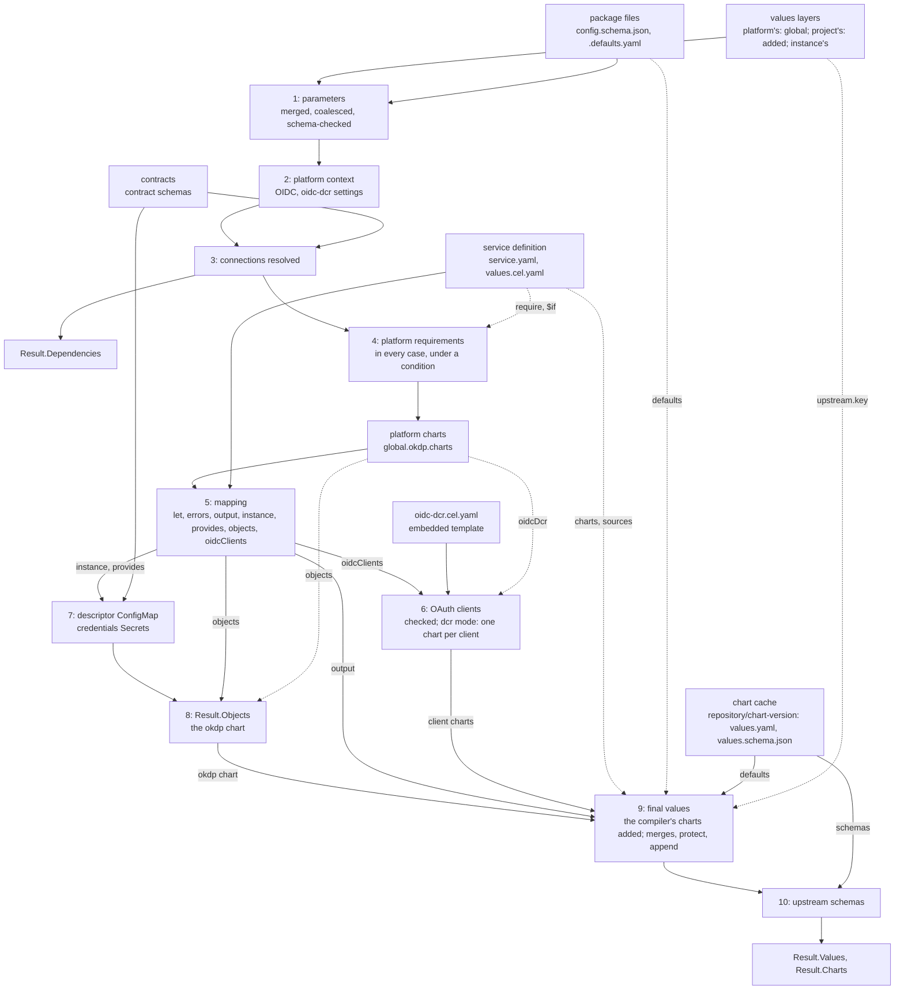

# Architecture

Describe how okdp-compiler works. The formats it reads and writes are
specified in [service definition](specs/02_service_definition.md) and
[inputs and outputs](specs/01_inputs_outputs.md).

## Position in OKDP

An OKDP service is a set of upstream Helm charts deployed together as one
instance, configured from a few parameters, the platform's and projects
settings and the connections to other instances. okdp-compiler is the compile
step: it computes, in Go, the values each upstream chart is then rendered with,
unchanged, by Helm, from the chart's own repository. A service is a package,
a directory in git, not a chart: OKDP publishes no chart of the service.

One compile is one instance. It reads the package (`LoadDefinition`:
`service.yaml` and `values.cel.yaml`; then each compile, the parameters and
OKDP's defaults) and, in `Inputs`, the chart cache (the upstream charts' 
defaults and schemas), the contracts, the values layers (the platform's,
`Platform`, the project's, `Project`, then the instance's, `Values`), and the release and
namespace, shared by all the instance's charts
([Inputs and outputs](specs/01_inputs_outputs.md)).
It returns, in `Result`: `Values`, the final values each upstream chart is
rendered with by `helm template`; `Charts`, the upstream chart that renders
each, by repository, name and version
([Chart index](specs/01_inputs_outputs.md#chart-index));
`Objects`, OKDP's own objects for the cluster, rendered by the `okdp` chart
the compiler adds; `Dependencies`, for the deployer (Flux
`dependsOn`, Argo CD sync waves)
([Outputs](specs/01_inputs_outputs.md#outputs)).

Callers: a Go program embeds the package at the module's root
(`compiler`), compiles from a git tree, an embedded filesystem or memory,
and gets the files the binary writes for a compile from one function
(`Write`); `okdp-compile` (`cmd/okdp-compile`) runs the same code from
directories, in CI or scripts.
The library depends on neither Helm nor the Kubernetes client libraries:
cel-go for expressions, `santhosh-tekuri/jsonschema/v6` for schemas,
`sigs.k8s.io/yaml` for values, `go.yaml.in/yaml/v3` for the mapping, the
oidc-dcr template and `service.yaml`.

## Compile pipeline



`LoadDefinition` (`load.go`) decodes `service.yaml` into
`Service`, strictly (`decodeService`: one document, an unknown field
refused by yaml.v3's `KnownFields`; each `require` entry a key or `{key, $if}`:
`Requirement.UnmarshalYAML`), checks it (`Service.Check`,
`service.go`), keeps `values.cel.yaml` as bytes and the
package's filesystem as `Definition.Files`: the mapping is parsed by each
compile, so a YAML error in it surfaces at `Compile`, and the other files
of the package are read by each compile.

`Compile` (`pipeline.go`) checks its required inputs
(`Definition.Files`, `Charts`, `Contracts`, `Release`, `Namespace`), the
release, a name Helm accepts (`helmfn.IsRelease`,
`internal/helmfn/names.go`: a DNS-1123 label of 53 characters at most),
and the namespace, a DNS-1123 label (`helmfn.IsDNSLabel`), then
`service.yaml` again, for a `Definition` built in memory: a `name` and a
`version`, each `require` entry a key, its condition one expression, no
chart `okdp`, each chart key a DNS label (it names the umbrella's
dependency alias), each chart's `source` a repository URL, a
chart name and a pinned version (`chart.Ref.Check`, `internal/chart/ref.go`;
[Sources](specs/02_service_definition.md#sources)), and the `protect` and
`append` paths (`chart.Specs.Check`,
`internal/chart/spec.go`). Then it runs the stages, one call each, in
order. The first three build the compile's `instance`
(`context.go`), the typed state the others read: the release
and namespace, the service's name and version, the merged values,
`global.okdp`, its `ingress.suffix`, the OIDC settings and their mode, the
dependencies, and what the mapping sees (its `scope`):

1. **Parameters** (`parameters`, `context.go`, on
   `chart.Parameters`, `internal/chart/parameters.go`). `config.schema.json` is
   read first, once for the compile, before the layers
   (`chart.ReadParameterSchema`; a missing schema fails), as any values
   schema is (`chart.ParseSchema`, a `chart.Schema`): decoded once, the
   validator keeping its numbers as written, its map view
   (`Schema.Doc`, `value.Normalize`) reading them as `float64`;
   compiled once (`chart.CompileSchema`). The defaults are the `default` of
   each property reached from the root through `properties`, the outermost
   on a path (`schemaDefaults`): a `default` anywhere else is not read. The map
   view gives the keys of `global` below and the connection walk (stage 3).
   `global` is the platform's
   (`valuesLayers`, `layers.go`): a project layer that sets a
   value the platform's layers set, merged, or gives one of their
   connections fails (`projectLayers`, `chart.Overlap`); an instance layer
   that sets `global` fails, but for the keys `config.schema.json` declares
   under it, `okdp` excepted. Then a project or an instance layer,
   normalized, with `{{` in a key or a string, at any depth, fails
   (`chart.NoTemplate`, `internal/chart/merge.go`); the platform's layers
   and the package's defaults are not checked.
   Each layer, those of `Inputs.Platform`, `Inputs.Project`, then
   `Inputs.Values`, is
   normalized by `valuesLayers` (`value.Normalize`: string keys, `[]any`
   lists, `float64` numbers, whatever the Go types; what values cannot hold
   fails, the layer and path named) and merged in order by
   `value.Merge`, Helm's merge of `-f` files; the result is coalesced over the
   defaults by `coalesceValues`. The coalesced values are checked against
   the compiled root (`validate`; both `Schema.Values`); every
   violation is reported at once, under the
   `name` of `service.yaml`. Nothing below runs on invalid parameters.
2. **Platform context** (`platformContext`). The settings of
   `global.okdp` the compiler reads are described by a schema it embeds,
   `platform.schema.json` (`platformSchema`, parsed once per
   process by `chart.ParseSchema`): their types, the maps on the way to
   them, `clientProvisioning`'s values, the oidc-dcr Jobs' whole numbers,
   the keys of `charts`, the defaults. `platformSettings` checks the
   merged `global` against it as the parameters are checked
   (`Schema.Values`), every violation at once under a heading that names
   the platform values: a value of another type fails rather than reads as
   not set ([fields the compiler
   reads](specs/01_inputs_outputs.md#fields-the-compiler-reads)). First
   `unset` drops, in a copy, what is not set: the `null` of a setting the
   schema describes, and an empty string where its default is a string, so
   that the setting takes its default (the coalesce of the parameters
   would delete it); a `null` the schema does not describe is kept.
   `global.okdp` stays as written for the mapping (`instance.okdp`); OIDC
   is derived from the checked copy (`platform.oidc`), a `null` `enabled`
   kept (it reads as false): the client provisioning mode in effect
   (`existing`, `dcr`); `registrationUrl` and `authMethod` are left to stage 6
   ([OAuth client settings](specs/01_inputs_outputs.md#oauth-client-settings)).
3. **Connections** (`connections`; `resolver`, `connections.go`).
   The map view of `config.schema.json` (stage 1) is walked
   (`walk`) together with a deep copy of the parameters, through
   `properties` (keys sorted) and `items`. A reference must be a string,
   `null` and `""` being not set. Each is resolved (`resolve`) to an
   external connection or an instance of the namespace, whose name must be
   a release name (`helmfn.IsRelease`), and completed
   against its contract (`contract.complete`). A contract is read once per
   compile, by the first reference or output that names it, and shared by
   the others (`contractCache`, created by `Compile` for stages 3
   and 7; `readContract`): decoded once, the validator keeping its numbers
   as written, the keywords read from its map view (`value.Normalize`), and
   compiled once; one that cannot be read gives each the same error. An
   external connection holds fields of its contract only, none of them
   secret (`contract.fields`), and is validated against the contract's
   schema (`contract.check`); last, the connection must hold no `{{`
   (`chart.NoTemplate`)
   ([Connections](specs/01_inputs_outputs.md#connections)). The
   references that do not resolve are reported together, one line each,
   sorted by parameter path (`resolveAll`). Internal references are
   recorded as `Dependency`, sorted by parameter path.
   `global` and `connections` are then removed from the parameters; the
   instance's upstream values stay, `values.upstream.<key>`, so that an
   `errors` rule covers them; they are checked and applied at stage 9. The
   context is assembled (`mappingScope`): `release`, `values`, `global`
   (`global.okdp` as written), `platform` (OIDC, the name of the main OAuth
   client's Secret, `clientSecret`; the ingress annotations, the proxy
   environment), `service`, `labels`, `selectorLabels`
   ([Context](specs/02_service_definition.md#context)).
4. **Platform requirements** (`checkRequirements`,
   `context.go`, called by `Compile` on the instance).
   `Compile` first opens the compile's CEL session (`compile.NewSession`):
   its context, its cost limit, OKDP's host functions for the instance
   (`functions`, built from the `instance`) and the CEL environments built
   with them, shared by the
   conditions, the mapping and the client templates. The
   `require` entries of `service.yaml`, in order, each a dotted path under
   `global.okdp` that must be set and not empty (`required`): an entry
   without a condition in every case, one with `$if` when its condition
   holds, evaluated on the context in the session
   (`compile.Session.Condition`), its value `true` or `false`
   ([require](specs/02_service_definition.md#require)). A missing
   value is reported after the errors of stages 2 and 3. `Compile` then
   reads the platform's charts, `global.okdp.charts` (`platformCharts`,
   `objects.go`), their form checked at stage 2: `objects`,
   required, the chart of the `okdp` chart, and `oidcDcr`, the chart of the OAuth clients, `DcrSource`
   (oidc-dcr 0.5.0) by default; each checked as a source is ([Platform
   charts](specs/01_inputs_outputs.md#platform-charts)).
5. **Mapping** (`runMapping`, `mapping.go`, on
   `compile.Session.Load`, `internal/compile/cel.go` and `tree.go`). The
   mapping is parsed into ordered maps (`parseDoc`), then built into a tree
   (`builder`), in every branch: its top-level keys `let`, `errors` and
   the sections OKDP names (another key fails), its directives checked,
   each string scanned and each expression compiled once, in the CEL
   environment of the names in scope at its place, with OKDP's host
   functions (`functions`) beside the language's. The tree is then
   evaluated in the compile's session, without compiling again. The
   `let` bindings are evaluated in order, each seeing the
   previous ones; then every `errors` item, a rule (`$if`, `message`), all
   messages collected, any message failing the compile (`bind`); then the
   sections (`Doc.Section`):
   `output`, `instance`, `provides`, `objects` and `oidcClients`, in that
   order. They are checked together against a schema the compiler embeds,
   `mapping.schema.json` (`mappingSchema`, parsed once per
   process by `chart.ParseSchema`), as `global.okdp` is
   (`schemaValues`, `unset`: a null not set, through `items` and `$ref`
   too), every violation at once: `output` a map of maps, a null chart
   left out; `instance` a map, its `url` and `usage` strings; the others
   lists, an `objects` item a whole manifest, with a `kind` and a
   `metadata.name`, a `provides` item and an OAuth client of their keys
   and types; another shape fails rather than reads as empty or is printed
   ([sections](specs/02_service_definition.md#evaluation-order)).
6. **OAuth clients** (`oidcClients`, `oidc.go`).
   The clients, of the form the mapping schema checks, are checked across
   clients in every mode, their names unique
   ([oidcClients](specs/02_service_definition.md#oidcclients)). In
   `dcr` mode, OIDC enabled, with at least one client, the platform's
   registration settings are checked, no two clients write one Secret, and
   the embedded template
   `oidc-dcr.cel.yaml` is evaluated once per client, in the
   compile's session (`compile.Session.EvalTemplate`), on the context plus
   `client` and `names`: the
   values of the client's chart, which stage 9 adds
   ([OAuth client charts](specs/01_inputs_outputs.md#oauth-client-charts)).
7. **Descriptor and credentials Secrets** (`descriptor`,
   `descriptor.go`). Each `provides` entry, of the form the
   mapping schema checks (stage 5), is
   checked against its contract, read once for stages 3 and 7, as an
   external connection is: its fields (`contract.fields`), completed
   (`contract.complete`), validated against its schema
   (`contract.check`); published
   under the release name, it is compared with what the `resolver`
   computes for an internal reference to this instance
   (`x-okdp-internal`): provider and consumers compute the same names. An
   entry with a `secret` gets its credentials Secret
   (`credentialsSecret`, `secrets.go`) ([Descriptor
   ConfigMap](specs/01_inputs_outputs.md#descriptor-configmap), [Credentials
   Secrets](specs/01_inputs_outputs.md#credentials-secrets)).
8. **Objects** (`Compile`, `objects.go`).
   `Result.Objects` is the descriptor, the credentials Secrets, then the
   mapping's `objects`
   ([objects section](specs/01_inputs_outputs.md#objects-section)); copies
   of them are the values of the `okdp` chart, `{objects: [...]}`
   (`objectsChart`; [The okdp chart](specs/01_inputs_outputs.md#the-okdp-chart)).
9. **Final values** (`chart.FinalValues`, `internal/chart/merge.go`), for
   each chart of `output`, which must be a chart of `service.yaml`, a client
   chart or `okdp`, its values a map; a chart the mapping leaves out (`$if`,
   null) is not compiled.
   The compiler's own charts are added first, in one place (`ownChart`,
   `addOwnCharts`, `objects.go`): the chart of each OAuth
   client (`clientCharts`, `oidc.go`), its key reserved in
   every mode, compiled in `dcr` mode, and the `okdp` chart (`ObjectsChart`).
   Neither `service.yaml` nor the mapping's
   `output` may list one of these keys, the first in that order failing
   with a message naming what adds the chart; their specs
   (`chart.Spec{Source: <platform chart>}`: no OKDP defaults, no instance
   upstream values) are added to those of `service.yaml`, which are not
   changed, their values to the mapping's output.
   The upstream chart is the key's `source`: the chart cache
   (`chartCache.get`, `internal/chart/cache.go`) reads it once per compile
   (its own `values.yaml` and `values.schema.json`, not its subcharts'),
   from `<repository>/<chart>-<version>/` or `.tgz` (`Ref.cacheDir`); a
   chart its repository's directory does not hold fails with the `mkdir -p`
   and `helm pull` commands that fetch it there. The
   chart's `values.yaml` (its nulls removed), the `defaults` file and the
   computed values are merged as `-f` files (`layered`). When the chart
   accepts upstream values, the instance's `upstream.<key>` values go
   through `applyUpstream`: the `{{` check, `protect`, `append`, then the
   merge. Last, `global` is
   set. `Result.Charts` records the source of each compiled key. The layers
   and the rules: [Merge
   precedence](specs/01_inputs_outputs.md#merge-precedence), [Upstream
   values](specs/01_inputs_outputs.md#upstream-values).
10. **Upstream schemas** (`checkSchema`, `internal/chart/schema.go`). The final
    values, coalesced over the chart defaults as Helm will coalesce them,
    are checked against the chart's `values.schema.json` when it has one.
    The violations of every chart are reported together, under the key and
    its upstream chart (`app (app-1.8.0)`).

Errors: a compile stops at its first error, except where the whole list
helps the author: the `errors` messages, the parameter schema violations,
the connection references that do not resolve, the violations of all
compiled charts. The first error is the same from one compile to the next:
a check over the keys of a map visits them sorted, a list in its order
(`provides`, first error by position). A message says where: the chart, the
parameter path, the mapping path (`output: app: env[2]:
value: ...`), the `let` or `$let` binding, the OAuth client (`oidcClients[1]
(console)`). A path in values (a parameter, a layer's value, an upstream
value, a contract field) is written one way, as a `protect` path is
(`value.Key`, `value.Index`): plain keys joined by dots, a key that holds a
dot in brackets (`annotations["example.org/x"]`), a list item `[i]`.

## Source map

The module's root is the public package, `compiler`: OKDP's rules, the order
of the stages and the edges (the package read, the files written). Under
`internal/`, four packages each import only those below them:
`cmd/okdp-compile` -> `compiler` -> `compile` and `chart` -> `helmfn` ->
`value`.
`compile` and `chart` do not import each other: the mapping language knows
nothing of Helm charts, the Helm code nothing of the mapping language, and
neither knows OKDP. `helmfn`, the Helm, sprig and Kubernetes rules the
compiler reproduces, knows none of them.

| Package | File | Owns | Relations |
|---|---|---|---|
| `value` | `value.go` | the data model (`M`) and its helpers: `Normalize` (a round trip through `encoding/json/v2`), `Copy`, `AsMap`, `AsList`, `Merge` (Helm's `MergeMaps`), `Truthy`, `Str`, `Dig`, `Short`; `YAML11Bools`, the booleans of YAML 1.1 that YAML 1.2 reads as strings | every package; `YAML11Bools` for the mapping's scalars (`compile`) and `upstream` in `service.yaml` (`chart`) |
| | `path.go` | the path of a value, as messages write it (`Key`, `Index`): plain keys joined by dots, a key that is empty or holds a special character in brackets, the form of the `protect` paths | `formatPath` and `NoTemplate` (`chart`); the parameter paths of the connections and `Dependency.Field`, the fields of the contract violations (`compiler`) |
| `helmfn` | `helmfn.go` | the Go code of the Helm and sprig template functions the compiler reproduces: `Sha256Sum`, `ToJSON`, `ToPrettyJSON`, `ToYAML`, `Quote`, `Trunc` | the host functions (`internal/compile/functions.go`), the generated Secrets (`secrets.go`) |
| | `names.go` | the names Kubernetes and Helm accept: `IsDNSLabel`, `IsRelease` (`ReleaseMax`); `TruncName`, a name cut as charts cut it (`trunc n \| trimSuffix "-"`) | the chart keys (`chart`); the release, the namespace and an internal reference, `fullname` (`compiler`) |
| `compile` | `cel.go` | the mapping language: `Session` (`NewSession`), what the evaluations of one compile share: its context, its CEL cost limit, the caller's host functions and the CEL environments built with them; documents read as ordered YAML 1.1 data, loaded with the names of their sections, `let` and `errors` evaluated (`Session.Load`), sections (`Doc.Section`); an expression compiled once to a program (`compile`), run under the session's context and remaining cost (`run`); `Session.EvalTemplate`, `Session.Condition` (a condition outside a document, `true` or `false`); `toData`, a CEL value as data, as cel-go converts it to JSON | registers `str`, `first`, the functions of `functions.go`, then the caller's |
| | `tree.go` | a document compiled into a tree of typed nodes (`builder`: text, list, plain map, `$if` with its `$else`, `$for` in a map and in a list item, `$spread`, `let` and `$let` bindings), which is its check: the top-level keys, each directive of its place, `$for` with its keys, `$else` with `$if` and `$value`, `$if`, `$merge`, `$spread` expressions, binding names, every expression compiled in its scope, in every branch; the evaluation, a method per node type; `CheckCondition` | `Session.Load`; `CheckCondition` for `require` (`compiler`) |
| | `functions.go` | `sha256`, `toJson`, `toPrettyJson`, `toYaml`, `quote` (`hostFunctions`); `Unary`, the binding of a host function, its argument as data (`toData`) | `helmfn` |
| `chart` | `values.go` | Helm's reading (`ParseValues`) and coalescing of values | stages 1, 9 and 10 |
| | `schema.go` | JSON Schema validation, reported as Helm reports it (sorted, for a stable report); `CompileSchema`, a schema compiled as Helm compiles it | stages 1, 2 and 10; the contracts (`connections.go`) |
| | `ref.go` | `Ref`, an upstream chart, its check and its repository's directory of the chart cache (`cacheDir`) | the sources of `spec.go`, the platform's charts (`objects.go`) |
| | `cache.go` | the chart cache (`chartCache`: `<repository>/<chart>-<version>/` or `.tgz`; `readArchive`, the two files of an archive, named as Helm's loader names them; the 100 MiB cap, `maxChartSize`) | `merge.go` |
| | `spec.go` | the `charts` section of `service.yaml`: `Spec`, `Specs.Check` (the chart keys, DNS labels, among its checks) | `paths.go`, `ref.go`, `helmfn.IsDNSLabel`; checked by `Service.Check` |
| | `paths.go` | the grammar of the `protect` and `append` paths (`parsePath`); `formatPath`, the keys a value was found at, written back | `spec.go`, `merge.go`; `value.Key` |
| | `parameters.go` | stage 1: `Schema`, a values schema decoded and compiled once, its defaults read (`ParseSchema`), its values coalesced over them and checked (`Schema.Values`); the package's `config.schema.json`, read once per compile (`ReadParameterSchema`); `Parameters` | `values.go`, `schema.go`; read by `compiler` (`context.go`: the parameters, the platform schema) |
| | `merge.go` | stage 9 (`FinalValues`), the instance's upstream values, `protect` and `append`; `NoTemplate`, the `{{` check | `cache.go`, `values.go`, `schema.go`, `paths.go`; `NoTemplate` also by `compiler` (`layers.go`, `connections.go`) |
| `compiler` | `compiler.go` | the package doc; `ParseValues`; aliases of the chart types of `service.yaml` (`ChartSpec`, `ChartRef`) | wraps `chart` |
| | `service.go` | `Definition`, `Service` (`service.yaml`) and its check (`Service.Check`); `require`: `Requirements`, `Requirement`, their decoding and check, `required` (the error of a missing platform value, which names the input, `platformValue`, as `platformCharts` does) | `chart.Specs.Check`, `compile.CheckCondition`; read by `LoadDefinition` |
| | `pipeline.go` | `Inputs`, `Result`, `Compile`: the order of the stages, one call each, the compile's CEL session | calls `parameters`, `platformContext`, `connections`, `compile.NewSession` (with `functions`), `checkRequirements`, `platformCharts`, `runMapping`, `oidcClients`, `descriptor`, `clientCharts`, `objectsChart`, `addOwnCharts`, `chart.FinalValues` |
| | `layers.go` | stage 1: the values layers, the platform's then the instance's, normalized (`value.Normalize`); `global` is the platform's, no `{{` in the instance's (`valuesLayers`) | the keys of `global` the parameter schema declares (`chart.Schema.Doc`), `chart.NoTemplate`; called by `context.go` |
| | `context.go` | stages 1 to 4: `instance`, the typed state of a compile, built by the parameters (`parameters`: `chart.ReadParameterSchema`, `valuesLayers`, `chart.Parameters`), the platform context (`platformContext`: `global.okdp` checked against the embedded `platform.schema.json`, `platformSettings`) and the connections (`connections`), which end with what the mapping sees (`mappingScope`); then the requirements, on the instance (`checkRequirements`); values checked against an embedded schema, the platform's or the mapping's (`schemaValues`, `unset`) | `chart.ParseSchema`, `chart.Schema.Values`; `connections.go`, `labels.go`; `oidc.go` for the oidc-dcr image and the main client's Secret; the compile's session (`compile.Session.Condition`) for the conditions; the `instance` is read by `mapping.go`, `oidc.go`, `descriptor.go`, `secrets.go` |
| | `connections.go` | connection references, `Dependency`; the contracts: `contract`, read, decoded and compiled once per compile (`contractCache`, `readContract`), and the checks of values against one (`fields`, `complete`, `check`) | used by `context.go` with the instance's `connections`, recording dependencies; by `descriptor.go` without them, to compute the convention a provider must match; one `contractCache` per compile, created by `pipeline.go`, for both |
| | `mapping.go` | stage 5: OKDP's sections (`runMapping`), checked against the embedded `mapping.schema.json` (`mappingSchema`), OKDP's host functions (`functions`: `okdpFullname`, `okdpGeneratedSecret`, and those of `labels.go` and `oidc.go`), built once per compile from its `instance`, for its session | `compile.Session.Load`; `functions` by `pipeline.go`; `fullname` (`helmfn.TruncName`) also names the client charts' objects (`oidc.go`) |
| | `labels.go` | the labels of OKDP's own objects, from the package's `name` (`serviceMeta`) and the release | the context (`service`, `labels`, `selectorLabels`), the CEL functions, every object the compiler writes |
| | `mapping.schema.json` | what a mapping writes that the compiler reads: the sections, their items and keys, and the argument of `okdpGeneratedSecret`, their types and meaning, embedded (`//go:embed`, `mappingSchema`); the package authors' reference | read by `mapping.go` (`runMapping`, `okdpGeneratedSecret`) |
| | `secrets.go` | `okdpGeneratedSecret`, on arguments the mapping schema checked, their defaults applied as Helm's `default` does (`password`), credentials Secrets | `helmfn`; `generatedSecret` serves both the CEL function and `descriptor.go` |
| | `oidc.go` | stage 6: the `oidcClients` checks across clients, the modes, the names of the client charts, objects and Secrets (`clientSecret`, `oidcClientSecret`), the client charts as the compiler's own (`clientCharts`), `DcrSource` | evaluates `oidc-dcr.cel.yaml` in the compile's session (`compile.Session.EvalTemplate`); used by `context.go` and `pipeline.go` |
| | `platform.schema.json` | the settings of `global.okdp` the compiler reads: their types, their defaults, their meaning, embedded (`//go:embed`, `platformSchema`); the platform authors' reference | read by `context.go` (`platformSettings`) |
| | `oidc-dcr.cel.yaml` | the values of a client chart: a template in the mapping language, embedded (`//go:embed`, `dcrTemplate`) | reads the context, with `platform.oidc.dcr` built by `context.go`, and the `client` and `names` given by `oidc.go` |
| | `descriptor.go` | stage 7 | `connections.go` (the compile's contracts, the resolver), `secrets.go`, `labels.go` |
| | `objects.go` | stage 8: the `okdp` chart (`ObjectsChart`, `objectsChart`); the compiler's own charts (`ownChart`), their keys checked once and their charts added to those of `service.yaml` (`addOwnCharts`, stage 9), the `okdp` key refused by `Service.Check` with the same message; the platform's charts, of the form the platform schema checks, the `objects` chart required, each checked as a source (`platformCharts`) | `chart.Ref`; `DcrSource` and `clientCharts` (`oidc.go`) |
| | `load.go` | `LoadDefinition`: `service.yaml`, decoded strictly (`decodeService`) and checked, and `values.cel.yaml` | `Service.Check` |
| | `output.go` | what a compile is written as, file name -> content: `Write`, the one entry point, which takes a `Result` as `Compile` returns it, its files chosen by `Output` as the flags choose them; the umbrella (`-o`), `okdp.dependencies.yaml` (`--mkdag`); `IsOutputFile`, a file `Write` gives with any `Output` | `okdp.Result` |
| | `umbrella.go` | the instance as one chart (`umbrella`, `-o`): `Chart.yaml` over the upstream charts of the index, named and versioned after `Result.Service` and `Result.Version`, and `instance.values.yaml` | `okdp.Result`; `chart.IsVersion` |

Layers: `value`, `internal/chart/values.go` and `internal/chart/schema.go`
reproduce Helm and know nothing of OKDP; `helmfn` reproduces Helm's and
sprig's functions and the names Kubernetes and Helm accept, each in one
place (`internal/compile/functions.go` binds the functions to CEL,
`secrets.go` reproduces okdp-lib-chart's generated Secrets
with them); `internal/chart/cache.go` reads the chart cache;
`internal/chart/merge.go` applies the rules of `service.yaml`'s charts;
`okdp` implements OKDP's rules, `oidc-dcr.cel.yaml` the values of the
oidc-dcr chart, and `pipeline.go` orders the stages. Each rule
is computed in one place and reused: the labels of the context, of
`okdpLabels` and of the descriptor; one generated Secret for the CEL
function and for `provides[].secret`; one resolver for consumers and for the
provider check; one OAuth client Secret name (`clientSecret`) for
`platform.oidcClientSecret`, `oidcClientSecret` and the oidc-dcr Job; one
CEL session per compile for the conditions of `require`, the mapping and
the oidc-dcr template.
`cmd/okdp-compile/main.go` is a thin caller of the public package:
`os.DirFS`, `compiler.ParseValues`, `compiler.LoadDefinition`,
`compiler.Compile`, then the files of `compiler.Write`, its flags as a
`compiler.Output`: the umbrella chart
([`--output`](01_usage.md#--output)), `okdp.dependencies.yaml`
([`--mkdag`](01_usage.md#--mkdag)).
Its own rules are the disk's:
every input is a flag (an argument that is not one would end Go's flag
parsing, and is refused), every
output is built before any is written, and the output directory (`-o`)
holds only the files it writes there: those of a previous compile
(`compiler.IsOutputFile`) are removed, a directory holding any other is
refused ([command line](01_usage.md#command-line)).

## Design decisions

### Helm fidelity

What Helm computes from the same values files, the compiler computes the
same way, and the fixtures check it against the helm binary
([Testing](#testing)). A values difference is silent: read as YAML
1.2, an upstream default `enabled: no` is the string `"no"`, which a
template's `if` takes as true.

- Reading: values files, the upstream charts' `values.yaml` included, as
  Helm 4's loader reads them (`loadValues`, `sigs.k8s.io/yaml`, YAML 1.1)
  ([Values files](specs/01_inputs_outputs.md#values-files)); the chart
  archives' two files as it names them (`readArchive`): names written on
  Windows included, 100 MiB at most
  ([Chart cache](specs/01_inputs_outputs.md#chart-cache)).
- Merging: `value.Merge` is Helm's `MergeMaps`, `coalesceValues` Helm 4's
  `CoalesceValues`
  ([Layers and nulls](specs/01_inputs_outputs.md#layers-and-nulls)).
- Final values: written so that Helm 3 or 4, coalescing them over the chart
  defaults, sees what it would see with OKDP's defaults, the computed and
  upstream values as `-f` files
  ([Equivalence with Helm](specs/01_inputs_outputs.md#equivalence-with-helm)),
  checked with Helm 4.3 and the 4.2 and 3.19 releases the deployers embed;
  Helm 3 reads the first document of a values file only, an upstream
  `values.yaml` of several documents needs Helm 4.
- Schemas: validated as Helm 4.3 validates them (`santhosh-tekuri/jsonschema`
  v6), on the coalesced values the templates see, reported in Helm's words
  (Helm 4.2 and 3.19 report the same),
  sorted by path since Helm's order varies between runs
  ([Schema check](specs/01_inputs_outputs.md#schema-check)).
- Functions: a host function that reproduces a Helm or sprig function is
  that function's Go code, the Helm and sprig ones in one
  package (`helmfn`). Where Helm prints `""` for a value it cannot encode,
  the compile fails instead.
- Reproduced, not imported: the helm module pulls in client-go and requires
  newer Go and Kubernetes versions than the programs that embed this
  package. `coalesceValues`, `coalesceTables`, `cleanNil`, `value.Merge`
  and `loadValues` follow helm v4.3.0; the fixtures guard the copy.
  `readArchive` names files as its `LoadArchiveFiles` does,
  `TestReadArchive` guards it.

### One data model

Values are `value.M` (`map[string]any`): string keys, `float64` numbers,
`[]any` lists, which is what Helm values are after their JSON round trip.
In-memory layers, of any Go type, are normalized to it (`value.Normalize`):
written by `encoding/json/v2` and read back, which names the path of what
fails as a JSON pointer and refuses text that is not UTF-8, two keys that
read as the same and a cycle
([values files](specs/01_inputs_outputs.md#values-files)). CEL
results are converted back to it as cel-go converts them to JSON
(`toData`: every number a float64, but an integer beyond 2^53, a NaN or
an infinity, which are text; a key that is not a string or an optional
without a value fails the expression), so a value
computed by CEL and the same value read from a file are equal. Stages work
on deep copies: the caller's inputs are never modified, and the mapping
sees a copy of the parameters while the merges use them as written.

### The mapping file

- Parsed with yaml.v3 nodes, not `sigs.k8s.io/yaml`: key order matters.
  `let` and `$let` bind in order, each binding seeing the previous ones, and
  map keys are evaluated in order, so the error reported is stable.
  `sigs.k8s.io/yaml` goes through JSON and loses the order.
- Anchors, aliases and merge keys (`<<`) are refused (`fromNode`,
  `mapKey`) rather than resolved as Helm's reader resolves them: a mapping
  reuses a value with `let`. So is a key written twice, or two keys Helm
  reads as one (`on:` and `"true":`, `1:` and `1.0:`), of which Helm keeps
  one value. What the reader accepts, it reads as Helm does
  (`FuzzMappingReader` compares with `ParseValues` on any document).
- Scalars and keys decoded as YAML 1.1 (`scalar`, `mapKey`), not as yaml.v3's
  YAML 1.2: a snippet copied from an upstream `values.yaml` means the same in
  the mapping. Binding names are the exception, kept as written, so a
  binding `n` is `n`, not `"false"`
  ([YAML reading](specs/02_service_definition.md#yaml-reading)). A final
  line break is added, as Helm adds it: a block scalar ending the file
  keeps its newline.
- One YAML document: a second one fails, rather than being ignored as
  `yaml.Unmarshal` ignores it.
- A document is compiled once, when loaded, into a tree of typed nodes
  (`tree.go`), before any evaluation and in the whole document: a
  misspelled `$` key or top-level key fails rather than being written to
  the values or ignored, and an expression that does not compile (a
  syntax error, an undeclared name, an unknown function) fails, in the
  branches no case takes too. Building the tree is the check: a misplaced
  directive has no node to become, so no second walk must classify the
  maps as the evaluation does. Type errors stay evaluation errors
  ([Limitations](#limitations)).
- Expressions are CEL: no I/O, every variable dynamically typed. An
  environment is built per set of variable names in scope, and cached for
  the compile; each expression is compiled once, to a program each
  evaluation runs (once per element in a `$for`). Under a cost limit, the
  program's cost tracker reads its limit through a pointer the session
  sets before each evaluation (CEL clones the tracker per evaluation,
  sharing the pointer), so a compiled program is limited to what the
  compile has left.
- `service.yaml` is not a values file: yaml.v3 decodes it into Go types as
  YAML 1.2 ([service.yaml](specs/02_service_definition.md#serviceyaml)).
  A boolean field reads the YAML 1.1 booleans as such (`upstream: off` is
  false), as yaml.v3 decodes a `bool`.

### The oidc-dcr template

The values of an OAuth client's chart
([OAuth client charts](specs/01_inputs_outputs.md#oauth-client-charts))
are computed by `oidc-dcr.cel.yaml`, a template in the mapping
language embedded in the compiler (`//go:embed`), not by Go code:

- They are values of the oidc-dcr chart: YAML shaped like its
  `values.yaml`, read side by side with it. When the chart changes (a new
  value, a renamed key), the change is to data, reviewed as such, not to
  code.
- One engine: `compile.Session.EvalTemplate` goes through `Session.Load`
  as a mapping does, in the compile's session, with the same host
  functions (`functions`), so the template is read as a mapping is (YAML
  1.1, ordered `let`, `errors`), with the same directives, functions and
  error paths. A field left out (`$if`) or a registration field the
  client's `request` overrides (`$merge`) needs no Go of its own.
- Embedded, not in the package: the template is versioned with the Go code
  that checks the clients and computes the names it reads, and so is
  `DcrSource`, the oidc-dcr version it writes values for. Every service
  registers its clients the same way: a package declares its clients (the
  client keys), not the chart's values. No file is read for it, so the
  compile stays hermetic
  ([Everything through fs.FS](#everything-through-fsfs)).

What stays Go (`oidc.go`) is what a per-client template cannot
express, or what more than one reader needs:

- the checks across clients
  ([oidcClients](specs/02_service_definition.md#oidcclients)), with errors
  naming the client; the form of each client is the mapping schema's,
  `mapping.schema.json`;
- the mode (no chart in `existing` mode) and what `dcr` mode requires of
  the platform's settings (their types and defaults are the platform
  schema's, `platform.schema.json`);
- the names: the chart key, the objects' full name (cut to 63 characters,
  as `okdpFullname`), the Secret.
  The Secret name is also what
  `oidcClientSecret` and `platform.oidcClientSecret` return, so the
  mapping that reads the Secret and the Job that writes it agree (a client
  that sets its own `secret` names it in the mapping too). The template
  receives them as `names`;
- the charts (`clientCharts`): the reserved keys and the chart entries,
  rendered by the platform's oidc-dcr chart, which the compiler adds with
  its other own chart, `okdp`, in one place (`addOwnCharts`).

### Values for unmodified upstream charts

The compiler stops at values:

- each upstream chart stays a standard chart, rendered as published, from
  its own repository, by Helm itself: hooks, `.Files`, `.Capabilities`,
  subcharts and the chart's schema behave as upstream intends. OKDP keeps
  no copy of it and publishes no chart of the service: the compiler reads
  only the chart's `values.yaml` and `values.schema.json`, from the chart
  cache ([Chart cache](specs/01_inputs_outputs.md#chart-cache));
- the result is data: checked against the upstream schema at compile time,
  diffed in a pull request, compared with a previous render;
- no Helm template code runs in the compiler, and none can come in through
  instance values: `{{` is refused in the project's and the instance's
  layers and every resolved connection.

The cost: what an upstream chart has no value for cannot be changed, and
neither can the chart itself ([Limitations](#limitations)). OKDP's own
objects take the same path: they are the `objects` values of the `okdp`
chart, rendered by the platform's objects chart (okdp-objects), which
writes each item as a manifest. So do the OAuth clients: each is a chart
rendered by the platform's oidc-dcr chart, whose Job registers it. Both are
charts of the platform, the same for every service, named in the platform
values, oidc-dcr with a default (`DcrSource`)
([Platform charts](specs/01_inputs_outputs.md#platform-charts)).

### Stateless, hermetic, concurrent

- `Compile` keeps no state between calls: each call parses and compiles
  the mapping, and the oidc-dcr template once per client, and opens its own CEL session
  (`compile.NewSession`), whose host functions and environments serve its
  conditions, mapping and templates, never another compile's (a session is
  not safe for concurrent use). The package-level variables are read-only:
  tables, a regular expression, the embedded template. A `Definition` can
  be shared between goroutines, and is not changed: the client charts and
  the `okdp` chart are added to a copy of its charts
  (`TestConcurrentCompile` races it under `go test -race`). Each compile reads an upstream chart from the chart
  cache once, however many keys it renders. Caching across compiles, if
  any, is the caller's: a chart cache keyed by pinned versions never goes
  stale.
- No clock, random number, environment variable, network, or file outside
  the given filesystems: the same inputs give the same result. GitOps tools
  render on every sync (Argo CD with `helm template`), and a value that
  changes per render never converges. Random credentials are therefore
  generated in the cluster by External Secrets `Password` generators
  (`okdpGeneratedSecret`), never at compile time.
- Where an order shows, it is sorted: dependencies and connection errors
  by parameter path, schema violations by path and by chart, the keys a
  check visits before its first error. The example's outputs rely on
  byte-identical results.

### Everything through fs.FS

The compiler opens no path itself: the package, the chart cache and the
contracts are `fs.FS`, the values layers are
in-memory maps, the oidc-dcr template is in the binary.

- A server compiles from a git tree or an `embed.FS`, tests
  from `fstest.MapFS`, the CLI from `os.DirFS`; the contracts from any of
  them, an `embed.FS` of the contract schemas included.
- The paths written in `service.yaml` (`defaults`) are cleaned and opened
  inside the package, and an `fs.FS` path cannot contain `..`: a package
  cannot read outside itself. A chart cache entry,
  `<repository>/<chart>-<version>`, is named by a checked source or
  platform chart (a repository whose host and path are an `fs.ValidPath`
  without `\`, a chart name without `/`, `.` or `..`, a pinned version), so
  it stays inside the cache. The CLI uses
  `os.DirFS`, which still follows symbolic links.
- A schema `$ref` to a file or a URL fails the compile instead of being
  fetched (`schemaLoader`); a `urn:` reference accepts anything, as in Helm.

### Security boundaries

The package, with the upstream charts its sources pin, is reviewed in its
repository; the contracts, the platform's charts and the platform values
with the platform. A project's values layers, from its owners, and the
instance's layers and files are input, from a console user or a GitOps pull
request. The chart cache is the caller's,
filled from the pinned references. The compiler enforces:

| Boundary | Where | Reason |
|---|---|---|
| Platform values | `valuesLayers`, `projectLayers`, stage 1 | `global` comes from the package's defaults and the platform's layers (`Inputs.Platform`): a project layer (`Inputs.Project`) only adds to them, never changing a value they set nor a connection they give; an instance layer sets only the keys of `global` the parameter schema declares, never `okdp`. `global.okdp` holds the instance's host (`ingress.suffix`), where its OAuth clients register (`oidc.dcr.registrationUrl`), the charts OKDP's objects and clients are rendered with (`charts`), and every chart receives `global` (`imageRegistry`) |
| Parameters valid before use | stage 1, before the requirements and the mapping | the schema is the one place for a parameter rule (a pattern guarding a value a Job pastes into a script); the mapping never sees a value it refuses |
| Connection references | `walk`, `resolve` | a reference is a string, `null` or `""` (not set): a map would reach the mapping as a connection, past its contract and the checks below. An internal reference is a release name (`helmfn.IsRelease`): it becomes hosts, Secret names and `Dependency.Instance` |
| Credentials never inlined | `contract.fields`, from `resolve` and `descriptor` | an external connection and a provided output carry contract fields only, never an `x-okdp-secret` field: credentials are referenced by Secret name (`secretRef`), since values and descriptors are not secret |
| Contracts | `resolve`, `descriptor` | a reference to a connection of another contract fails; an external connection and a provided output hold only fields of their contract, its required ones, no secret field, and values its schema accepts (`contract.check`: types, `enum`, `pattern`...): a consumer reads a `port` that is a number, an `engine` it knows |
| Provider and consumers agree | `descriptor` | an output under the release name equals what internal references resolve to |
| Protected upstream paths | `applyUpstream` | `protect` paths, and always `global`, cannot be set by an instance, nor replaced by setting a parent to a non-map |
| No templates in instance values | `chart.NoTemplate`, from `valuesLayers`, `resolve`, `applyUpstream` | some upstream charts pass values to `tpl`, where template code could call `lookup` and read the cluster's Secrets, and a parameter reaches the charts through the mapping: `{{` is refused in any key or string of the project's and the instance's layers (parameters, `global`, `connections`, upstream values) and of a resolved connection, whatever layer or default it comes from. A value of a type values do not hold fails: the check does not let through what it cannot read |
| Upstream schemas | stage 10 | an upstream chart's rules fail the compile, not the deployment |
| Pinned charts | `chart.Ref.Check` | a source and a platform chart name one version, not a range: the chart the compile checks the values against is the chart the deployer renders |
| Declared charts only | `addOwnCharts`, `chart.FinalValues` | the mapping cannot output a chart that `service.yaml` does not declare, nor replace a client chart or the `okdp` chart with one of its own: their keys are the compiler's, checked in one place, and their charts the platform's |
| OAuth client charts | `clientCharts`, `addOwnCharts` | no OKDP defaults, no instance upstream values: the Job that registers a client and writes its Secret is computed by the compiler, from the client keys, the release and the platform's settings, so an instance cannot change where a client is registered or which Secret receives its credentials |

What an expression computes is bounded only on request: a caller that
compiles packages it does not review passes a context (cancelled between
the stages and inside comprehensions) and a total CEL cost
(`Compile`, `Inputs.CostLimit`), both held by the compile's session
(`compile.Session`), the cost counted across the conditions of `require`,
the mapping and the client templates; the CLI sets none.

Not decided by the compiler: which layers are the platform's. What the
caller gives as `Inputs.Platform` (`--platform`) is trusted as the platform
values, and comes from the platform's repository, never from a project's
owners or the instance's author, whose layers are `Inputs.Project`
(`--project`) and `Inputs.Values` (`-f`); the keys of `global` an instance may set are the parameter schema's
decision, reviewed with the package
([Platform values](specs/01_inputs_outputs.md#platform-values)).

## Testing

`go test ./...` runs everything offline: the Helm outputs are committed
fixtures, helm is needed only to regenerate them.

### Helm fixtures

`testdata/helm` holds what `helm template` computes on the same
inputs, written by `generate.sh` with Helm 4 on the `PATH` and the Helm
versions the deployers embed ([GitOps](01_usage.md#gitops)). Each case
renders a small chart, and stores its output or its error; the
`helm_test.go` of the package that reproduces each behaviour compares:

| Fixture | Helm's side | Test |
|---|---|---|
| `values/<case>/` | `.Values` with the `layer-*.yaml` files (`helm.json`), and with the compiler's `final.yaml` (`helm-final.json`); with each other Helm major version, where it differs (`helm3.json`), and where it renders the final values differently from the layers (`helm3-final.json`) | `chart`: `TestHelmValues`, coalescing as Helm, and final values that each version renders back to the same `.Values`, but for each known difference of a version (`helmFinalKnown`) |
| `schema/<case>/` | Helm's error report, or `ok` (`helm.txt`; `helm3.txt` where a version reports differently) | `chart`: `TestHelmSchema`, each report |
| `functions/` | `sha256sum`, `toJson`, `toPrettyJson`, `toYaml`, `quote` of inputs given with `-f`, and `okdp.fullname` (`helm.json`; `helm3.json` where a version renders differently) | `compile`: `TestHelmFunctions`; `compiler`: `TestHelmFullname`, each render |
| `secrets/generated/` | the objects of `okdp.generatedSecret`, or its error, the same with every version | `compiler`: `TestHelmGeneratedSecret`, without the `helm.sh/chart` labels the compiler does not set (`withoutChartLabel`); an error where Helm fails, its message the compiler's |
| `secrets/descriptor/` | `okdp.descriptor` of outputs with a `secret`, the same with every version | `compiler`: `TestHelmDescriptorSecrets`, the same |
| `umbrella/` | the `.Values` of each subchart of the umbrella the compiler writes (`Chart.yaml`, `instance.values.yaml`) over the charts of the values cases, two of them under a second key (`helm.json`); with each other Helm major version, where it differs (`helm3.json`) | `compiler`: `TestHelmUmbrella`, each subchart sees what its chart sees alone (`helm-final.json`), but for the empty `global` and the nested null defaults Helm adds to a subchart, and each known difference of a version (`umbrellaRenders`) |

`SOURCE` records what rendered them, written by `generate.sh`: the version
of the helm on the `PATH` (`helm`) and the deployers' versions (`helms`).
The tests read them through `internal/helmtest`, imported by
tests only: the directory, the JSON renders, the versions of `SOURCE`, and
the `helm<major>` files beside each reference file.

To regenerate: `go test ./internal/chart -run TestHelmValues -update`
(writes each `final.yaml`), `go test . -run TestHelmUmbrella
-update` (writes the umbrella), then `generate.sh` (bash 3.2 or later,
python3 with PyYAML; the GNU or the BSD tools), with the deployers'
helm binaries in `UMBRELLA_HELMS`, separated by spaces, downloaded from
`https://get.helm.sh`, checked against their `.sha256sum` and kept out of
the repository; `make fixtures` runs the three, `UMBRELLA_HELMS` passed
on:

```bash
h=$(mktemp -d)
for v in $(sed -n 's/^helms //p' testdata/helm/SOURCE); do
  (cd "$h" && curl -fsSL --remote-name-all https://get.helm.sh/helm-v$v-linux-amd64.tar.gz{,.sha256sum} &&
    sha256sum -c helm-v$v-linux-amd64.tar.gz.sha256sum && mkdir v$v && tar -C v$v -xzf helm-v$v-linux-amd64.tar.gz)
done
make fixtures UMBRELLA_HELMS="$(echo "$h"/v*/linux-amd64/helm)"
```

(On macOS: `darwin-arm64`, and `shasum -a 256 -c`.) Each binary renders
every fixture again, and two versions of one major version that render
differently fail. What a major version renders differently from the helm
on the `PATH` goes beside the reference file, `helm` renamed
`helm<major>`, removed when it renders the same. A new version or a new difference
goes in `umbrellaRenders` (`helm_umbrella_test.go`) or
`helmFinalKnown` (`internal/chart/helm_test.go`), and in the spec
([Umbrella chart](specs/01_inputs_outputs.md#umbrella-chart),
[Equivalence with Helm](specs/01_inputs_outputs.md#equivalence-with-helm)).
Without `UMBRELLA_HELMS`, the `helm<major>` files and the `helms` of
`SOURCE` are left as they are.

The `helm-fixtures` workflow (`.github/workflows/helm-fixtures.yml`)
regenerates them (`make fixtures`) on each pull request that touches
`testdata/helm` or `internal/chart`, with the Helm versions of `SOURCE`,
and fails when they differ from the
committed ones.

A behaviour copied from Helm gets a case here, and only what no other case
covers: a fixture is Helm's whole output, labels and
all.

### Unit tests

Most source files have their `_test.go`, in memory (`fstest.MapFS`, as a
server passes its inputs); the host functions copied from Helm and the
schemas are tested against Helm, in `helm_test.go`, `helmfn` through the
packages that call it.
`internal/compile/cel_test.go` covers the language: directives, YAML 1.1,
what the reader refuses, the values of expressions, error paths, the
mistakes a document is refused for when loaded, in the branches no
evaluation takes too (`TestMistakes`: directives, unknown sections,
expressions that do not compile), the cost limit and cancellation of a
session over compiled programs (`TestSession`); and the CEL libraries table of the
[functions spec](specs/04_functions.md#cel-libraries), each
library at the version `pinnedLibraries` enables (`TestLibraryVersions`):
a version is raised with the docs. `internal/chart/spec_test.go` covers the
source checks
(`TestRefCheck`) and the `charts` section, `internal/chart/cache_test.go`
the chart cache, unpacked or an archive with subcharts, in its
repository's directory, not at the root (`TestChartCache`), an archive
written on Windows or by `git archive`, a path Helm refuses skipped
(`TestReadArchive`), the 100 MiB cap of an archive (`TestChartSize`), and the
repository's directory (`TestRefCacheDir`),
`internal/chart/merge_test.go` and `internal/chart/paths_test.go` the
upstream values, `protect` and `append`. `pipeline_test.go`
runs the whole pipeline on a minimal package and chart cache: schemas,
upstream values, `protect` and `append`, objects and the `okdp` chart with
the platform's charts (`TestObjects`), dependencies, one upstream chart for
two keys (`TestSharedSource`). `layers_test.go` covers the
platform's, the project's and the instance's layers: what an instance may
set of `global` (`TestValuesLayers`), what a project may add, and the
platform values it may not change (`TestProjectLayers`), layers of Go types that merge as the same values
read from a file, and the layer and path of what values cannot hold
(`TestValuesLayersGoTypes`); `internal/value/value_test.go` the reading of
each Go type (`TestNormalize`, `TestNormalizeErrors`) and the paths of the
messages (`TestPath`).
`mapping_test.go` covers OKDP's
sections and functions. `service_test.go` covers `require`:
its entries decoded and checked, the conditions evaluated in a whole
compile, after the context (`TestRequireWhen`). `oidc_test.go` covers the OAuth
clients: the values the oidc-dcr template computes (the defaults compared
whole; the names, client keys, platform settings), the modes and
`oidcClientSecret`, the errors across clients and of the platform, and the
client charts in a whole compile (`TestDcrCompile`); `context_test.go` the
oidc-dcr settings and their defaults. The template has no Helm fixture: its
expected values are in `oidc_test.go`. `load_test.go` checks
the loading of a package, `output_test.go` the files
`-o` writes, `umbrella_test.go`
the umbrella's chart and values. `cmd/okdp-compile/main_test.go` runs the
command line on the example: the refused arguments and options, the stale
files removed, nothing written when a compile, an output or a directory
fails; and, with `testscript`, the scripts of
`testdata/cli/` (`TestScript`), which run the binary as
a process from the repository root: its exit statuses (0, 1 for an error, 2
for a usage error), `$OKDP_CHARTS` and `$OKDP_CONTRACTS` and the flags that
override them, what it prints on stdout and stderr, one script per concern.
The public package is tested through the example in the root package:
`example_test.go` holds the Go programs of README.md and
[usage](01_usage.md#go-library) as examples, with their output, and
`TestDocPrograms` checks that the documentation shows those programs and
outputs; `ExampleCompile_server` cancels a compile and bounds its cost; `compiler_test.go`
compiles the example in the `existing` and `dcr` modes from goroutines
sharing one `Definition` and the same values layers
(`TestConcurrentCompile`, meaningful under `go test -race`).

### Fuzz tests

Go fuzz tests, beside the unit tests whose cases seed them, check a
property on any input; `go test ./...` runs the seeds only:

| Fuzz test | Property |
|---|---|
| `compile`: `FuzzScan` | the `${{ }}` scanner gives a string back whole, and an expression CEL parses is one expression, whatever its strings, braces and comments hold |
| `compile`: `FuzzMappingReader` | the mapping reader returns on any document; what it reads is values, those Helm reads (`ParseValues`) when Helm reads it too |
| `chart`: `FuzzParsePath`, `FuzzFormatPath` | a `protect` or `append` path written back reads as the same keys; any keys without a quote, a backslash or a star written as a path read back as themselves |
| `chart`: `FuzzParseValues` | what it reads is values, and their YAML as the compiler writes it reads back the same |

One at a time, a package at a time:
`go test -run='^$' -fuzz=FuzzScan -fuzztime=60s ./internal/compile`;
`make fuzz` runs each in turn, `FUZZTIME` (30s) each. An
input that fails is written to the package's `testdata/fuzz/`: once fixed,
it becomes a case of the unit test, and the file is removed.

### Example

`examples/01_minimal/` is the smallest package: `input/service/` deploys
one chart, `app` (the fictional `hello` chart of `input/charts/`), whose
`values.cel.yaml` sets three values from the parameters (`replicas`, its
default in `config.schema.json`) and the release, and the instance's
usage; `input/platform.yaml` gives only the okdp chart
(`global.okdp.charts.objects`), `input/config.yaml` the
instance's values. `output/` is what `okdp-compile -o <dir>` writes for
it, under the release `demo-hello` and the namespace `demo`. Nothing references a contract: the compile reads none.

`examples/02_advanced/input/` is what one compile of a service, `webapp`,
reads: `service/` (`service.yaml`, `values.cel.yaml` with a database connection
and an OAuth client, `config.schema.json` with the parameters' defaults,
`app.defaults.yaml`),
`charts/` (the chart cache: the `values.yaml` of each chart only, in its
repository's directory, the platform's okdp-objects and oidc-dcr
included), `contracts/`, `platform.yaml` (the platform values: `global.okdp`,
and `platform-db`, a connection every instance may reference, the
instance's audit database),
`platform-dcr.yaml` (a platform layer after it: the OAuth clients in `dcr`
mode) and `config.yaml`, the instance's values (`-f`), its
upstream values of `app` included.
The rest of `examples/02_advanced/` is what the compile writes:
`output-no-dcr/` as `okdp-compile -o <dir>`, and `output-dcr/`
likewise with `platform-dcr.yaml`.

`examples/03_full/` is the reference of the mapping language: its package,
the `workspace` service, uses every section, directive and host function,
most of the CEL libraries and of the YAML reading, each commented, over
five charts (`api` and `scheduler` two renders of one chart, the second
without upstream values; `backup` left out by `$if`, its chart
not in the cache), three OAuth clients in `dcr` mode (one public, one
computed by `$spread`), and contracts with internal conventions, derived
and conditional defaults and secret fields. Its values come in three
layers: `platform.yaml` (`--platform`), `demo.yaml`, the project's
(`--project`: settings under `global.okdp.project`, which the mapping reads,
and connections of its own), and `config.yaml` (`-f`), whose references
reach an instance of the namespace and connections of the platform, the
project and the instance, in a list of objects and under a nested key.
`output/` is what `-o <dir> --mkdag` writes, under the release
`demo-workspace` and the namespace `demo`.

`TestExample` (`examples_test.go`) checks the three examples.
For `02_advanced`, it
compiles `config.yaml`, an instance layer, over `platform.yaml`, a
platform layer, under the release
`demo-webapp` and the namespace `demo`, and compares the files of
`Write` with them byte for byte, each one `IsOutputFile`
names; then the same with
`platform-dcr.yaml` after `platform.yaml`, with `output-dcr/`. For
`03_full`, it compiles `config.yaml` over `demo.yaml`, a project layer,
over `platform.yaml`, and compares the same files, with `Dependencies`,
with `output/`. `TestRun` (`cmd/okdp-compile/main_test.go`) checks
that the command line writes them, removes `okdp.dependencies.yaml`
without `--mkdag`, and writes it with it.
After a change, `go test . -update` rewrites them
(`go test ./internal/chart -update` each `final.yaml` of the values
fixtures; `make example` only them); the diff is the change's effect,
reviewed as such.

### Failure cases

`testdata/<case>.yaml` at the repository root: instance values that must
fail on the example (`02_advanced`); `testdata/platform/<case>.yaml`:
platform values that must fail on it; `testdata/project/<case>.yaml`:
project values. The first line is `# error: <message>` (`\n` for a line
break). `TestExampleErrors` applies an instance case as an instance layer
over the platform values, a platform case as a platform layer after
`platform.yaml`, a project case as a project layer after it, and expects an
error containing the message. The instance
cases cover the connection checks (wrong contract, unknown field, secret
field, the contract's types), the example's `errors` rules (no `secretRef`, replicas without a
database), the protected upstream paths, a parameter schema violation, and
an instance that sets `global` (`instance-sets-global.yaml`); the platform
cases, a missing platform value and the OAuth client in `dcr` mode without
a registration URL (`dcr-without-registration-url.yaml`); the project case,
a project that gives a field of a platform connection
(`redefines-platform-connection.yaml`).

### Continuous integration

`.github/workflows/ci.yml` runs on each pull request and push to `main`,
with the Go version of `go.mod`: gofmt, `go vet`, golangci-lint,
`go mod tidy -diff` of `go.mod` and of `tools/go.mod`, the build, and
`go test -race ./...`; `make check` runs the same locally. golangci-lint is
pinned by the `tool` directive of `tools/go.mod`, a module of its own: its
dependencies stay out of the library's `go.mod`, and so out of the module
graph of every program that imports the library. It runs from the root as
`go tool -modfile=tools/go.mod golangci-lint run ./...` (`make lint`), and
is tidied in its directory, `go -C tools mod tidy` (`make tidy`): with
`-modfile`, tidy would read the library's packages. `.golangci.yml` enables
the default linters and those that report mistakes or older idioms here
without noise. Dependabot (`.github/dependabot.yml`) proposes the updates
weekly: the library's modules (`deps:`), golangci-lint and the actions
(`ci:`). `.github/workflows/helm-fixtures.yml` regenerates the
[Helm fixtures](#helm-fixtures) on the pull requests that touch them.

## Limitations

- **Through the umbrella, an upstream chart renders as a subchart**: an
  aliased key is its `.Chart.Name`, and Helm adds an empty `global` and
  keeps the null defaults nested in its maps
  ([Umbrella chart](specs/01_inputs_outputs.md#umbrella-chart)).
  Helm 3 deletes a nested key that
  the chart's defaults and the values both set to null, and reads the first
  document of a `values.yaml` only.

- **`protect` and `append` paths name map keys**: no list index; a family
  of keys is a prefix only, a bracketed key ending with `*`
  ([Paths](specs/02_service_definition.md#protect-and-append)).
- **Upstream templates cannot be changed.** Nothing patches or rewrites a
  rendered chart: what a chart has no value for (a label on one object, a
  hard-coded Secret reference, a Job field) stays as upstream wrote it.
- **Upstream charts are rendered as published.** A package does not
  modify a chart: a bundled subchart is disabled by its values, not
  removed; a chart cannot be cut down to a part of it (only its CRDs); the
  CRDs of `crds/` are upgraded by the deployer's settings, not turned into
  templates.
- **Subcharts of an upstream chart** are left to Helm: the final values and
  the schema check use the chart's own `values.yaml` and
  `values.schema.json`; the defaults and schemas of its subcharts apply only
  when Helm renders it.
- **One chart cache directory per repository URL without its scheme.**
  `oci://x/charts` and `https://x/charts` share `x/charts/`
  ([chart cache](specs/01_inputs_outputs.md#chart-cache)).
- **Schema references** resolve within the schema only (and `urn:`):
  [Everything through fs.FS](#everything-through-fsfs).
- **Connection references** are found through `properties` and `items` of
  the parameter schema only
  ([Declaring a reference](specs/01_inputs_outputs.md#declaring-a-reference)):
  one under any other keyword is not resolved, and reaches the mapping as a
  string.
- **Dependencies are reported, not checked.** Whether the referenced
  instance exists and provides the contract is outside one compile; so is
  any check across instances.
- **Type errors show when evaluated.** Every expression compiles when the
  mapping is loaded, in every branch, but variables are dynamic: a type
  error (`values.replicas + 1`, `no such overload`) or a missing key
  passes until an instance takes the branch
  ([Expressions](specs/02_service_definition.md#lone-expressions-and-interpolation)).
  Test cases need to cover each branch.
- **OAuth clients are registered anonymously only.** In `dcr` mode, OIDC
  enabled, a mapping that declares a client needs
  `global.okdp.oidc.dcr.authMethod: anonymous`
  ([OAuth client settings](specs/01_inputs_outputs.md#oauth-client-settings)).
- **A client chart's values are the template's.** A package sets the client
  keys, the platform the Job settings; a client chart takes no OKDP defaults
  and no instance upstream values. The template writes the values of
  oidc-dcr >= 0.5.0 (camelCase); the version the platform names
  (`global.okdp.charts.oidcDcr`) is not checked against it (its
  `values.schema.json` is applied, when it has one).

## Extension points

- **Host functions.** Plain Go, deterministic and hermetic. A function of
  its arguments alone, the same for any caller of the language, goes in
  `hostFunctions` (`internal/compile/functions.go`); an OKDP function, or
  one that needs the compile context, goes in `functions`
  (`mapping.go`), as `okdpFullname`, `okdpGeneratedSecret` and
  `oidcClientSecret` (`oidcFunctions`, `oidc.go`) do. Names
  mappings bind themselves are avoided (`okdpFullname`, since mappings bind
  `fullname`). A function reproducing a Helm or sprig one gets a
  `generate.sh` case and a `TestHelm*` comparison, its Go code in
  `helmfn`; every function
  gets an entry in [Functions](specs/04_functions.md).
- **Platform context.** A new setting of `global.okdp` the compiler reads
  is a property of `platform.schema.json`: its type, its
  default, its meaning in its `description`, checked and defaulted with the
  others (`platformSettings`), with a test case in `context_test.go`, and a
  row of [Fields the compiler
  reads](specs/01_inputs_outputs.md#fields-the-compiler-reads). A value
  derived from it is added in `platformContext` (stage 2), checked there
  when a schema cannot say it, to the mapping's `platform` in
  `mappingScope`, as a field of `instance` when a later stage reads it, and
  to [Context](specs/02_service_definition.md#context). A new setting of
  the oidc-dcr Jobs is a property of `global.okdp.oidc.dcr` in the schema,
  read by the template as `platform.oidc.dcr`, and a row of [OAuth client
  settings](specs/01_inputs_outputs.md#oauth-client-settings).
- **The oidc-dcr values.** A value of the oidc-dcr chart (a new one, a key
  a new version renames) is set in `oidc-dcr.cel.yaml`, with its
  expectations in `oidc_test.go`, not in Go
  ([The oidc-dcr template](#the-oidc-dcr-template)). A new client key also
  goes in `mapping.schema.json`, with its type and its
  `description`, and in
  [oidcClients](specs/02_service_definition.md#oidcclients).
- **Contracts** are data: a new contract, or new `x-okdp-internal`,
  `x-okdp-secret`, `x-okdp-derived` or default fields, needs no compiler
  change ([Contracts](specs/01_inputs_outputs.md#contracts)).
- **OKDP objects.** What the mapping writes in `objects` reaches the cluster
  through the `okdp` chart: a new kind of object needs no compiler change.
- **Chart sources.** Where a chart comes from is data: a new upstream chart
  or version is a `source` of `service.yaml` and an entry of the chart
  cache, a new platform chart version a platform value.
- **Callers.** Anything that provides `fs.FS` inputs and values maps; the
  CLI is one such caller. A caller writes the result where it keeps it,
  the files of `compiler.Write`, the CLI's in any of its modes.
