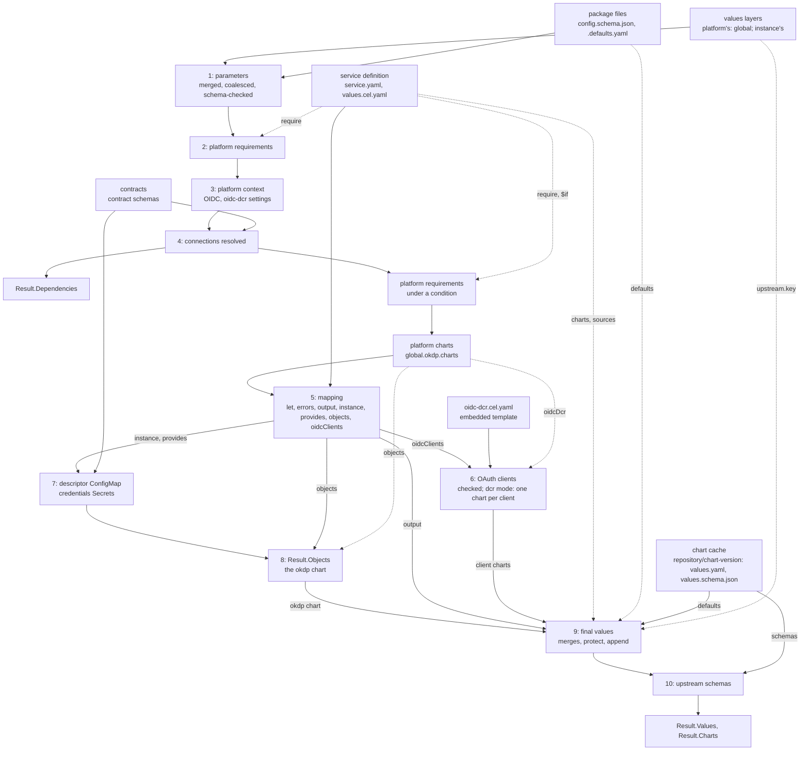

# Architecture

Describe how okdp-compiler works. The formats it reads and writes are
specified in [service definition](specs/02_service_definition.md) and
[inputs and outputs](specs/01_inputs_outputs.md).

## Position in OKDP

An OKDP service is a set of upstream Helm charts deployed together as one
instance, configured from a few parameters, the platform's and projects
settings and the connections to other instances. okdp-compiler is the compile
step: it computes, in Go, the values each upstream chart is then rendered with,
unchanged, by Helm, from the chart's own repository. A service is a package,
a directory in git, not a chart: OKDP publishes no chart of the service.

One compile is one instance. It reads the package (`fsio.LoadDefinition`:
`service.yaml` and `values.cel.yaml`; then each compile, the parameters and
OKDP's defaults) and, in `Inputs`, the chart cache (the upstream charts' 
defaults and schemas), the contracts, the values layers (the platform's,
`Platform`, then the instance's, `Values`), and the release and
namespace, shared by all the instance's charts
([Inputs and outputs](specs/01_inputs_outputs.md)).
It returns, in `Result`: `Values`, the final values each upstream chart is
rendered with by `helm template`; `Charts`, the upstream chart that renders
each, by repository, name and version
([Chart index](specs/01_inputs_outputs.md#chart-index));
`Objects`, OKDP's own objects for the cluster, rendered by the `okdp` chart
the compiler adds; `Dependencies`, for the deployer (Flux
`dependsOn`, Argo CD sync waves); `Computed`, the mapping's output before
the merges, for inspection
([Outputs](specs/01_inputs_outputs.md#outputs)).

Callers: a Go program embeds the package at the module's root
(`compiler`) and compiles from a git tree, an embedded filesystem or memory;
`okdp-compile` (`cmd/okdp-compile`) runs the same code from directories, in
CI or scripts.
The library depends on neither Helm nor the Kubernetes client libraries:
cel-go for expressions, `santhosh-tekuri/jsonschema/v6` for schemas,
`sigs.k8s.io/yaml` for values, `go.yaml.in/yaml/v3` for the mapping, the
oidc-dcr template and `service.yaml`.

## Compile pipeline



`fsio.LoadDefinition` (`internal/fsio/load.go`) decodes `service.yaml` into
`okdp.Service`, strictly (`decodeService`: one document, an unknown field
refused by yaml.v3's `KnownFields`, its error listing the fields of its
place; each `require` entry a key or `{key, $if}`:
`Requirements.UnmarshalYAML`), checks it (`Service.Check`,
`internal/okdp/service.go`), keeps `values.cel.yaml` as bytes and the
package's filesystem as `Definition.Files`: the mapping is parsed by each
compile, so a YAML error in it surfaces at `Compile`, and the other files
of the package are read by each compile.

`okdp.Compile` (`internal/okdp/pipeline.go`) checks its required inputs
(`Definition.Files`, `Charts`, `Contracts`, `Release`, `Namespace`), the
release, a name Helm accepts (`isRelease`, `internal/okdp/names.go`: a
DNS-1123 label of 53 characters at most), and the namespace, a DNS-1123
label (`dnsLabel`), then
`service.yaml` again, for a `Definition` built in memory: a `name` and a
`version`, each `require` entry a key, its condition one expression, no
chart `okdp`, each chart key a DNS label (it names files and the
umbrella's dependency alias), each chart's `source` a repository URL, a
chart name and a pinned version (`chart.Ref.Check`, `internal/chart/ref.go`;
[Sources](specs/02_service_definition.md#sources)), the `upstream.from`
entries and the `protect` and `append` paths (`chart.Specs.Check`,
`internal/chart/spec.go`). Then it runs:

1. **Parameters** (`chart.Parameters`, `internal/chart/parameters.go`, called by
   `buildContext`, `internal/okdp/context.go`). `global` is the platform's
   (`valuesLayers`, `internal/okdp/layers.go`): an instance layer that sets
   it fails, but for the keys `config.schema.json` declares under it,
   `okdp` excepted. Then an instance layer, normalized, with `{{` in a key
   or a string, at any depth, fails (`chart.NoTemplate`,
   `internal/chart/merge.go`); the platform's layers and the package's
   defaults are not checked. The defaults are the `default` of each property
   of `config.schema.json` reached from the root through `properties`
   (`schemaDefaults`): a `default` anywhere else, two on one path, or one
   its property's schema rejects fails.
   Each layer, those of `Inputs.Platform` then those of `Inputs.Values`, is
   normalized by `valuesLayers` (`value.Normalize`: string keys, `[]any`
   lists, `float64` numbers, whatever the Go types; what values cannot hold
   fails, the layer and path named) and merged in order by
   `value.Merge`, Helm's merge of `-f` files; the result is coalesced over the
   defaults by `coalesceValues`. The coalesced values are checked against
   `config.schema.json` (`checkSchema`; a missing schema fails); every
   violation is reported at once, under the
   `name` of `service.yaml`. Nothing below runs on invalid parameters.
2. **Platform requirements**. Each `require` entry of `service.yaml`
   without a condition is a dotted path under `global.okdp` that must be
   set and not empty (`required`); an entry with one waits for the context
   (stage 4).
3. **Platform context**. The settings of `global.okdp` the compiler reads
   are checked against their types, and the maps on the way to them
   (`checkPlatform`, `platformSettings`): a value of another type, `null`
   excepted, fails rather than reads as not set
   ([fields the compiler reads](specs/01_inputs_outputs.md#fields-the-compiler-reads)).
   `platform` is derived from `global.okdp`: OIDC with its defaults and
   client provisioning mode (`existing` or `dcr`, anything else fails);
   the settings of the oidc-dcr Jobs, `global.okdp.oidc.dcr`, their
   defaults applied and their types checked in every mode,
   `registrationUrl` and `authMethod` excepted, left to stage 6
   (`dcrSettings`, `internal/okdp/oidc.go`;
   [OAuth client settings](specs/01_inputs_outputs.md#oauth-client-settings));
   the name of the main OAuth client's Secret (`clientSecret`); the ingress
   annotations, the proxy environment. `global.okdp` is also passed as
   written.
4. **Connections** (`resolver`, `internal/okdp/connections.go`).
   `config.schema.json` is read again as JSON (so it must exist) and walked
   (`walk`) together with a deep copy of the parameters, through
   `properties` (keys sorted) and `items`. A reference must be a string,
   `null` and `""` being not set. Each is resolved (`resolve`) to an
   external connection or an instance of the namespace, whose name must be
   a release name (`isRelease`, `internal/okdp/names.go`), and completed
   against its contract (`readContract`, `complete`); an external
   connection is then validated against the contract's schema
   (`checkContract`); last, the connection must hold no `{{`
   (`chart.NoTemplate`)
   ([Connections](specs/01_inputs_outputs.md#connections)). The
   references that do not resolve are reported together, one line each,
   sorted by parameter path (`resolveAll`). Internal references are
   recorded as `Dependency`, sorted by parameter path.
   `global` and `connections` are then removed from the parameters; the
   instance's upstream values stay, `values.upstream.<key>`, so that an
   `errors` rule covers them; they are checked and applied at stage 9. The
   context is assembled: `release`, `values`, `global`, `platform`,
   `service`, `labels`, `selectorLabels`
   ([Context](specs/02_service_definition.md#context)). `Compile` then
   checks the `require` entries with a condition (`requireWhen`): each
   `$if`, in order, evaluated on the context with the mapping's host
   functions, within the compile's budget (`compile.Condition`), its value
   `true` or `false`; when it holds, the key is checked as at stage 2
   ([require](specs/02_service_definition.md#require)). It then reads
   the platform's charts, `global.okdp.charts` (`platformCharts`,
   `internal/okdp/objects.go`): `objects`, required, the chart of the `okdp`
   chart, and `oidcDcr`, the chart of the OAuth clients, `DcrSource`
   (oidc-dcr 0.5.0) by default; each checked as a source is ([Platform
   charts](specs/01_inputs_outputs.md#platform-charts)).
5. **Mapping** (`runMapping`, `internal/okdp/mapping.go`, on `compile.Load`,
   `internal/compile/cel.go`). The mapping is parsed into ordered maps
   (`parseDoc`), with OKDP's host functions (`functions`) beside the
   language's. The `let` bindings are evaluated in order, each seeing the
   previous ones; then every `errors` item, a rule (`$if`, `message`) or an
   expression returning messages, all messages collected, any message
   failing the compile (`bind`); then the sections (`Doc.Section`):
   `output`, `instance`, `provides`, `objects` and `oidcClients`, in that
   order, each of its shape (`shaped`): `output` a map of maps, a null
   chart left out; `instance` a map, its `url` and `usage` strings; the
   others lists; `null` is empty, another shape fails rather than reads as
   empty or is printed
   ([sections](specs/02_service_definition.md#evaluation-order)). Each
   `objects` item must be a whole manifest, with a `kind` and a
   `metadata.name`.
6. **OAuth clients** (`oidcClients`, `clientCharts`, `internal/okdp/oidc.go`).
   The clients are checked in every mode, their names and their objects'
   names (`fullname`) unique
   ([oidcClients](specs/02_service_definition.md#oidcclients)). In
   `dcr` mode, OIDC enabled, with at least one client, the platform's
   registration settings are checked, no two clients write one Secret, and
   the embedded template
   `internal/okdp/oidc-dcr.cel.yaml` is evaluated once per client
   (`compile.EvalTemplate`) on the context plus `client` and `names`: the
   values of the client's chart. Then, in any mode with a client, `clientCharts`
   checks the reserved chart keys; in `dcr` mode it adds each client chart
   to a copy of the charts of `service.yaml` (`chart.Spec{Source: <oidcDcr>}`:
   no OKDP defaults, no instance upstream values), and its values to the
   mapping's output, which `Result.Computed` shows
   ([OAuth client charts](specs/01_inputs_outputs.md#oauth-client-charts)).
7. **Descriptor and credentials Secrets** (`descriptor`,
   `internal/okdp/descriptor.go`). Each `provides` entry is checked for its
   shape (`checkOutput`: a map, its `values`, `secretRef` and `secret`
   maps, the secret's `generate` a list of keys checked as
   `okdpGeneratedSecret`'s, its `stringData` a map of strings), then
   checked and completed against its contract, and validated
   against its schema (`checkContract`); published
   under the release name, it is compared with what the `resolver`
   computes for an internal reference to this instance
   (`x-okdp-internal`): provider and consumers compute the same names. A
   `secretRef` names a Secret, its `name` required. An
   entry with a `secret` gets its credentials Secret
   (`credentialsSecret`, `internal/okdp/secrets.go`) ([Descriptor
   ConfigMap](specs/01_inputs_outputs.md#descriptor-configmap), [Credentials
   Secrets](specs/01_inputs_outputs.md#credentials-secrets)).
8. **Objects** (`Compile`, `objectsChart`, `internal/okdp/objects.go`).
   `Result.Objects` is the descriptor, the credentials Secrets, then the
   mapping's `objects`, no two of them one object of the cluster: the same
   API group, kind, namespace and name (`uniqueObjects`;
   [objects section](specs/01_inputs_outputs.md#objects-section)).
   `objectsChart` adds the `okdp` chart (`ObjectsChart`) to the copy of the
   charts, rendered by the platform's objects chart, and copies of the
   objects to the mapping's output as its values, `{objects: [...]}`; the
   mapping's own `output` may not list `okdp`
   ([The okdp chart](specs/01_inputs_outputs.md#the-okdp-chart)).
9. **Final values** (`chart.FinalValues`, `internal/chart/merge.go`), for
   each chart of `output`, which must be a chart of `service.yaml`, a client
   chart or `okdp`, its values a map; a chart the mapping leaves out (`$if`,
   null) is not compiled.
   The upstream chart is the key's `source`: the chart cache
   (`chartCache.get`, `internal/chart/cache.go`) reads it once per compile
   (its own `values.yaml` and `values.schema.json`, not its subcharts'),
   from `<repository>/<chart>-<version>/` or `.tgz` (`Ref.cacheDir`), else
   from `<chart>-<version>/` or `.tgz` at the root, unless the compiled keys
   name that chart and version from two repositories (`newChartCache`); a
   chart it does not hold fails with the `mkdir -p` and `helm pull`
   commands that fetch it into its repository's directory. The
   chart's `values.yaml` (its nulls removed), the `defaults` file and the
   computed values are merged as `-f` files (`layered`). When the chart
   accepts upstream values, the instance's `upstream.<key>` values go
   through `applyUpstream`: the `{{` check, `protect`, `append`, then the
   merge. Last, `global` is
   set. `Result.Charts` records the source of each compiled key. The layers
   and the rules: [Merge
   precedence](specs/01_inputs_outputs.md#merge-precedence), [Upstream
   values](specs/01_inputs_outputs.md#upstream-values).
10. **Upstream schemas** (`checkSchema`, `internal/chart/schema.go`). The final
    values, coalesced over the chart defaults as Helm will coalesce them,
    are checked against the chart's `values.schema.json` when it has one.
    The violations of every chart are reported together, under the key and
    its upstream chart (`app (app-1.8.0)`).

Errors: a compile stops at its first error, except where the whole list
helps the author: the `errors` messages, the parameter schema violations,
the connection references that do not resolve, the violations of all
compiled charts. The first error is the same from one compile to the next:
a check over the keys of a map visits them sorted, a list in its order
(`provides`, first error by position). A message says where: the chart, the
parameter path, the mapping path (`output: app: env[2]:
value: ...`), the `let` or `$let` binding, the OAuth client (`oidcClients[1]
(console)`).

## Source map

The module's root is the public package, `compiler`: it gives callers the
types they name, as aliases, and wraps the functions of `fsio`, `chart` and
`okdp`. Under `internal/`, five packages each import only those below them:
`cmd/okdp-compile` -> `compiler` -> `fsio` -> `okdp` -> `compile` and `chart`
-> `value`.
`compile` and `chart` do not import each other: the mapping language knows
nothing of Helm charts, the Helm code nothing of the mapping language, and
neither knows OKDP.

| Package | File | Owns | Relations |
|---|---|---|---|
| `compiler` | `compiler.go` | the public API: `LoadDefinition`, `ParseValues`, `Compile`, `CompileContext` and its options (`WithCostLimit`, `WithoutObjectsChart`), `DcrSource`, `Files`, `Dependencies`, `Umbrella`, `Document`; aliases of the types a caller names (`Definition`, `Inputs`, `Result`, `ChartRef`...) | wraps `fsio`, `chart`, `okdp` |
| `value` | `value.go` | the data model (`M`) and its helpers: `Normalize`, `Copy`, `AsMap`, `AsList`, `Merge` (Helm's `MergeMaps`), `Truthy`, `Str`, `Dig`, `Short` | every package |
| | `normalize.go` | `Normalize`'s reading of Go values of any type, by reflection, and its errors | `valuesLayers` (`okdp`), the mapping's scalars (`compile`) |
| `compile` | `cel.go` | the mapping language: documents read as ordered YAML 1.1 data, directives, `let` and `errors` (`Load`), sections (`Doc.Section`), CEL environments; `EvalTemplate`, `Eval`, `Condition` (a condition outside a document, `true` or `false`); `Budget`, a compile's context and CEL cost limit, shared by its documents; `toData`, a CEL value as data, and `Native`, as a host function takes it | registers `str`, `first`, the functions of `functions.go`, then the caller's |
| | `check.go` | the directives of a document, checked before it is evaluated: each of its place, `$for` with its keys, `$if`, `$merge`, `$spread` expressions, binding names; `CheckCondition` | `Load`, `Doc.Section`; `CheckCondition` for `require` (`okdp`) |
| | `functions.go` | `sha256`, `toJson`, `toPrettyJson`, `toYaml`, `quote`; `Text`, a CEL value as text, for host functions | |
| `chart` | `values.go` | Helm's reading (`ParseValues`) and coalescing of values | stages 1, 9 and 10 |
| | `schema.go` | JSON Schema validation, reported as Helm reports it; `CompileSchema`, a schema compiled as Helm compiles it | stages 1 and 10; the contracts (`internal/okdp/connections.go`) |
| | `ref.go` | `Ref`, an upstream chart, its check and its repository's directory of the chart cache (`cacheDir`) | the sources of `spec.go`, the platform's charts (`internal/okdp/objects.go`) |
| | `cache.go` | the chart cache (`chartCache`: `<repository>/<chart>-<version>/` or `.tgz`, else at the root; `readArchive`, an archive as Helm's loader reads it; the 100 MiB cap, `maxChartSize`) | `merge.go` |
| | `spec.go` | the `charts` section of `service.yaml`: `Spec`, `Upstream`, `Specs.Check` (the chart keys, DNS labels, among its checks) | `paths.go`, `ref.go`; checked by `okdp.Service.Check` |
| | `paths.go` | the grammar of the `protect` and `append` paths | `spec.go`, `merge.go` |
| | `parameters.go` | stage 1: `Parameters` | `values.go`, `schema.go` |
| | `merge.go` | stage 9 (`FinalValues`), the instance's upstream values, `protect` and `append`; `NoTemplate`, the `{{` check | `cache.go`, `values.go`, `schema.go`, `paths.go`; `NoTemplate` also by `internal/okdp` (`layers.go`, `connections.go`) |
| `okdp` | `service.go` | `Definition`, `Service` (`service.yaml`) and its check (`Service.Check`); `require`: `Requirements`, `Requirement`, their decoding and check, `required` (the error of a missing platform value, which names the input, `platformValue`, as `platformCharts` does) | `chart.Specs.Check`, `compile.CheckCondition`; read by `fsio.LoadDefinition` |
| | `pipeline.go` | `Inputs`, `Result`, `Compile`, `CompileContext` and its options: the order of the stages | calls `buildContext`, `requireWhen`, `platformCharts`, `runMapping`, `oidcClients`, `clientCharts`, `descriptor`, `objectsChart`, `chart.FinalValues` |
| | `layers.go` | stage 1: the values layers, the platform's then the instance's, normalized (`value.Normalize`); `global` is the platform's, no `{{` in the instance's (`valuesLayers`) | `readJSON` (`connections.go`), `chart.NoTemplate`; called by `context.go` |
| | `context.go` | stages 1 to 4: parameters (`valuesLayers`, `chart.Parameters`), requirements, platform context, the context; then the requirements under a condition (`requireWhen`) | `connections.go`, `labels.go`; `oidc.go` for the oidc-dcr settings and the main client's Secret; `compile.Condition` and `functions` (`mapping.go`) for the conditions |
| | `connections.go` | connection references, `complete`, `Dependency`, `readJSON`; the contracts (`readContract`) and the check of values against them (`checkContract`) | used by `context.go` with the instance's `connections`, recording dependencies; by `descriptor.go` without them, to compute the convention a provider must match |
| | `names.go` | the names Kubernetes and Helm accept: `dnsLabel`, `isRelease` | `connections.go`, for an internal reference; `pipeline.go`, for the release and namespace; `oidc.go`, for a client's name |
| | `mapping.go` | stage 5: OKDP's sections (`runMapping`), OKDP's host functions (`functions`: `okdpFullname`, `okdpGeneratedSecret`, and those of `labels.go` and `oidc.go`) | `compile.Load`; `fullname` also names the client charts' objects (`oidc.go`) |
| | `labels.go` | the labels of OKDP's own objects, from the package's `name` (`serviceMeta`) and the release | the context (`service`, `labels`, `selectorLabels`), the CEL functions, every object the compiler writes |
| | `secrets.go` | `okdpGeneratedSecret` and the check of its arguments (`checkSecretArgs`, `password`), credentials Secrets | `generatedSecret` serves both the CEL function and `descriptor.go`; `checkOutput` checks a secret's `generate` with `password` |
| | `oidc.go` | stage 6: the `oidcClients` checks, the modes, the names of the client charts, objects and Secrets (`clientSecret`, `oidcClientSecret`), the client charts (`clientCharts`), `DcrSource`; the oidc-dcr settings (`dcrSettings`, stage 3) | evaluates `oidc-dcr.cel.yaml` with `compile.EvalTemplate` and `functions`; used by `context.go` and `pipeline.go` |
| | `oidc-dcr.cel.yaml` | the values of a client chart: a template in the mapping language, embedded (`//go:embed`, `dcrTemplate`) | reads the context, with `platform.oidc.dcr` built by `context.go`, and the `client` and `names` given by `oidc.go` |
| | `descriptor.go` | stage 7 | `connections.go`, `secrets.go`, `labels.go` |
| | `objects.go` | stage 8: the `okdp` chart (`ObjectsChart`, `objectsChart`); the platform's charts (`platformCharts`) | `chart.Ref`; `DcrSource` (`oidc.go`) |
| `fsio` | `load.go` | `LoadDefinition`: `service.yaml`, decoded strictly (`decodeService`) and checked, and `values.cel.yaml` | `okdp.Service.Check` |
| | `output.go` | what a compile is written as: `Document` (`--out`), `Files` (`--emit-dir`, file name -> content), `Dependencies` (`--mkdag`, `okdp.dependencies.yaml` beside them); `checkKey`, a chart key the outputs can name (a file, an umbrella alias), for a `Result` built by a caller | `okdp.Result` |
| | `install.go` | `Install` (`--mkinstall`), `install.sh` beside the files of `Files`: `helm upgrade --install` of each chart, its release `<release>-<key>` cut to 53 characters, the OAuth clients' charts first; each word shell-quoted unless plain | `okdp.Result`, `okdp.DcrChart` |
| | `umbrella.go` | the instance as one chart: `Umbrella` (`--umbrella`), `Chart.yaml` over the upstream charts of the index and `instance.values.yaml` | `okdp.Result`, the service's name and versions; `chart.IsVersion`, `checkKey` (`output.go`) |

Layers: `value`, `internal/chart/values.go` and `internal/chart/schema.go`
reproduce Helm and know nothing of OKDP; `internal/compile/functions.go` and
`internal/okdp/secrets.go` reproduce Helm, sprig and okdp-lib-chart
functions; `internal/chart/cache.go` reads the chart cache;
`internal/chart/merge.go` applies the rules of `service.yaml`'s charts;
`okdp` implements OKDP's rules, `oidc-dcr.cel.yaml` the values of the
oidc-dcr chart, and `internal/okdp/pipeline.go` orders the stages. Each rule
is computed in one place and reused: the labels of the context, of
`okdpLabels` and of the descriptor; one generated Secret for the CEL
function and for `provides[].secret`; one resolver for consumers and for the
provider check; one OAuth client Secret name (`clientSecret`) for
`platform.oidcClientSecret`, `oidcClientSecret` and the oidc-dcr Job; one
engine for the mappings and the oidc-dcr template.
`cmd/okdp-compile/main.go` is a thin caller of the public package:
`os.DirFS`, `compiler.ParseValues`, `compiler.LoadDefinition`,
`compiler.Compile`, then the files of `compiler.Files`, `compiler.Umbrella`
and `compiler.Document`, the chart index (`Result.Charts`) included:
the charts `install.sh` installs with [`--mkinstall`](01_usage.md#--mkinstall), the
dependencies of `Chart.yaml` with [`--umbrella`](01_usage.md#--umbrella),
`charts` with [`--out`](01_usage.md#--out). Its own rules are the disk's:
every input is a flag (an argument that is not one would end Go's flag
parsing, and is refused), the directory flags name directories, every
output is built before any is written, and an output directory holds only
the files its flag writes there: those of a previous compile are removed,
a directory holding any other is refused
([command line](01_usage.md#command-line)).

## Design decisions

### Helm fidelity

What Helm computes from the same values files, the compiler computes the
same way, and the fixtures check it against the helm binary
([Testing](#testing)). A values difference is silent: read as YAML
1.2, an upstream default `enabled: no` is the string `"no"`, which a
template's `if` takes as true.

- Reading: values files, the upstream charts' `values.yaml` included, as
  Helm 4's loader reads them (`loadValues`, `sigs.k8s.io/yaml`, YAML 1.1)
  ([Values files](specs/01_inputs_outputs.md#values-files)); the chart
  archives as it reads them (`readArchive`): names written on Windows,
  paths out of the chart refused, 100 MiB at most
  ([Chart cache](specs/01_inputs_outputs.md#chart-cache)).
- Merging: `value.Merge` is Helm's `MergeMaps`, `coalesceValues` Helm 4's
  `CoalesceValues`
  ([Layers and nulls](specs/01_inputs_outputs.md#layers-and-nulls)).
- Final values: written so that Helm 3 or 4, coalescing them over the chart
  defaults, sees what it would see with OKDP's defaults, the computed and
  upstream values as `-f` files
  ([Equivalence with Helm](specs/01_inputs_outputs.md#equivalence-with-helm)),
  checked with Helm 4.3 and the 4.2 and 3.19 releases the deployers embed;
  Helm 3 reads the first document of a values file only, an upstream
  `values.yaml` of several documents needs Helm 4.
- Schemas: validated as Helm 4.3 validates them (`santhosh-tekuri/jsonschema`
  v6), on the coalesced values the templates see, reported in Helm's words
  (Helm 4.2 and 3.19 report the same),
  sorted by path since Helm's order varies between runs
  ([Schema check](specs/01_inputs_outputs.md#schema-check)).
- Functions: a host function that reproduces a Helm, sprig or okdp-lib-chart
  function is that function's Go code. Where Helm prints `""` for a value it
  cannot encode, the compile fails instead.
- Reproduced, not imported: the helm module pulls in client-go and requires
  newer Go and Kubernetes versions than the programs that embed this
  package. `coalesceValues`, `coalesceTables`, `cleanNil`, `value.Merge`
  and `loadValues` follow helm v4.3.0; the fixtures guard the copy.
  `readArchive` follows its `LoadArchiveFiles`, `TestReadArchive` guards it.

### One data model

Values are `value.M` (`map[string]any`): string keys, `float64` numbers,
`[]any` lists, which is what Helm values are after their JSON round trip.
In-memory layers, of any Go type, are normalized to it (`value.Normalize`,
`internal/value/normalize.go`): by reflection rather than a JSON round
trip, which gives the same values but names no path in its errors, refuses
`map[any]any` and turns text that is not UTF-8 into U+FFFD; what only
`encoding/json` gives a meaning to (a struct, a `MarshalJSON` method) goes
through it ([values files](specs/01_inputs_outputs.md#values-files)). CEL
results are converted back to it (`toData`, recursively: optionals
unwrapped, every number a float64; a NaN, an infinity or a key that is not
a string fails the expression, as Helm could not read it back), so a value
computed by CEL and the same value read from a file are equal. Stages work
on deep copies: the caller's inputs are never modified, and the mapping
sees a copy of the parameters while the merges use them as written.

### The mapping file

- Parsed with yaml.v3 nodes, not `sigs.k8s.io/yaml`: key order matters.
  `let` and `$let` bind in order, each binding seeing the previous ones, and
  map keys are evaluated in order, so the error reported is stable.
  `sigs.k8s.io/yaml` goes through JSON and loses the order.
- Aliases are expanded by the reader (`reader`), as nodes do not expand
  them: an alias inside its own anchor fails rather than recursing forever,
  and the nodes aliases produce are capped per document (`maxAliasNodes`,
  100,000: about 80 ms of reading), so that an alias bomb fails as in Helm.
- Scalars and keys decoded as YAML 1.1 (`scalar`, `mapKey`), not as yaml.v3's
  YAML 1.2: a snippet copied from an upstream `values.yaml` means the same in
  the mapping. Binding names are the exception, kept as written, so a
  binding `n` is `n`, not `"false"`
  ([YAML reading](specs/02_service_definition.md#yaml-reading)). Merge keys
  (`<<`) are resolved as Helm's reader resolves them, in the order written
  (`TestHelmMergeKeys` compares with `ParseValues`, `FuzzMappingReader` on
  any document); the one case where it departs from YAML's merge keys, a
  key written before the `<<` that replaces it, is refused rather than
  reproduced, and so are two keys of one text but different values (`1:`
  and `1.0:`), of which Helm keeps either value at random (`clash`). The
  lines are read as Helm reads them (`helmLines`).
- One YAML document: a second one fails, rather than being ignored as
  `yaml.Unmarshal` ignores it.
- Directives are checked before evaluation (`check.go`), in the whole
  section: a misspelled `$` key fails rather than being written to the
  values, in the branches no case takes too. Expressions stay checked when
  evaluated ([Limitations](#limitations)).
- Expressions are CEL: no I/O, every variable dynamically typed. An
  environment is built per set of variable names in scope, and cached for
  the compile.
- `service.yaml` is not a values file: yaml.v3 decodes it into Go types as
  YAML 1.2 ([service.yaml](specs/02_service_definition.md#serviceyaml)).
  Where the two readings differ on a field, the field is checked:
  `Upstream.UnmarshalYAML` refuses a plain `no` or `off`, a boolean in YAML
  1.1, a path in YAML 1.2.

### The oidc-dcr template

The values of an OAuth client's chart
([OAuth client charts](specs/01_inputs_outputs.md#oauth-client-charts))
are computed by `internal/okdp/oidc-dcr.cel.yaml`, a template in the mapping
language embedded in the compiler (`//go:embed`), not by Go code:

- They are values of the oidc-dcr chart: YAML shaped like its
  `values.yaml`, read side by side with it. When the chart changes (a new
  value, a renamed key), the change is to data, reviewed as such, not to
  code.
- One engine: `compile.EvalTemplate` goes through `compile.Load` as a
  mapping does, with the same host functions (`functions`), so the
  template is read as a mapping is (YAML 1.1, ordered `let`, `errors`),
  with the same directives, functions and error paths. A field left out
  (`$if`) or a registration field the client's `request` overrides
  (`$merge`) needs no Go of its own.
- Embedded, not in the package: the template is versioned with the Go code
  that checks the clients and computes the names it reads, and so is
  `DcrSource`, the oidc-dcr version it writes values for. Every service
  registers its clients the same way: a package declares its clients (the
  client keys), not the chart's values. No file is read for it, so the
  compile stays hermetic
  ([Everything through fs.FS](#everything-through-fsfs)).

What stays Go (`internal/okdp/oidc.go`) is what a per-client template cannot
express, or what more than one reader needs:

- the checks ([oidcClients](specs/02_service_definition.md#oidcclients)),
  of each client and across clients, with errors naming the client;
- the mode (no chart in `existing` mode) and the platform's settings: their
  defaults and types (`dcrSettings`), and what `dcr` mode requires of them;
- the names: the chart key, the objects' full name (cut to 63 characters,
  as `okdpFullname`; two clients cut to one name are refused), the Secret.
  The Secret name is also what
  `oidcClientSecret` and `platform.oidcClientSecret` return, so the
  mapping that reads the Secret and the Job that writes it agree (a client
  that sets its own `secret` names it in the mapping too). The template
  receives them as `names`;
- the charts (`clientCharts`): the reserved keys, the chart entries added
  to a copy of the charts of `service.yaml`, rendered by the platform's
  oidc-dcr chart.

### Values for unmodified upstream charts

The compiler stops at values:

- each upstream chart stays a standard chart, rendered as published, from
  its own repository, by Helm itself: hooks, `.Files`, `.Capabilities`,
  subcharts and the chart's schema behave as upstream intends. OKDP keeps
  no copy of it and publishes no chart of the service: the compiler reads
  only the chart's `values.yaml` and `values.schema.json`, from the chart
  cache ([Chart cache](specs/01_inputs_outputs.md#chart-cache));
- the result is data: checked against the upstream schema at compile time,
  diffed in a pull request, compared with a previous render;
- no Helm template code runs in the compiler, and none can come in through
  instance values: `{{` is refused in the instance's layers and every
  resolved connection.

The cost: what an upstream chart has no value for cannot be changed, and
neither can the chart itself ([Limitations](#limitations)). OKDP's own
objects take the same path: they are the `objects` values of the `okdp`
chart, rendered by the platform's objects chart (okdp-objects), which
writes each item as a manifest. So do the OAuth clients: each is a chart
rendered by the platform's oidc-dcr chart, whose Job registers it. Both are
charts of the platform, the same for every service, named in the platform
values, oidc-dcr with a default (`DcrSource`)
([Platform charts](specs/01_inputs_outputs.md#platform-charts)).

### Stateless, hermetic, concurrent

- `Compile` keeps no state between calls: each call parses the mapping, and
  the oidc-dcr template once per client, and builds its own CEL engines.
  The package-level variables are read-only: tables, a regular expression,
  the embedded template. A `Definition` can be shared between goroutines,
  and is not changed: the client charts and the `okdp` chart are added to a
  copy of its charts (`TestConcurrentCompile` races it under `go test
  -race`). Each compile reads an upstream chart from the chart
  cache once, however many keys it renders. Caching across compiles, if
  any, is the caller's: a chart cache keyed by pinned versions never goes
  stale.
- No clock, random number, environment variable, network, or file outside
  the given filesystems: the same inputs give the same result. GitOps tools
  render on every sync (Argo CD with `helm template`), and a value that
  changes per render never converges. Random credentials are therefore
  generated in the cluster by External Secrets `Password` generators
  (`okdpGeneratedSecret`), never at compile time.
- Where an order shows, it is sorted: dependencies and connection errors
  by parameter path, schema violations by path and by chart, the keys a
  check visits before its first error. The example's outputs rely on
  byte-identical results.

### Everything through fs.FS

The compiler opens no path itself: the package, the chart cache and the
contracts are `fs.FS`, the values layers are
in-memory maps, the oidc-dcr template is in the binary.

- A server compiles from a git tree or an `embed.FS`, tests
  from `fstest.MapFS`, the CLI from `os.DirFS`; the contracts from any of
  them, an `embed.FS` of the contract schemas included.
- The paths written in `service.yaml` (`defaults`) are cleaned and opened
  inside the package, and an `fs.FS` path cannot contain `..`: a package
  cannot read outside itself. A chart
  cache entry, `<repository>/<chart>-<version>` or `<chart>-<version>`, is
  named by a checked source or platform chart (a repository whose host and
  path are an `fs.ValidPath` without `\`, a chart name without `/`, `.` or
  `..`, a pinned version), so it stays inside the cache. The CLI uses
  `os.DirFS`, which still follows symbolic links.
- A schema `$ref` to a file or a URL fails the compile instead of being
  fetched (`schemaLoader`); a `urn:` reference accepts anything, as in Helm.

### Security boundaries

The package, with the upstream charts its sources pin, is reviewed in its
repository; the contracts, the platform's charts and the platform values
with the platform. The instance's values layers and files are input, from a
console user or a GitOps pull request. The chart cache is the caller's,
filled from the pinned references. The compiler enforces:

| Boundary | Where | Reason |
|---|---|---|
| Platform values | `valuesLayers`, stage 1 | `global` comes from the package's defaults and the platform's layers (`Inputs.Platform`): an instance layer sets only the keys of `global` the parameter schema declares, never `okdp`. `global.okdp` holds the instance's host (`ingress.suffix`), where its OAuth clients register (`oidc.dcr.registrationUrl`), the charts OKDP's objects and clients are rendered with (`charts`), and every chart receives `global` (`imageRegistry`) |
| Parameters valid before use | stage 1, before the requirements and the mapping | the schema is the one place for a parameter rule (a pattern guarding a value a Job pastes into a script); the mapping never sees a value it refuses |
| Connection references | `walk`, `resolve` | a reference is a string, `null` or `""` (not set): a map would reach the mapping as a connection, past its contract and the checks below. An internal reference is a release name (`isRelease`): it becomes hosts, Secret names and `Dependency.Instance` |
| Credentials never inlined | `resolve` | an external connection carries contract fields only, never an `x-okdp-secret` field: credentials are referenced by Secret name (`secretRef`), since values and descriptors are not secret |
| Contracts | `resolve`, `descriptor` | a reference to a connection of another contract fails; an external connection and a provided output hold only fields of their contract, its required ones, no secret field, and values its schema accepts (`checkContract`: types, `enum`, `pattern`...): a consumer reads a `port` that is a number, an `engine` it knows |
| Provider and consumers agree | `descriptor` | an output under the release name equals what internal references resolve to |
| Protected upstream paths | `applyUpstream` | `protect` paths, and always `global`, cannot be set by an instance, nor replaced by setting a parent to a non-map |
| No templates in instance values | `chart.NoTemplate`, from `valuesLayers`, `resolve`, `applyUpstream` | some upstream charts pass values to `tpl`, where template code could call `lookup` and read the cluster's Secrets, and a parameter reaches the charts through the mapping: `{{` is refused in any key or string of the instance's layers (parameters, `connections`, upstream values) and of a resolved connection, whatever layer or default it comes from. A value of a type values do not hold fails: the check does not let through what it cannot read |
| Upstream schemas | stage 10 | an upstream chart's rules fail the compile, not the deployment |
| Pinned charts | `chart.Ref.Check` | a source and a platform chart name one version, not a range: the chart the compile checks the values against is the chart the deployer renders |
| Declared charts only | `Compile`, `clientCharts`, `objectsChart` | the mapping cannot output a chart that `service.yaml` does not declare, nor replace a client chart or the `okdp` chart with one of its own: their keys are the compiler's, and their charts the platform's |
| OAuth client charts | `clientCharts` | no OKDP defaults, no instance upstream values: the Job that registers a client and writes its Secret is computed by the compiler, from the client keys, the release and the platform's settings, so an instance cannot change where a client is registered or which Secret receives its credentials |

What an expression computes is bounded only on request: a caller that
compiles packages it does not review passes a context (cancelled between
the stages and inside comprehensions) and a total CEL cost
(`CompileContext`, `WithCostLimit`); the CLI sets none.

Not decided by the compiler: which layers are the platform's. What the
caller gives as `Inputs.Platform` (`--platform`) is trusted as the platform
values, and comes from the platform's repository, never from the instance's
author; the keys of `global` an instance may set are the parameter schema's
decision, reviewed with the package
([Platform values](specs/01_inputs_outputs.md#platform-values)).

## Testing

`go test ./...` runs everything offline: the Helm outputs are committed
fixtures, helm is needed only to regenerate them.

### Helm fixtures

`testdata/helm` holds what `helm template` computes on the same
inputs, written by `generate.sh` with Helm 4 on the `PATH` and the Helm
versions the deployers embed ([GitOps](01_usage.md#gitops)). Each case
renders a small chart, and stores its output or its error; the
`helm_test.go` of the package that reproduces each behaviour compares:

| Fixture | Helm's side | Test |
|---|---|---|
| `values/<case>/` | `.Values` with the `layer-*.yaml` files (`helm.json`), and with the compiler's `final.yaml` (`helm-final.json`); with each other Helm major version, where it differs (`helm3.json`), and where it renders the final values differently from the layers (`helm3-final.json`) | `chart`: `TestHelmValues`, coalescing as Helm, and final values that each version renders back to the same `.Values`, but for each known difference of a version (`helmFinalKnown`) |
| `schema/<case>/` | Helm's error report, or `ok` (`helm.txt`; `helm3.txt` where a version reports differently) | `chart`: `TestHelmSchema`, each report |
| `functions/` | `sha256sum`, `toJson`, `toPrettyJson`, `toYaml`, `quote` of inputs given with `-f`, and `okdp.fullname` (`helm.json`; `helm3.json` where a version renders differently) | `compile`: `TestHelmFunctions`; `okdp`: `TestHelmFullname`, each render |
| `secrets/generated/` | the objects of `okdp.generatedSecret`, or its error, the same with every version | `okdp`: `TestHelmGeneratedSecret`, without the `helm.sh/chart` labels the compiler does not set (`withoutChartLabel`) |
| `secrets/descriptor/` | `okdp.descriptor` of outputs with a `secret`, the same with every version | `okdp`: `TestHelmDescriptorSecrets`, the same |
| `umbrella/` | the `.Values` of each subchart of the umbrella the compiler writes (`Chart.yaml`, `instance.values.yaml`) over the charts of the values cases, two of them under a second key (`helm.json`); with each other Helm major version, where it differs (`helm3.json`) | `fsio`: `TestHelmUmbrella`, each subchart sees what its chart sees alone (`helm-final.json`), but for the empty `global` and the nested null defaults Helm adds to a subchart, and each known difference of a version (`umbrellaRenders`) |

`SOURCE` records what rendered them, written by `generate.sh`: the version
of the helm on the `PATH` (`helm`), the deployers' versions (`helms`), and
the okdp-lib-chart repository and commit (`-dirty` when its templates were
modified).

To regenerate: `go test ./internal/chart -run TestHelmValues -update`
(writes each `final.yaml`), `go test ./internal/fsio -run TestHelmUmbrella
-update` (writes the umbrella), then `generate.sh` (bash 3.2 or later,
python3 with PyYAML; the GNU or the BSD tools), with the deployers'
helm binaries in `UMBRELLA_HELMS`, separated by spaces, downloaded from
`https://get.helm.sh`, checked against their `.sha256sum` and kept out of
the repository; `make fixtures` runs the three, `UMBRELLA_HELMS` passed
on:

```bash
h=$(mktemp -d)
for v in $(sed -n 's/^helms //p' testdata/helm/SOURCE); do
  (cd "$h" && curl -fsSL --remote-name-all https://get.helm.sh/helm-v$v-linux-amd64.tar.gz{,.sha256sum} &&
    sha256sum -c helm-v$v-linux-amd64.tar.gz.sha256sum && mkdir v$v && tar -C v$v -xzf helm-v$v-linux-amd64.tar.gz)
done
make fixtures UMBRELLA_HELMS="$(echo "$h"/v*/linux-amd64/helm)"
```

(On macOS: `darwin-arm64`, and `shasum -a 256 -c`.) Each binary renders
every fixture again, and two versions of one major version that render
differently fail. What a major version renders differently from the helm
on the `PATH` goes beside the reference file, `helm` renamed
`helm<major>`, removed when it renders the same. A new version or a new difference
goes in `umbrellaRenders` (`internal/fsio/helm_test.go`) or
`helmFinalKnown` (`internal/chart/helm_test.go`), and in the spec
([Umbrella chart](specs/01_inputs_outputs.md#umbrella-chart),
[Equivalence with Helm](specs/01_inputs_outputs.md#equivalence-with-helm)).
Without `UMBRELLA_HELMS`, the `helm<major>` files and the `helms` of
`SOURCE` are left as they are.

The `helm-fixtures` workflow (`.github/workflows/helm-fixtures.yml`)
regenerates them (`make fixtures`) on each pull request that touches
`testdata/helm` or `internal/chart`, with the Helm versions of `SOURCE`,
and fails when they differ from the
committed ones.

A behaviour copied from Helm gets a case here, and only what no other case
covers: a fixture is Helm's whole output, labels and
all.

### Unit tests

Most source files have their `_test.go`, in memory (`fstest.MapFS`, as a
server passes its inputs); the host functions, schemas and
generated Secrets are tested against Helm, in `helm_test.go`.
`internal/compile/cel_test.go` covers the language: directives, YAML 1.1,
aliases and merge keys, the values of expressions, error paths and the
mistakes the checks refuse; and the CEL libraries table of the
[service definition](specs/02_service_definition.md#cel-libraries), each
library at the version `pinnedLibraries` enables (`TestLibraryVersions`):
a version is raised with the docs. `internal/chart/spec_test.go` covers the
source checks
(`TestRefCheck`) and the `charts` section, `internal/chart/cache_test.go`
the chart cache, unpacked or an archive with subcharts, in its
repository's directory or at the root, one chart name and version of two
repositories (`TestChartCache`, `TestFinalValuesRepositories`), an archive
written on Windows or by `git archive` and the paths Helm refuses
(`TestReadArchive`), the 100 MiB cap (`TestChartSize`), and the
repository's directory (`TestRefCacheDir`),
`internal/chart/merge_test.go` and `internal/chart/paths_test.go` the
upstream values, `protect` and `append`. `internal/okdp/pipeline_test.go`
runs the whole pipeline on a minimal package and chart cache: schemas,
upstream values, `protect` and `append`, objects and the `okdp` chart with
the platform's charts (`TestObjects`), dependencies, one upstream chart for
two keys (`TestSharedSource`). `internal/okdp/layers_test.go` covers the
platform's and the instance's layers: what an instance may set of `global`
(`TestValuesLayers`), layers of Go types that merge as the same values
read from a file, and the layer and path of what values cannot hold
(`TestValuesLayersGoTypes`); `internal/value/value_test.go` the reading of
each Go type (`TestNormalize`, `TestNormalizeErrors`).
`internal/okdp/mapping_test.go` covers OKDP's
sections and functions. `internal/okdp/service_test.go` covers `require`:
its entries decoded and checked, the conditions evaluated in a whole
compile (`TestRequireWhen`). `internal/okdp/oidc_test.go` covers the OAuth
clients: the values the oidc-dcr template computes (the defaults compared
whole; the names, client keys, platform settings), the modes and
`oidcClientSecret`, the errors of the section and of the platform, and the
client charts in a whole compile (`TestDcrCompile`); `context_test.go` the
oidc-dcr settings and their defaults. The template has no Helm fixture: its
expected values are in `oidc_test.go`. `internal/fsio/load_test.go` checks
the loading of a package, `internal/fsio/output_test.go` the files
`--emit-dir` writes, `internal/fsio/install_test.go` the script of
`--mkinstall`, `internal/fsio/umbrella_test.go`
the umbrella's chart and values. `cmd/okdp-compile/main_test.go` runs the
command line on the example: the refused arguments and options, the stale
files removed, nothing written when a compile, an output or a directory
fails; and, with `testscript`, the scripts of
`testdata/cli/` (`TestScript`), which run the binary as
a process from the repository root: its exit statuses (0, 1 for an error, 2
for a usage error), `$OKDP_CHARTS` and `$OKDP_CONTRACTS` and the flags that
override them, what it prints on stdout and stderr, one script per concern.
The public package is tested through the example in the root package:
`example_test.go` holds the Go programs of README.md and
[usage](01_usage.md#go-library) as examples, with their output, and
`TestDocPrograms` checks that the documentation shows those programs and
outputs; `ExampleCompileContext` uses the options; `compiler_test.go`
compiles the example in the `existing` and `dcr` modes from goroutines
sharing one `Definition` and the same values layers
(`TestConcurrentCompile`, meaningful under `go test -race`).

### Fuzz tests

Go fuzz tests, beside the unit tests whose cases seed them, check a
property on any input; `go test ./...` runs the seeds only:

| Fuzz test | Property |
|---|---|
| `compile`: `FuzzScan` | the `${{ }}` scanner gives a string back whole, and an expression CEL parses is one expression, whatever its strings, braces and comments hold |
| `compile`: `FuzzMappingReader` | the mapping reader returns soon on any document, aliases and merge keys included, with an error rather than a huge document; what it reads is values, those Helm reads (`ParseValues`) when Helm reads it too |
| `chart`: `FuzzParsePath`, `FuzzFormatPath` | a `protect` or `append` path written back reads as the same keys; any keys written as a path read back as themselves |
| `chart`: `FuzzParseValues` | what it reads is values, and their YAML as the compiler writes it reads back the same |

One at a time, a package at a time:
`go test -run='^$' -fuzz=FuzzScan -fuzztime=60s ./internal/compile`;
`make fuzz` runs each in turn, `FUZZTIME` (30s) each. An
input that fails is written to the package's `testdata/fuzz/`: once fixed,
it becomes a case of the unit test, and the file is removed.

### Example

`examples/01_minimal/` is the smallest package: `input/service/` deploys
one chart, `app` (the fictional `hello` chart of `input/charts/`), whose
`values.cel.yaml` sets three values from the parameters (`replicas`, its
default in `config.schema.json`) and the release, and the instance's
usage; `input/platform.yaml` gives only the okdp chart
(`global.okdp.charts.objects`), `input/config.yaml` the
instance's values. `output/helm-cmd/` is what `okdp-compile --emit-dir
--mkinstall` writes for it, `output/umbrella-chart/` what `--umbrella`
writes, under the release `demo-hello` and the namespace `demo`. Nothing
references a contract: the compile reads none.

`examples/02_advanced/input/` is what one compile of a service, `webapp`,
reads: `service/` (`service.yaml`, `values.cel.yaml` with a database connection
and an OAuth client, `config.schema.json` with the parameters' defaults,
`app.defaults.yaml`),
`charts/` (the chart cache: the `values.yaml` of each chart only, in its
repository's directory, the platform's okdp-objects and oidc-dcr
included), `contracts/`, `platform.yaml` (the platform values: `global.okdp`,
and `platform-db`, a connection every instance may reference, the
instance's audit database),
`platform-dcr.yaml` (a platform layer after it: the OAuth clients in `dcr`
mode) and `config.yaml`, the instance's values (`-f`), its
upstream values of `app` included.
The rest of `examples/02_advanced/` is what the compile writes:
`output-no-dcr/helm-cmd/` as `okdp-compile --emit-dir --mkinstall`,
`output-no-dcr/umbrella-chart/` as `--umbrella`, and `output-dcr/helm-cmd/`
as `--emit-dir --mkinstall` with `platform-dcr.yaml`. `TestExample`
(`internal/fsio/example_test.go`) checks both examples. For `02_advanced`, it
compiles `config.yaml`, an instance layer, over `platform.yaml`, a
platform layer, under the release
`demo-webapp` and the namespace `demo`, and compares the files of
`fsio.Files` with `fsio.Install`, and of `fsio.Umbrella`, with them byte for
byte; then the same with `platform-dcr.yaml` after `platform.yaml`, the
files of `fsio.Files` with `fsio.Install` with `output-dcr/helm-cmd/`. `TestRun` (`cmd/okdp-compile/main_test.go`) checks
that the command line writes them, `install.sh` executable, removes
`install.sh` without `--mkinstall` and `okdp.dependencies.yaml` without
`--mkdag`, and writes the latter with it.
After a change, `go test ./internal/fsio -update` rewrites them
(`go test ./internal/chart -update` each `final.yaml` of the values
fixtures; `make example` only them); the diff is the change's effect,
reviewed as such.

### Failure cases

`testdata/<case>.yaml` at the repository root: instance values that must
fail on the example; `testdata/platform/<case>.yaml`: platform values that
must fail on it. The first line is `# error: <message>` (`\n` for a line
break). `TestExampleErrors` applies an instance case as an instance layer
over the platform values, a platform case as a platform layer after
`platform.yaml`, and expects an error containing the message. The instance
cases cover the connection checks (wrong contract, unknown field, secret
field, the contract's types), the example's `errors` rules (no `secretRef`, replicas without a
database), the protected upstream paths, a parameter schema violation, and
an instance that sets `global` (`instance-sets-global.yaml`); the platform
cases, a missing platform value and the OAuth client in `dcr` mode without
a registration URL (`dcr-without-registration-url.yaml`).

### Continuous integration

`.github/workflows/ci.yml` runs on each pull request and push to `main`,
with the Go version of `go.mod`: gofmt, `go vet`, golangci-lint,
`go mod tidy -diff` of `go.mod` and of `tools/go.mod`, the build, and
`go test -race ./...`; `make check` runs the same locally. golangci-lint is
pinned by the `tool` directive of `tools/go.mod`, a module of its own: its
dependencies stay out of the library's `go.mod`, and so out of the module
graph of every program that imports the library. It runs from the root as
`go tool -modfile=tools/go.mod golangci-lint run ./...` (`make lint`), and
is tidied in its directory, `go -C tools mod tidy` (`make tidy`): with
`-modfile`, tidy would read the library's packages. `.golangci.yml` enables
the default linters and those that report mistakes or older idioms here
without noise. Dependabot (`.github/dependabot.yml`) proposes the updates
weekly: the library's modules (`deps:`), golangci-lint and the actions
(`ci:`). `.github/workflows/helm-fixtures.yml` regenerates the
[Helm fixtures](#helm-fixtures) on the pull requests that touch them.

## Limitations

- **Through the umbrella, an upstream chart renders as a subchart**: an
  aliased key is its `.Chart.Name`, and Helm adds an empty `global` and
  keeps the null defaults nested in its maps
  ([Umbrella chart](specs/01_inputs_outputs.md#umbrella-chart)).
  `--emit-dir` renders each chart alone. Helm 3 deletes a nested key that
  the chart's defaults and the values both set to null, and reads the first
  document of a `values.yaml` only.

- **`protect` and `append` paths name map keys**: no list index; a family
  of keys is a prefix only, a bracketed key ending with `*`
  ([Paths](specs/02_service_definition.md#protect-and-append)).
- **Upstream templates cannot be changed.** Nothing patches or rewrites a
  rendered chart: what a chart has no value for (a label on one object, a
  hard-coded Secret reference, a Job field) stays as upstream wrote it.
- **Upstream charts are rendered as published.** A package does not
  modify a chart: a bundled subchart is disabled by its values, not
  removed; a chart cannot be cut down to a part of it (only its CRDs); the
  CRDs of `crds/` are upgraded by the deployer's settings, not turned into
  templates.
- **Subcharts of an upstream chart** are left to Helm: the final values and
  the schema check use the chart's own `values.yaml` and
  `values.schema.json`; the defaults and schemas of its subcharts apply only
  when Helm renders it.
- **One chart cache directory per repository URL without its scheme.**
  `oci://x/charts` and `https://x/charts` share `x/charts/`, and
  `<chart>-<version>` at the root holds no repository: it serves a compile
  only when the compiled keys name that chart and version from one
  repository ([chart cache](specs/01_inputs_outputs.md#chart-cache)).
- **Schema references** resolve within the schema only (and `urn:`):
  [Everything through fs.FS](#everything-through-fsfs).
- **Connection references** are found through `properties` and `items` of
  the parameter schema only
  ([Declaring a reference](specs/01_inputs_outputs.md#declaring-a-reference)):
  one under any other keyword is not resolved, and reaches the mapping as a
  string.
- **Dependencies are reported, not checked.** Whether the referenced
  instance exists and provides the contract is outside one compile; so is
  any check across instances.
- **Expressions are checked when evaluated.** Variables are dynamic, so an
  expression is compiled only when evaluated
  ([Expressions](specs/02_service_definition.md#lone-expressions-and-interpolation)):
  a mistake in a branch passes until an instance takes it. Test cases need
  to cover each branch. The directives, not the expressions, are checked
  in every branch.
- **OAuth clients are registered anonymously only.** In `dcr` mode, OIDC
  enabled, a mapping that declares a client needs
  `global.okdp.oidc.dcr.authMethod: anonymous`
  ([OAuth client settings](specs/01_inputs_outputs.md#oauth-client-settings)).
- **A client chart's values are the template's.** A package sets the client
  keys, the platform the Job settings; a client chart takes no OKDP defaults
  and no instance upstream values. The template writes the values of
  oidc-dcr >= 0.5.0 (camelCase); the version the platform names
  (`global.okdp.charts.oidcDcr`) is not checked against it (its
  `values.schema.json` is applied, when it has one).

## Extension points

- **Host functions.** Plain Go, deterministic and hermetic. A function of
  its arguments alone, the same for any caller of the language, goes in
  `hostFunctions` (`internal/compile/functions.go`); an OKDP function, or
  one that needs the compile context, goes in `functions`
  (`internal/okdp/mapping.go`), as `okdpFullname`, `okdpGeneratedSecret` and
  `oidcClientSecret` (`oidcFunctions`, `internal/okdp/oidc.go`) do. Names
  mappings bind themselves are avoided (`okdpFullname`, since mappings bind
  `fullname`). A function reproducing a Helm, sprig or okdp-lib-chart one
  gets a `generate.sh` case and a `TestHelm*` comparison; every function
  gets an entry in [Functions](specs/02_service_definition.md#functions).
- **Platform context.** A value derived from `global.okdp` is added in
  `buildContext` (stage 3), and to
  [Context](specs/02_service_definition.md#context). A new setting of
  the oidc-dcr Jobs is a key of `global.okdp.oidc.dcr`, typed and defaulted
  in `dcrSettings`, read by the template as `platform.oidc.dcr`, and a row
  of [OAuth client settings](specs/01_inputs_outputs.md#oauth-client-settings).
- **The oidc-dcr values.** A value of the oidc-dcr chart (a new one, a key
  a new version renames) is set in `internal/okdp/oidc-dcr.cel.yaml`, with its
  expectations in `oidc_test.go`, not in Go
  ([The oidc-dcr template](#the-oidc-dcr-template)). A new client key also
  goes in `clientKeys` and `checkClient` (`internal/okdp/oidc.go`), and in
  [oidcClients](specs/02_service_definition.md#oidcclients).
- **Contracts** are data: a new contract, or new `x-okdp-internal`,
  `x-okdp-secret`, `x-okdp-derived` or default fields, needs no compiler
  change ([Contracts](specs/01_inputs_outputs.md#contracts)).
- **OKDP objects.** What the mapping writes in `objects` reaches the cluster
  through the `okdp` chart: a new kind of object needs no compiler change.
- **Chart sources.** Where a chart comes from is data: a new upstream chart
  or version is a `source` of `service.yaml` and an entry of the chart
  cache, a new platform chart version a platform value.
- **Callers.** Anything that provides `fs.FS` inputs and values maps; the
  CLI is one such caller. A caller writes the result where it keeps it,
  from `compiler.Files`, `compiler.Umbrella` or `compiler.Document`.
