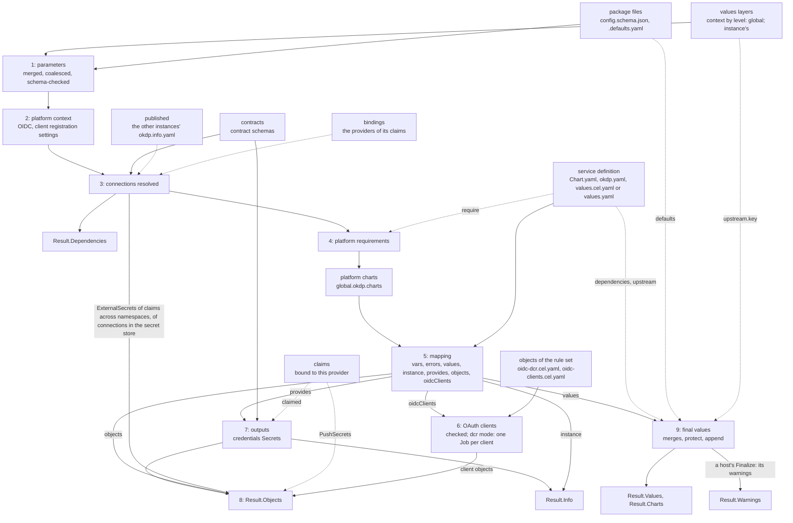

# Architecture

Describe how okdp-compiler works. The formats it reads and writes are
specified in [service definition](specs/02_service_definition.md) and
[inputs and outputs](specs/01_inputs_outputs.md).

The compiler's rules are data, in two rule sets ([Rules](#rules)). The
mandatory set, embedded
([`internal/rules/mandatory`](../internal/rules/mandatory)), applied to every compile, gives the schema of the platform's settings,
the workload fragments and the OAuth clients. A rule set added to it
(`Inputs.Rules`, read by `LoadRules`) gives the checks, their tables, the
schema of a mapping and the charts the compiler adds. okdp-gitops holds
the standard set, `rules/v1`, and [`testdata/rules`](../testdata/rules)
is the copy this module's tests compile with: every `testdata/rules/...`
path below is a file of that set.

## Position in OKDP

An OKDP service is a set of upstream Helm charts deployed together as one
instance, configured from a few parameters, the platform's and projects
settings and the connections to other instances. okdp-compiler is the compile
step: it computes, in Go, the values each upstream chart is then rendered with,
unchanged, by Helm, from the chart's own repository. A service is a package,
a directory in git, not a chart: OKDP publishes no chart of the service.

One compile is one instance. It reads the package (`LoadDefinition`:
`Chart.yaml`, `okdp.yaml` and the values file; then each compile, the
parameters and OKDP's defaults) and, in `Inputs`, the contracts, the
values layers (the context's,
`Context`, by level: the platform's at 0, a project's above; then the
instance's, `Values`), and the release and
namespace, shared by all the instance's charts; what the other instances
of the namespace publish (`Published`), the outputs a connection reference
may name. It reads no upstream chart: a host checks the final values
against them in its Finalize (okdp-gitops)
([Inputs and outputs](specs/01_inputs_outputs.md)).
It returns, in `Result`: `Values`, the final values each upstream chart is
rendered with by `helm template`; `Charts`, the upstream chart that renders
each, by repository, name and version
([Chart index](specs/01_inputs_outputs.md#chart-index));
`Objects`, OKDP's own objects for the cluster, which the `okdp-objects`
chart renders as written; `Info`, what the instance publishes, for a
control plane or a console that reads git; `Dependencies`, the instances
it depends on, for a deployer that orders the releases (okdp-gitops: Flux
`dependsOn`, Argo CD sync waves); `Warnings`, what does not fail the
compile (a `values.yaml` that holds expressions)
([Outputs](specs/01_inputs_outputs.md#outputs)).

`LoadRepository` reads a tree, in one or more repositories, each of its
role (`Repository.Role`: the tree's, or a catalog's), as its
instances. `CompileAll` compiles instances together, those of a namespace each
after the instances whose outputs it references, with what they publish
as `Published`: the order of a tree's instances is the compiler's, not
its caller's. `NewGraph` then checks the dependencies of the results and
orders the releases.

Callers: a Go program embeds the package at the module's root
(`compiler`), compiles from a git tree, an embedded filesystem or memory,
and gets the files of a compile from one function (`Write`): `values.yaml`,
`okdp-objects.values.yaml` and `okdp.info.yaml`, which `helm install`
takes with the catalog's chart and the `okdp-objects` chart. okdp-gitops
is that program for Flux and Argo CD, and writes the single release each
deploys, an umbrella over both charts
([output](https://github.com/OKDP/okdp-gitops/blob/main/docs/specs/03_output.md));
its `okdp-compile` runs the same code from directories, in CI or scripts.
The library depends on neither Helm nor the Kubernetes client libraries:
cel-go for expressions, `santhosh-tekuri/jsonschema/v6` for schemas,
`sigs.k8s.io/yaml` for values, `go.yaml.in/yaml/v3` for the mapping, the
rule set's templates, `Chart.yaml` and the package keys of `okdp.yaml`.

## Compile pipeline

No upstream chart is read: a host checks the final values against the
charts in its `Inputs.Finalize`, fetching them itself (okdp-gitops: their
schemas, the default lists an instance appended to).

`okdp.LoadDefinition` (`internal/okdp/load.go`) reads `Chart.yaml` into
`chart.Metadata` (`chart.ReadMetadata`, `chart/metadata.go`:
strictly, an unknown field refused by yaml.v3's `KnownFields`, one YAML
document; then `Metadata.Check`: `apiVersion: v2`, a name, a SemVer
version, an application chart, and each dependency's name, key, repository
and pinned version, the keys unique, Helm's `condition`, `tags`, `enabled`
and `import-values` refused). It decodes the package keys of `okdp.yaml`,
when present, into `okdp.Package`, strictly too (`require` a list of keys,
`roles`, `dependsOn`, `defaults`, and `upstream`, whose forms its
`UnmarshalYAML` decodes); the mapping's sections are held as `yaml.Node`,
not read, so that `KnownFields` still refuses any other key, and `output`
is refused with a message of its own. From both it builds the `Service`
(`Definition.service`, `internal/okdp/service.go`): the name and version
of `Chart.yaml`, the requirements and catalog metadata of `okdp.yaml`, and
the charts by key (`chart.Specs`, `chart.NewSpecs`), one per dependency,
its source the dependency's chart, its OKDP defaults and upstream rules
those of `okdp.yaml`, whose keys must be dependencies', and the paths of
`protect` and `append` checked. The `Definition`
keeps the metadata, the package keys, `okdp.yaml` and the values file as
bytes (`Definition.Okdp`, `Definition.Values`, nil when absent), the
mapping's sources, and the package's filesystem as
`Definition.Files`: the mapping is parsed by each compile, so a YAML error
in it surfaces at `Compile`, and the other files of the package are read
by each compile.

`okdp.Compile` (`internal/okdp/pipeline.go`; a nil context, definition or
file system panics) checks the release, a name Helm accepts
(`chart.IsRelease`, `chart/ref.go`: a DNS-1123 label of 53
characters at most), and the namespace, a DNS-1123 label
(`chart.IsDNSLabel`), then builds the `Service` again
(`Definition.service`), for a `Definition` built in memory: a name and a
SemVer version, each dependency key a DNS label (it names its
dependency alias), unique, each dependency a repository URL, a chart name
and a pinned version (`Metadata.Check`, `chart.Ref.Check`,
`chart/ref.go`;
[Dependencies](specs/02_service_definition.md#dependencies)), and the
`protect` and `append` paths (`chart.NewSpecs`, `chart.Specs.Check`,
`chart/spec.go`). Then it runs the stages, one call each, in
order. The first three, one call (`newInstance`), build the compile's
`instance` (`internal/okdp/context.go`), the typed state the others read:
the release and namespace, the service's name and version, the merged
values, `global.okdp`, its `ingress.suffix`, the OIDC settings and their
mode, the dependencies, and what the mapping sees (its `scope`):

1. **Parameters** (`newInstance`, `internal/okdp/context.go`, on
   `chart.Parameters`, `chart/parameters.go`).
   `config.schema.json` is read first, once for the compile, before the
   layers (`chart.ReadParameterSchema`; a missing one is the empty schema,
   `{}`), as any values schema is (`chart.ParseSchema`, a `chart.Schema`):
   decoded once, the validator keeping its numbers as written, its map
   view (`Schema.Doc`, `value.Normalize`) reading them as `float64`;
   compiled once (`chart.CompileSchema`). The defaults are the `default`
   of each property reached from the root through `properties`, the
   outermost on a path (`schemaDefaults`): a `default` anywhere else is
   not read. The map view gives the keys of `global` below and the
   connection walk (stage 3); the requirement of each connection reference
   it declares, set or not, is compiled there (`requirements`,
   `readRequirement`, `internal/okdp/connections.go`), every one that
   fails reported, and one out of the walk's reach refused (`schemaRefs`:
   under a combinator, a definition, `additionalProperties`). `global`,
   `connections` and `claims` are the context's
   (`valuesLayers`, `internal/okdp/layers.go`): the context's layers are
   sorted by level, lowest first, a level's in order (`contextLayers`); a
   layer that sets a value a lower level's layers set, merged, or gives
   one of their connections or named claims fails (`chart.Overlap`), and
   one of level 0 that declares claims; an instance layer that sets
   `global` fails, but for the keys `config.schema.json` declares under
   it, `okdp` excepted, and one that sets `connections` or `claims` fails:
   an instance's own connections are a context layer of its level, the
   named claims its project's. A context layer above level 0 or an
   instance layer, normalized, with `{{` in a key or a string, at any
   depth, fails (`chart.NoTemplate`, `chart/check.go`); the
   platform's level, 0, and the package's defaults are not checked. Each
   layer, those of `Inputs.Context` by level, then `Inputs.Values`, is
   normalized (`value.Normalize`: string keys, `[]any` lists, `float64`
   numbers, whatever the Go types; what values cannot hold fails, the
   layer and path named) and merged in that order by `value.Merge`, Helm's
   merge of `-f` files; the result is coalesced over the defaults by
   `coalesceValues`, `connections` and `claims` apart: not parameters,
   they are kept as merged, out of the defaults and the check. The
   coalesced values are checked against the compiled root (`validate`;
   both `Schema.Values`); every violation is reported at once, under the
   `name` of `Chart.yaml`. Nothing below runs on invalid parameters.
2. **Platform context** (`newInstance`). The settings of
   `global.okdp` the compiler reads are described by the rule set's
   platform schema (`RuleSet.PlatformSchema`,
   `internal/rules/mandatory/schemas/platform.schema.json`, parsed once):
   their types, the maps on the way to
   them, `clientProvisioning`'s values, the oidc-dcr Jobs' whole numbers,
   the keys of `charts`, the defaults. The settings are read from the
   context's layers alone, never from the parameters, which a package
   schema's defaults reach (`contextLayers`, `parameters`): level 0's
   `global.okdp`, merged, then the `provisioning` of each layer above;
   no other key of a higher level is read, whatever the checks let
   through, and `global.okdp` of the parameters is replaced by that view
   as written. `platformSettings` checks it against the schema as the
   parameters are checked
   (`Schema.Values`), every violation at once under a heading that names
   the platform values: a value of another type fails rather than reads as
   not set ([fields the compiler
   reads](specs/01_inputs_outputs.md#fields-the-compiler-reads)). Nulls
   are read as Helm reads them in a chart's values: a `null` deletes the
   setting's default, and is refused by its type where there is none; an
   empty string is a value.
   The mapping sees `global.okdp` as the context wrote it (`global`); the
   compiler reads the checked copy (`instance.okdp`: the privileged
   projects, the store, the upstream policy, the platform charts, the
   classes). What the mapping sees as `platform` is the rule set's
   document `scope` (`scope.cel.yaml`), computed from it: OIDC, the client
   provisioning mode in effect (`existing`, `dcr`) among it ([OAuth client
   settings](specs/01_inputs_outputs.md#oauth-client-settings)).
3. **Connections** (`newInstance`; `resolver`, `internal/okdp/connections.go`).
   The map view of `config.schema.json` (stage 1) is walked
   (`walk`) together with a deep copy of the parameters, through
   `properties` (keys sorted) and `items`. A reference must be a string,
   `null` and `""` being not set. Each is resolved (`resolve`) to an
   external connection; else, a named claim of the context
   (`namedClaims`), to the output of `Inputs.Bindings`; else to the output
   of that name and contract one other instance of the namespace
   publishes (`output`, on `Inputs.Published`, the compiling release left
   out, two providers refused); a claim template to the output of
   `Inputs.Bindings`. No connection is
   computed from a name: what an instance is reached at, its provider
   publishes. It is completed
   against its contract (`contract.complete`). A contract is read by the
   first reference or output that names it (`readContract`), once for
   the compiles of a set (`contractCache`, `Memo`): decoded once, the
   validator keeping its numbers as written, the keywords read from its
   map view (`value.Normalize`), and compiled once. An
   external connection or an output, its values a copy read as values
   (`value.Normalize`), holds fields of its contract only, none of them
   secret (`contract.fields`), and is validated against the contract's
   schema (`contract.check`). The reference's requirement, its `require`,
   names fields of the contract or `secretRef` (`contract.requires`, before
   the connection is looked for), and the connection, `secretRef`
   included, is validated against it (`requirement.check`): a claim bound
   to the provider of the default class says so, the compiler never binds it to
   another. An external connection whose credentials are in the platform's
   secret store (`secretRef: {remoteKey}`) resolves to the Secret of the
   instance's namespace the compiler reads them into,
   `<release>.<connection>-credentials` (`storeSecret`), as a claim across
   namespaces does; last, the connection must hold no `{{`
   (`chart.NoTemplate`)
   ([Connections](specs/01_inputs_outputs.md#connections)). The
   references that do not resolve are reported together, one line each,
   in the order of the walk (`walk`: keys sorted at each level, items in
   order). The references to an output or a claim are recorded as
   `Dependency`, the output named, sorted by parameter path.
   `global` and `connections` are then removed from the parameters; the
   instance's upstream values stay, `values.upstream.<key>`, so that an
   `errors` rule covers them; they are checked and applied at stage 9. The
   context is assembled (`instance.scope`): `release`, `values`, `global`
   (as written: `global.okdp`, the platform's, and the other keys of
   `global`, a project's `global.project`), `platform` (OIDC, the name of
   the main OAuth client's Secret, `clientSecret`; the ingress
   annotations, the proxy
   environment), `service`, `labels`, `selectorLabels`
   ([Context](specs/02_service_definition.md#context)).
4. **Platform requirements** (`Compile`, on the instance). The `require`
   entries of `okdp.yaml`, in order, each a dotted path under
   `global.okdp` that must be set and not empty
   ([require](specs/02_service_definition.md#require)). A missing
   value is reported after the errors of stages 2 and 3. `Compile` then
   opens the compile's CEL session (`cel2yaml.NewSession`): its cost
   limit, OKDP's host functions for the instance (`functions`, built
   from the `instance` and the compile's context) and the CEL
   environments built with them, shared by the mapping and the
   compiler's templates, each evaluation cancelled with the context. It reads the
   platform's charts, `global.okdp.charts` (`platformCharts`,
   `internal/okdp/objects.go`): each chart of the rule set (`RuleSet.Charts`:
   in the standard set `objects`, the `okdp-objects` chart, 0.1.0), unless
   the platform sets it, checked as a source is ([Platform
   charts](specs/01_inputs_outputs.md#platform-charts)).
5. **Mapping** (`runMapping`, `internal/okdp/mapping.go`, on
   `compile.Eval`, `internal/compile/compile.go`, over `cel2yaml.Session`). The
   mapping, two sources (`compile.Source`, its name the first segment of
   its errors), each when present: `okdp.yaml`, its package keys skipped,
   and the values file, `values.cel.yaml` or `values.yaml` (its name
   `Definition.ValuesFile`), the section `output` whole. They are parsed
   into ordered maps (`parseDoc`), then built into one tree (`builder`),
   in every branch: the top-level keys of `okdp.yaml`, `vars`, `errors`
   and the sections OKDP names (another key fails), its directives
   checked, each string scanned and each expression compiled once, in the
   CEL environment of the names in scope at its place, with OKDP's host
   functions (`functions`) beside the language's. The tree is then
   evaluated in the compile's session, without compiling again. The `vars`
   bindings are evaluated in order, each seeing the previous ones; then
   the `errors` section, a list of messages (each the `$value` of an item
   kept by its `$if`), all collected, any message failing the compile
   (`bind`); then the sections: `output` (the values file), `instance`,
   `provides`, `objects` and those the rule sets add (`RuleSet.Sections`:
   `oidcClients` in the mandatory set), in that order, with the keys
   each writes at its top level, kept or not (`Doc.Written`: those of its
   map as written, not those its `$merge` or a `$for` gives). They are
   checked together against the rule set's mapping schema,
   `testdata/rules/schemas/mapping.schema.json` (`RuleSet.MappingSchema`,
   parsed once by `LoadRules`; none with the mandatory set alone), as
   `global.okdp`
   is (`schemaValues`; a
   null section is not set, another null refused where no default exists),
   every violation at once: the values a map of maps or nulls; `instance`
   a map, its `url` and `usage` strings; the others lists, an `objects`
   item a whole manifest, with a `kind` and a `metadata.name`, a
   `provides` item and an OAuth client of their keys and types; another
   shape fails rather than reads as empty or is printed
   ([sections](specs/02_service_definition.md#evaluation-order)).
6. **The objects of the rule set's sections** (`ownObjects`,
   `internal/okdp/objects.go`). For each of `RuleSet.OwnObjects`, its
   section is read by its document. In the mandatory set, `oidcClients`,
   `internal/rules/mandatory/charts/oidc-clients.cel.yaml`: the clients, of
   the form
   the mapping schema checks, are checked across clients in every mode,
   their names unique
   ([oidcClients](specs/02_service_definition.md#oidcclients)). In `dcr`
   mode, OIDC enabled, with at least one client, the platform's
   registration settings are checked, no two clients write one Secret, and
   the template `internal/rules/mandatory/charts/oidc-dcr.cel.yaml` is
   evaluated
   once per client, in the compile's session (`evalTemplate`), on the
   context plus `client` and `names`: the client's objects, among the
   mapping's, so that stage 8 checks them. A project that is not
   privileged has the hosts of the client's URLs checked first
   (`checkItemURLs`, `hostRules`).
7. **Outputs and credentials Secrets** (`provided`,
   `internal/okdp/provides.go`). Each `provides` entry, of the form the
   mapping schema checks (stage 5), is
   checked against its contract, read again, as an external
   connection is: its fields (`contract.fields`), completed
   (`contract.complete`), validated against its schema
   (`contract.check`). An
   entry with a `secret` gets its credentials Secret
   (`credentialsSecret`; a generated one by `okdpGeneratedSecret`'s
   template, `generatedSecret`). Then two outputs of one contract and name
   fail (`twice`). The checked outputs and the mapping's `instance`, its
   `url` and `usage` trimmed (`published`), are `Result.Info`, which
   `compiler.Write` writes to `okdp.info.yaml` ([The info
   file](specs/01_inputs_outputs.md#the-info-file), [Credentials
   Secrets](specs/01_inputs_outputs.md#credentials-secrets)).
8. **Objects** (`Compile`).
   `Result.Objects` is the credentials Secrets, then the
   mapping's `objects`, then the PushSecrets and ExternalSecrets of the
   credentials of claims across namespaces, and the ExternalSecrets of the
   connections in the platform's secret store (`pushSecrets`, `pullSecret`)
   ([objects section](specs/01_inputs_outputs.md#objects-section)): in no
   chart, `compiler.Write` gives them as the values of the objects' chart,
   which renders them as written
   ([the objects chart](specs/01_inputs_outputs.md#the-objects-chart)).
   Then the checks of the rule set over them all, each object or key at a
   time (`internal/okdp/policy.go`, `hosts.go`), unless the namespace is
   one of the platform's own projects (`privileged`, `Result.Privileged`):
   `CheckObjects`, the check `object` (each object in the instance's
   namespace, none of a kind of the table `clusterScopedKinds` nor of the
   groups of `deployerApiGroups`, the items of a `List` alike), and
   `CheckIngressHosts`, the check `host`, on the objects; the first refused
   fails the compile. Then, in every project, unless
   `Inputs.AllowPlainSecrets`, the check `plainSecret`
   (`checkPlainSecrets`): no Secret holds values in clear, no
   ExternalSecret's template a literal at a sensitive key, no Fake
   generator values. With the mandatory set alone these checks pass.
9. **Final values** (`Inputs.Finalize`, else `merge.FinalValues`,
   `internal/merge/merge.go`), for
   each dependency of `Chart.yaml` the values file does not leave out
   (`rendered`, `internal/okdp/pipeline.go`, Helm's rule: every one, but a
   key it writes, `Doc.Written` or a key of its values, left out by `$if`
   or null), its computed values `{}` when the file does not write its
   key. A key of the values file must
   be a dependency of `Chart.yaml`, null or not ([rendered
   dependencies](specs/02_service_definition.md#rendered-dependencies)).
   The key of the objects' chart is reserved
   (`checkObjectsChart`, `internal/okdp/objects.go`): neither
   `Chart.yaml` nor the values file may list it. The upstream chart is the
   key's source, its dependency's chart. The key's `defaults` file and the
   computed values are merged as `-f` files (`merged`, `keyValues`); the
   chart's own `values.yaml` is no layer: Helm coalesces the final values
   over it when it renders. When the chart accepts upstream values, the
   instance's `upstream.<key>` values go through `applyUpstream`: the `{{`
   check, `protect`, the caller's check (`chart.UpstreamCheck`), `append`,
   then the merge; the paths of the lists appended to are kept by key
   (`Final.Appended`). Last, `global` is set, left out when empty.
   `merge.FinalValues` returns a `merge.Final` (`compiler.FinalValuesOf`):
   the values, the source of each compiled key, which `Result.Charts`
   records, and the appended lists. The compiler reads no upstream chart.
   A host's `Inputs.Finalize` wraps this merge (`compiler.FinalValues`):
   okdp-gitops' adds the upstream policy (`policy.UpstreamCheck`, for a
   project that is not privileged), the hosts of the charts' ingresses
   (`policy.CheckIngressValues`), the warning of a literal of the
   upstream values at a sensitive key (`policy.PlainUpstream`), and the
   checks against the upstream charts it fetched (`chartcheck`): the
   final values, coalesced over the chart's `values.yaml` by Helm's
   `chartutil.CoalesceValues`, against its `values.schema.json`, and a
   warning for an appended list whose final list lacks items of the
   chart's default list
   ([checks of the final values](specs/01_inputs_outputs.md#checks-of-the-final-values)).
   The layers and the rules: [Merge
   precedence](specs/01_inputs_outputs.md#merge-precedence), [Upstream
   values](specs/01_inputs_outputs.md#upstream-values).

Errors: a compile stops at its first error, except where the whole list
helps the author: the `errors` messages, the parameter schema violations,
the connection references that do not resolve. The first error is the
same from one compile to the next: a check over the keys of a map visits
them sorted, a list in its order
(`provides`, first error by position). A message says where: the chart, the
parameter path, the mapping's file and path (`values.cel.yaml: app:
env[2]: value: ...`, `okdp.yaml: vars host: ...`), the `vars` or `$vars`
binding, the OAuth client
(`oidcClients[1] (console)`). A path in values (a parameter, a layer's
value, an upstream value, a contract field) is written one way, as a
`protect` path is (`value.Key`, `value.Index`): plain keys joined by dots,
a key that holds a dot in brackets (`annotations["example.org/x"]`), a list
item `[i]`.

## Source map

The module's root is the public package, `compiler`: it gives callers the
types they name, as aliases, and wraps the functions of `okdp`, `graph`,
`tree`, `merge`, `repository` and `chart`. Under `internal/`, the packages
each import only those below them: `compiler` -> `repository` and `tree`
-> `graph` -> `okdp` -> `merge`, `rules` -> `compile` and `chart` ->
`value`: the compile knows no tree and no graph, the graph no tree
(`TestLayers`). okdp-gitops holds the writers: the command line, the
targets and their output, `treeedit`, `chartcache` and the checks against
the upstream charts (`chartcheck`).
`compile` and `chart` do not import each other: the mapping language knows
nothing of Helm charts, the Helm code nothing of the mapping language, and
neither knows OKDP.

| Package | File | Owns | Relations |
|---|---|---|---|
| `value` | `value.go` | the data model (`M`) and its helpers: `Normalize` (a round trip through `encoding/json/v2`), `Copy`, `AsMap`, `AsList`, `Merge` (Helm's `MergeMaps`), `Truthy`, `Str`, `Dig`, `Short` (a value for a message, its sensitive keys redacted) | every package |
| | `redact.go` | what a message does not print: `Sensitive`, a key whose value may be a credential (`password`, `token`, `clientSecret`, `apiKey`, a key ending with one, or with `Key`), `SensitivePath`, the key of a path, a list item's its list's, `Redact`, a value with those of its sensitive keys `Redacted` (`<redacted>`), `ShortAt`, a value of a key for a message | `Short`; `chart.Validate` |
| | `path.go` | the path of a value, as messages write it (`Key`, `Index`): plain keys joined by dots, a key that is empty or holds a special character in brackets, the form of the `protect` paths; read back as its keys and indexes (`Split`, `Join`), a JSON pointer (`Pointer`) | `formatPath` and `NoTemplate` (`chart`); the parameter paths of the connections and `Dependency.Field`, the fields of the contract violations (`okdp`) |
| `compile` | `compile.go` | the top level of a mapping, over the language of github.com/okdp/cel2yaml (`cel2yaml.Session`, opened with `cel2yaml.NewSession`: its CEL cost limit, the caller's host functions and the CEL environments built with them); documents read from one file or several (`Source`: a name, the first segment of its errors; a file of top-level keys, some skipped for another reader, or one section whole) with `cel2yaml.Parse`, each `vars` binding, `errors` and each section compiled to a `cel2yaml.Template` in the names in scope at its place, all before any is evaluated, then evaluated with the names of their sections: `vars` and `errors`, then the sections (`Eval`, a `Doc`: their values, and the keys each writes, `Written`), as one `cel2yaml.Session.Document` | `cel2yaml.Session.Template`, `cel2yaml.Template.Eval` |
| `chart` | `values.go` | Helm's reading (`ParseValues`) and coalescing of values (`coalesceValues`: the parameters over the defaults of `config.schema.json`) | stages 1 and 9; okdp-gitops' `chartcheck` (`ParseValues`) |
| | `schema.go` | JSON Schema validation, reported as Helm reports it (sorted, for a stable report), the value of a sensitive key not printed (`redactCauses`: a pattern, a format, a numeric bound, `<redacted>` in its place), each violation apart too (`Violation`, `violations`: the leaves of the report); `CompileSchema`, a schema compiled as Helm compiles it | stages 1 and 2; the contracts (`internal/okdp/connections.go`); okdp-gitops' `chartcheck` (`ParseSchema`, `SchemaError`) |
| | `ref.go` | `Ref`, an upstream chart, its check (`Check`: an `https://` or `oci://` repository whose path a chart cache can lay out, `repoPath`; the layout itself is okdp-gitops' `chartdir`); SemVer precedence (`CompareVersions`); the names Kubernetes and Helm accept: `IsDNSLabel`, `IsRelease` (`ReleaseMax`) | the dependencies of `metadata.go`, the sources of `spec.go`, the platform's charts (`internal/okdp/objects.go`); the chart keys (`metadata.go`, `spec.go`); the release, the namespace and an internal reference (`okdp`) |
| | `metadata.go` | `Chart.yaml`: `Metadata`, Helm's fields in Helm's order, the order okdp-gitops' umbrella writes them in; `Dependency`, its key (`Key`: the alias, else the name) and its upstream chart (`Ref`); `Maintainer`; `ReadMetadata`, the strict reader of one YAML document, and `Metadata.Check`: `apiVersion: v2`, a name, a SemVer version, an application chart, each dependency's name, key (a DNS label, unique), repository and pinned version, Helm's `condition`, `tags`, `enabled` and `import-values` refused | `ref.go` (`Ref.Check`, `IsDNSLabel`, `IsVersion`); read by `LoadDefinition`, `compiler.ChartMetadata`; written back by okdp-gitops' umbrella |
| | `spec.go` | the charts of a package, by key: `Spec` (its source, its OKDP defaults, the instance upstream values it accepts, their `protect` and `append` paths), built from the dependencies of `Chart.yaml` and the `defaults` and `upstream` of `okdp.yaml` (`NewSpecs`; `Upstream`, the forms of `upstream`, decoded by its `UnmarshalYAML`); `Specs.Check` (the `protect` and `append` paths) | `metadata.go`, `paths.go`; built by `okdp.Definition.service` |
| | `paths.go` | the grammar of the `protect` and `append` paths (`parsePath`); `formatPath`, the keys a value was found at, written back | `spec.go`, `merge.go`; `value.Key` |
| | `parameters.go` | stage 1: `Schema`, a values schema decoded and compiled once, its defaults read (`ParseSchema`), its values coalesced over them and checked (`Schema.Values`); the package's `config.schema.json`, read once per compile, `{}` when missing (`ReadParameterSchema`); `Parameters`, `connections` and `claims` apart, its violations a `ValuesError` | `values.go`, `schema.go`; read by `okdp` (`context.go`: the parameters, the platform schema) |
| | `check.go` | what is checked of values whatever the chart: `NoTemplate`, the `{{` check; `Overlap`, a layer setting what a lower one set; `UpstreamCheck`, the type of the caller's check of upstream values | `okdp` (`layers.go`, `connections.go`), `merge` |
| `merge` | `merge.go` | stage 9 (`FinalValues`, a `Final`: the values by key from `keyValues`, the source of each, the paths appended to, `Appended`), the instance's upstream values, `protect`, the caller's check (`chart.UpstreamCheck`) and `append`; no upstream chart read | `chart`; `compiler.FinalValues` for a host's `Inputs.Finalize` |
| | `paths.go` | the paths the merge walks | `merge.go` |
| `rules` | `rules.go` | the rule sets (`LoadRules`, the set given added to the mandatory one, `Mandatory`, it alone, embedded from `mandatory/`, `RuleSet`; its zero value holds no rule, its checks failing with `ErrNotLoaded`; a rule that refuses is a `*Failure`, `errors.Is(err, ErrRefused)`, values that violate a schema a `*SchemaError`): its tables, each with what the platform adds to it (`addFrom`), its schemas, fragments and templates, labels, names and charts; every table and check required of the two sets together, an unknown one refused, a rule of both refused | `chart`, `compile`; the walkers of `okdp` |
| | `check.go` | its documents, prepared once per set in free sessions (`checker`, `get`, `put`) and evaluated by the walkers (`Refuse`, `Problem`, `Values`), a check that fails to evaluate an error; the functions they call (`ruleFunctions`) | `compile.Prepare` |
| | `rules.schema.json` | the form of `rules.yaml`, embedded | `LoadRules` |
| `okdp` | `doc.go` | the package doc | |
| | `service.go` | `Definition` (the `Chart.yaml` metadata, the package keys of `okdp.yaml`, `okdp.yaml` and the values file as bytes, the values file's name, the package's files, the warnings of its load); `Package`, the package keys of `okdp.yaml` (`require` a list of keys, `defaults`, `upstream`, `provisions`, each a `Provision`, a contract and its claimers, read from its name or `{contract, claimers}`; the mapping's sections held as `yaml.Node`, unread); `Service` (the name and version of `Chart.yaml`, the requirements and catalog metadata of `okdp.yaml`, the charts), built from a `Definition` and checked, at load and before every compile (`Definition.service`, its messages naming `Chart.yaml` or `okdp.yaml`); `platformValue`, the end of the error of a missing platform value, which names the input | `chart.Metadata.Check`, `chart.NewSpecs`; read by `LoadDefinition` and `Compile`; `platformValue` by `pipeline.go` |
| | `load.go` | `LoadDefinition`: `Chart.yaml`, read and checked (`chart.ReadMetadata`); `okdp.yaml`, its package keys decoded strictly (`output` refused), the keys of `defaults` and `upstream` those of dependencies; the values file, `values.cel.yaml` or `values.yaml` (both refused), a `values.yaml` checked for expressions and `$`-keys, a warning (`holdsExpressions`); the `Service` built from them and checked | `chart.ReadMetadata`, `Definition.service` |
| | `pipeline.go` | `Inputs`, `ContextLayer`, `Result` (with the definition's warnings), `Compile`: the order of the stages, each a method of `run`, the state of one compile (`checkInputs`; `platformInstance`, stages 1 to 4, the platform requirements among them; `mapping`, stages 5 and 6, in the compile's CEL session; `provides`, stage 7; `objects`, stage 8; `finalValues`, stage 9, the dependencies rendered by `rendered`) | calls `newInstance`, `cel2yaml.NewSession` (with `functions`, the context given to each evaluation), `platformCharts`, `runMapping`, `ownObjects`, `provided`, `published`, `checkObjectsChart`, `Inputs.Finalize` or `merge.FinalValues` |
| | `memo.go` | `Memo`: what the compiles of a set of instances read once, an instance's parameters (`paramsMemo`), the contracts of a file system (`contractCache`); `CompileAllWith`, for a caller that compiles the same instances again | `Compile`, `claimsOf`, `newInstance`, `resolver` |
| | `layers.go` | stage 1: the values layers, the context's by level (`contextLayers`: a level adds to the lower levels' values and changes none, nothing of `global.okdp` but `provisioning` above level 0 (`platformOnly`), no key of `global` but those `policy.projectGlobals` lists (`projectGlobals`), checked by the upstream policy (`upstreamGlobals`), no `claims` at level 0, no `{{` above it; the context's `global.okdp`, level 0's and the classes above it) then the instance's, normalized (`value.Normalize`); `global`, `connections` and `claims` are the context's, no `{{` in the instance's (`valuesLayers`) | the keys of `global` the parameter schema declares (`chart.Schema.Doc`), `chart.NoTemplate`; called by `context.go` |
| | `context.go` | stages 1 to 3: `instance`, the typed state of a compile, built by one function (`newInstance`): the parameters (`chart.ReadParameterSchema`, the references' requirements, `valuesLayers`, `chart.Parameters`), the platform context (`global.okdp` of the context's layers alone, `contextLayers`, checked against the rule set's platform schema, `platformSettings`) and the connections (`resolver`), which end with what the mapping sees (`instance.scope`); values checked against a schema of the rule set, the platform's or the mapping's (`schemaValues`) | `chart.ParseSchema`, `chart.Schema.Values`; `connections.go`, `labels.go`; the rule set's document `scope`; the `instance` is read by `mapping.go`, `objects.go`, `provides.go` |
| | `connections.go` | the references of the parameters, visited (`refs`), resolved to a connection, a named claim's or a claim template's output of `Inputs.Bindings`, or an output of `Inputs.Published` (`resolver`: `resolve`, then one resolution per source, `resolveNamed`, `resolveClaim`, `resolveExternal`, its contract's fields apart from its own keys (`connectionFields`), as written (`Connection`, `ParseConnection`, `MarshalYAML`), `resolveOutput`), `Dependency`; the outputs no instance publishes, said by the error (`missingOutputs`); the contracts: `contract`, read, decoded and compiled once for the compiles of a set (`readContract`, `contractCache`), its claim schema with it, `x-okdp-internal` refused, and the checks of values against one (`fields`, `complete`, `check`), of a claim's request against its claim schema (`contract.request`); every connection of an instance's context checked at its declaration, referenced or not (`declaredConnections`, `declared`, `declaration`, `CheckConnection`, `Connection.Entry`); what a reference requires (`requirement`, `require`): compiled (`readRequirement`), those of the parameter schema at stage 1, with the request each fixes (`requirements`), found as the walk finds them, one out of its reach refused (`schemaRefs`, `ConnectionRefs`), its fields against the contract (`contract.requires`), the connection against it (`requirement.check`) | used by `context.go` with the context's `connections`, recording dependencies; the contracts by `provides.go` |
| | `descriptor.go` | a contract as the compile reads it, for a caller that shows it (`ReadContract`, `ReadContracts`, `ContractDescriptor`, `ContractField`): `readContract`, its fields in the order of the file (`propertyOrder`) | `readContract` |
| | `accessors.go` | the errors of a field (`FieldError`, `atField`: the references, the claims bound, the named claims); the names of the claims (`NamedClaimID`, `IsClaimID`, `CheckProvider`) | `connections.go`, `namespace.go`, `claims.go` |
| | `mapping.go` | stage 5: OKDP's sections (`runMapping`: the sources `okdp.yaml`, its package keys skipped, and the values file, the section `output`, named by `Definition.ValuesFile`, `values.cel.yaml` by default), checked against the rule set's mapping schema, OKDP's host functions (`functions`: `okdpFullname`, `okdpGeneratedSecret`, those of `labels.go`, `fragmentFunctions` and `documentFunctions`, the rule set's), built once per compile from its `instance`, for its session; `generatedSecret`, the objects of `okdpGeneratedSecret` and of a generated credentials Secret, and `evalTemplate`, a template of the rule set evaluated in the session, its errors under its file's name | `compile.Eval`; `functions` by `pipeline.go`; `fullname` (`truncName`, a name cut as charts cut it, `trunc n \| trimSuffix "-"`) |
| | `fragments.go` | the workloads of the rule set as CEL functions (`RuleSet.Fragments`: `okdpPodSpec`, `okdpJob`, `okdpSignInProxy`, `okdpWebWorkload` in the mandatory set): the arguments checked against the mapping schema under the function's name, then the fragment evaluated on them (`fragment.call`) in the session of the call | `mapping.go: functions`, `evalTemplate` |
| | `labels.go` | the labels of OKDP's own objects, from the package's `name` and the release, the selector labels a subset (`labels`) | the context (`service`, `labels`, `selectorLabels`), the CEL functions, every object the compiler writes |
| | `provides.go` | stage 7: `Info`, `Output`, `SecretRef`, what the instance publishes (`published`); the outputs, each checked against its contract, two of one contract and name refused (`provided`, `twice`), the credentials Secrets (`credentialsSecret`), a plain one refused unless `Inputs.AllowPlainSecrets` | `connections.go` (the contracts, the resolver), `generatedSecret` (`mapping.go`) |
| | `objects.go` | the objects the rule set's sections add (`ownObjects`, stage 6), the hosts of the URLs they register (`checkItemURLs`), the key of the objects' chart reserved in `Chart.yaml` and the values file (`checkObjectsChart`), stage 9; the platform's charts, each of the rule set's unless the platform sets it (`platformCharts`, stage 4); `ObjectsChart`, `ObjectsValue` | `chart.Ref`; `RuleSet.OwnObjects`, `RuleSet.Charts` |
| | `claims.go` | `Claim`, a connection claimed of a provider's instance; `Binding`, the provider a reference's claim is bound to; a claim as written, a claim template or a named claim, its request among it (`ClaimSpec`, `parseClaim`), the named claims of the context (`namedClaims`), one of them as written, what it holds even when it fails (`ParseClaim`), those of an instance's parameters and context, a template's request merged over the package's (`claimsOf`), its ID (`claimID`); the provider a claim or a class names (`providerName`); the classes of the context, `global.okdp.provisioning`, read from the merged values of `claimsOf`, and the platform's, of level 0 (`instanceClaims`, `platformClasses`); `provisions` checked (`checkProvisions`), and the claimers of a provider (`CheckClaimers`, `consents`), the claims bound to an instance checked (`checkClaims`), their outputs found among the provided ones (`claimed`), what the mapping sees of them (`claimsScope`) | `service.go` (`Service.Provisions`), `pipeline.go` (before the context, after stage 7), `context.go` (`claims`) |
| | `transfer.go` | the credentials of claims across namespaces, through the platform's secret store, and those of the connections kept in it (`secretRef.remoteKey`): the key of a claim's credentials (`storeKey`), the PushSecrets of the provider's namespace (`pushSecrets`), the ExternalSecrets of the claimer's and of a connection's referrer (`pullSecret`), the credentials a reference needs read (`transfer`) | `connections.go` (`resolveClaim`, `storeSecret`), `pipeline.go` |
| | `namespace.go` | `Instance`, `Outcome`, `Bound`, `CompileAll`: each instance whose context's connections hold at their declaration (`declaredConnections`), each claim bound to its provider, the one it names or the provider of its class, the one it names or the default one of its context, the named claims of a namespace once, declared alike, each request, what its class fixes under it, checked against the contract's claim schema, its defaults applied (`compilation.bind`: one `binder` step each for the claims of an instance, the named claims of a namespace, the references to them, the claims given to their providers and the outcomes; `compilation.provider`, `choice`, `claimRequest`, each reading the claim's `claimSite`; what `CompileAll` gathers for an instance in its `member`), a provider of another namespace through a class of the platform's or with its consent (`consent`, `Instance.Claimers`), then the instances of the tree compiled together, each published to its namespace (`compilation.compileAll`: Kahn's algorithm, its edges discovered by compiling, an instance waiting for the outputs its compile says it lacks, of its namespace or of its claims' providers), the outputs two instances of a namespace publish refused, and what resolved through them compiled again (`compilation.refuseShared`, `compilation.recompile`), two objects of a namespace that write one Secret refused (`compilation.refuseSecretTargets`, `secretTargets`, the items of a `List` walked as every rule on objects walks them, `eachObject`), the claimers of a provider refused, of any namespace, compiled again (`refuseClaimers`); the instances that do not compile named in the refusals for an output (`compilation.notes`, `notCompiled`) | `Compile`, `missingOutputs` (`connections.go`), `claimsOf`, `claimID` (`claims.go`) |
| | `policy.go` | the walkers of the platform's policy, each running a check of the rule set: the namespaces no project has (`checkNamespace`, `checkPlatformNamespace`; `CheckNamespace` both, `compiler.CheckProjectName`'s), the platform's own projects (`privileged`, `Result.Privileged`), the objects of the others' instances (`CheckObjects`, stage 8) and in every project no Secret with values in clear unless `Inputs.AllowPlainSecrets` (`checkPlainSecrets`, stage 8), two objects of one name (`checkDuplicateObjects`) | called by `pipeline.go`; `Inputs.Rules` |
| | `hosts.go` | the hosts of the objects (`CheckIngressHosts`, the check `host`, stage 8), read of the same rules by okdp-gitops' `policy` for the charts' ingresses | `pipeline.go` |
| | `rules.go` | `RuleSet` as this package reads it, `rulesOr`, the mandatory set for a compile that gives none | `rules` |
| | `access.go` | who a project's people are: `Role` (`RoleViewer`, `RoleEditor`, `RoleAdmin`), `ParseAccess` (`AccessKey`, `DefaultGroup`, `IsGroup`), read from the context's level 1 alone (`projectAccess`); `CheckProject`, a `NamespaceError`; the platform's administrators (`PlatformAdmins`), `PlatformOf`, `ProjectGroups`, `SecretStoreOf` for okdp-gitops' `target.ProjectOf` | `pipeline.go`, `layers.go` (`access` refused at another level, left out of the values) |
| `repository` | `repository.go` | the tree of a deployment, in one or more repositories: `Repository`, its `Role` (`RoleTree`, `RoleCatalog`), `Load` and `LoadProjects`: the owner of each part, every conflict at once, a catalog's `platform.yaml` or `projects/` and a repository without a role refused (`index`), then each instance (`instance`): its directory, of its files only (`instanceFiles`), its `instance.yaml`, read strictly (`InstanceSpec`, `ParseInstance`, its `claimers` nil when absent, empty for none), its package, loaded once (`definition`), its context layers (`platform.yaml` without claims, its `connections.yaml`, connections only) and values; the names of the tree; per project (`LoadProjects`): a problem of a project's own refuses it as a whole (`Loaded.Refused`, `Refused`, its context in `Inputs`, its own layer in it when its `project.yaml` reads, `Own`), only the platform's parts and the packages (`packageError`) fail the tree | `okdp.LoadDefinition`, `chart.ParseValues` |
| | `error.go` | `Error`, the problems of a tree that does not load, one per problem, the joined errors of `Load` listed one by one (`newError`, `JoinErrors`), the errors they are of unwrapped; `Added`, the problems one has that another has not | `Load` |
| | `catalog.go` | the catalog of the repositories, as `Load` indexes it: `LoadCatalog`, `Catalog`, its services and their versions, highest first (`sortVersions`), a package (`packageDir`, shared with `definition`), the contracts; `ErrNotInCatalog` | `index`, `chart.CompareVersions` |
| | `catalogs.go` | `CatalogsFile`, `catalogs.yaml` beside `platform.yaml`, read strictly (`ParseCatalogs`: `Catalogs`, `CatalogRepository`, its ref `DefaultCatalogRef` by default, `MenuCategory`, `MenuService`, every problem at once, `parser`), checked by `Load` when a repository of the tree holds it, its menu's services those of the catalogs (`checkCatalogs`, `menu`, `Catalog.CheckMenu`) | `index`, `packageDir` |
| `graph` | `graph.go` | the deployment graph of compiled instances: `Node`, `Graph`, `Error`; `New`, every dependency checked against the release it points to (`provides`), the waves, Kahn's algorithm by levels (`levels`), each cycle named, a shortest one from its smallest release (`cycles`); `DependsOn`, `Wave` | `okdp.Result` |
| `tree` | `tree.go` | a tree's instances compiled together and read as a caller asks of them: `Compile` (`okdp.CompileAll`, once, no upstream chart read; then `graph.New`), each problem of the graph at its instance (`Instance.GraphErr`, `atInstances`), the claims bound to each provider (`Provided`), what it granted each (`Granted`), why an instance does not deploy (`Err`, `Problems`), the projects that do not load (`Refused`) | `okdp.CompileAll`, `graph.New` |
| | `partial.go` | the projects of a tree written and kept (`Partial`, `Kept`, `KeptInstance`): those that do not load (`Tree.Refused`, `Kept.Unloaded`), those of the refused instances and of the instances a caller keeps too (`PartialWith`), then, round after round, of an instance at which the graph of what is left has a problem of its own (its dependencies on kept projects left out), or that depends on a release of a kept project (`dependsOnKept`), until the graph of what is left has none; `Regressions`, the instances a change broke | `graph.New` |
| `compiler` | `compiler.go`, `exports.go` | the public API: `LoadDefinition`, `Compile`, `LoadRepository`, `LoadCatalog`, `LoadRules`, `ParseConnection`, `ParseClaim`, `CompileAll`, `CompileTree`, `Build` (`BuildOptions`, its `Loaded` given the instances that load before they compile), `DefaultCostLimit`, `LoadErrorOf`, `Partial`, `PartialWith`, `Regressions`, `AddedProblems`, `CheckProjectName`, `NewGraph`, `FinalValues` (`FinalValuesOf`: `Values`, `Charts`, `Appended`), `ParseValues`; aliases of the types a caller names; the names of the tree (`PlatformFile`, `ContractsDir`, `CatalogDir`, `ProjectsDir`, `ProjectFile`, `InstancesDir`, `InstanceFile`, `ConnectionsFile`, `ConfigFile`), its release rule (`ReleaseName`) and its names (`IsName`); what a host reads of a rule set (`Roles`, `EngineNamespaces`, `PlatformObjectNames`, the `Table*` names) | wraps `okdp`, `repository`, `graph`, `tree`, `merge`, `chart` |
| | `write.go` | the files of a compile (`Write`: `ValuesFile`, `ObjectsValuesFile`, `InfoFile`), `ChartValues`, `ObjectsChartValues`, the objects Helm keeps given Argo CD's sync options (`keepSynced`, `RuleSet.Keep`) | `okdp.Result` |
| | `accessors.go` | what the compile decides, for a caller that answers before it writes: `CheckConnection`, `FieldErrors`, a compile's error as the problems of its fields (`FieldError`: `Path`, `Pointer`, `Message`; `okdp.FieldError`, `chart.ValuesError`, a `LoadError` a problem each); `ConnectionRefs` (`ConnectionRef`); `ReadContract`, `ReadContracts` (`ContractDescriptor`, `ContractField`); `MergeValues`; `NamedClaimID`, `IsClaimID`, `CheckProvider` | `okdp`, `chart`, `value` |

Layers: `value`, `chart/values.go` and `chart/schema.go`
reproduce Helm and know nothing of OKDP; github.com/okdp/cel2yaml
reproduces Helm's and sprig's functions, bound to CEL;
`chart/ref.go` holds the names Kubernetes and Helm accept;
`internal/merge` applies the rules of the package's charts (`okdp.yaml`'s
`defaults` and `upstream`) and reads no upstream chart; `internal/okdp`
binds claims and resolves connections, its walkers running what the rule
set says, and `internal/okdp/pipeline.go` orders the stages. Each rule is
computed in one place and reused: the labels of the context, of
`okdpLabels` and of the credentials Secrets; one generated Secret for the
CEL function and for `provides[].secret`; one resolver for consumers and
for the provider check; one CEL session per compile for the mapping and
the rule set's templates.

### Rules

A rule set is a directory: `rules.yaml` and the files it names, read once
against `rules.schema.json`. A compile applies two: the mandatory set,
`internal/rules/mandatory`, embedded, and the one it is given
(`Inputs.Rules`, read by `LoadRules`), added to it. Each rule is in one
of them: a table, a document, a function, a template, a section, a chart
or a schema of the mandatory set is refused in the other, and so are
`names`, `labels` and `keepSync`, each given whole. There is no precedence
to read: both apply. Their checks and documents are prepared in one
session, each able to call any other with `rule`.

`LoadRules` fails closed: a table or a check neither set gives, or unknown,
no mapping schema or no `objects` chart refuses the set, never a rule
turned off; an empty table is written `values: []`. A role other than
`viewer`, `editor` or `admin` refuses it too: what each may do is code.

| Part of `rules.yaml` | Holds |
|---|---|
| `tables` | lists the checks and walkers read, a table with `addFrom` also read from the list of `global.okdp` at that path: the platform adds to it, never removes |
| `checks` | documents of the mapping language with `vars` and `errors`, one per walker |
| `schemas` | the platform's settings, a mapping's sections and the arguments of its functions |
| `functions` | the fragments and functions a mapping calls |
| `templates`, `documents` | the objects and values the compiler has the rule set compute: a generated Secret, the secret store's objects, `scope` (what a mapping sees as `platform`) |
| `sections`, `ownObjects`, `charts` | the sections of a mapping, those whose items add objects, the charts' defaults |
| `names`, `labels`, `keepSync` | the names of credentials, the labels of OKDP's objects, what Argo CD is told of what Helm keeps |

The checks run in a session of the rule set's own, prepared once and kept
in a free list: a compile pays neither to build them nor in its cost,
which bounds what a package's expressions compute.

`Inputs.Rules` nil is the mandatory set alone (`rules.Mandatory`): its
tables, the others empty, every check passing, no mapping schema and no
default for the objects chart. Its functions, its OAuth clients, its
platform schema and its documents apply, and claims bind across
namespaces. `LoadRules` stays strict: the mandatory set alone is a
compile that gives none, not a `rules.yaml` that leaves things out.

## Design decisions

### Helm fidelity

What Helm computes from the same values files, the compiler computes the
same way, and the fixtures check it against the helm binary
([Testing](#testing)). A values difference is silent: read as YAML
1.2, an upstream default `enabled: no` is the string `"no"`, which a
template's `if` takes as true.

- Reading: values files as Helm 3 reads them, the first document only
  (`ParseValues`, `sigs.k8s.io/yaml`, YAML 1.1); okdp-gitops reads the
  upstream charts' `values.yaml` with it
  ([Values files](specs/01_inputs_outputs.md#values-files)).
- Merging: `value.Merge` is Helm's `MergeMaps`, `coalesceValues` Helm 4's
  `CoalesceValues`
  ([Layers and nulls](specs/01_inputs_outputs.md#layers-and-nulls)).
- Final values: OKDP's defaults, the computed and upstream values merged,
  none of the chart's defaults, so that Helm 3 or 4, coalescing them over
  the chart defaults, sees what it would see with these as `-f` files
  ([Equivalence with Helm](specs/01_inputs_outputs.md#equivalence-with-helm)),
  checked with Helm 4.3 and the 4.2 and 3.19 releases the deployers embed.
- Schemas: validated as Helm 4.3 validates them (`santhosh-tekuri/jsonschema`
  v6), on the coalesced values the templates see, reported in Helm's words
  (Helm 4.2 and 3.19 report the same),
  sorted by path since Helm's order varies between runs
  ([Schema check](specs/01_inputs_outputs.md#schema-check)).
- Functions: a host function that reproduces a Helm or sprig function is
  that function's Go code, in `hostFunctions`
  (`functions.go` of github.com/okdp/cel2yaml). Where Helm prints `""` for a
  value it
  cannot encode, the compile fails instead.
- Reproduced, not imported: the helm module pulls in client-go and requires
  newer Go and Kubernetes versions than the programs that embed this
  package. `coalesceValues` and `value.Merge` follow helm v4.3.0; the
  fixtures guard the copy.

### One data model

Values are `value.M` (`map[string]any`): string keys, `float64` numbers,
`[]any` lists, which is what Helm values are after their JSON round trip.
In-memory layers, of any Go type, are normalized to it (`value.Normalize`):
written by `encoding/json/v2` and read back, which names the path of what
fails as a JSON pointer and refuses text that is not UTF-8, two keys that
read as the same and a cycle
([values files](specs/01_inputs_outputs.md#values-files)). CEL
results are converted back to it as cel-go converts them to JSON
(`toData`: every number a float64, but an integer beyond 2^53, a NaN or
an infinity, which are text; a key that is not a string or an optional
without a value fails the expression), so a value
computed by CEL and the same value read from a file are equal. Stages work
on deep copies: the caller's inputs are never modified, and the mapping
sees a copy of the parameters while the merges use them as written.

### The mapping file

- Parsed with yaml.v3 nodes, not `sigs.k8s.io/yaml`: key order matters.
  `vars` and `$vars` bind in order, each binding seeing the previous ones,
  and map keys are evaluated in order, so the error reported is stable.
  `sigs.k8s.io/yaml` goes through JSON and loses the order.
- Aliases are refused (`fromNode`) rather than resolved as Helm's reader
  resolves them: a mapping reuses a value with `vars`.
- Scalars decoded as yaml.v3 decodes them, YAML 1.2, then as values hold
  them (`value.Normalize`); keys taken as written, the later of a key
  written twice winning; the first YAML document only, as `yaml.Unmarshal`
  reads it ([YAML reading](specs/02_service_definition.md#yaml-reading)).
  A snippet copied from an upstream `values.yaml` means the same in the
  mapping but for YAML 1.1's booleans and the keys Helm converts. A final
  line break is added, as Helm adds it: a block scalar ending the file
  keeps its newline.
- A document is compiled once, when loaded, into a tree of typed nodes
  (`tree.go` of github.com/okdp/cel2yaml), before any evaluation and in the
  whole document: a
  misspelled `$` key or top-level key fails rather than being written to
  the values or ignored, and an expression that does not compile (a
  syntax error, an undeclared name, an unknown function) fails, in the
  branches no case takes too. Building the tree is the check: a misplaced
  directive has no node to become, so no second walk must classify the
  maps as the evaluation does. Type errors stay evaluation errors
  ([Limitations](#limitations)).
- Expressions are CEL: no I/O, every variable dynamically typed. An
  environment is built per set of variable names in scope, and cached for
  the compile; each expression is compiled once, to a program each
  evaluation runs (once per element in a `$for`). Under a cost limit, an
  evaluation may cost the limit (CEL's limit of the program), and the
  session counts what each costs: the compile fails once the total passes
  the limit, which it can then pass by one evaluation's cost at most.
- `Chart.yaml` and the package keys of `okdp.yaml` are not values files:
  yaml.v3 decodes them into Go types, as YAML 1.2, strictly
  ([Chart.yaml](specs/02_service_definition.md#chartyaml),
  [okdp.yaml](specs/02_service_definition.md#okdpyaml)). `okdp.yaml` is
  then read again, whole, by the mapping reader, which skips its package
  keys: one file for OKDP's part of the package, two readers.

### The oidc-dcr template

The objects that register an OAuth client
([OAuth client objects](specs/01_inputs_outputs.md#oauth-client-objects))
are computed by `internal/rules/mandatory/charts/oidc-dcr.cel.yaml`, a
template in the mapping language of the mandatory rule set, not by Go code:

- They are manifests, on the hardened Job of `okdpJob`, read as such. When
  the registration changes, the change is to data, reviewed as such, not
  to code; and it is the mandatory rule set, not a chart that a package
  could hold back or a registry could change.
- One engine: `compile.Eval` evaluates the template as it does
  a mapping, in the compile's session, with the same host
  functions (`functions`), so the template is read as a mapping is (YAML
  1.2, ordered `vars`, `errors`), with the same directives, functions and
  error paths, under its own file's name (`oidc-dcr.cel.yaml: `). A field
  left out (`$if`) or a registration field the client's `request`
  overrides (`$merge`) needs no Go of its own.
- In the rule set, not in the package: every service registers its
  clients the same way, a package declaring its clients (the client keys),
  not the Job. The objects join the instance's and are checked with them
  (`run.objects`). The rule set is read once, so the compile stays
  hermetic ([Everything through fs.FS](#everything-through-fsfs)).

`internal/rules/mandatory/charts/oidc-clients.cel.yaml` holds
what a per-client template cannot express, or what more than one reader
needs:

- the checks across clients
  ([oidcClients](specs/02_service_definition.md#oidcclients)), with errors
  naming the client; the form of each client is the mapping schema's,
  `testdata/rules/schemas/mapping.schema.json`;
- the mode (no chart in `existing` mode) and what `dcr` mode requires of
  the platform's settings (their types and defaults are the platform
  schema's, `internal/rules/mandatory/schemas/platform.schema.json`);
- the names: the chart key, the objects' full name (cut to 63 characters,
  as `okdpFullname`), the Secret.
  The Secret name is also what
  `oidcClientSecret` and `platform.oidcClientSecret` return, so the
  mapping that reads the Secret and the Job that writes it agree (a client
  that sets its own `secret` names it in the mapping too). The template
  receives them as `names`;
- the objects' chart: its reserved key, checked in one place
  (`checkObjectsChart`).

The objects of `okdpGeneratedSecret` are a template too,
`internal/rules/mandatory/fragments/generated-secret.cel.yaml`, for the
same reasons: the
Password generators and the ExternalSecret are manifests, written as YAML,
their names and defaults as expressions. The function evaluates it at each
call (`generatedSecret`), in the session running the expression that calls
it: its cost is counted in the compile's total, though the calling
expression's own limit is not lowered while it runs, and it is read and
compiled at each call. A generated credentials Secret of `provides`
(`credentialsSecret`) comes from the same template.

### Values for unmodified upstream charts

The compiler stops at values:

- each upstream chart stays a standard chart, rendered as published, from
  its own repository, by Helm itself: hooks, `.Files`, `.Capabilities`,
  subcharts and the chart's schema behave as upstream intends. OKDP keeps
  no copy of it and publishes no chart of the service: a compile reads
  none of it, Helm applying its defaults when it renders; okdp-gitops'
  check reads only the chart's `values.yaml` and `values.schema.json`,
  from a chart cache ([Chart cache](specs/01_inputs_outputs.md#chart-cache));
- the result is data, what OKDP decides of the chart's values and nothing
  of its defaults: a chart bump changes none of it, a pull request diffs
  only OKDP's decisions; checked against the upstream schema before it is
  committed (okdp-gitops' Finalize), compared with a previous render;
- no Helm template code runs in the compiler, and none can come in through
  instance values: `{{` is refused in the context's layers above level 0,
  the instance's layers and every resolved connection.

The cost: what an upstream chart has no value for cannot be changed, and
neither can the chart itself ([Limitations](#limitations)). OKDP's own
objects are the compiler's manifests, which the `okdp-objects` chart
renders as written: Helm runs no template code on them
([OKDP's own objects](03_okdp_objects.md)). The OAuth clients are among
them: a Job per client, the same for every service
([OAuth client objects](specs/01_inputs_outputs.md#oauth-client-objects)).

### Stateless, hermetic, concurrent

- `Compile` keeps no state between calls: each call parses and compiles
  the mapping, the oidc-dcr template once per client and the generated
  Secret template once per Secret, and opens its own CEL session
  (`cel2yaml.NewSession`), whose host functions and environments serve its
  mapping and templates, never another compile's (a session is
  not safe for concurrent use), and which counts their CEL cost, what the
  host functions build included, under the caller's limit. The
  package-level variables are read-only: tables, a regular expression, the
  rule set's schema. A rule set does not change once read, its checks
  prepared in sessions of its own. A `Definition` can be shared between
  goroutines, and is not changed (`TestConcurrentCompile` races it under
  `go test -race`). A compile
  reads no upstream chart: fetching and caching them is the host's
  (okdp-gitops reads each once per build, however many keys it renders),
  and a chart cache keyed by pinned versions never goes stale.
- No clock, random number, environment variable, network, or file outside
  the given filesystems: the same inputs give the same result. GitOps tools
  render on every sync (Argo CD with `helm template`), and a value that
  changes per render never converges. Random credentials are therefore
  generated in the cluster by External Secrets `Password` generators
  (`okdpGeneratedSecret`), never at compile time.
- Where an order shows, it is sorted: dependencies by parameter path,
  connection errors by the keys of each level, schema violations by path
  and by chart, the keys a
  check visits before its first error. The example's outputs rely on
  byte-identical results.

### Compiling instances together

An output's name is computed by its provider's mapping: the edges between
instances are only known by compiling them, so no graph can order the
compiles beforehand. `CompileAll` is Kahn's algorithm with its edges
discovered on the way: a compile that lacks outputs says which
(`missingOutputs`, the message unchanged), and the instance waits for
them. This holds because the outputs an instance references do not
depend on what is published: a connection is tried first, and depends
on the context and the contract only. Waiting
for those outputs, rather than compiling every refused instance again
each round until nothing changes, compiles an instance at most twice,
and a real failure once; every refusal comes from a compile that saw
every output it names. A successful compile is final: what it resolved
does not change when more is published, but for an output two instances
publish, which is refused, with what resolved through it, and with the
claimers of a refused provider, of any namespace, so that no outcome
depends on the order of the instances.

### One tree, several repositories

A platform, its catalogs and its projects are often apart: a team writes
its project's repository, a catalog ships its packages and their
contracts. `LoadRepository` reads one tree from any number of
repositories, each of its role, and merges them part by part with no
precedence: a part in two repositories is refused, not overridden, so
that the order of the repositories never changes the tree, and a part's
repository is the one to fix. A repository of the tree (`RoleTree`)
holds any part of it; a catalog (`RoleCatalog`), `catalog/` and
`contracts/` only: its maintainers are trusted for packages, not for
the deployment, and a `platform.yaml` or a `projects/` there is refused,
not read without it. The role is required, its zero value refused: a
caller that forgets it does not let a catalog through. A contract may be in
several, the same bytes in each, as okdp-gitops' catalogs ship theirs.
The compiler reads directories; fetching a repository at a revision is
its caller's.

### Claims and providers

A consumer says what it needs, a connection of a contract; a provider's
package says what it provisions. `CompileAll` binds the two, so that a
database is written once, in its claimer's values, not in the provider's
values, a connection file and the reference. A claim is known from the
claimer's parameters and context alone (the parameter stage, `claimsOf`),
so binding precedes any compile, and a provider depends on its claims, not
on its claimers' compiles: no cycle, and the worklist, over the whole
tree, compiles each claimer after its provider. A claim names a class, not
a provider, or takes the default class of its context: the common case
stays free of names, and a binding moves only when a claim, a class or the
default changes, never because an instance was added, as binding to the
only provider would (a second one would refuse every such claim). Classes
stand between a claim and its provider, as StorageClasses between a claim
and its driver: the platform defines its classes and the default, a
project adds its own at its level and changes none of the platform's, so
that a claimer that wants another provider names a class of its project,
and the platform moves a class to another provider without touching a
claim. A provider of another namespace serves a claim with its consent
(`consent`): the platform gives it for its classes, which route every
namespace to their providers; a claim that names a provider, or a class
of its project's, binds one of another project only when the provider
lists the claimer's namespace among its claimers (`instance.yaml`,
`Inputs.Claimers`, else its package's `provisions`). A project reaches
no other project's database, nor its credentials, by naming its
provider: the provider's owner decides who claims of it. The binding is
printed, the compiled output's diff showing any move. Claims and their
bindings are computed, never stored: the tree stays the only source.

The model is Kubernetes' claims of storage: `{}` is a claim template, as
a StatefulSet's `volumeClaimTemplates`, a claim of the reference's own; a
named claim is declared once, in its project (`claims.<name>`), as a
PersistentVolumeClaim of the namespace, and referenced by name, as a pod
mounts a claim. Declared once, a named claim needs no agreement between
its claimers, nobody checks that they say the same, and it exists
whether a reference names it or not. A contract has the two sides of a
claim: what a claim may request, its claim schema (`x-okdp-claim`), as a
PersistentVolumeClaim's `resources.requests`, and what the provider
publishes, its `properties`, as a volume's `capacity`. The request is
checked when the claim binds, its defaults applied, so that the provider
reads a request it can serve and a refusal names the claimer's field,
not the provider's mapping. Two divergences are kept on
purpose, both because the tree is the only source: no selection by
matching, a claim never bound to a provider for what it publishes (what a
reference requires checks, it never selects), and no persisted binding,
a binding being a pure function of what is written, so that a reviewer
reads a move in the binding lines before it happens.

A claim's ID is its parts joined by dots, `<namespace>.<instance>.<field>`
or `<namespace>.<name>`, not by dashes. Each part is a DNS-1123 label, a
namespace, an instance and a name by their own rules and the field
normalized to one, so that the dots are the separators and the dot count
tells the kind: injective, readable, predictable by hand. A dash join was
ambiguous (instance `a-b` and parameter `c`, instance `a` and parameter
`b-c`: one ID, one database for two applications, nothing said), and the
dot is the one character of a Kubernetes name a part cannot hold. The
instance is its name, not its release, `<project>-<instance>`, which
would repeat the namespace (`demo.demo-app.db`); an output that names
none is named after it too: a project copied or renamed keeps the
references between its instances. The IDs name databases, Secrets and
store keys: a scheme changed after a deployment orphans data, so it is
settled before it ships.

### A graph for deployment only

The compile needs no graph: its edges are discovered as it goes. A
deployer does: Flux orders releases by their direct dependencies
(`dependsOn`), Argo CD by layers (a sync wave, the longest path to a
release without dependencies). `graph.New` builds the graph once, from
the results, and returns it only when every edge reaches a release that
provides what is referenced and there is no cycle: what reads it never
meets a cycle nor an edge to nothing. A cycle is refused rather than
broken somewhere: Flux would wait forever, and where to break it is the
user's choice, a connection in place of one of the references. Its nodes
are releases, its edges `Result.Dependencies` deduplicated; the details
(contract, field) stay in the results. The graph imports `okdp` and
nothing imports it but the public package: the compile knows no graph.

### Writing apart from compiling

A compile gives values and objects; how a deployer gets them is the
host's. The compile (`okdp`) reads its inputs, the graph (`graph`) the
results; `compiler.Write` gives the files of one result, for `helm
install`, and okdp-gitops' targets write the results and the graph for
Flux and Argo CD: one umbrella per instance, each project's own manifests,
its Namespace and the identity its releases are confined to it with. A
target never sees a package, an input or an expression, and a new deployer
is a new target, the compile unchanged. okdp-gitops needs nothing internal
for it: the root package and `chart`, `value` are public.

### Everything through fs.FS

The compiler opens no path itself: the package and the contracts are
`fs.FS`, the values layers are in-memory maps, the rule set an `fs.FS`
read once. It reads no upstream chart.

- A server compiles from a git tree or an `embed.FS`, tests
  from `fstest.MapFS`; the contracts from any of them, an `embed.FS` of
  the contract schemas included.
- The paths written in `okdp.yaml` (`defaults`) are cleaned and opened
  inside the package, and an `fs.FS` path cannot contain `..`: a package
  cannot read outside itself. A source or platform chart is checked so
  that a chart cache's entry, `<repository>/<chart>-<version>`, stays
  inside the cache (a repository whose host and path are an
  `fs.ValidPath` without `\`, a chart name without `/`, `.` or `..`, a
  pinned version); the cache is okdp-gitops'.
- What a command reads of a directory, symbolic links refused, bounded,
  is okdp-gitops' (`internal/dirfs`).
- A schema `$ref` to a file, a URL or a `urn:` fails the compile instead of
  being fetched (a `jsonschema.SchemeURLLoader` of no scheme).

### Security boundaries

The package, with the upstream charts its sources pin, is reviewed in its
repository; the contracts, the platform's charts and the platform values
with the platform. The context's layers above level 0 (a project's), from
their owners, and the instance's layers and files are input, from a
console user or a GitOps pull request. The upstream charts are read by
the host alone (okdp-gitops' chart cache, filled from the pinned
references), never by the compiler. The [threat
model](04_threat_model.md) takes these boundaries by author, with what
the compiler cannot enforce. Rules named after the rule set hold with the
standard set, none with the mandatory one alone. The fixtures `testdata/...` and
`.txtar` are okdp-gitops', which compiles whole trees with that set, and
so are the upstream and ingress policy it adds through `Inputs.Finalize`.
The compiler enforces:

| Boundary | Where | Reason | Fixture |
|---|---|---|---|
| Context values | `valuesLayers`, `contextLayers`, stage 1 | `global` comes from the package's defaults and the context's layers (`Inputs.Context`), level 0 the platform's: a higher level (a project's) only adds to the lower levels, never changing a value they set, a connection they give, a named claim, a class or a default class (each taken whole): a project adds classes, it moves none of the platform's claims to another provider; and of `global.okdp`, the platform's settings, a higher level sets `provisioning` only, no other key, known to the compiler or not, set by the platform or not (`platformOnly`), and the compiler reads them of the context's layers alone, never of the parameters: a package's `config.schema.json` that declares `global.okdp` or gives it a default (`properties.global.default`) is refused (`chart.ReadParameterSchema`): a project cannot name the chart its OAuth clients are rendered with (`charts`), where they register (`oidc`), the secret store (`secrets`), nor make itself privileged (`policy`); its own settings go beside `okdp` (`global.project`), and of the keys beside `okdp` only those `policy.projectGlobals` lists (`project` and `storageClass` by default), whose values the upstream policy checks; an instance layer sets only the keys of `global` the parameter schema declares, never `okdp`, no `connections`, an instance's own being a context layer of a level of their own, and no `claims`, a project's, as is what a level adds above the platform's. `global.okdp` holds the instance's host (`ingress.suffix`), where its OAuth clients register (`oidc.dcr.registrationUrl`), the chart its OAuth clients are rendered with (`charts`), the platform's policy (`policy`), and every chart receives `global` (`imageRegistry`) | `testdata/context/1/sets-platform-*.yaml`, `sets-unknown-platform-key.yaml`, `redefines-platform-*.yaml`; `testdata/instance-sets-*.yaml`; `testdata/cli/policy.txtar` (`schema-okdp`, `schema-default`), `TestPlatformFromContext` |
| Parameters valid before use | stage 1, before the requirements and the mapping | the schema is the one place for a parameter rule (a pattern guarding a value a Job pastes into a script); the mapping never sees a value it refuses | `testdata/schema-violation.yaml` |
| Connection references | `walk`, `resolve` | a reference is a string, `null` or `""` (not set): a map would reach the mapping as a connection, past its contract and the checks below | `TestResolveErrors` |
| Credentials never inlined | `contract.fields`, from `resolve` and `provided` | an external connection and a provided output carry contract fields only, never an `x-okdp-secret` field: credentials are referenced by Secret name (`secretRef`), since values and `okdp.info.yaml` are not secret | `testdata/context/2/secret-in-connection.yaml` |
| No credentials in clear | `credentialsSecret`, `checkPlainSecrets`, stage 8; okdp-gitops' `policy.PlainUpstream` | a `provides` `secret` without `generate`, a Secret of the objects with `data` or `stringData`, an ExternalSecret's template literal at a sensitive key and a Fake generator's values are refused, a literal of the upstream values at a sensitive key warned of, unless the caller sets `Inputs.AllowPlainSecrets`: the objects is committed to the deployments repository, readable by whoever reads it, and its Secrets' values would be credentials in clear there and in the release's manifests; they are generated in the cluster (`okdpGeneratedSecret`) or read from the platform's secret store | `testdata/cli/plain-secrets.txtar` |
| Contracts | `resolve`, `provided` | a reference to a connection of another contract fails; an external connection and a provided output hold only fields of their contract, its required ones, no secret field, and values its schema accepts (`contract.check`: types, `enum`, `pattern`...): a consumer reads a `port` that is a number, an `engine` it knows | `testdata/context/2/wrong-contract.yaml`, `unknown-field.yaml`, `connection-types.yaml` |
| Provider and consumers agree | `output`, `provided` | a reference reads what its provider publishes, never a value computed from a name: an output checked against its contract when provided, and again as the consumer reads it | `TestProvidesTypes`, `TestCompileAll` |
| Protected upstream paths | `applyUpstream` | `protect` paths, and always `global`, cannot be set by an instance, nor replaced by setting a parent to a non-map | `testdata/protected-upstream.yaml`, `protected-annotation.yaml` |
| Upstream policy | okdp-gitops' `policy.UpstreamCheck`, from `applyUpstream` through `Inputs.Finalize` | whatever its package accepts, an instance of a project that is not privileged (`global.okdp.policy.privileged`) sets, at any depth of its upstream values, no key of a pod's privileges, security context, identity, containers or objects (`deniedKeys`, and the platform's `policy.upstream.deny`), nor `runAsUser: 0` nor `runAsNonRoot: false`, in a string that reads as YAML too (charts render some with `tpl`); and with `policy.upstream.registries`, its images come from those registries: `upstream: true` would otherwise let a project's instance run a privileged pod, mount the node's disk, take another ServiceAccount or pull any image. The package's values are reviewed with it, not checked; a privilege a chart grants from keys of other names (`rbac.create`) is the platform's to deny by name, and Pod Security Admission and the engine's identity are the second line | `testdata/denied-upstream.yaml`, `denied-upstream-text.yaml`, `testdata/context/0/unlisted-registry.yaml` |
| No templates in instance values | `chart.NoTemplate`, from `valuesLayers`, `resolve`, `applyUpstream` | some upstream charts pass values to `tpl`, where template code could call `lookup` and read the cluster's Secrets, and a parameter reaches the charts through the mapping: `{{` is refused in any key or string of the context's layers above level 0 and of the instance's layers (parameters, `global`, upstream values) and of a resolved connection, whatever layer or default it comes from. A value of a type values do not hold fails: the check does not let through what it cannot read | `testdata/template-code.yaml`, `testdata/context/1/template-code.yaml` |
| Upstream schemas | okdp-gitops' `chartcheck`, through `Inputs.Finalize`, with the charts it fetched | an upstream chart's rules fail the check, not the deployment; the compiler gives the final values, the chart of each key and the lists appended to (`FinalValuesOf`) | okdp-gitops' `TestCheck`, `testdata/cli/check.txtar` |
| Pinned charts | `chart.Ref.Check` | a source and a platform chart name one version, not a range: the chart okdp-gitops' check holds the values to is the chart the deployer renders; and a repository over `https://` or `oci://`, never `http://`: a chart fetched in clear could be swapped on the way, by okdp-gitops' chart cache and by the deployer | `testdata/cli/chart-sources.txtar`, `testdata/context/0/http-chart-repository.yaml` |
| Declared charts only | `checkObjectsChart`, `merge.FinalValues` | the values file cannot give values to a chart that `Chart.yaml` does not declare, nor take the key of the objects' chart | `TestDcrCompile` |
| Credentials across namespaces | `pushSecrets`, `pullSecret`, `storeKey` | the compiler writes the keys of the platform's secret store, `<provider namespace>/<id>`, the ID starting with the claimers' namespace, and the platform's under `platform/`, a namespace no project may have, and cannot enforce who reads them: the layout lets a path-based store (OpenBao, Vault, a cloud secret manager) scope each namespace's identity, the SecretStore of its namespace with `secrets.provider`, with one policy: write its own segment, read `+/<namespace>.*` and `platform/*`. Without a provider, a ClusterSecretStore is one identity for every namespace, one trust domain; a backend without paths (External Secrets' Kubernetes provider) cannot hold the keys of the claims across namespaces. A key goes with its claim (`deletionPolicy: Delete`). A package's `objects` may reference the store too, reviewed with the package ([What the store must enforce](specs/01_inputs_outputs.md#what-the-store-must-enforce)) | `examples/04_claims` (its PushSecrets and ExternalSecrets) |
| One writer per Secret | `compilation.refuseSecretTargets`, `isSecretName`, `mapping.schema.json` | two of OKDP's objects of a namespace, of one instance or of two, that write one Secret (a v1 Secret, an ExternalSecret's target) or one key of the store (a PushSecret's) refuse the instances that hold them: they would overwrite each other's credentials, and a provider's `secretRef.name`, a DNS-1123 subdomain, names its claimers' copies, `<release>-<name>`, which could otherwise be another instance's connection Secret, `<release>.<connection>-credentials` | `testdata/cli/secrets.txtar`, `TestCompileAllSecretTargets` |
| Repository roles | `repository.go: index`, `Repository.Role` | a catalog (`RoleCatalog`) contributes `catalog/` and `contracts/` only: its `platform.yaml` or `projects/` is refused, each path named, so that its maintainers add no project (one the platform lists as privileged, a reserved namespace) nor the platform's values, nor make the tree fail with a part it shares; the role is required, the zero value refused | `testdata/cli/repository.txtar` (`--catalog`), `TestLoadRoles` |
| Reserved namespaces | `Compile` (`checkNamespace`, `checkPlatformNamespace`), okdp-gitops' `target.OwnNamespaces`; `compiler.CheckProjectName`, the compile's rule for a program that creates projects | the namespace `platform` is no project's: `platform/` holds the platform's keys of the store, which a path-based store lets every namespace read and its own namespace write ([what the store must enforce](specs/01_inputs_outputs.md#what-the-store-must-enforce)); nor `kube-*`, Kubernetes' own, nor the deployer engines' and the targets' namespaces (`flux-system`, `argocd`, `okdp-releases`; the flux target's `Source`'s), where a project's releases, with every verb of their namespace, would rewrite the engine's objects (its sources, Applications, HelmReleases, the other projects' identities); nor those of `global.okdp.policy.reserved`, level 0's, a reservation winning over `policy.privileged`; `default` is not reserved. The targets name their objects there after the releases and the projects, DNS labels: the platform's own objects there take a name with a dot (`okdp.instances`), which no release can take | `testdata/cli/secrets.txtar`, `testdata/cli/policy.txtar` (`reserved`), `testdata/context/0/reserved-*.yaml`, `TestOwnNamespaces` |
| Claims across namespaces | `consent`, `Instance.Claimers` | a claim's ID starts with its claimers' namespace and its credentials cross through the store, but a claim that names its provider, or a class of its project's, would otherwise reach any provider of any project: the provider of another namespace serves it only when it lists the claimer's namespace among its claimers (its `instance.yaml`, `Inputs.Claimers`, else its package's `provisions`), or `*`; the platform's classes (level 0, reviewed, which no level above changes) route every namespace to their providers, the platform consenting for them ([providers](specs/01_inputs_outputs.md#providers)) | `testdata/cli/claims.txtar` |
| Store keys of connections | `storeSecret`, `connectionLevels` | a connection of a project or an instance (level 1 or above) names the key its instances read (`secretRef.remoteKey`), a path of the store: the compiler keeps it under the namespace's own segment, `<namespace>/`, the one its PushSecrets write and an administrator fills, so that a `connections.yaml` cannot read another namespace's claim (`data/demo.app.db`) nor the platform's keys, which the platform's connections (level 0, reviewed) give; the store's policy is the second wall ([Credentials in the platform's secret store](specs/01_inputs_outputs.md#credentials-in-the-platforms-secret-store)) | `testdata/context/1/remote-key-of-the-platform.yaml`, `testdata/context/2/remote-key-of-another-namespace.yaml` |
| Objects in the namespace | `CheckObjects`, stage 8 | an instance of a project that is not privileged (`global.okdp.policy.privileged`) installs no cluster-scoped object (`clusterScoped`: Kubernetes' own kinds and the operators', by API group and kind), no object of the deployer engines' API groups (the table `deployerApiGroups`: Flux's toolkit, the Flux Operator's, Flux's source extensions, Argo CD's) and writes no other namespace, whatever the source of the object (the objects section, a generated Secret's `namespace`, the credentials Secrets, the transfers), the items of a `List` included: a package's `objects` reach the cluster as written, and a project's instance could otherwise grant itself a ClusterRole or write a Secret of another project. A kind the compiler does not know is assumed namespaced: the engine's identity, confined to the namespace, is the second line | `testdata/cli/policy.txtar` |
| Privileged projects | `privileged`, `Result.Privileged`, `platformOnly` | the platform's own projects (`global.okdp.policy.privileged`: cert-manager, an operator) install cluster-scoped objects, write other namespaces, set any upstream value and run with the engine's own identity, Pod Security `privileged`: only level 0 names them, a project's `policy` refused, so that no project makes itself one | `testdata/context/1/sets-platform-policy.yaml` |
| OAuth client objects | `ownObjects`, `checkItemURLs`, `charts/oidc-clients.cel.yaml` | no OKDP defaults, no instance upstream values: the Job that registers a client and writes its Secret is computed by the rule set, from the client keys, the release and the platform's settings, so an instance cannot change where a client is registered or which Secret receives its credentials; a package's `secret` of a client is the release's, `<release>-<client name>` exactly, so that the Job's Role changes no other instance's Secret; a project's redirect hosts are its own, and `request` sets no URL the provider trusts | `TestDcrRedirectHosts`, `TestDcrErrors`, `testdata/cli/oidc.txtar` |
| Redacted messages | `value.Short`, `value.ShortAt`, `chart.Validate` (`redactCauses`) | an error is printed to whoever runs the compile, logged by CI and by a server, copied into an issue: a schema violation of a sensitive value (`value.Sensitive`: its key, or the list's it is in, `password`, `passwd`, `secret`, `token`, `apikey`, `api_key`, `accesskey`, `secretkey`, `credential`, `privatekey`, `clientsecret`, case-insensitive, a plural's `s` left out, or a key ending with `Password`, `Secret`, `Token` or `Key`) prints `<redacted>` in place of the value, as does a value a message prints (`value.Short`) for those of its keys; a message that names a sensitive key's value by itself prints it with `value.ShortAt` (a connection reference, a named claim or a claim's key that is not of its type: `reference`, `parseClaim`, `ParseClaim`), but a store key, `remoteKey`, which names credentials and holds none. A key that does not say what it holds is not recognized: the parameter schema's names are the package's | `testdata/cli/errors.txtar` |
| Project access | `okdp.ParseAccess`; okdp-gitops' `target.Access`, `argocd.Policies` | who sees, operates and administers a project is the platform's and the project's, without a control plane: `project.yaml`'s `access` maps the identity provider's groups to `viewer`, `editor` or `admin` (`okdp-project-<namespace>` an editor by default), read from level 1 alone, no instance receiving it, and the targets write it as the roles of the project's AppProject (no `exec`) and the RoleBindings of its namespace to Kubernetes' `view`, `edit` and `admin`; the platform's administrators (`global.okdp.access.admins`) are the bootstrap's to bind. A control plane mirrors it (`deploy.ProjectAccess`, `compiler.PlatformAdmins`) ([access](specs/01_inputs_outputs.md#access)) | `TestAccessCompile`, `TestAccess`, `testdata/targets/<target>/projects/demo/project/` |
| Objects Helm keeps | `keepSynced`, `Write` | an object annotated `helm.sh/resource-policy: keep` (a claim's database) gets Argo CD's sync options `Prune=false,Delete=false`: Argo CD reads no Helm annotation, and would delete it, its data with it, when the render drops it or its Application goes | `TestKeepSynced` |
| Bounded compile | `cel2yaml.Session`, `Inputs.CostLimit`, `Inputs.Timeout` | a package's expressions, and the instance values that make them iterate, run within a total CEL cost per instance, what a host function reads and builds counted, and a context the compile checks between stages and inside comprehensions (below) | `testdata/cli/limits.txtar` |

What an expression computes is bounded only on request: a caller that
compiles packages it does not review passes a context (cancelled between
the stages and inside comprehensions) and a total CEL cost (`Compile`,
`Inputs.CostLimit`), both held by the compile's session
(`cel2yaml.Session`), the cost counted across the mapping and the
compiler's templates, and what each host function reads and builds
counted in it (`cel2yaml.Func`, `cel2yaml.Costed`, `hostCost`: a call pays
the bytes of its argument, which it converts whole, and of the string it
writes, a map of one key of a megabyte a megabyte), as are the elements
of a `$for` and what its body builds (`Session.charge`, `Session.grow`).
Whatever the limit, a document's values are bounded (`maxDocSize`,
32 MiB about their bytes in memory, each copy counted, what an
expression returns measured before it is converted). okdp-gitops sets
both: the cost limit, 1000000 per instance, an expression costing what is
left of it (`Session.program`), and one minute for one instance's compile
(`Inputs.Timeout`), past which that instance is refused and the others
compiled.

Not decided by the compiler: which layers are the platform's. What the
caller gives at level 0 of `Inputs.Context` (`platform.yaml`) is trusted
as the platform values, and comes from the platform's repository, never
from a project's owners or the instance's author, whose layers are the
higher levels (`project.yaml`, `connections.yaml`) and `Inputs.Values`
(`config.yaml`); the keys of
`global` an instance may set are the parameter schema's decision, reviewed
with the package
([Context values](specs/01_inputs_outputs.md#context-values)).

## Testing

`go test ./...` runs everything offline. The tests compile with
`testdata/rules`, the copy of the standard set (`internal/testrules`):
those of `internal/okdp` swap the package's default for it
(`testrules_test.go`), the others give it through `Inputs.Rules` or
`BuildOptions.Rules`.

### Helm fixtures

What `helm template` computes on the same inputs is compared in
okdp-gitops, with Helm 4 and the Helm versions the deployers embed
(`testdata/helm`, `generate.sh`): values coalescing, schema reports, the
functions copied from Helm, the umbrella as each deployer renders it.

### Unit tests

Most source files have their `_test.go`, in memory (`fstest.MapFS`, as a
server passes its inputs). github.com/okdp/cel2yaml covers the language in
its own tests. At the root: `TestLayers`, the packages each import only
those below them; `TestConcurrentCompile`, a compile raced; `TestBuild`
(`BuildOptions.Loaded` among it) and `TestCompileTree`, a tree compiled;
`TestCompileWithoutRules`, the
mandatory set alone, its functions applied and nothing refused;
`TestCheckProjectName`, the compile's rule; `TestWrite`, `TestKeepSynced`,
the files of a compile. `internal/rules` tests the loader failing closed,
the mandatory set and the two sets together (`TestLoadRules`,
`TestMandatory`, `TestBothSets`, `TestSetsDisjoint`), `internal/merge` the
merge and the lists appended to (`TestFinalValues`); the checks against
the upstream charts are okdp-gitops' `internal/chartcheck`'s (`TestCheck`,
`TestCheckMissing`, `TestCheckGlobal`, `TestCheckSchemaRef`,
`TestCheckNull`, `TestFetch`, `TestCoalesce`);
`internal/okdp` the stages, the claims and their binding
(`TestCompileAll`, `TestCompileAllClaims`, `TestCompileAllConsent`...),
the layers, the walkers driven by the standard set (`TestObjectsPolicy`,
`TestPlainSecrets`, `TestIngressHostsObjects`) and the OAuth clients
(`oidc_test.go`). `BenchmarkCompileAll` measures a compile of a tree.

### Fuzz tests

Go fuzz tests, beside the unit tests whose cases seed them, check a
property on any input; `go test ./...` runs the seeds only. The fuzz tests
of the language (`FuzzScan`, `FuzzParse`, `FuzzHostCost`) are those of
github.com/okdp/cel2yaml:

| Fuzz test | Property |
|---|---|
| `chart`: `FuzzParsePath`, `FuzzFormatPath` | a `protect` or `append` path written back reads as the same keys; any keys without a quote, a backslash or a star written as a path read back as themselves |
| `chart`: `FuzzParseValues` | what it reads is values, and their YAML as the compiler writes it reads back the same |
| `okdp`: `FuzzParseAccess` | a project's access gives the same answer twice: an error and no group, or groups `IsGroup` accepts with a role, a map read back whole, an absent access the default group an editor |
| `okdp`: `FuzzClaimID` | a claim's ID is stable, 63 characters at most, of lowercase letters, digits, `-` and `.`, the normalised parts joined by dots when they fit |
| `okdp`: `FuzzContextLayers` | the same answer twice, the layers unchanged and not shared with the result; accepted, a layer above level 0 sets nothing of `global.okdp` but `provisioning` and holds no template code |
| `okdp`: `FuzzValuesLayers` | accepted, an instance's layers hold no `connections`, `claims` or `access`, no template code and of `global` the declared keys only |
| `repository`: `FuzzLoad` | `Load` and `LoadProjects` agree: a tree `Load` accepts refuses no project, one it refuses is an `*Error`, a refused project has no instance |

One at a time, a package at a time:
`go test -run='^$' -fuzz=FuzzParsePath -fuzztime=60s ./chart`;
`make fuzz` runs each in turn, `FUZZTIME` (30s) each, and
`.github/workflows/fuzz.yml` every night, 60s each. An input that fails
is written to the package's `testdata/fuzz/` (the nightly run uploads
it): once fixed, it becomes a case of the unit test, and the file is
removed.

### Examples

Each example of `examples/` is its sources under `input/`, `catalog/` the
package or its services, `contracts/`, and `config/` the platform's
`platform.yaml`, a project's `project.yaml` and an instance's files, and
under `output/` what `Write` gives of each instance. A single package has
`input/config/{instance.yaml,config.yaml,...}` and its output at
`output/`; a tree has `input/config/<project>/<instance>/` and
`output/<project>/<instance>/`. `exampleRepository` builds the tree
`LoadRepository` reads from them, in memory, its single package in the
project `demo`. `TestExample` compiles the instances of each example
together, with the standard set and no `Inputs.Finalize`, and compares
`Write`'s files byte for byte (`go test . -run TestExample -update`
rewrites them; the diff is the change's effect, reviewed as such).
okdp-gitops holds the examples of its command line, the tree on disk with
each target's output.

Instance values and context values that must fail on an example, first
line `# error: <message>`, are okdp-gitops' too (`TestExampleErrors`).

### Continuous integration

`.github/workflows/ci.yml` runs on each pull request and push to `main`,
with the Go version of `go.mod`: gofmt, `go vet`, golangci-lint,
`go mod tidy -diff` of `go.mod` and of `tools/go.mod`, the build, and
`go test -race ./...`; `make check` runs the same locally. golangci-lint is
pinned by the `tool` directive of `tools/go.mod`, a module of its own: its
dependencies stay out of the library's `go.mod`, and so out of the module
graph of every program that imports the library. It runs from the root as
`go tool -modfile=tools/go.mod golangci-lint run ./...` (`make lint`), and
is tidied in its directory, `go -C tools mod tidy` (`make tidy`): with
`-modfile`, tidy would read the library's packages. `.golangci.yml` enables
the default linters and those that report mistakes or older idioms here
without noise. Dependabot (`.github/dependabot.yml`) proposes the updates
weekly: the library's modules (`deps:`), golangci-lint and the actions
(`ci:`).

Every action is pinned by its commit, its tag in a comment, and
golangci-lint by its version, but govulncheck, which its action installs at
its latest. The `govulncheck` job of `ci.yml` (golang/govulncheck-action)
fails on a known vulnerability the code reaches, of a module or of the
standard library of the Go of `go.mod`: it is fixed by raising the module,
or `go.mod`'s `go` line.
`.github/workflows/fuzz.yml` runs the [fuzz tests](#fuzz-tests) every
night and on demand (`make fuzz FUZZTIME=60s`), the failing inputs
uploaded as an artifact.

A release is a tag and a GitHub release, made by release-please
(`release-please.yml`): no binary is published, `make build` gives
`okdp-compile`. `SECURITY.md` says how to
report a vulnerability, the versions supported and the disclosure.

## Limitations

- **`protect` and `append` paths name map keys**: no list index; a family
  of keys is a prefix only, a bracketed key ending with `*`
  ([Paths](specs/02_service_definition.md#protect-and-append)).
- **okdp-gitops' upstream policy names keys, not what a chart does with
  them**: a
  privilege a chart grants from a key of another name (`rbac.create`) is
  the platform's to deny by name (`policy.upstream.deny`); a string a
  chart renders as YAML is checked when it reads as YAML whole, not a
  fragment the template completes; the chart's default images are not
  read ([upstream policy](specs/01_inputs_outputs.md#upstream-policy)).
- **Upstream templates cannot be changed.** Nothing patches or rewrites a
  rendered chart: what a chart has no value for (a label on one object, a
  hard-coded Secret reference, a Job field) stays as upstream wrote it.
- **Upstream charts are rendered as published.** A package does not
  modify a chart: a bundled subchart is disabled by its values, not
  removed; a chart cannot be cut down to a part of it (only its CRDs); the
  CRDs of `crds/` are upgraded by the deployer's settings, not turned into
  templates.
- **Subcharts of an upstream chart** are left to Helm: okdp-gitops'
  schema check uses the chart's own `values.yaml` and
  `values.schema.json`; the defaults and schemas of its subcharts apply
  only when Helm renders it.
- **Upstream checks are the host's.** A compile reads no chart: a value
  the chart's `values.schema.json` refuses, or an appended list that drops
  the chart's default items, is found by okdp-gitops' check, in its
  Finalize, else by Helm when it renders. A program that compiles through
  this library alone checks nothing against the upstream charts.
- **One chart cache directory per repository URL without its scheme.**
  `oci://x/charts` and `https://x/charts` share `x/charts/` in
  okdp-gitops' cache
  ([chart cache](specs/01_inputs_outputs.md#chart-cache)); a chart is
  pulled once, by version, with no digest pinned nor expiry: the cache
  directory is the platform's, trusted as its writers are.
- **Schema references** resolve within the schema only:
  [Everything through fs.FS](#everything-through-fsfs).
- **Connection references** are found through `properties` and `items` of
  the parameter schema only
  ([Declaring a reference](specs/01_inputs_outputs.md#declaring-a-reference)):
  one under any other keyword is refused at stage 1 (`requirements`,
  `schemaRefs`), rather than left to reach the mapping as a string.
- **Dependencies are reported, not checked.** Whether the referenced
  instance exists and provides the contract is outside one compile; so is
  any check across instances.
- **Type errors show when evaluated.** Every expression compiles when the
  mapping is loaded, in every branch, but variables are dynamic: a type
  error (`values.replicas + 1`, `no such overload`) or a missing key
  passes until an instance takes the branch
  ([Expressions](specs/02_service_definition.md#lone-expressions-and-interpolation)).
  Test cases need to cover each branch.
- **OAuth clients are registered anonymously only.** In `dcr` mode, OIDC
  enabled, a mapping that declares a client needs
  `global.okdp.oidc.dcr.authMethod: anonymous`
  ([OAuth client settings](specs/01_inputs_outputs.md#oauth-client-settings)).
- **A client's objects are the template's.** A package sets the client
  keys, the platform the Job settings; neither writes the Job. The default
  image is the rule set's, by digest, and a platform that replaces it
  gives the image the script expects (curl, jq, kubectl, a shell).

## Extension points

- **Host functions.** Plain Go, deterministic and hermetic. A function of
  its arguments alone, the same for any caller of the language, goes in
  `hostFunctions` (`functions.go` of github.com/okdp/cel2yaml); an OKDP
  function, or
  one that needs the compile context, goes in `functions`
  (`internal/okdp/mapping.go`), as `okdpFullname` and `okdpGeneratedSecret` do;
  a function of mappings is the rule set's (`functions`, a fragment or a
  document, as `okdpPodSpec` and `oidcClientSecret`). Names mappings bind
  themselves are avoided (`okdpFullname`, since mappings bind `fullname`).
  Every function gets an entry in [Functions](specs/04_functions.md).
- **Platform context.** A new setting of `global.okdp` is a property of
  the mandatory set's platform schema,
  `internal/rules/mandatory/schemas/platform.schema.json`: its type, its
  default, its meaning in its
  `description`, checked and defaulted with the others (`newInstance`),
  with a test case in `context_test.go`, and a
  row of [Fields the compiler
  reads](specs/01_inputs_outputs.md#fields-the-compiler-reads). A value
  derived from it is added in `newInstance` (stage 2), checked there when
  a schema cannot say it, to the mapping's `platform`, as a field of
  `instance` when a later stage reads it, and to
  [Context](specs/02_service_definition.md#context). A new setting of the
  oidc-dcr Jobs is a property of `global.okdp.oidc.dcr` in the schema,
  read by the template as `platform.oidc.dcr`, and a row of [OAuth client
  settings](specs/01_inputs_outputs.md#oauth-client-settings).
- **The registration objects.** What the Job does or mounts is set in
  `charts/oidc-dcr.cel.yaml` of the mandatory set, with its expectations in
  `oidc_test.go`, not in Go
  ([The oidc-dcr template](#the-oidc-dcr-template)). A new client key also
  goes in `testdata/rules/schemas/mapping.schema.json`, with its type and its
  `description`, and in
  [oidcClients](specs/02_service_definition.md#oidcclients).
- **Contracts** are data: a new contract, or new `x-okdp-secret`,
  `x-okdp-derived` or default fields, needs no compiler
  change ([Contracts](specs/01_inputs_outputs.md#contracts)).
- **OKDP objects.** What the mapping writes in `objects` reaches the cluster
  through the objects' chart, which renders them as written: a new
  kind of object needs no compiler change.
- **Chart sources.** Where a chart comes from is data: a new upstream chart
  or version is a dependency of `Chart.yaml` and an entry of the chart
  cache, a new platform chart version a platform value.
- **Callers.** Anything that provides `fs.FS` inputs and values maps. A
  caller writes the result where it keeps it, the files of `compiler.Write`.
- **Rules.** A check or a platform's table changes in the standard set
  (okdp-gitops' `rules/v1` and its copy), a fragment, a template or what
  else a compile needs in `internal/rules/mandatory`; a new kind of rule
  is a walker here and a key of `rules.schema.json`.
