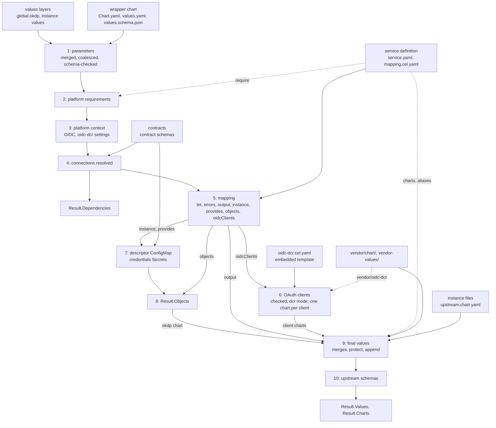

# Architecture

Describe how okdp-compiler works. The formats it reads and writes are
specified in [service definition](specs/02_service_definition.md) and
[inputs and outputs](specs/01_inputs_outputs.md).

## Position in OKDP

An OKDP service is a set of upstream Helm charts deployed together as one
instance, configured from a few parameters, the platform's and projects
settings and the connections to other instances. okdp-compiler is the compile
step: it computes, in Go, the values each upstream chart is then rendered with,
unchanged, by Helm.

One compile is one instance. It reads the service definition
(`LoadDefinition`) and, in `Inputs`, the wrapper chart, the contracts, the
values layers (the platform values, then the instance's), the instance's
upstream values files, and the release and namespace, shared by all the
instance's charts ([Inputs and outputs](specs/01_inputs_outputs.md)).
It returns, in `Result`: `Values`, the final values each upstream chart is
rendered with by `helm template`; `Charts`, the vendored chart that renders
each ([Chart index](specs/01_inputs_outputs.md#chart-index));
`Objects`, OKDP's own objects for the cluster, rendered by the `okdp` chart
when the service declares it; `Dependencies`, for the deployer (Flux
`dependsOn`, Argo CD sync waves); `Computed`, the mapping's output before
the merges, for inspection
([Outputs](specs/01_inputs_outputs.md#outputs)).

Callers: the control plane server embeds the package and compiles from a git
tree; `okdp-compile` (`cmd/okdp-compile`) runs the same code from directories,
in CI or scripts. The library depends on neither Helm nor the Kubernetes client 
libraries: cel-go for expressions, `santhosh-tekuri/jsonschema/v6` for schemas, 
`sigs.k8s.io/yaml` for values, `gopkg.in/yaml.v3` for the mapping, the oidc-dcr
template and `service.yaml`.

## Compile pipeline

`LoadDefinition` (`compiler/compile.go`) decodes `service.yaml` into
`Service` and keeps `mapping.cel.yaml` as bytes: the mapping is parsed by
each compile, so a YAML error in it surfaces at `Compile`.

`Compile` checks its required inputs (`Chart`, `Contracts`, `Release`,
`Namespace`) and the chart aliases of `service.yaml` (each
`charts.<key>.chart` the name of a vendored chart, not a path:
[Aliases](specs/02_service_definition.md#aliases)), then runs:

1. **Parameters** (`buildContext`, `compiler/context.go`). The wrapper's
   `values.yaml` is read as Helm reads it. Each layer of `Inputs.Values` is
   normalized (string keys, `float64` numbers) and merged in order by
   `mergeMaps`, Helm's merge of `-f` files; the result is coalesced over the
   defaults by `coalesceValues`. The coalesced values are checked against
   `values.schema.json` (`schemaViolations`, which skips a missing schema;
   stage 4 does not); every violation is reported at once, under the chart
   name of `Chart.yaml`. Nothing below runs on invalid parameters.
2. **Platform requirements**. Each `require` entry of `service.yaml` is a
   dotted path under `global.okdp` that must be set and not empty.
3. **Platform context**. `platform` is derived from `global.okdp`: OIDC with
   its defaults and client provisioning mode (`existing` or `dcr`, anything
   else fails); the settings of the oidc-dcr Jobs, `global.okdp.oidc.dcr`,
   their defaults applied and their types checked in every mode,
   `registrationUrl` and `authMethod` excepted, left to stage 6
   (`dcrSettings`, `compiler/oidc.go`;
   [OAuth client settings](specs/01_inputs_outputs.md#oauth-client-settings));
   the name of the main OAuth client's Secret (`clientSecret`); the ingress
   annotations, the proxy environment. `global.okdp` is also passed as
   written.
4. **Connections** (`resolver`, `compiler/connections.go`).
   `values.schema.json` is read again as JSON (so it must exist) and walked
   (`walk`) together with a deep copy of the parameters, through
   `properties` and `items`. Each reference is resolved (`resolve`) to an
   external connection or an instance of the namespace, and completed
   against its contract (`complete`)
   ([Connections](specs/01_inputs_outputs.md#connections)).
   Internal references are recorded as `Dependency`, sorted by parameter
   path. `global` and `connections` are then removed from the parameters,
   and the context is assembled: `release`, `values`, `global`, `platform`,
   `chart`, `labels`, `selectorLabels`
   ([Context](specs/02_service_definition.md#context)).
5. **Mapping** (`runCEL`, `compiler/cel.go`). The mapping is parsed into
   ordered maps (`parseDoc`). The `let` bindings are evaluated in order,
   each seeing the previous ones; then every `errors` expression, all
   messages collected, any message failing the compile (`bind`); then
   `output`, `instance`, `provides`, `objects` and `oidcClients`, in that
   order. Each `objects` item must be a whole manifest, with a `kind` and a
   `metadata.name`; `oidcClients` must be a list.
6. **OAuth clients** (`oidcClients`, `clientCharts`, `compiler/oidc.go`).
   The clients are checked in every mode
   ([oidcClients](specs/02_service_definition.md#oidcclients)). In
   `dcr` mode, with at least one client, the platform's registration
   settings are checked, and the embedded template
   `compiler/oidc-dcr.cel.yaml` is evaluated once per client
   (`evalTemplate`) on the context plus `client` and `names`: the values of
   the client's chart. Then, in any mode with a client, `clientCharts`
   checks the reserved chart keys and `vendor/oidc-dcr`; in `dcr` mode it
   adds each client chart to a copy of the charts of `service.yaml`
   (`ChartSpec{Chart: "oidc-dcr"}`: no base values, no instance upstream
   values), and its values to the mapping's output, which `Result.Computed`
   shows ([OAuth client charts](specs/01_inputs_outputs.md#oauth-client-charts)).
7. **Descriptor and credentials Secrets** (`descriptor`,
   `compiler/descriptor.go`). Each `provides` entry is checked and completed
   against its contract; published under the release name, it is compared
   with what the `resolver` computes for an internal reference to this
   instance (`x-okdp-internal`): provider and consumers compute the same
   names. An entry with a `secret` gets its credentials Secret
   (`credentialsSecret`, `compiler/secrets.go`)
   ([Descriptor ConfigMap](specs/01_inputs_outputs.md#descriptor-configmap),
   [Credentials Secrets](specs/01_inputs_outputs.md#credentials-secrets)).
8. **Objects** (`Compile`). `Result.Objects` is the descriptor, the
   credentials Secrets, then the mapping's `objects`. When `service.yaml`
   declares the `okdp` chart (`ObjectsChart`), copies of them are appended to
   `output.okdp.objects`, and the chart is compiled even when the mapping
   leaves it out ([The okdp chart](specs/01_inputs_outputs.md#the-okdp-chart)).
9. **Final values** (`finalValues`, `compiler/merge.go`), for each chart of
   `output`, which must be a chart of `service.yaml` or a client chart; a
   chart the mapping leaves out (`$if`) is not compiled. The vendored chart
   is the key's alias, or the key itself (`ChartSpec.vendored`):
   `vendor/<vendored>/values.yaml` (required, a missing one reported as a
   chart not vendored; its nulls removed), the `base` file and the computed
   values are merged as `-f` files (`layered`). When the chart accepts
   upstream values, the instance's files, then its inline `upstream.<key>`
   values, go through `applyUpstream` one source at a time: the `{{` check,
   `protect`, `append`, then the merge. Last, `global` is set.
   `Result.Charts` records the vendored chart of each compiled key. The
   layers and the rules:
   [Merge precedence](specs/01_inputs_outputs.md#merge-precedence),
   [Upstream values](specs/01_inputs_outputs.md#upstream-values).
10. **Upstream schemas** (`schemaViolations`, `compiler/schema.go`). The
    final values, coalesced over the chart defaults as Helm will coalesce
    them, are checked against `vendor/<vendored>/values.schema.json` when it
    exists. The violations of every chart are reported together, under the
    key, followed by its vendored chart when they differ (`canary
    (vendor/app)`).

Errors: a compile stops at its first error, except where the whole list
helps the author: the `errors` messages, the parameter schema violations,
the violations of all compiled charts. A message says where: the chart, the
parameter path, the upstream file, the mapping path (`output: app: env[2]:
value: ...`), the `let` or `$let` binding, the OAuth client (`oidcClients[1]
(console)`).

## Source map

Files of `compiler/`, by stage, and what each one relies on:

| File | Owns | Relations |
|---|---|---|
| `compile.go` | public types, `LoadDefinition`, `Compile`: the order of the stages, the chart alias check, the `okdp` chart rule, `Result.Charts` | calls `buildContext`, `runCEL`, `oidcClients`, `clientCharts`, `descriptor`, `finalValues`, `schemaError` |
| `context.go` | stages 1 to 4: parameters, requirements, platform context, the context | `values.go`, `schema.go`, `connections.go`, `labels.go`; `oidc.go` for the oidc-dcr settings and the main client's Secret |
| `connections.go` | connection references, `complete`, `Dependency` | used by `context.go` with the instance's `connections`, recording dependencies; by `descriptor.go` without them, to compute the convention a provider must match |
| `cel.go` | stage 5: the mapping read as ordered YAML 1.1 data, directives, sections, CEL environments; `evalTemplate`, the same engine for the compiler's own templates | registers `str`, `first` and the functions of `functions.go`, `labels.go`, `secrets.go`, `oidc.go`; keeps the context for the functions that need it |
| `functions.go` | `sha256`, `toJson`, `toPrettyJson`, `toYaml`, `quote`, `okdpFullname` | `fullname` also names the client charts' objects (`oidc.go`) |
| `labels.go` | `okdp.labels`, `okdp.selectorLabels` | the context (`chart`, `labels`, `selectorLabels`), the CEL functions, every object the compiler writes |
| `secrets.go` | `okdpGeneratedSecret`, credentials Secrets | `generatedSecret` serves both the CEL function and `descriptor.go` |
| `oidc.go` | stage 6: the `oidcClients` checks, the modes, the names of the client charts, objects and Secrets (`clientSecret`, `oidcClientSecret`), the client charts (`clientCharts`); the oidc-dcr settings (`dcrSettings`, stage 3) | evaluates `oidc-dcr.cel.yaml` with `evalTemplate` (`cel.go`); `fullname` (`functions.go`); used by `context.go` and `compile.go` |
| `oidc-dcr.cel.yaml` | the values of a client chart: a template in the mapping language, embedded (`//go:embed`, `dcrTemplate`) | reads the context, with `platform.oidc.dcr` built by `context.go`, and the `client` and `names` given by `oidc.go` |
| `descriptor.go` | stage 7 | `connections.go`, `secrets.go`, `labels.go` |
| `merge.go` | stage 9, `protect` and `append`; `vendor/<alias>` for an aliased chart | `values.go`, `schema.go` |
| `schema.go` | JSON Schema validation, reported as Helm reports it | stages 1 and 10 |
| `values.go` | the data model; Helm's reading (`ParseValues`), merging and coalescing of values | every stage |

Layers: `values.go` and `schema.go` reproduce Helm and know nothing of
OKDP; `functions.go`, `labels.go` and `secrets.go` reproduce Helm, sprig
and okdp-lib-chart functions; `connections.go`, `context.go`,
`descriptor.go`, `oidc.go` and `merge.go` implement OKDP's rules,
`oidc-dcr.cel.yaml` the values of the oidc-dcr chart; `compile.go` orders
them. Each rule is computed in one place and reused: the labels of the
context, of `okdpLabels` and of the descriptor; one generated Secret for the
CEL function and for `provides[].secret`; one resolver for consumers and for
the provider check; one OAuth client Secret name (`clientSecret`) for
`platform.oidcClientSecret`, `oidcClientSecret` and the oidc-dcr Job; one
engine for the mappings and the oidc-dcr template.
`cmd/okdp-compile/main.go` is a thin caller: `os.DirFS`, `ParseValues`,
`LoadDefinition`, `Compile`, then output files, the chart index
(`Result.Charts`) included: `okdp.charts.yaml` with
[`--emit-dir`](01_usage.md#--emit-dir), `charts` with [`--out`](01_usage.md#--out).

## Design decisions

### Helm fidelity

What Helm computes from the same values files, the compiler computes the
same way, and the fixtures check it against the helm binary
([Testing](#testing)). A values difference is silent: read as YAML
1.2, an upstream default `enabled: no` is the string `"no"`, which a
template's `if` takes as true.

- Reading: values files as Helm 4's loader reads them (`loadValues`,
  `sigs.k8s.io/yaml`, YAML 1.1), `Chart.yaml` into strings
  ([Values files](specs/01_inputs_outputs.md#values-files),
  [Chart.yaml](specs/01_inputs_outputs.md#chartyaml)).
- Merging: `mergeMaps` is Helm's `MergeMaps`, `coalesceValues` Helm 4's
  `CoalesceValues`
  ([Layers and nulls](specs/01_inputs_outputs.md#layers-and-nulls)).
- Final values: written so that Helm 3 or 4, coalescing them over the chart
  defaults, sees what it would see with the base, computed and upstream
  values as `-f` files
  ([Equivalence with Helm](specs/01_inputs_outputs.md#equivalence-with-helm)).
- Schemas: validated as Helm 4.3 validates them (`santhosh-tekuri/jsonschema`
  v6), on the coalesced values the templates see, reported in Helm's words,
  sorted by path since Helm's order varies between runs
  ([Schema check](specs/01_inputs_outputs.md#schema-check)).
- Functions: a host function that reproduces a Helm, sprig or okdp-lib-chart
  function is that function's Go code. Where Helm prints `""` for a value it
  cannot encode, the compile fails instead.
- Reproduced, not imported: the helm module pulls in client-go and requires
  newer Go and Kubernetes versions than the control plane server that embeds
  this package. `coalesceValues`, `coalesceTables`, `cleanNil`, `mergeMaps`
  and `loadValues` follow helm v4.3.0; the fixtures guard the copy.

### One data model

Values are `M` (`map[string]any`): string keys, `float64` numbers, `[]any`
lists, which is what Helm values are after their JSON round trip. In-memory
layers are normalized to it (`normalize`), CEL results are converted back to
it (`native`, through `structpb`), so a value computed by CEL and the same
value read from a file are equal. Stages work on deep copies: the caller's
inputs are never modified, and the mapping sees a copy of the parameters
while the merges use them as written.

### The mapping file

- Parsed with yaml.v3 nodes, not `sigs.k8s.io/yaml`: key order matters.
  `let` and `$let` bind in order, each binding seeing the previous ones, and
  map keys are evaluated in order, so the error reported is stable.
  `sigs.k8s.io/yaml` goes through JSON and loses the order.
- Scalars and keys decoded as YAML 1.1 (`scalar`, `mapKey`), not as yaml.v3's
  YAML 1.2: a snippet copied from an upstream `values.yaml` means the same in
  the mapping. Binding names are the exception, kept as written, so a
  binding `n` is `n`, not `"false"`
  ([YAML reading](specs/02_service_definition.md#yaml-reading)).
- Expressions are CEL: no I/O, every variable dynamically typed. An
  environment is built per set of variable names in scope, and cached for
  the compile.
- `service.yaml` is not a values file: yaml.v3 decodes it into Go types as
  YAML 1.2 ([service.yaml](specs/02_service_definition.md#serviceyaml)).

### The oidc-dcr template

The values of an OAuth client's chart
([OAuth client charts](specs/01_inputs_outputs.md#oauth-client-charts))
are computed by `compiler/oidc-dcr.cel.yaml`, a template in the mapping
language embedded in the compiler (`//go:embed`), not by Go code:

- They are values of the oidc-dcr chart: YAML shaped like its
  `values.yaml`, read side by side with it. When the chart changes (a new
  value, a renamed key), the change is to data, reviewed as such, not to
  code.
- One engine: `evalTemplate` shares `parseDoc` and `bind` with `runCEL`, so
  the template is read as a mapping is (YAML 1.1, ordered `let`, `errors`),
  with the same directives, functions and error paths. A field left out
  (`$if`) or a registration field the client's `request` overrides
  (`$merge`) needs no Go of its own.
- Embedded, not in the package: the template is versioned with the Go code
  that checks the clients and computes the names it reads. Every service
  registers its clients the same way: a package declares its clients (the
  client keys), not the chart's values. No file is read for it, so the
  compile stays hermetic
  ([Everything through fs.FS](#everything-through-fsfs)).

What stays Go (`compiler/oidc.go`) is what a per-client template cannot
express, or what more than one reader needs:

- the checks ([oidcClients](specs/02_service_definition.md#oidcclients)),
  of each client and across clients, with errors naming the client;
- the mode (no chart in `existing` mode) and the platform's settings: their
  defaults and types (`dcrSettings`), and what `dcr` mode requires of them;
- the names: the chart key, the objects' full name (cut to 63 characters,
  as `okdpFullname`), the Secret. The Secret name is also what
  `oidcClientSecret` and `platform.oidcClientSecret` return, so the
  mapping that reads the Secret and the Job that writes it agree (a client
  that sets its own `secret` names it in the mapping too). The template
  receives them as `names`;
- the charts (`clientCharts`): the reserved keys, `vendor/oidc-dcr`
  present, the chart entries added to a copy of the charts of
  `service.yaml`.

### Values for unmodified upstream charts

The compiler stops at values:

- each upstream chart stays a standard chart, vendored as published and
  rendered by Helm itself: hooks, `.Files`, `.Capabilities`, subcharts and
  the chart's schema behave as upstream intends;
- the result is data: checked against the upstream schema at compile time,
  diffed in a pull request, compared with a previous render;
- no Helm template code runs in the compiler, and none can come in through
  instance values (`{{` is refused).

The cost: what an upstream chart has no value for cannot be changed
([Limitations](#limitations)). OKDP's own objects take the same path: they
are the `objects` values of the `okdp` chart (okdp-objects), which writes
each item as a manifest. So do the OAuth clients: each is a chart compiled
from the vendored oidc-dcr chart, whose Job registers it.

### Stateless, hermetic, concurrent

- `Compile` keeps no state between calls: each call parses the mapping, and
  the oidc-dcr template once per client, and builds its own CEL engines.
  The package-level variables are read-only: tables, a regular expression,
  the embedded template. A `Definition` can be shared between goroutines,
  and is not changed: the client charts are added to a copy of its charts.
  Caching across compiles, if any, is the caller's.
- No clock, random number, environment variable, network, or file outside
  the given filesystems: the same inputs give the same result. GitOps tools
  render on every sync (Argo CD with `helm template`), and a value that
  changes per render never converges. Random credentials are therefore
  generated in the cluster by External Secrets `Password` generators
  (`okdpGeneratedSecret`), never at compile time.
- Where an order shows, it is sorted: dependencies by parameter path, schema
  violations by path and by chart. `example/compiled` relies on
  byte-identical results.

### Everything through fs.FS

The compiler opens no path itself: the wrapper chart, the instance files
and the contracts are `fs.FS`, the values layers are in-memory maps, the
oidc-dcr template is in the binary.

- The control plane server compiles from a git tree or an `embed.FS`, tests
  from `fstest.MapFS`, the CLI from `os.DirFS`; the contracts from any of
  them, an `embed.FS` of the contract schemas included.
- The paths written in `service.yaml` (`base`, `upstream`) are cleaned and
  opened inside their filesystem, and an `fs.FS` path cannot contain `..`:
  a definition cannot read outside the chart or the instance files. A chart
  alias (`charts.<key>.chart`) must be a plain name, so `vendor/<chart>`
  stays under `vendor/`. The CLI uses `os.DirFS`, which still follows
  symbolic links.
- A schema `$ref` to a file or a URL fails the compile instead of being
  fetched (`schemaLoader`); a `urn:` reference accepts anything, as in Helm.

### Security boundaries

The service definition, the wrapper chart with its vendored charts, and the
contracts are reviewed with the package. The values layers and the instance
files are input, from a console user or a GitOps pull request. The compiler
enforces:

| Boundary | Where | Reason |
|---|---|---|
| Parameters valid before use | stage 1, before the requirements and the mapping | the schema is the one place for a parameter rule (a pattern guarding a value a Job pastes into a script); the mapping never sees a value it refuses |
| Credentials never inlined | `resolve` | an external connection carries contract fields only, never an `x-okdp-secret` field: credentials are referenced by Secret name (`secretRef`), since values and descriptors are not secret |
| Contracts | `resolve`, `descriptor` | a reference to a connection of another contract fails; a provided output is a valid instance of its contract, without secret fields |
| Provider and consumers agree | `descriptor` | an output under the release name equals what internal references resolve to |
| Protected upstream paths | `applyUpstream` | `protect` paths, and always `global`, cannot be set by an instance, nor replaced by setting a parent to a non-map |
| No templates in upstream values | `applyUpstream` | some upstream charts pass values to `tpl`, where template code could call `lookup` and read the cluster's Secrets |
| Upstream schemas | stage 10 | an upstream chart's rules fail the compile, not the deployment |
| Declared charts only | `Compile`, `clientCharts` | the mapping cannot output a chart that `service.yaml` does not declare, nor replace a client chart with one of its own: the key of a declared client's chart is the compiler's |
| OAuth client charts | `clientCharts` | no base values, no instance upstream values: the Job that registers a client and writes its Secret is computed by the compiler, from the client keys, the release and the platform's settings, so an instance cannot change where a client is registered or which Secret receives its credentials |

Not decided by the compiler: the values layers are not told apart, so a
later layer can change `global.okdp` like any parameter
([Platform values](specs/01_inputs_outputs.md#platform-values)).
Which layers a user writes, and whether `global` is open to them, is the
caller's decision, or the parameter schema's.

## Testing

`go test ./...` runs everything offline: the Helm outputs are committed
fixtures, helm is needed only to regenerate them.

### Helm fixtures

`testdata/helm` holds what `helm template` computes on the same
inputs, written by `generate.sh` with Helm 4 on the `PATH` and an
okdp-lib-chart checkout (`OKDP_LIB_CHART`), whose templates are what the
compiler reproduces. Each case renders a small chart carrying the
library's templates, and stores its output or its error; `helm_test.go`
compares:

| Fixture | Helm's side | Test |
|---|---|---|
| `values/<case>/` | `.Values` with the `layer-*.yaml` files (`helm.json`), and with the compiler's `final.yaml` (`helm-final.json`) | `TestHelmValues`: coalescing as Helm, and final values that Helm renders back to the same `.Values` |
| `schema/<case>/` | Helm's error report, or `ok` (`helm.txt`) | `TestHelmSchema` |
| `functions/` | `sha256sum`, `toJson`, `toPrettyJson`, `toYaml`, `quote`, `okdp.fullname` | `TestHelmFunctions` |
| `labels/<case>/` | `.Chart`, `okdp.labels`, `okdp.selectorLabels` | `TestHelmLabels` |
| `secrets/generated/` | the objects of `okdp.generatedSecret`, or its error | `TestHelmGeneratedSecret` |
| `secrets/descriptor/` | `okdp.descriptor` of outputs with a `secret` | `TestHelmDescriptorSecrets` |

To regenerate: `go test ./compiler -run TestHelmValues -update` (writes each
`final.yaml`), then `OKDP_LIB_CHART=../okdp-lib-chart
testdata/helm/generate.sh` (it also needs python3 with PyYAML). A
behaviour copied from Helm or okdp-lib-chart gets a case here, and only
what no other case covers: a fixture is Helm's whole output, labels and
all.

### Unit tests

Most source files have their `_test.go`, in memory (`fstest.MapFS`, as the
control plane server passes its inputs); the host functions, labels,
schemas and generated Secrets are tested against Helm, in `helm_test.go`.
`compile_test.go` runs the whole pipeline on a minimal chart: schemas,
upstream files, `protect` and `append`, objects and the `okdp` chart,
dependencies, chart aliases (`TestChartAlias`). `oidc_test.go` covers the
OAuth clients: the values the oidc-dcr template computes (the defaults
compared whole; the names, client keys, platform settings), the modes and
`oidcClientSecret`, the errors of the section and of the platform, and the
client charts in a whole compile (`TestDcrCompile`); `context_test.go` the
oidc-dcr settings and their defaults. The template has no Helm fixture: its
expected values are in `oidc_test.go` and `example/compiled/dcr.yaml`.
`cmd/okdp-compile/main_test.go` checks the files `--emit-dir` writes, the
chart index included.

### Example

`example/` is a complete service, `webapp`: `service.yaml` and
`mapping.cel.yaml` (the service definition, an OAuth client included),
`webapp/` (its wrapper chart, with the vendored charts' `values.yaml` only,
the okdp and oidc-dcr charts included), `contracts/`,
`platform-values.yaml`, `values/` (the instances; `dcr.yaml` sets the
platform to `dcr` mode, so its compile adds the `oidc-dcr` chart) and
`compiled/` (their compiled output). `TestExample` (`example_test.go`)
compiles each `example/values/<case>.yaml` over
`example/platform-values.yaml`, and compares the final values, the chart
index (`charts`), the objects and the dependencies byte for byte with
`example/compiled/<case>.yaml`. After a change, `go test ./compiler
-update` rewrites them (and each `final.yaml` of the values fixtures); the
diff is the change's effect, reviewed as such.

### Failure cases

`testdata/<case>.yaml` at the repository root: instance values that must
fail on the example. The first line is `# error: <message>` (`\n` for a line
break), and `TestExampleErrors` applies the file over the platform values
and expects an error containing the message. They cover the connection
checks (wrong contract, unknown field, secret field), the example's
`errors` rules (no `secretRef`, replicas without a database), a protected
upstream path, a missing platform value, a parameter schema violation, and
the OAuth client in `dcr` mode without a registration URL
(`dcr-without-registration-url.yaml`).

## Limitations

- **The mapping does not see the instance's upstream files.** They are read
  at stage 9, after the mapping; the mapping sees only the inline
  `values.upstream`. `protect`, `append` and the `{{` check cover both, but
  an `errors` rule on upstream values covers the inline ones only. A
  service that needs such a rule accepts inline values only (`upstream:
  []`).
- **`protect` and `append` paths are dotted map keys**: no list index, no
  key containing a dot (annotation names, Spark properties), no pattern.
- **Upstream templates cannot be changed.** Nothing patches or rewrites a
  rendered chart: what a chart has no value for (a label on one object, a
  hard-coded Secret reference, a Job field) stays as upstream wrote it.
- **Subcharts of a vendored chart** are left to Helm: the final values and
  the schema check use the chart's own `values.yaml` and
  `values.schema.json`; the defaults and schemas of its subcharts apply only
  when Helm renders it.
- **Schema references** resolve within the schema only (and `urn:`):
  [Everything through fs.FS](#everything-through-fsfs).
- **Connection references** are found through `properties` and `items` of
  the parameter schema only
  ([Declaring a reference](specs/01_inputs_outputs.md#declaring-a-reference)):
  one under any other keyword is not resolved, and reaches the mapping as a
  string.
- **Dependencies are reported, not checked.** Whether the referenced
  instance exists and provides the contract is outside one compile; so is
  any check across instances.
- **Expressions are checked when evaluated.** Variables are dynamic, so an
  expression is compiled only when evaluated
  ([Expressions](specs/02_service_definition.md#lone-expressions-and-interpolation)):
  a mistake in a branch passes until an instance takes it. Test cases need
  to cover each branch.
- **OAuth clients are registered anonymously only.** In `dcr` mode, a
  mapping that declares a client needs `global.okdp.oidc.dcr.authMethod:
  anonymous`
  ([OAuth client settings](specs/01_inputs_outputs.md#oauth-client-settings)).
- **A client chart's values are the template's.** A package sets the client
  keys, the platform the Job settings; a client chart takes no base values
  and no instance upstream values. The template writes the values of
  oidc-dcr >= 0.5.0 (camelCase); the version of `vendor/oidc-dcr` is not
  checked (its `values.schema.json` is applied, when it has one).

## Extension points

- **Host functions.** Plain Go, deterministic and hermetic. A function of
  its arguments and the release goes in `hostFunctions`
  (`compiler/functions.go`); one that needs the compile context is
  registered in `celEngine.env` with `e.ctx`, as `okdpGeneratedSecret` and
  `oidcClientSecret` (`oidcFunctions`, `compiler/oidc.go`) are. Names
  mappings bind themselves are avoided (`okdpFullname`, since mappings bind
  `fullname`). A function reproducing a Helm, sprig or okdp-lib-chart one
  gets a `generate.sh` case and a `TestHelm*` comparison; every function
  gets an entry in [Functions](specs/02_service_definition.md#functions).
- **Platform context.** A value derived from `global.okdp` is added in
  `buildContext` (stage 3), and to
  [Context](specs/02_service_definition.md#context). A new setting of
  the oidc-dcr Jobs is a key of `global.okdp.oidc.dcr`, typed and defaulted
  in `dcrSettings`, read by the template as `platform.oidc.dcr`, and a row
  of [OAuth client settings](specs/01_inputs_outputs.md#oauth-client-settings).
- **The oidc-dcr values.** A value of the oidc-dcr chart (a new one, a key
  a new version renames) is set in `compiler/oidc-dcr.cel.yaml`, with its
  expectations in `oidc_test.go` and `example/compiled/dcr.yaml`, not in Go
  ([The oidc-dcr template](#the-oidc-dcr-template)). A new client key also
  goes in `clientKeys` and `checkClient` (`compiler/oidc.go`), and in
  [oidcClients](specs/02_service_definition.md#oidcclients).
- **Contracts** are data: a new contract, or new `x-okdp-internal`,
  `x-okdp-secret`, `x-okdp-derived` or default fields, needs no compiler
  change ([Contracts](specs/01_inputs_outputs.md#contracts)).
- **OKDP objects.** What the mapping writes in `objects` reaches the cluster
  through the `okdp` chart: a new kind of object needs no compiler change.
- **Callers.** Anything that provides `fs.FS` inputs and values maps; the
  CLI is one such caller.
