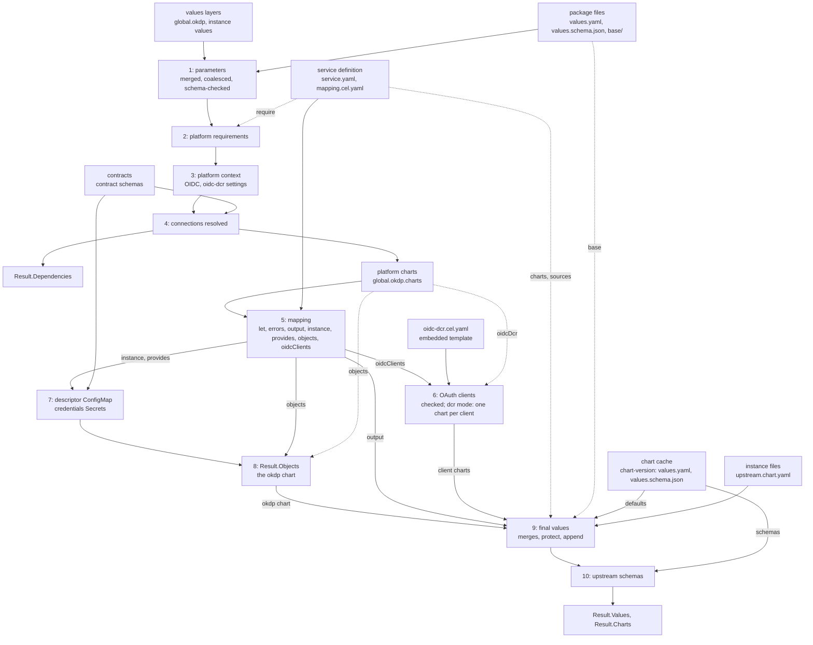

# Architecture

Describe how okdp-compiler works. The formats it reads and writes are
specified in [service definition](specs/02_service_definition.md) and
[inputs and outputs](specs/01_inputs_outputs.md).

## Position in OKDP

An OKDP service is a set of upstream Helm charts deployed together as one
instance, configured from a few parameters, the platform's and projects
settings and the connections to other instances. okdp-compiler is the compile
step: it computes, in Go, the values each upstream chart is then rendered with,
unchanged, by Helm, from the chart's own repository. A service is a package,
a directory in git, not a chart: OKDP publishes no chart of the service.

One compile is one instance. It reads the package (`fsio.LoadDefinition`:
`service.yaml`, `mapping.cel.yaml`, the parameters and the base values) and,
in `Inputs`, the chart cache (the upstream charts' defaults and schemas),
the contracts, the values layers (the platform values, then the
instance's), the instance's upstream values files, and the release and
namespace, shared by all the instance's charts
([Inputs and outputs](specs/01_inputs_outputs.md)).
It returns, in `Result`: `Values`, the final values each upstream chart is
rendered with by `helm template`; `Charts`, the upstream chart that renders
each, by repository, name and version
([Chart index](specs/01_inputs_outputs.md#chart-index));
`Objects`, OKDP's own objects for the cluster, rendered by the `okdp` chart
the compiler adds; `Dependencies`, for the deployer (Flux
`dependsOn`, Argo CD sync waves); `Computed`, the mapping's output before
the merges, for inspection
([Outputs](specs/01_inputs_outputs.md#outputs)).

Callers: the control plane server embeds the Go package at the module's root
(`compiler`) and compiles from a git tree; `okdp-compile`
(`cmd/okdp-compile`) runs the same code from directories, in CI or scripts.
The library depends on neither Helm nor the Kubernetes client libraries:
cel-go for expressions, `santhosh-tekuri/jsonschema/v6` for schemas,
`sigs.k8s.io/yaml` for values, `gopkg.in/yaml.v3` for the mapping, the
oidc-dcr template and `service.yaml`.

## Compile pipeline

`fsio.LoadDefinition` (`internal/fsio/load.go`) decodes `service.yaml` into
`okdp.Service`, checks it (`Service.Check`, `internal/okdp/service.go`), keeps
`mapping.cel.yaml` as bytes and the package's filesystem as
`Definition.Files`: the mapping is parsed by each compile, so a YAML error
in it surfaces at `Compile`, and the other files of the package are read by
each compile.

`okdp.Compile` (`internal/okdp/pipeline.go`) checks its required inputs
(`Definition.Files`, `Charts`, `Contracts`, `Release`, `Namespace`) and
`service.yaml` again, for a `Definition` built in memory: a `name` and a
`version`, no chart `okdp`, each chart's `source` a repository URL, a chart
name and a pinned version (`chart.Ref.Check`, `internal/chart/ref.go`;
[Sources](specs/02_service_definition.md#sources)), the `upstream.from`
entries and the `protect` and `append` paths (`chart.Specs.Check`,
`internal/chart/spec.go`). Then it runs:

1. **Parameters** (`chart.Parameters`, `internal/chart/parameters.go`, called by
   `buildContext`, `internal/okdp/context.go`). The package's
   `values.yaml` is read as Helm reads it. Each layer of `Inputs.Values` is
   normalized (string keys, `float64` numbers) and merged in order by
   `value.Merge`, Helm's merge of `-f` files; the result is coalesced over the
   defaults by `coalesceValues`. The coalesced values are checked against
   `values.schema.json` (`schemaViolations`, which skips a missing schema;
   stage 4 does not); every violation is reported at once, under the
   `name` of `service.yaml`. Nothing below runs on invalid parameters.
2. **Platform requirements**. Each `require` entry of `service.yaml` is a
   dotted path under `global.okdp` that must be set and not empty.
3. **Platform context**. `platform` is derived from `global.okdp`: OIDC with
   its defaults and client provisioning mode (`existing` or `dcr`, anything
   else fails); the settings of the oidc-dcr Jobs, `global.okdp.oidc.dcr`,
   their defaults applied and their types checked in every mode,
   `registrationUrl` and `authMethod` excepted, left to stage 6
   (`dcrSettings`, `internal/okdp/oidc.go`;
   [OAuth client settings](specs/01_inputs_outputs.md#oauth-client-settings));
   the name of the main OAuth client's Secret (`clientSecret`); the ingress
   annotations, the proxy environment. `global.okdp` is also passed as
   written.
4. **Connections** (`resolver`, `internal/okdp/connections.go`).
   `values.schema.json` is read again as JSON (so it must exist) and walked
   (`walk`) together with a deep copy of the parameters, through
   `properties` and `items`. Each reference is resolved (`resolve`) to an
   external connection or an instance of the namespace, and completed
   against its contract (`complete`)
   ([Connections](specs/01_inputs_outputs.md#connections)). Internal
   references are recorded as `Dependency`, sorted by parameter path.
   `global` and `connections` are then removed from the parameters, and the
   context is assembled: `release`, `values`, `global`, `platform`,
   `service`, `labels`, `selectorLabels`
   ([Context](specs/02_service_definition.md#context)). `Compile` then reads
   the platform's charts, `global.okdp.charts` (`platformCharts`,
   `internal/okdp/objects.go`): `objects`, required, the chart of the `okdp`
   chart, and `oidcDcr`, the chart of the OAuth clients, `DcrSource`
   (oidc-dcr 0.5.0) by default; each checked as a source is ([Platform
   charts](specs/01_inputs_outputs.md#platform-charts)).
5. **Mapping** (`runMapping`, `internal/okdp/mapping.go`, on `compile.Load`,
   `internal/compile/cel.go`). The mapping is parsed into ordered maps
   (`parseDoc`), with OKDP's host functions (`functions`) beside the
   language's. The `let` bindings are evaluated in order, each seeing the
   previous ones; then every `errors` expression, all messages collected,
   any message failing the compile (`bind`); then the sections
   (`Doc.Section`): `output`, `instance`, `provides`, `objects` and
   `oidcClients`, in that order. Each `objects` item must be a whole
   manifest, with a `kind` and a `metadata.name`; `oidcClients` must be a
   list.
6. **OAuth clients** (`oidcClients`, `clientCharts`, `internal/okdp/oidc.go`).
   The clients are checked in every mode
   ([oidcClients](specs/02_service_definition.md#oidcclients)). In
   `dcr` mode, with at least one client, the platform's registration
   settings are checked, and the embedded template
   `internal/okdp/oidc-dcr.cel.yaml` is evaluated once per client
   (`compile.EvalTemplate`) on the context plus `client` and `names`: the
   values of the client's chart. Then, in any mode with a client, `clientCharts`
   checks the reserved chart keys; in `dcr` mode it adds each client chart
   to a copy of the charts of `service.yaml` (`chart.Spec{Source: <oidcDcr>}`:
   no base values, no instance upstream values), and its values to the
   mapping's output, which `Result.Computed` shows
   ([OAuth client charts](specs/01_inputs_outputs.md#oauth-client-charts)).
7. **Descriptor and credentials Secrets** (`descriptor`,
   `internal/okdp/descriptor.go`). Each `provides` entry is checked and
   completed against its contract; published under the release name, it is
   compared with what the `resolver` computes for an internal reference to
   this instance (`x-okdp-internal`): provider and consumers compute the
   same names. An entry with a `secret` gets its credentials Secret
   (`credentialsSecret`, `internal/okdp/secrets.go`) ([Descriptor
   ConfigMap](specs/01_inputs_outputs.md#descriptor-configmap), [Credentials
   Secrets](specs/01_inputs_outputs.md#credentials-secrets)).
8. **Objects** (`Compile`, `objectsChart`, `internal/okdp/objects.go`).
   `Result.Objects` is the descriptor, the credentials Secrets, then the
   mapping's `objects`.
   `objectsChart` adds the `okdp` chart (`ObjectsChart`) to the copy of the
   charts, rendered by the platform's objects chart, and copies of the
   objects to the mapping's output as its values, `{objects: [...]}`; the
   mapping's own `output` may not list `okdp`
   ([The okdp chart](specs/01_inputs_outputs.md#the-okdp-chart)).
9. **Final values** (`chart.FinalValues`, `internal/chart/merge.go`), for
   each chart of `output`, which must be a chart of `service.yaml`, a client
   chart or `okdp`; a chart the mapping leaves out (`$if`) is not compiled.
   The upstream chart is the key's `source`: the chart cache
   (`chartCache.get`, `internal/chart/cache.go`) reads it once per compile,
   from `<chart>-<version>/`, else from `<chart>-<version>.tgz` (its own
   `values.yaml` and `values.schema.json`, not its subcharts'); a chart it
   does not hold fails with the `helm pull` command that fetches it. The
   chart's `values.yaml` (its nulls removed), the `base` file and the
   computed values are merged as `-f` files (`layered`). When the chart
   accepts upstream values, the instance's files, then its inline
   `upstream.<key>` values, go through `applyUpstream` one source at a time:
   the `{{` check, `protect`, `append`, then the merge. Last, `global` is
   set. `Result.Charts` records the source of each compiled key. The layers
   and the rules: [Merge
   precedence](specs/01_inputs_outputs.md#merge-precedence), [Upstream
   values](specs/01_inputs_outputs.md#upstream-values).
10. **Upstream schemas** (`checkSchema`, `internal/chart/schema.go`). The final
    values, coalesced over the chart defaults as Helm will coalesce them,
    are checked against the chart's `values.schema.json` when it has one.
    The violations of every chart are reported together, under the key and
    its upstream chart (`app (app-1.8.0)`).

Errors: a compile stops at its first error, except where the whole list
helps the author: the `errors` messages, the parameter schema violations,
the violations of all compiled charts. A message says where: the chart, the
parameter path, the upstream file, the mapping path (`output: app: env[2]:
value: ...`), the `let` or `$let` binding, the OAuth client (`oidcClients[1]
(console)`).

## Source map

The module's root is the public package, `compiler`: it gives callers the
types they name, as aliases, and wraps the functions of five packages under
`internal/`, each importing only those below it: `cmd/okdp-compile` ->
`compiler` -> `fsio` -> `okdp` -> `compile` and `chart` -> `value`.
`compile` and `chart` do not import each other: the mapping language knows
nothing of Helm charts, the Helm code nothing of the mapping language, and
neither knows OKDP.

| Package | File | Owns | Relations |
|---|---|---|---|
| `compiler` | `compiler.go` | the public API: `LoadDefinition`, `ParseValues`, `Compile`, `Files`, `Umbrella`, `Document`; aliases of the types a caller names (`Definition`, `Inputs`, `Result`, `ChartRef`...) | wraps `fsio`, `chart`, `okdp` |
| `value` | `value.go` | the data model (`M`) and its helpers: `Normalize`, `Copy`, `AsMap`, `AsList`, `Merge` (Helm's `MergeMaps`), `Truthy`, `Str`, `Dig`, `Short` | every package |
| `compile` | `cel.go` | the mapping language: documents read as ordered YAML 1.1 data, directives, `let` and `errors` (`Load`), sections (`Doc.Section`), CEL environments; `EvalTemplate`, `Eval`; `Native`, a CEL value as data | registers `str`, `first`, the functions of `functions.go`, then the caller's |
| | `functions.go` | `sha256`, `toJson`, `toPrettyJson`, `toYaml`, `quote`; `Text`, a CEL value as text, for host functions | |
| `chart` | `values.go` | Helm's reading (`ParseValues`) and coalescing of values | stages 1, 9 and 10 |
| | `schema.go` | JSON Schema validation, reported as Helm reports it | stages 1 and 10 |
| | `ref.go` | `Ref`, an upstream chart, and its check | the sources of `spec.go`, the platform's charts (`internal/okdp/objects.go`) |
| | `cache.go` | the chart cache (`chartCache`: `<chart>-<version>/` or `.tgz`, `readArchive`) | `merge.go` |
| | `spec.go` | the `charts` section of `service.yaml`: `Spec`, `Upstream`, `Specs.Check` | `paths.go`, `ref.go`; checked by `okdp.Service.Check` |
| | `paths.go` | the grammar of the `protect` and `append` paths | `spec.go`, `merge.go` |
| | `parameters.go` | stage 1: `Parameters` | `values.go`, `schema.go` |
| | `merge.go` | the instance's upstream values (`ReadUpstream`, `Upstreams.Show`), stage 9 (`FinalValues`), `protect` and `append` | `cache.go`, `values.go`, `schema.go`, `paths.go` |
| `okdp` | `service.go` | `Definition`, `Service` (`service.yaml`) and its check (`Service.Check`) | `chart.Specs.Check`; read by `fsio.LoadDefinition` |
| | `pipeline.go` | `Inputs`, `Result`, `Compile`: the order of the stages | calls `buildContext`, `platformCharts`, `runMapping`, `oidcClients`, `clientCharts`, `descriptor`, `objectsChart`, `chart.FinalValues` |
| | `context.go` | stages 1 to 4: parameters (`chart.Parameters`), requirements, platform context, the context | `connections.go`, `labels.go`; `oidc.go` for the oidc-dcr settings and the main client's Secret; `chart.ReadUpstream` |
| | `connections.go` | connection references, `complete`, `Dependency`, `readJSON` | used by `context.go` with the instance's `connections`, recording dependencies; by `descriptor.go` without them, to compute the convention a provider must match |
| | `mapping.go` | stage 5: OKDP's sections (`runMapping`), OKDP's host functions (`functions`: `okdpFullname`, `okdpGeneratedSecret`, and those of `labels.go` and `oidc.go`) | `compile.Load`; `fullname` also names the client charts' objects (`oidc.go`) |
| | `labels.go` | the labels of OKDP's own objects, from the package's `name` and `appVersion` (`serviceMeta`) | the context (`service`, `labels`, `selectorLabels`), the CEL functions, every object the compiler writes |
| | `secrets.go` | `okdpGeneratedSecret`, credentials Secrets | `generatedSecret` serves both the CEL function and `descriptor.go` |
| | `oidc.go` | stage 6: the `oidcClients` checks, the modes, the names of the client charts, objects and Secrets (`clientSecret`, `oidcClientSecret`), the client charts (`clientCharts`), `DcrSource`; the oidc-dcr settings (`dcrSettings`, stage 3) | evaluates `oidc-dcr.cel.yaml` with `compile.EvalTemplate` and `functions`; used by `context.go` and `pipeline.go` |
| | `oidc-dcr.cel.yaml` | the values of a client chart: a template in the mapping language, embedded (`//go:embed`, `dcrTemplate`) | reads the context, with `platform.oidc.dcr` built by `context.go`, and the `client` and `names` given by `oidc.go` |
| | `descriptor.go` | stage 7 | `connections.go`, `secrets.go`, `labels.go` |
| | `objects.go` | stage 8: the `okdp` chart (`ObjectsChart`, `objectsChart`); the platform's charts (`platformCharts`) | `chart.Ref`; `DcrSource` (`oidc.go`) |
| `fsio` | `load.go` | `LoadDefinition`: `service.yaml`, checked, and `mapping.cel.yaml` | `okdp.Service.Check` |
| | `output.go` | what a compile is written as: `Document` (`--out`), `Files` (`--emit-dir`, file name -> content) | `okdp.Result` |
| | `umbrella.go` | the instance as one chart: `Umbrella` (`--umbrella`), `Chart.yaml` over the upstream charts of the index and `instance.values.yaml` | `okdp.Result`, the service's name and versions; `chart.IsVersion` |

Layers: `value`, `internal/chart/values.go` and `internal/chart/schema.go`
reproduce Helm and know nothing of OKDP; `internal/compile/functions.go` and
`internal/okdp/secrets.go` reproduce Helm, sprig and okdp-lib-chart
functions; `internal/chart/cache.go` reads the chart cache;
`internal/chart/merge.go` applies the rules of `service.yaml`'s charts;
`okdp` implements OKDP's rules, `oidc-dcr.cel.yaml` the values of the
oidc-dcr chart, and `internal/okdp/pipeline.go` orders the stages. Each rule
is computed in one place and reused: the labels of the context, of
`okdpLabels` and of the descriptor; one generated Secret for the CEL
function and for `provides[].secret`; one resolver for consumers and for the
provider check; one OAuth client Secret name (`clientSecret`) for
`platform.oidcClientSecret`, `oidcClientSecret` and the oidc-dcr Job; one
engine for the mappings and the oidc-dcr template.
`cmd/okdp-compile/main.go` is a thin caller of the public package:
`os.DirFS`, `compiler.ParseValues`, `compiler.LoadDefinition`,
`compiler.Compile`, then the files of `compiler.Document` and
`compiler.Files`, the chart index (`Result.Charts`) included:
`okdp.charts.yaml` with [`--emit-dir`](01_usage.md#--emit-dir), `charts`
with [`--out`](01_usage.md#--out).

## Design decisions

### Helm fidelity

What Helm computes from the same values files, the compiler computes the
same way, and the fixtures check it against the helm binary
([Testing](#testing)). A values difference is silent: read as YAML
1.2, an upstream default `enabled: no` is the string `"no"`, which a
template's `if` takes as true.

- Reading: values files, the upstream charts' `values.yaml` included, as
  Helm 4's loader reads them (`loadValues`, `sigs.k8s.io/yaml`, YAML 1.1)
  ([Values files](specs/01_inputs_outputs.md#values-files)).
- Merging: `value.Merge` is Helm's `MergeMaps`, `coalesceValues` Helm 4's
  `CoalesceValues`
  ([Layers and nulls](specs/01_inputs_outputs.md#layers-and-nulls)).
- Final values: written so that Helm 3 or 4, coalescing them over the chart
  defaults, sees what it would see with the base, computed and upstream
  values as `-f` files
  ([Equivalence with Helm](specs/01_inputs_outputs.md#equivalence-with-helm)).
- Schemas: validated as Helm 4.3 validates them (`santhosh-tekuri/jsonschema`
  v6), on the coalesced values the templates see, reported in Helm's words,
  sorted by path since Helm's order varies between runs
  ([Schema check](specs/01_inputs_outputs.md#schema-check)).
- Functions: a host function that reproduces a Helm, sprig or okdp-lib-chart
  function is that function's Go code. Where Helm prints `""` for a value it
  cannot encode, the compile fails instead.
- Reproduced, not imported: the helm module pulls in client-go and requires
  newer Go and Kubernetes versions than the control plane server that embeds
  this package. `coalesceValues`, `coalesceTables`, `cleanNil`, `value.Merge`
  and `loadValues` follow helm v4.3.0; the fixtures guard the copy.

### One data model

Values are `value.M` (`map[string]any`): string keys, `float64` numbers,
`[]any` lists, which is what Helm values are after their JSON round trip.
In-memory layers are normalized to it (`value.Normalize`), CEL results are
converted back to it (`compile.Native`, through `structpb`), so a value
computed by CEL and the same value read from a file are equal. Stages work
on deep copies: the caller's inputs are never modified, and the mapping
sees a copy of the parameters while the merges use them as written.

### The mapping file

- Parsed with yaml.v3 nodes, not `sigs.k8s.io/yaml`: key order matters.
  `let` and `$let` bind in order, each binding seeing the previous ones, and
  map keys are evaluated in order, so the error reported is stable.
  `sigs.k8s.io/yaml` goes through JSON and loses the order.
- Scalars and keys decoded as YAML 1.1 (`scalar`, `mapKey`), not as yaml.v3's
  YAML 1.2: a snippet copied from an upstream `values.yaml` means the same in
  the mapping. Binding names are the exception, kept as written, so a
  binding `n` is `n`, not `"false"`
  ([YAML reading](specs/02_service_definition.md#yaml-reading)).
- Expressions are CEL: no I/O, every variable dynamically typed. An
  environment is built per set of variable names in scope, and cached for
  the compile.
- `service.yaml` is not a values file: yaml.v3 decodes it into Go types as
  YAML 1.2 ([service.yaml](specs/02_service_definition.md#serviceyaml)).

### The oidc-dcr template

The values of an OAuth client's chart
([OAuth client charts](specs/01_inputs_outputs.md#oauth-client-charts))
are computed by `internal/okdp/oidc-dcr.cel.yaml`, a template in the mapping
language embedded in the compiler (`//go:embed`), not by Go code:

- They are values of the oidc-dcr chart: YAML shaped like its
  `values.yaml`, read side by side with it. When the chart changes (a new
  value, a renamed key), the change is to data, reviewed as such, not to
  code.
- One engine: `compile.EvalTemplate` goes through `compile.Load` as a
  mapping does, with the same host functions (`functions`), so the
  template is read as a mapping is (YAML 1.1, ordered `let`, `errors`),
  with the same directives, functions and error paths. A field left out
  (`$if`) or a registration field the client's `request` overrides
  (`$merge`) needs no Go of its own.
- Embedded, not in the package: the template is versioned with the Go code
  that checks the clients and computes the names it reads, and so is
  `DcrSource`, the oidc-dcr version it writes values for. Every service
  registers its clients the same way: a package declares its clients (the
  client keys), not the chart's values. No file is read for it, so the
  compile stays hermetic
  ([Everything through fs.FS](#everything-through-fsfs)).

What stays Go (`internal/okdp/oidc.go`) is what a per-client template cannot
express, or what more than one reader needs:

- the checks ([oidcClients](specs/02_service_definition.md#oidcclients)),
  of each client and across clients, with errors naming the client;
- the mode (no chart in `existing` mode) and the platform's settings: their
  defaults and types (`dcrSettings`), and what `dcr` mode requires of them;
- the names: the chart key, the objects' full name (cut to 63 characters,
  as `okdpFullname`), the Secret. The Secret name is also what
  `oidcClientSecret` and `platform.oidcClientSecret` return, so the
  mapping that reads the Secret and the Job that writes it agree (a client
  that sets its own `secret` names it in the mapping too). The template
  receives them as `names`;
- the charts (`clientCharts`): the reserved keys, the chart entries added
  to a copy of the charts of `service.yaml`, rendered by the platform's
  oidc-dcr chart.

### Values for unmodified upstream charts

The compiler stops at values:

- each upstream chart stays a standard chart, rendered as published, from
  its own repository, by Helm itself: hooks, `.Files`, `.Capabilities`,
  subcharts and the chart's schema behave as upstream intends. OKDP keeps
  no copy of it and publishes no chart of the service: the compiler reads
  only the chart's `values.yaml` and `values.schema.json`, from the chart
  cache ([Chart cache](specs/01_inputs_outputs.md#chart-cache));
- the result is data: checked against the upstream schema at compile time,
  diffed in a pull request, compared with a previous render;
- no Helm template code runs in the compiler, and none can come in through
  instance values (`{{` is refused).

The cost: what an upstream chart has no value for cannot be changed, and
neither can the chart itself ([Limitations](#limitations)). OKDP's own
objects take the same path: they are the `objects` values of the `okdp`
chart, rendered by the platform's objects chart (okdp-objects), which
writes each item as a manifest. So do the OAuth clients: each is a chart
rendered by the platform's oidc-dcr chart, whose Job registers it. Both are
charts of the platform, the same for every service, named in the platform
values ([Platform charts](specs/01_inputs_outputs.md#platform-charts)).

### Stateless, hermetic, concurrent

- `Compile` keeps no state between calls: each call parses the mapping, and
  the oidc-dcr template once per client, and builds its own CEL engines.
  The package-level variables are read-only: tables, a regular expression,
  the embedded template. A `Definition` can be shared between goroutines,
  and is not changed: the client charts and the `okdp` chart are added to a
  copy of its charts. Each compile reads an upstream chart from the chart
  cache once, however many keys it renders. Caching across compiles, if
  any, is the caller's: a chart cache keyed by pinned versions never goes
  stale.
- No clock, random number, environment variable, network, or file outside
  the given filesystems: the same inputs give the same result. GitOps tools
  render on every sync (Argo CD with `helm template`), and a value that
  changes per render never converges. Random credentials are therefore
  generated in the cluster by External Secrets `Password` generators
  (`okdpGeneratedSecret`), never at compile time.
- Where an order shows, it is sorted: dependencies by parameter path, schema
  violations by path and by chart. `example/output` relies on
  byte-identical results.

### Everything through fs.FS

The compiler opens no path itself: the package, the chart cache, the
instance files and the contracts are `fs.FS`, the values layers are
in-memory maps, the oidc-dcr template is in the binary.

- The control plane server compiles from a git tree or an `embed.FS`, tests
  from `fstest.MapFS`, the CLI from `os.DirFS`; the contracts from any of
  them, an `embed.FS` of the contract schemas included.
- The paths written in `service.yaml` (`base`, `upstream`) are cleaned and
  opened inside their filesystem, and an `fs.FS` path cannot contain `..`:
  a package cannot read outside itself or the instance files. A chart
  cache entry, `<chart>-<version>`, is named by a checked source or
  platform chart (a chart name without `/`, `.` or `..`, a pinned
  version), so it stays at the cache's root. The CLI uses `os.DirFS`, which
  still follows symbolic links.
- A schema `$ref` to a file or a URL fails the compile instead of being
  fetched (`schemaLoader`); a `urn:` reference accepts anything, as in Helm.

### Security boundaries

The package, with the upstream charts its sources pin, is reviewed in its
repository; the contracts and the platform's charts with the platform. The
values layers and the instance files are input, from a console user or a
GitOps pull request. The chart cache is the caller's, filled from the pinned
references. The compiler enforces:

| Boundary | Where | Reason |
|---|---|---|
| Parameters valid before use | stage 1, before the requirements and the mapping | the schema is the one place for a parameter rule (a pattern guarding a value a Job pastes into a script); the mapping never sees a value it refuses |
| Credentials never inlined | `resolve` | an external connection carries contract fields only, never an `x-okdp-secret` field: credentials are referenced by Secret name (`secretRef`), since values and descriptors are not secret |
| Contracts | `resolve`, `descriptor` | a reference to a connection of another contract fails; a provided output is a valid instance of its contract, without secret fields |
| Provider and consumers agree | `descriptor` | an output under the release name equals what internal references resolve to |
| Protected upstream paths | `applyUpstream` | `protect` paths, and always `global`, cannot be set by an instance, nor replaced by setting a parent to a non-map |
| No templates in upstream values | `applyUpstream` | some upstream charts pass values to `tpl`, where template code could call `lookup` and read the cluster's Secrets |
| Upstream schemas | stage 10 | an upstream chart's rules fail the compile, not the deployment |
| Pinned charts | `chart.Ref.Check` | a source and a platform chart name one version, not a range: the chart the compile checks the values against is the chart the deployer renders |
| Declared charts only | `Compile`, `clientCharts`, `objectsChart` | the mapping cannot output a chart that `service.yaml` does not declare, nor replace a client chart or the `okdp` chart with one of its own: their keys are the compiler's, and their charts the platform's |
| OAuth client charts | `clientCharts` | no base values, no instance upstream values: the Job that registers a client and writes its Secret is computed by the compiler, from the client keys, the release and the platform's settings, so an instance cannot change where a client is registered or which Secret receives its credentials |

Not decided by the compiler: the values layers are not told apart, so a
later layer can change `global.okdp` like any parameter
([Platform values](specs/01_inputs_outputs.md#platform-values)).
Which layers a user writes, and whether `global` is open to them, is the
caller's decision, or the parameter schema's.

## Testing

`go test ./...` runs everything offline: the Helm outputs are committed
fixtures, helm is needed only to regenerate them.

### Helm fixtures

`testdata/helm` holds what `helm template` computes on the same
inputs, written by `generate.sh` with Helm 4 on the `PATH` and an
okdp-lib-chart checkout (`OKDP_LIB_CHART`), whose templates are what the
compiler reproduces. Each case renders a small chart carrying the
library's templates, and stores its output or its error; the
`helm_test.go` of the package that reproduces each behaviour compares:

| Fixture | Helm's side | Test |
|---|---|---|
| `values/<case>/` | `.Values` with the `layer-*.yaml` files (`helm.json`), and with the compiler's `final.yaml` (`helm-final.json`) | `chart`: `TestHelmValues`, coalescing as Helm, and final values that Helm renders back to the same `.Values` |
| `schema/<case>/` | Helm's error report, or `ok` (`helm.txt`) | `chart`: `TestHelmSchema` |
| `functions/` | `sha256sum`, `toJson`, `toPrettyJson`, `toYaml`, `quote`, `okdp.fullname` | `compile`: `TestHelmFunctions`; `okdp`: `TestHelmFullname` |
| `secrets/generated/` | the objects of `okdp.generatedSecret`, or its error | `okdp`: `TestHelmGeneratedSecret`, without the `helm.sh/chart` labels the compiler does not set (`withoutChartLabel`) |
| `secrets/descriptor/` | `okdp.descriptor` of outputs with a `secret` | `okdp`: `TestHelmDescriptorSecrets`, the same |
| `umbrella/` | the `.Values` of each subchart of the umbrella the compiler writes (`Chart.yaml`, `instance.values.yaml`) over the charts of the values cases, two of them under a second key (`helm.json`) | `fsio`: `TestHelmUmbrella`, each subchart sees what its chart sees alone (`helm-final.json`), but for the empty `global` and the nested null defaults Helm adds to a subchart |

To regenerate: `go test ./internal/chart -run TestHelmValues -update`
(writes each `final.yaml`), `go test ./internal/fsio -run TestHelmUmbrella
-update` (writes the umbrella), then
`OKDP_LIB_CHART=../okdp-lib-chart testdata/helm/generate.sh` (it also needs
python3 with PyYAML). A behaviour copied from Helm or okdp-lib-chart gets a
case here, and only what no other case covers: a fixture is Helm's whole
output, labels and all.

### Unit tests

Most source files have their `_test.go`, in memory (`fstest.MapFS`, as the
control plane server passes its inputs); the host functions, schemas and
generated Secrets are tested against Helm, in `helm_test.go`.
`internal/compile/cel_test.go` covers the language: directives, YAML 1.1,
error paths. `internal/chart/spec_test.go` covers the source checks
(`TestRefCheck`) and the `charts` section, `internal/chart/cache_test.go`
the chart cache, unpacked or an archive with subcharts (`TestChartCache`),
`internal/chart/merge_test.go` and `internal/chart/paths_test.go` the
upstream values, `protect` and `append`. `internal/okdp/pipeline_test.go`
runs the whole pipeline on a minimal package and chart cache: schemas,
upstream files, `protect` and `append`, objects and the `okdp` chart with
the platform's charts (`TestObjects`), dependencies, one upstream chart for
two keys (`TestSharedSource`). `internal/okdp/mapping_test.go` covers OKDP's
sections and functions. `internal/okdp/oidc_test.go` covers the OAuth
clients: the values the oidc-dcr template computes (the defaults compared
whole; the names, client keys, platform settings), the modes and
`oidcClientSecret`, the errors of the section and of the platform, and the
client charts in a whole compile (`TestDcrCompile`); `context_test.go` the
oidc-dcr settings and their defaults. The template has no Helm fixture: its
expected values are in `oidc_test.go`. `internal/fsio/load_test.go` checks
the loading of a package, `internal/fsio/output_test.go` the files
`--emit-dir` writes, the chart index included, `internal/fsio/umbrella_test.go`
the umbrella's chart and values.

### Example

`example/input/` is what one compile of a service, `webapp`, reads:
`package/` (`service.yaml`, `mapping.cel.yaml` with a database connection
and an OAuth client, `values.yaml`, `values.schema.json`, `base/app.yaml`),
`charts/` (the chart cache: the `values.yaml` of each chart only, the
platform's okdp-objects included), `contracts/`, `platform.yaml` (the
platform values) and `instance.yaml` (the instance's values).
`example/output/` is what the compile writes: `files/` as `okdp-compile
--emit-dir`, `umbrella/` as `--umbrella`. `TestExample`
(`internal/fsio/example_test.go`) compiles `instance.yaml` over
`platform.yaml`, under the CLI's default release and namespace, and
compares the files of `fsio.Files` and `fsio.Umbrella` with them byte for
byte.
After a change, `go test ./internal/fsio -update` rewrites them
(`go test ./internal/chart -update` each `final.yaml` of the values
fixtures); the diff is the change's effect, reviewed as such.

### Failure cases

`testdata/<case>.yaml` at the repository root: instance values that must
fail on the example. The first line is `# error: <message>` (`\n` for a line
break), and `TestExampleErrors` applies the file over the platform values
and expects an error containing the message. They cover the connection
checks (wrong contract, unknown field, secret field), the example's
`errors` rules (no `secretRef`, replicas without a database), a protected
upstream path, a missing platform value, a parameter schema violation, and
the OAuth client in `dcr` mode without a registration URL
(`dcr-without-registration-url.yaml`).

## Limitations

- **Through the umbrella, an upstream chart renders as a subchart**: an
  aliased key is its `.Chart.Name`, and Helm adds an empty `global` and
  keeps the null defaults nested in its maps
  ([Umbrella chart](specs/01_inputs_outputs.md#umbrella-chart)).
  `--emit-dir` renders each chart alone.

- **`protect` and `append` paths name map keys**: no list index; a family
  of keys is a prefix only, a bracketed key ending with `*`
  ([Paths](specs/02_service_definition.md#protect-and-append)).
- **Upstream templates cannot be changed.** Nothing patches or rewrites a
  rendered chart: what a chart has no value for (a label on one object, a
  hard-coded Secret reference, a Job field) stays as upstream wrote it.
- **Upstream charts are rendered as published.** A package does not
  modify a chart: a bundled subchart is disabled by its values, not
  removed; a chart cannot be cut down to a part of it (only its CRDs); the
  CRDs of `crds/` are upgraded by the deployer's settings, not turned into
  templates.
- **Subcharts of an upstream chart** are left to Helm: the final values and
  the schema check use the chart's own `values.yaml` and
  `values.schema.json`; the defaults and schemas of its subcharts apply only
  when Helm renders it.
- **One chart cache name per chart and version.** `<chart>-<version>`
  does not hold the repository: two sources of the same chart name and
  version from two repositories share one cache entry, and the compile reads
  whichever the cache holds.
- **Schema references** resolve within the schema only (and `urn:`):
  [Everything through fs.FS](#everything-through-fsfs).
- **Connection references** are found through `properties` and `items` of
  the parameter schema only
  ([Declaring a reference](specs/01_inputs_outputs.md#declaring-a-reference)):
  one under any other keyword is not resolved, and reaches the mapping as a
  string.
- **Dependencies are reported, not checked.** Whether the referenced
  instance exists and provides the contract is outside one compile; so is
  any check across instances.
- **Expressions are checked when evaluated.** Variables are dynamic, so an
  expression is compiled only when evaluated
  ([Expressions](specs/02_service_definition.md#lone-expressions-and-interpolation)):
  a mistake in a branch passes until an instance takes it. Test cases need
  to cover each branch.
- **OAuth clients are registered anonymously only.** In `dcr` mode, a
  mapping that declares a client needs `global.okdp.oidc.dcr.authMethod:
  anonymous`
  ([OAuth client settings](specs/01_inputs_outputs.md#oauth-client-settings)).
- **A client chart's values are the template's.** A package sets the client
  keys, the platform the Job settings; a client chart takes no base values
  and no instance upstream values. The template writes the values of
  oidc-dcr >= 0.5.0 (camelCase); the version the platform names
  (`global.okdp.charts.oidcDcr`) is not checked against it (its
  `values.schema.json` is applied, when it has one).

## Extension points

- **Host functions.** Plain Go, deterministic and hermetic. A function of
  its arguments alone, the same for any caller of the language, goes in
  `hostFunctions` (`internal/compile/functions.go`); an OKDP function, or
  one that needs the compile context, goes in `functions`
  (`internal/okdp/mapping.go`), as `okdpFullname`, `okdpGeneratedSecret` and
  `oidcClientSecret` (`oidcFunctions`, `internal/okdp/oidc.go`) do. Names
  mappings bind themselves are avoided (`okdpFullname`, since mappings bind
  `fullname`). A function reproducing a Helm, sprig or okdp-lib-chart one
  gets a `generate.sh` case and a `TestHelm*` comparison; every function
  gets an entry in [Functions](specs/02_service_definition.md#functions).
- **Platform context.** A value derived from `global.okdp` is added in
  `buildContext` (stage 3), and to
  [Context](specs/02_service_definition.md#context). A new setting of
  the oidc-dcr Jobs is a key of `global.okdp.oidc.dcr`, typed and defaulted
  in `dcrSettings`, read by the template as `platform.oidc.dcr`, and a row
  of [OAuth client settings](specs/01_inputs_outputs.md#oauth-client-settings).
- **The oidc-dcr values.** A value of the oidc-dcr chart (a new one, a key
  a new version renames) is set in `internal/okdp/oidc-dcr.cel.yaml`, with its
  expectations in `oidc_test.go`, not in Go
  ([The oidc-dcr template](#the-oidc-dcr-template)). A new client key also
  goes in `clientKeys` and `checkClient` (`internal/okdp/oidc.go`), and in
  [oidcClients](specs/02_service_definition.md#oidcclients).
- **Contracts** are data: a new contract, or new `x-okdp-internal`,
  `x-okdp-secret`, `x-okdp-derived` or default fields, needs no compiler
  change ([Contracts](specs/01_inputs_outputs.md#contracts)).
- **OKDP objects.** What the mapping writes in `objects` reaches the cluster
  through the `okdp` chart: a new kind of object needs no compiler change.
- **Chart sources.** Where a chart comes from is data: a new upstream chart
  or version is a `source` of `service.yaml` and an entry of the chart
  cache, a new platform chart version a platform value.
- **Callers.** Anything that provides `fs.FS` inputs and values maps; the
  CLI is one such caller. A caller writes the result where it keeps it,
  from `compiler.Files` or `compiler.Document`.
