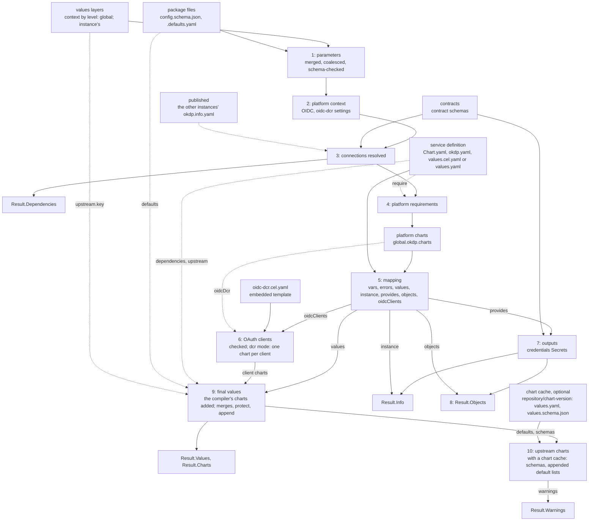

# Architecture

Describe how okdp-compiler works. The formats it reads and writes are
specified in [service definition](specs/02_service_definition.md) and
[inputs and outputs](specs/01_inputs_outputs.md).

## Position in OKDP

An OKDP service is a set of upstream Helm charts deployed together as one
instance, configured from a few parameters, the platform's and projects
settings and the connections to other instances. okdp-compiler is the compile
step: it computes, in Go, the values each upstream chart is then rendered with,
unchanged, by Helm, from the chart's own repository. A service is a package,
a directory in git, not a chart: OKDP publishes no chart of the service.

One compile is one instance. It reads the package (`LoadDefinition`:
`Chart.yaml`, `okdp.yaml` and the values file; then each compile, the
parameters and OKDP's defaults) and, in `Inputs`, the contracts, the
values layers (the context's,
`Context`, by level: the platform's at 0, a project's above; then the
instance's, `Values`), and the release and
namespace, shared by all the instance's charts; what the other instances
of the namespace publish (`Published`), the outputs a connection reference
may name; for a check, the chart
cache (the upstream charts' defaults and schemas)
([Inputs and outputs](specs/01_inputs_outputs.md)).
It returns, in `Result`: `Values`, the final values each upstream chart is
rendered with by `helm template`; `Charts`, the upstream chart that renders
each, by repository, name and version
([Chart index](specs/01_inputs_outputs.md#chart-index));
`Objects`, OKDP's own objects for the cluster, which the umbrella renders
as written; `Info`, what the instance publishes, for a control plane
or a console that reads git; `Dependencies`, the instances it depends
on, for a deployer that orders the releases (okdp-gitops: Flux
`dependsOn`, Argo CD sync waves); `Warnings`, what does not fail the
compile (a `values.yaml` that holds expressions)
([Outputs](specs/01_inputs_outputs.md#outputs)).

`LoadRepository` reads a tree, in one or more repositories, as its
instances. `CompileAll` compiles instances together, those of a namespace each
after the instances whose outputs it references, with what they publish
as `Published`: the order of a tree's instances is the compiler's, not
its caller's. `NewGraph` then checks the dependencies of the results and
orders the releases, and a target writes them for a deployer: the
umbrella chart of each instance, with Flux's or Argo CD's objects.

Callers: a Go program embeds the package at the module's root
(`compiler`), compiles from a git tree, an embedded filesystem or memory,
and gets the files the binary writes for a compile from one function
(`Write`); `okdp-compile` (`cmd/okdp-compile`) runs the same code from
directories, in CI or scripts.
The library depends on neither Helm nor the Kubernetes client libraries:
cel-go for expressions, `santhosh-tekuri/jsonschema/v6` for schemas,
`sigs.k8s.io/yaml` for values, `go.yaml.in/yaml/v3` for the mapping, the
compiler's templates, `Chart.yaml` and the package keys of `okdp.yaml`.

## Compile pipeline



`okdp.LoadDefinition` (`internal/okdp/load.go`) reads `Chart.yaml` into
`chart.Metadata` (`chart.ReadMetadata`, `internal/chart/metadata.go`:
strictly, an unknown field refused by yaml.v3's `KnownFields`, one YAML
document; then `Metadata.Check`: `apiVersion: v2`, a name, a SemVer
version, an application chart, and each dependency's name, key, repository
and pinned version, the keys unique, Helm's `condition`, `tags`, `enabled`
and `import-values` refused). It decodes the package keys of `okdp.yaml`,
when present, into `okdp.Package`, strictly too (`require` a list of keys,
`roles`, `dependsOn`, `defaults`, and `upstream`, whose forms its
`UnmarshalYAML` decodes); the mapping's sections are held as `yaml.Node`,
not read, so that `KnownFields` still refuses any other key, and `output`
is refused with a message of its own. From both it builds the `Service`
(`Definition.service`, `internal/okdp/service.go`): the name and version
of `Chart.yaml`, the requirements and catalog metadata of `okdp.yaml`, and
the charts by key (`chart.Specs`, `chart.NewSpecs`), one per dependency,
its source the dependency's chart, its OKDP defaults and upstream rules
those of `okdp.yaml`, whose keys must be dependencies', and the paths of
`protect` and `append` checked. The `Definition`
keeps the metadata, the package keys, `okdp.yaml` and the values file as
bytes (`Definition.Okdp`, `Definition.Values`, nil when absent), the
mapping's sources, and the package's filesystem as
`Definition.Files`: the mapping is parsed by each compile, so a YAML error
in it surfaces at `Compile`, and the other files of the package are read
by each compile.

`okdp.Compile` (`internal/okdp/pipeline.go`; a nil context, definition or
file system panics) checks the release, a name Helm accepts
(`chart.IsRelease`, `internal/chart/ref.go`: a DNS-1123 label of 53
characters at most), and the namespace, a DNS-1123 label
(`chart.IsDNSLabel`), then builds the `Service` again
(`Definition.service`), for a `Definition` built in memory: a name and a
SemVer version, each dependency key a DNS label (it names the umbrella's
dependency alias), unique, each dependency a repository URL, a chart name
and a pinned version (`Metadata.Check`, `chart.Ref.Check`,
`internal/chart/ref.go`;
[Dependencies](specs/02_service_definition.md#dependencies)), and the
`protect` and `append` paths (`chart.NewSpecs`, `chart.Specs.Check`,
`internal/chart/spec.go`). Then it runs the stages, one call each, in
order. The first three, one call (`newInstance`), build the compile's
`instance` (`internal/okdp/context.go`), the typed state the others read:
the release and namespace, the service's name and version, the merged
values, `global.okdp`, its `ingress.suffix`, the OIDC settings and their
mode, the dependencies, and what the mapping sees (its `scope`):

1. **Parameters** (`newInstance`, `internal/okdp/context.go`, on
   `chart.Parameters`, `internal/chart/parameters.go`).
   `config.schema.json` is read first, once for the compile, before the
   layers (`chart.ReadParameterSchema`; a missing one is the empty schema,
   `{}`), as any values schema is (`chart.ParseSchema`, a `chart.Schema`):
   decoded once, the validator keeping its numbers as written, its map
   view (`Schema.Doc`, `value.Normalize`) reading them as `float64`;
   compiled once (`chart.CompileSchema`). The defaults are the `default`
   of each property reached from the root through `properties`, the
   outermost on a path (`schemaDefaults`): a `default` anywhere else is
   not read. The map view gives the keys of `global` below and the
   connection walk (stage 3). `global` and `connections` are the context's
   (`valuesLayers`, `internal/okdp/layers.go`): the context's layers are
   sorted by level, lowest first, a level's in order (`contextLayers`); a
   layer that sets a value a lower level's layers set, merged, or gives
   one of their connections fails (`chart.Overlap`); an instance layer
   that sets `global` fails, but for the keys `config.schema.json`
   declares under it, `okdp` excepted, and one that sets `connections`
   fails: an instance's own are a context layer of its level. A context
   layer above level 0 or an instance layer, normalized, with `{{` in a
   key or a string, at any depth, fails (`chart.NoTemplate`,
   `internal/chart/merge.go`); the platform's level, 0, and the package's
   defaults are not checked. Each layer, those of `Inputs.Context` by
   level, then `Inputs.Values`, is normalized (`value.Normalize`: string
   keys, `[]any` lists, `float64` numbers, whatever the Go types; what
   values cannot hold fails, the layer and path named) and merged in that
   order by `value.Merge`, Helm's merge of `-f` files; the result is
   coalesced over the defaults by `coalesceValues`, `connections` apart:
   not parameters, they are kept as merged, out of the defaults and the
   check. The coalesced values are checked against the compiled root
   (`validate`; both `Schema.Values`); every violation is reported at
   once, under the `name` of `Chart.yaml`. Nothing below runs on invalid
   parameters.
2. **Platform context** (`newInstance`). The settings of
   `global.okdp` the compiler reads are described by a schema it embeds,
   `internal/okdp/platform.schema.json` (`platformSchema`, parsed once per
   process by `chart.ParseSchema`): their types, the maps on the way to
   them, `clientProvisioning`'s values, the oidc-dcr Jobs' whole numbers,
   the keys of `charts`, the defaults. `schemaValues` checks the
   merged `global` against it as the parameters are checked
   (`Schema.Values`), every violation at once under a heading that names
   the platform values: a value of another type fails rather than reads as
   not set ([fields the compiler
   reads](specs/01_inputs_outputs.md#fields-the-compiler-reads)). Nulls
   are read as Helm reads them in a chart's values: a `null` deletes the
   setting's default, and is refused by its type where there is none; an
   empty string is a value.
   `global.okdp` stays as written for the mapping (`instance.okdp`); OIDC
   is derived from the checked copy (`platform.oidc`): the client
   provisioning mode in effect
   (`existing`, `dcr`); `registrationUrl` and `authMethod` are left to stage 6
   ([OAuth client settings](specs/01_inputs_outputs.md#oauth-client-settings)).
3. **Connections** (`newInstance`; `resolver`, `internal/okdp/connections.go`).
   The map view of `config.schema.json` (stage 1) is walked
   (`walk`) together with a deep copy of the parameters, through
   `properties` (keys sorted) and `items`. A reference must be a string,
   `null` and `""` being not set. Each is resolved (`resolve`) to an
   external connection; else to the output of that name and contract one
   other instance of the namespace publishes (`output`, on
   `Inputs.Published`, the compiling release left out, two providers
   refused). No connection is computed from a name: what an instance is
   reached at, its provider publishes. It is completed
   against its contract (`contract.complete`). A contract is read by each
   reference or output that names it (`readContract`): decoded once, the
   validator keeping its numbers as written, the keywords read from its
   map view (`value.Normalize`), and compiled once. An
   external connection or an output, its values a copy read as values
   (`value.Normalize`), holds fields of its contract only, none of them
   secret (`contract.fields`), and is validated against the contract's
   schema (`contract.check`); last, the connection must hold no `{{`
   (`chart.NoTemplate`)
   ([Connections](specs/01_inputs_outputs.md#connections)). The
   references that do not resolve are reported together, one line each,
   in the order of the walk (`walk`: keys sorted at each level, items in
   order). The references to an output are recorded as `Dependency`, the
   output named, sorted by parameter path.
   `global` and `connections` are then removed from the parameters; the
   instance's upstream values stay, `values.upstream.<key>`, so that an
   `errors` rule covers them; they are checked and applied at stage 9. The
   context is assembled (`instance.scope`): `release`, `values`, `global`
   (`global.okdp` as written), `platform` (OIDC, the name of the main OAuth
   client's Secret, `clientSecret`; the ingress annotations, the proxy
   environment), `service`, `labels`, `selectorLabels`
   ([Context](specs/02_service_definition.md#context)).
4. **Platform requirements** (`Compile`, on the instance). The `require`
   entries of `okdp.yaml`, in order, each a dotted path under
   `global.okdp` that must be set and not empty
   ([require](specs/02_service_definition.md#require)). A missing
   value is reported after the errors of stages 2 and 3. `Compile` then
   opens the compile's CEL session (`compile.NewSession`): its context,
   its cost limit, OKDP's host functions for the instance (`functions`,
   built from the `instance`) and the CEL environments built with them,
   shared by the mapping and the compiler's templates. It reads the
   platform's charts, `global.okdp.charts` (`platformCharts`,
   `internal/okdp/objects.go`), their form checked at stage 2: `oidcDcr`,
   the chart of the OAuth clients, `DcrSource` (oidc-dcr 0.5.0) by default,
   checked as a source is ([Platform
   charts](specs/01_inputs_outputs.md#platform-charts)).
5. **Mapping** (`runMapping`, `internal/okdp/mapping.go`, on
   `compile.Session.Eval`, `internal/compile/cel.go` and `tree.go`). The
   mapping, two sources (`compile.Source`, its name the first segment of
   its errors), each when present: `okdp.yaml`, its package keys skipped,
   and the values file, `values.cel.yaml` or `values.yaml` (its name
   `Definition.ValuesFile`), the section `output` whole. They are parsed
   into ordered maps (`parseDoc`), then built into one tree (`builder`),
   in every branch: the top-level keys of `okdp.yaml`, `vars`, `errors`
   and the sections OKDP names (another key fails), its directives
   checked, each string scanned and each expression compiled once, in the
   CEL environment of the names in scope at its place, with OKDP's host
   functions (`functions`) beside the language's. The tree is then
   evaluated in the compile's session, without compiling again. The `vars`
   bindings are evaluated in order, each seeing the previous ones; then
   the `errors` section, a list of messages (each the `$value` of an item
   kept by its `$if`), all collected, any message failing the compile
   (`bind`); then the sections: `output` (the values file), `instance`,
   `provides`, `objects` and `oidcClients`, in that order, with the keys
   each writes at its top level, kept or not (`Doc.Written`: those of its
   map as written, not those its `$merge` or a `$for` gives). They are
   checked together against a schema the compiler embeds,
   `internal/okdp/mapping.schema.json` (`mappingSchema`, parsed once per
   process by `chart.ParseSchema`), as `global.okdp` is (`schemaValues`; a
   null section is not set, another null refused where no default exists),
   every violation at once: the values a map of maps or nulls; `instance`
   a map, its `url` and `usage` strings; the others lists, an `objects`
   item a whole manifest, with a `kind` and a `metadata.name`, a
   `provides` item and an OAuth client of their keys and types; another
   shape fails rather than reads as empty or is printed
   ([sections](specs/02_service_definition.md#evaluation-order)).
6. **OAuth clients** (`oidcClients`, `internal/okdp/oidc.go`). The
   clients, of the form the mapping schema checks, are checked across
   clients in every mode, their names unique
   ([oidcClients](specs/02_service_definition.md#oidcclients)). In `dcr`
   mode, OIDC enabled, with at least one client, the platform's
   registration settings are checked, no two clients write one Secret, and
   the embedded template `internal/okdp/oidc-dcr.cel.yaml` is evaluated
   once per client, in the compile's session (`compile.Session.Eval`, its
   section `values`), on the context plus `client` and `names`: the values
   of the client's chart, which stage 9 adds ([OAuth client
   charts](specs/01_inputs_outputs.md#oauth-client-charts)).
7. **Outputs and credentials Secrets** (`provided`,
   `internal/okdp/provides.go`). Each `provides` entry, of the form the
   mapping schema checks (stage 5), is
   checked against its contract, read again, as an external
   connection is: its fields (`contract.fields`), completed
   (`contract.complete`), validated against its schema
   (`contract.check`). An
   entry with a `secret` gets its credentials Secret
   (`credentialsSecret`; a generated one by `okdpGeneratedSecret`'s
   template, `generatedSecret`). Then two outputs of one contract and name
   fail (`twice`). The checked outputs and the mapping's `instance`, its
   `url` and `usage` trimmed (`published`), are `Result.Info`, which
   `helm.Write` writes to `okdp.info.yaml` ([The info
   file](specs/01_inputs_outputs.md#the-info-file), [Credentials
   Secrets](specs/01_inputs_outputs.md#credentials-secrets)).
8. **Objects** (`Compile`).
   `Result.Objects` is the credentials Secrets, then the
   mapping's `objects`
   ([objects section](specs/01_inputs_outputs.md#objects-section)): in no
   chart, `helm.Write` writes them to the objects file, which the
   umbrella renders as written
   ([the objects file](specs/01_inputs_outputs.md#the-objects-file)).
9. **Final values** (`chart.FinalValues`, `internal/chart/merge.go`), for
   each dependency of `Chart.yaml` the values file does not leave out
   (`rendered`, `internal/okdp/pipeline.go`, Helm's rule: every one, but a
   key it writes, `Doc.Written` or a key of its values, left out by `$if`
   or null), its computed values `{}` when the file does not write its
   key, and for the compiler's own charts. A key of the values file must
   be a dependency of `Chart.yaml`, null or not ([rendered
   dependencies](specs/02_service_definition.md#rendered-dependencies)).
   The compiler's own charts are then added, in one place (`ownChart`,
   `addOwnCharts`, `internal/okdp/objects.go`): the chart of each OAuth
   client (`clientCharts`, `internal/okdp/oidc.go`), its key reserved in
   every mode, compiled in `dcr` mode. Neither `Chart.yaml` nor the values
   file may list one of these keys, the first in that order failing with a
   message naming what adds the chart; their specs
   (`chart.Spec{Source: <platform chart>}`: no OKDP defaults, no instance
   upstream values) are added to the dependencies', which are not changed,
   their values to those of the values file. The upstream chart is the
   key's source, its dependency's chart. The key's `defaults` file and the
   computed values are merged as `-f` files (`merged`, `keyValues`); the
   chart's own `values.yaml` is no layer: Helm coalesces the final values
   over it when it renders. When the chart accepts upstream values, the
   instance's `upstream.<key>` values go through `applyUpstream`: the `{{`
   check, `protect`, `append`, then the merge. Last, `global` is set, left
   out when empty. `Result.Charts` records the source of each compiled
   key. The layers and the rules: [Merge
   precedence](specs/01_inputs_outputs.md#merge-precedence), [Upstream
   values](specs/01_inputs_outputs.md#upstream-values).
10. **Upstream charts** (`checkKey`, `internal/chart/merge.go`), with a
    chart cache only (`Inputs.Charts`, `okdp-compile --check --charts`):
    without one, no chart is read. The cache (`chartCache.get`,
    `internal/chart/cache.go`) reads each upstream chart once per compile
    (its own `values.yaml` and `values.schema.json`, not its subcharts'),
    from `<repository>/<chart>-<version>/<chart>/` (`Ref.cacheDir`); a
    chart the cache does not hold there fails with the `helm pull --untar`
    command that fetches it there. The final values, coalesced over the
    chart defaults as Helm will coalesce them, are checked against the
    chart's `values.schema.json` (`checkSchema`, `internal/chart/schema.go`)
    when it has one; the violations of every chart are reported together,
    under the key and its upstream chart (`app (app-1.8.0)`). A list the
    instance appended to whose final list lacks items of the chart's
    default list is a warning (`Result.Warnings`): Helm replaces that
    list. The final values are not changed.

Errors: a compile stops at its first error, except where the whole list
helps the author: the `errors` messages, the parameter schema violations,
the connection references that do not resolve, the violations of all
compiled charts. The first error is the same from one compile to the next:
a check over the keys of a map visits them sorted, a list in its order
(`provides`, first error by position). A message says where: the chart, the
parameter path, the mapping's file and path (`values.cel.yaml: app:
env[2]: value: ...`, `okdp.yaml: vars host: ...`), the `vars` or `$vars`
binding, the OAuth client
(`oidcClients[1] (console)`). A path in values (a parameter, a layer's
value, an upstream value, a contract field) is written one way, as a
`protect` path is (`value.Key`, `value.Index`): plain keys joined by dots,
a key that holds a dot in brackets (`annotations["example.org/x"]`), a list
item `[i]`.

## Source map

The module's root is the public package, `compiler`: it gives callers the
types they name, as aliases, and wraps the functions of `okdp`, `graph`,
the targets and `chart`. Under `internal/`, the packages each import only
those below them: `cmd/okdp-compile` -> `compiler` -> `repository`, and
`target/flux` and `target/argocd` -> `target/helm` -> `target` -> `graph`
-> `okdp` -> `compile` and `chart` -> `value`: the compile knows no tree,
no graph and no target, the graph no target (`TestLayers`).
`compile` and `chart` do not import each other: the mapping language knows
nothing of Helm charts, the Helm code nothing of the mapping language, and
neither knows OKDP.

| Package | File | Owns | Relations |
|---|---|---|---|
| `value` | `value.go` | the data model (`M`) and its helpers: `Normalize` (a round trip through `encoding/json/v2`), `Copy`, `AsMap`, `AsList`, `Merge` (Helm's `MergeMaps`), `Truthy`, `Str`, `Dig`, `Short` | every package |
| | `path.go` | the path of a value, as messages write it (`Key`, `Index`): plain keys joined by dots, a key that is empty or holds a special character in brackets, the form of the `protect` paths | `formatPath` and `NoTemplate` (`chart`); the parameter paths of the connections and `Dependency.Field`, the fields of the contract violations (`okdp`) |
| `compile` | `cel.go` | the mapping language: `Session` (`NewSession`), what the evaluations of one compile share: its context, its CEL cost limit, the caller's host functions and the CEL environments built with them; documents read from one file or several (`Source`: a name, the first segment of its errors; a file of top-level keys, some skipped for another reader, or one section whole) as ordered YAML 1.2 data, evaluated with the names of their sections: loaded, `vars` and `errors` evaluated, then the sections (`Session.Eval`, a `Doc`: their values, and the keys each writes, `Written`); an expression compiled once to a program in the CEL environment of its names, built once per set of names (`compile`), run under the session's context, its cost counted (`run`, `exec`); `toData`, a CEL value as data, as cel-go converts it to JSON | registers the functions of `functions.go`, then the caller's |
| | `tree.go` | a document compiled into a tree of typed nodes (`builder`: text, list, plain map, `$if` with its `$else`, `$for` in a map and in a list item, `$spread`, `vars` and `$vars` bindings), which is its check: the top-level keys of each file, `vars`, `errors` and each section given by one file, the keys each section writes at its top level (`literals`), each directive of its place (`check`), `$for` with its keys, every expression compiled in its scope, in every branch; the evaluation, a method per node type | `Session.Eval` |
| | `functions.go` | `str`, `first`, `sha256`, `toJson`, `toPrettyJson`, `toYaml`, `quote` (`hostFunctions`), each the Go code of the Helm or sprig function; `Unary`, the binding of a host function, its argument as data (`toData`), and `Func`, a host function of one argument bound with it | `encoding/json`, `sigs.k8s.io/yaml` |
| `chart` | `values.go` | Helm's reading (`ParseValues`) and coalescing of values | stages 1, 9 and 10 |
| | `schema.go` | JSON Schema validation, reported as Helm reports it (sorted, for a stable report); `CompileSchema`, a schema compiled as Helm compiles it | stages 1, 2 and 10; the contracts (`internal/okdp/connections.go`) |
| | `ref.go` | `Ref`, an upstream chart, its check and its repository's directory of the chart cache (`cacheDir`); the names Kubernetes and Helm accept: `IsDNSLabel`, `IsRelease` (`ReleaseMax`) | the dependencies of `metadata.go`, the sources of `spec.go`, the platform's charts (`internal/okdp/objects.go`); the chart keys (`metadata.go`, `spec.go`); the release, the namespace and an internal reference (`okdp`) |
| | `cache.go` | the chart cache of stage 10 (`chartCache`: `<repository>/<chart>-<version>/<chart>/`, `readEntry`) | `merge.go` |
| | `metadata.go` | `Chart.yaml`: `Metadata`, Helm's fields in Helm's order, the order `Write` writes them in; `Dependency`, its key (`Key`: the alias, else the name) and its upstream chart (`Ref`); `Maintainer`; `ReadMetadata`, the strict reader of one YAML document, and `Metadata.Check`: `apiVersion: v2`, a name, a SemVer version, an application chart, each dependency's name, key (a DNS label, unique), repository and pinned version, Helm's `condition`, `tags`, `enabled` and `import-values` refused | `ref.go` (`Ref.Check`, `IsDNSLabel`, `IsVersion`); read by `LoadDefinition`, `compiler.ChartMetadata`; written back by `helm.Write` |
| | `spec.go` | the charts of a package, by key: `Spec` (its source, its OKDP defaults, the instance upstream values it accepts, their `protect` and `append` paths), built from the dependencies of `Chart.yaml` and the `defaults` and `upstream` of `okdp.yaml` (`NewSpecs`; `Upstream`, the forms of `upstream`, decoded by its `UnmarshalYAML`); `Specs.Check` (the `protect` and `append` paths) | `metadata.go`, `paths.go`; built by `okdp.Definition.service` |
| | `paths.go` | the grammar of the `protect` and `append` paths (`parsePath`); `formatPath`, the keys a value was found at, written back | `spec.go`, `merge.go`; `value.Key` |
| | `parameters.go` | stage 1: `Schema`, a values schema decoded and compiled once, its defaults read (`ParseSchema`), its values coalesced over them and checked (`Schema.Values`); the package's `config.schema.json`, read once per compile, `{}` when missing (`ReadParameterSchema`); `Parameters` | `values.go`, `schema.go`; read by `okdp` (`context.go`: the parameters, the platform schema) |
| | `merge.go` | stages 9 and 10 (`FinalValues`: `keyValues`, then `checkKey` with a chart cache), the instance's upstream values, `protect` and `append`; `NoTemplate`, the `{{` check | `cache.go`, `values.go`, `schema.go`, `paths.go`; `NoTemplate` also by `okdp` (`layers.go`, `connections.go`) |
| `okdp` | `doc.go` | the package doc | |
| | `service.go` | `Definition` (the `Chart.yaml` metadata, the package keys of `okdp.yaml`, `okdp.yaml` and the values file as bytes, the values file's name, the package's files, the warnings of its load); `Package`, the package keys of `okdp.yaml` (`require` a list of keys, `defaults`, `upstream`; the mapping's sections held as `yaml.Node`, unread); `Service` (the name and version of `Chart.yaml`, the requirements and catalog metadata of `okdp.yaml`, the charts), built from a `Definition` and checked, at load and before every compile (`Definition.service`, its messages naming `Chart.yaml` or `okdp.yaml`); `platformValue`, the end of the error of a missing platform value, which names the input | `chart.Metadata.Check`, `chart.NewSpecs`; read by `LoadDefinition` and `Compile`; `platformValue` by `pipeline.go` |
| | `load.go` | `LoadDefinition`: `Chart.yaml`, read and checked (`chart.ReadMetadata`); `okdp.yaml`, its package keys decoded strictly (`output` refused), the keys of `defaults` and `upstream` those of dependencies; the values file, `values.cel.yaml` or `values.yaml` (both refused), a `values.yaml` checked for expressions and `$`-keys, a warning (`holdsExpressions`); the `Service` built from them and checked | `chart.ReadMetadata`, `Definition.service` |
| | `pipeline.go` | `Inputs`, `ContextLayer`, `Result` (with the definition's warnings), `Compile`: the order of the stages, one call each, the platform requirements (stage 4), the compile's CEL session, the dependencies rendered (`rendered`, stage 9) | calls `newInstance`, `compile.NewSession` (with `functions`), `platformCharts`, `runMapping`, `oidcClients`, `provided`, `published`, `clientCharts`, `addOwnCharts`, `chart.FinalValues` |
| | `layers.go` | stage 1: the values layers, the context's by level (`contextLayers`: a level adds to the lower levels' values and changes none, no `{{` above level 0) then the instance's, normalized (`value.Normalize`); `global` and `connections` are the context's, no `{{` in the instance's (`valuesLayers`) | the keys of `global` the parameter schema declares (`chart.Schema.Doc`), `chart.NoTemplate`; called by `context.go` |
| | `context.go` | stages 1 to 3: `instance`, the typed state of a compile, built by one function (`newInstance`): the parameters (`chart.ReadParameterSchema`, `valuesLayers`, `chart.Parameters`), the platform context (`global.okdp` checked against the embedded `platform.schema.json`) and the connections (`resolver`), which end with what the mapping sees (`instance.scope`); values checked against an embedded schema, the platform's or the mapping's (`schemaValues`) | `chart.ParseSchema`, `chart.Schema.Values`; `connections.go`, `labels.go`; `oidc.go` for the oidc-dcr image and the main client's Secret; the `instance` is read by `mapping.go`, `oidc.go`, `provides.go` |
| | `connections.go` | the references of the parameters, visited (`refs`), resolved to a connection or an output of `Inputs.Published` (`resolver`), `Dependency`; the outputs no instance publishes, said by the error (`missingOutputs`); the contracts: `contract`, read, decoded and compiled at each use (`readContract`, `x-okdp-internal` refused), and the checks of values against one (`fields`, `complete`, `check`) | used by `context.go` with the context's `connections`, recording dependencies; the contracts by `provides.go` |
| | `mapping.go` | stage 5: OKDP's sections (`runMapping`: the sources `okdp.yaml`, its package keys skipped, and the values file, the section `output`, named by `Definition.ValuesFile`, `values.cel.yaml` by default), checked against the embedded `mapping.schema.json` (`mappingSchema`), OKDP's host functions (`functions`: `okdpFullname`, `okdpGeneratedSecret`, and those of `labels.go` and `oidc.go`), built once per compile from its `instance`, for its session; `generatedSecret`, the objects of `okdpGeneratedSecret` and of a generated credentials Secret, and `evalTemplate`, a template of the compiler evaluated in the session, its errors under its file's name | `compile.Session.Eval`; `functions` by `pipeline.go`; `fullname` (`truncName`, a name cut as charts cut it, `trunc n \| trimSuffix "-"`) also names the client charts' objects (`oidc.go`) |
| | `labels.go` | the labels of OKDP's own objects, from the package's `name` and the release, the selector labels a subset (`labels`) | the context (`service`, `labels`, `selectorLabels`), the CEL functions, every object the compiler writes |
| | `mapping.schema.json` | what a mapping writes that the compiler reads: the sections, their items and keys, and the argument of `okdpGeneratedSecret`, their types and meaning, embedded (`//go:embed`, `mappingSchema`); the package authors' reference | read by `mapping.go` (`runMapping`, `okdpGeneratedSecret`) |
| | `generated-secret.cel.yaml` | the objects of `okdpGeneratedSecret`, on arguments the mapping schema checked: a template in the mapping language, embedded (`//go:embed`, `secretTemplate`): the Password generators and the ExternalSecret, their names, the defaults applied as Helm's `default` does, the `{{` of static keys escaped, the keys of one generator name refused | evaluated by `generatedSecret` (`mapping.go`), for the CEL function and `provides.go` |
| | `oidc.go` | stage 6: the `oidcClients` checks across clients, the modes, the names of the client charts, objects and Secrets (`clientSecret`, `oidcClientSecret`), the client charts as the compiler's own (`clientCharts`), `DcrSource` | evaluates `oidc-dcr.cel.yaml` in the compile's session (`evalTemplate`); used by `context.go` and `pipeline.go` |
| | `platform.schema.json` | the settings of `global.okdp` the compiler reads: their types, their defaults, their meaning, embedded (`//go:embed`, `platformSchema`); the platform authors' reference | read by `context.go` (`newInstance`) |
| | `oidc-dcr.cel.yaml` | the values of a client chart: a template in the mapping language, embedded (`//go:embed`, `dcrTemplate`) | reads the context, with `platform.oidc.dcr` built by `context.go`, and the `client` and `names` given by `oidc.go` |
| | `provides.go` | stage 7: `Info`, `Output`, `SecretRef`, what the instance publishes (`published`); the outputs, each checked against its contract, two of one contract and name refused (`provided`, `twice`), the credentials Secrets (`credentialsSecret`) | `connections.go` (the contracts, the resolver), `generatedSecret` (`mapping.go`) |
| | `objects.go` | the compiler's own charts (`ownChart`), the OAuth clients', their keys checked once, in `Chart.yaml` and the values file (`listed`), and their charts added to the dependencies' (`addOwnCharts`, stage 9); the platform's charts, of the form the platform schema checks, each checked as a source (`platformCharts`, stage 4) | `chart.Ref`; `DcrSource` and `clientCharts` (`oidc.go`) |
| | `namespace.go` | `Instance`, `Outcome`, `CompileAll`: the instances of each namespace compiled together (`compileNamespace`: Kahn's algorithm, its edges discovered by compiling, an instance waiting for the outputs its compile says it lacks), the outputs two instances publish refused, and what resolved through them compiled again (`refuseShared`); the instances that do not compile named in the refusals for an output (`notCompiled`) | `Compile`, `missingOutputs` (`connections.go`) |
| `repository` | `repository.go` | the tree of a deployment, in one or more repositories: `Repository`, `Load`: the owner of each part, every conflict at once (`index`), then each instance (`instance`): its package, loaded once (`definition`), its context layers (its `connections.yaml`, connections only) and values; the names of the tree | `okdp.LoadDefinition`, `chart.ParseValues` |
| `graph` | `graph.go` | the deployment graph of compiled instances: `Node`, `Graph`, `Error`; `New`, every dependency checked against the release it points to (`provides`), the waves, Kahn's algorithm by levels (`levels`), each cycle named, a shortest one from its smallest release (`cycles`); `DependsOn`, `Wave` | `okdp.Result` |
| `target` | `target.go` | `Target`, an output format, `Files` of the results and their graph; what the targets share: `ProjectDir`, `InstanceDir` (`projects/<namespace>/instances/<release>`), `Generated`, the mark of a generated file, `Lines`, a file built line by line; the checks of their options (`CheckPrefix`, `CheckQuoted`) and of the release names their objects share a namespace with (`UniqueReleases`) | `graph.Graph`, `okdp.Result` |
| `target/helm` | `umbrella.go` | what a compile is written as, path -> content: `Write`, the one entry point, which takes a `Result` as `Compile` returns it: the instance as one chart (`-o`), `Chart.yaml`, the package's (`Result.Chart`), its metadata kept, its dependencies the compiled keys (the rendered dependencies in `Chart.yaml` order, as written, then the OAuth client charts by key, from the index), `instance.values.yaml` (`ValuesFile`); when there are objects, `Result.Objects` as a YAML stream, `okdp.objects.yaml` (`ObjectsFile`), and the template that includes it as written, `templates/okdp.yaml` (`ObjectsTemplate`); and when the instance publishes something, `Result.Info`, `okdp.info.yaml` (`InfoFile`) | `okdp.Result`; `chart.Metadata` |
| | `target.go` | `Target`, the helm target: the files of `Write` of each result, in its `InstanceDir` | `umbrella.go`, `target` |
| `target/flux` | `flux.go` | the flux target (`Target`: `Source`, `PathPrefix`): the helm target's files, an instance's HelmRelease and Kustomization (`Instance`), a namespace's Kustomization (`Project`), okdp-gitops' format | `target/helm`, `target`, `graph.DependsOn`; `chart.IsDNSLabel` |
| `target/argocd` | `argocd.go` | the argocd target (`Target`: `RepoURL`, `Revision`, `PathPrefix`): the helm target's files, an instance's Application (`Application`), okdp-gitops' format | `target/helm`, `target`, `graph.Wave` |
| `compiler` | `compiler.go` | the public API: `LoadDefinition`, `Compile`, `LoadRepository`, `CompileAll`, `NewGraph`, `Write`, `ParseValues`; aliases of the types a caller names (`Definition`, `Inputs`, `ContextLayer`, `Result`, `Info`, `Output`, `Dependency`, `Instance`, `Outcome`, `Repository`, `Graph`, `GraphNode`, `GraphError`, `Target`, `Helm`, `Flux`, `ArgoCD`, `ChartRef`, `ChartMetadata`); the names of the files of `Write` (`UmbrellaValues`, `InfoFile`, `ObjectsFile`, `ObjectsTemplate`) | wraps `okdp`, `repository`, `graph`, the targets, `chart` |

Layers: `value`, `internal/chart/values.go` and `internal/chart/schema.go`
reproduce Helm and know nothing of OKDP; `internal/compile/functions.go`
reproduces Helm's and sprig's functions, bound to CEL;
`internal/chart/ref.go` holds the names Kubernetes and Helm accept;
`internal/chart/cache.go` reads the chart cache; `internal/chart/merge.go`
applies the rules of the package's charts (`okdp.yaml`'s `defaults` and
`upstream`); `internal/okdp` implements OKDP's rules,
`internal/okdp/oidc-dcr.cel.yaml` the values of the oidc-dcr chart,
`internal/okdp/generated-secret.cel.yaml` the objects of a generated
Secret, and `internal/okdp/pipeline.go` orders the stages. Each rule is
computed in one place and reused: the labels of the context, of
`okdpLabels` and of the credentials Secrets; one generated Secret for the
CEL function and for `provides[].secret`; one resolver for consumers and
for the provider check; one OAuth client Secret name (`clientSecret`) for
`platform.oidcClientSecret`, `oidcClientSecret` and the oidc-dcr Job; one
CEL session per compile for the mapping and the compiler's templates.
`cmd/okdp-compile/main.go` is a thin caller of the public package that
chains the stages (`run`): the tree of its `--repository` directories
(`os.DirFS`, `compiler.LoadRepository`), `compiler.CompileAll`,
`compiler.NewGraph`, the files of the target `--target` names
(`newTarget`, its options checked before the tree is read), written under
`-o`, whose `projects/` it owns (`writeTree`); each binding, refusal,
problem of the graph, warning and dependency printed on stderr after its
`<namespace>/<release>` ([`--repository`](01_usage.md#--repository)). A
tree is its only input: an instance is compiled with the others of its
tree, never alone. Its own rules are the disk's: every input is a flag (an
argument that is not one would end Go's flag parsing, and is refused), and
every output is built before any is written, into the output directory
(`-o`), created if needed, and the directories of their paths ([command
line](01_usage.md#command-line)).

## Design decisions

### Helm fidelity

What Helm computes from the same values files, the compiler computes the
same way, and the fixtures check it against the helm binary
([Testing](#testing)). A values difference is silent: read as YAML
1.2, an upstream default `enabled: no` is the string `"no"`, which a
template's `if` takes as true.

- Reading: values files, the upstream charts' `values.yaml` included, as
  Helm 3 reads them, the first document only (`ParseValues`,
  `sigs.k8s.io/yaml`, YAML 1.1)
  ([Values files](specs/01_inputs_outputs.md#values-files)).
- Merging: `value.Merge` is Helm's `MergeMaps`, `coalesceValues` Helm 4's
  `CoalesceValues`
  ([Layers and nulls](specs/01_inputs_outputs.md#layers-and-nulls)).
- Final values: OKDP's defaults, the computed and upstream values merged,
  none of the chart's defaults, so that Helm 3 or 4, coalescing them over
  the chart defaults, sees what it would see with these as `-f` files
  ([Equivalence with Helm](specs/01_inputs_outputs.md#equivalence-with-helm)),
  checked with Helm 4.3 and the 4.2 and 3.19 releases the deployers embed.
- Schemas: validated as Helm 4.3 validates them (`santhosh-tekuri/jsonschema`
  v6), on the coalesced values the templates see, reported in Helm's words
  (Helm 4.2 and 3.19 report the same),
  sorted by path since Helm's order varies between runs
  ([Schema check](specs/01_inputs_outputs.md#schema-check)).
- Functions: a host function that reproduces a Helm or sprig function is
  that function's Go code, in `hostFunctions`
  (`internal/compile/functions.go`). Where Helm prints `""` for a value it
  cannot encode, the compile fails instead.
- Reproduced, not imported: the helm module pulls in client-go and requires
  newer Go and Kubernetes versions than the programs that embed this
  package. `coalesceValues` and `value.Merge` follow helm v4.3.0; the
  fixtures guard the copy.

### One data model

Values are `value.M` (`map[string]any`): string keys, `float64` numbers,
`[]any` lists, which is what Helm values are after their JSON round trip.
In-memory layers, of any Go type, are normalized to it (`value.Normalize`):
written by `encoding/json/v2` and read back, which names the path of what
fails as a JSON pointer and refuses text that is not UTF-8, two keys that
read as the same and a cycle
([values files](specs/01_inputs_outputs.md#values-files)). CEL
results are converted back to it as cel-go converts them to JSON
(`toData`: every number a float64, but an integer beyond 2^53, a NaN or
an infinity, which are text; a key that is not a string or an optional
without a value fails the expression), so a value
computed by CEL and the same value read from a file are equal. Stages work
on deep copies: the caller's inputs are never modified, and the mapping
sees a copy of the parameters while the merges use them as written.

### The mapping file

- Parsed with yaml.v3 nodes, not `sigs.k8s.io/yaml`: key order matters.
  `vars` and `$vars` bind in order, each binding seeing the previous ones,
  and map keys are evaluated in order, so the error reported is stable.
  `sigs.k8s.io/yaml` goes through JSON and loses the order.
- Aliases are refused (`fromNode`) rather than resolved as Helm's reader
  resolves them: a mapping reuses a value with `vars`.
- Scalars decoded as yaml.v3 decodes them, YAML 1.2, then as values hold
  them (`value.Normalize`); keys taken as written, the later of a key
  written twice winning; the first YAML document only, as `yaml.Unmarshal`
  reads it ([YAML reading](specs/02_service_definition.md#yaml-reading)).
  A snippet copied from an upstream `values.yaml` means the same in the
  mapping but for YAML 1.1's booleans and the keys Helm converts. A final
  line break is added, as Helm adds it: a block scalar ending the file
  keeps its newline.
- A document is compiled once, when loaded, into a tree of typed nodes
  (`tree.go`), before any evaluation and in the whole document: a
  misspelled `$` key or top-level key fails rather than being written to
  the values or ignored, and an expression that does not compile (a
  syntax error, an undeclared name, an unknown function) fails, in the
  branches no case takes too. Building the tree is the check: a misplaced
  directive has no node to become, so no second walk must classify the
  maps as the evaluation does. Type errors stay evaluation errors
  ([Limitations](#limitations)).
- Expressions are CEL: no I/O, every variable dynamically typed. An
  environment is built per set of variable names in scope, and cached for
  the compile; each expression is compiled once, to a program each
  evaluation runs (once per element in a `$for`). Under a cost limit, an
  evaluation may cost the limit (CEL's limit of the program), and the
  session counts what each costs: the compile fails once the total passes
  the limit, which it can then pass by one evaluation's cost at most.
- `Chart.yaml` and the package keys of `okdp.yaml` are not values files:
  yaml.v3 decodes them into Go types, as YAML 1.2, strictly
  ([Chart.yaml](specs/02_service_definition.md#chartyaml),
  [okdp.yaml](specs/02_service_definition.md#okdpyaml)). `okdp.yaml` is
  then read again, whole, by the mapping reader, which skips its package
  keys: one file for OKDP's part of the package, two readers.

### The oidc-dcr template

The values of an OAuth client's chart
([OAuth client charts](specs/01_inputs_outputs.md#oauth-client-charts))
are computed by `internal/okdp/oidc-dcr.cel.yaml`, a template in the mapping
language embedded in the compiler (`//go:embed`), not by Go code:

- They are values of the oidc-dcr chart: YAML shaped like its
  `values.yaml`, read side by side with it. When the chart changes (a new
  value, a renamed key), the change is to data, reviewed as such, not to
  code.
- One engine: `compile.Session.Eval` evaluates the template as it does
  a mapping, in the compile's session, with the same host
  functions (`functions`), so the template is read as a mapping is (YAML
  1.2, ordered `vars`, `errors`), with the same directives, functions and
  error paths, under its own file's name (`oidc-dcr.cel.yaml: `). A field
  left out (`$if`) or a registration field the client's `request`
  overrides (`$merge`) needs no Go of its own.
- Embedded, not in the package: the template is versioned with the Go code
  that checks the clients and computes the names it reads, and so is
  `DcrSource`, the oidc-dcr version it writes values for. Every service
  registers its clients the same way: a package declares its clients (the
  client keys), not the chart's values. No file is read for it, so the
  compile stays hermetic
  ([Everything through fs.FS](#everything-through-fsfs)).

What stays Go (`internal/okdp/oidc.go`) is what a per-client template cannot
express, or what more than one reader needs:

- the checks across clients
  ([oidcClients](specs/02_service_definition.md#oidcclients)), with errors
  naming the client; the form of each client is the mapping schema's,
  `internal/okdp/mapping.schema.json`;
- the mode (no chart in `existing` mode) and what `dcr` mode requires of
  the platform's settings (their types and defaults are the platform
  schema's, `internal/okdp/platform.schema.json`);
- the names: the chart key, the objects' full name (cut to 63 characters,
  as `okdpFullname`), the Secret.
  The Secret name is also what
  `oidcClientSecret` and `platform.oidcClientSecret` return, so the
  mapping that reads the Secret and the Job that writes it agree (a client
  that sets its own `secret` names it in the mapping too). The template
  receives them as `names`;
- the charts (`clientCharts`): the reserved keys and the chart entries,
  rendered by the platform's oidc-dcr chart, which the compiler adds in
  one place (`addOwnCharts`).

The objects of `okdpGeneratedSecret` are a template too,
`internal/okdp/generated-secret.cel.yaml`, for the same reasons: the
Password generators and the ExternalSecret are manifests, written as YAML,
their names and defaults as expressions. The function evaluates it at each
call (`generatedSecret`), in the session running the expression that calls
it: its cost is counted in the compile's total, though the calling
expression's own limit is not lowered while it runs, and it is read and
compiled at each call. A generated credentials Secret of `provides`
(`credentialsSecret`) comes from the same template.

### Values for unmodified upstream charts

The compiler stops at values:

- each upstream chart stays a standard chart, rendered as published, from
  its own repository, by Helm itself: hooks, `.Files`, `.Capabilities`,
  subcharts and the chart's schema behave as upstream intends. OKDP keeps
  no copy of it and publishes no chart of the service: a compile reads
  none of it, Helm applying its defaults when it renders; a check reads
  only the chart's `values.yaml` and `values.schema.json`, from a chart
  cache ([Chart cache](specs/01_inputs_outputs.md#chart-cache));
- the result is data, what OKDP decides of the chart's values and nothing
  of its defaults: a chart bump changes none of it, a pull request diffs
  only OKDP's decisions; checked against the upstream schema before it is
  committed (`--check --charts`), compared with a previous render;
- no Helm template code runs in the compiler, and none can come in through
  instance values: `{{` is refused in the context's layers above level 0,
  the instance's layers and every resolved connection.

The cost: what an upstream chart has no value for cannot be changed, and
neither can the chart itself ([Limitations](#limitations)). OKDP's own
objects are the compiler's manifests, which the umbrella's own template
includes as written: Helm runs no template code on them
([OKDP's own objects](03_okdp_objects.md)). The OAuth clients take the
upstream charts' path: each is a chart rendered by the platform's oidc-dcr
chart, whose Job registers it, the same for every service, named in the
platform values, with a default (`DcrSource`)
([Platform charts](specs/01_inputs_outputs.md#platform-charts)).

### Stateless, hermetic, concurrent

- `Compile` keeps no state between calls: each call parses and compiles
  the mapping, the oidc-dcr template once per client and the generated
  Secret template once per Secret, and opens its own CEL session
  (`compile.NewSession`), whose host functions and environments serve its
  mapping and templates, never another compile's (a session is
  not safe for concurrent use). The package-level variables are read-only:
  tables, a regular expression, the embedded templates. A `Definition` can
  be shared between goroutines, and is not changed: the client charts are
  added to a copy of its charts
  (`TestConcurrentCompile` races it under `go test -race`). A compile
  reads no upstream chart; a check reads each from the chart cache once,
  however many keys it renders. Caching across compiles, if any, is the
  caller's: a chart cache keyed by pinned versions never goes stale.
- No clock, random number, environment variable, network, or file outside
  the given filesystems: the same inputs give the same result. GitOps tools
  render on every sync (Argo CD with `helm template`), and a value that
  changes per render never converges. Random credentials are therefore
  generated in the cluster by External Secrets `Password` generators
  (`okdpGeneratedSecret`), never at compile time.
- Where an order shows, it is sorted: dependencies by parameter path,
  connection errors by the keys of each level, schema violations by path
  and by chart, the keys a
  check visits before its first error. The example's outputs rely on
  byte-identical results.

### Compiling instances together

An output's name is computed by its provider's mapping: the edges between
instances are only known by compiling them, so no graph can order the
compiles beforehand. `CompileAll` is Kahn's algorithm with its edges
discovered on the way: a compile that lacks outputs says which
(`missingOutputs`, the message unchanged), and the instance waits for
them. This holds because the outputs an instance references do not
depend on what is published: a connection is tried first, and depends
on the context and the contract only. Waiting
for those outputs, rather than compiling every refused instance again
each round until nothing changes, compiles an instance at most twice,
and a real failure once; every refusal comes from a compile that saw
every output it names. A successful compile is final: what it resolved
does not change when more is published, but for an output two instances
publish, which is refused, with what resolved through it, so that no
outcome depends on the order of the instances.

### One tree, several repositories

A platform, its catalogs and its projects are often apart: a team writes
its project's repository, a catalog ships its packages and their
contracts. `LoadRepository` reads one tree from any number of
repositories, each holding any part of it, and merges them part by part
with no precedence: a part in two repositories is refused, not
overridden, so that the order of the repositories never changes the
tree, and a part's repository is the one to fix. A contract may be in
several, the same bytes in each, as okdp-gitops' catalogs ship theirs.
The compiler reads directories; fetching a repository at a revision is
its caller's.

### A graph for deployment only

The compile needs no graph: its edges are discovered as it goes. A
deployer does: Flux orders releases by their direct dependencies
(`dependsOn`), Argo CD by layers (a sync wave, the longest path to a
release without dependencies). `graph.New` builds the graph once, from
the results, and returns it only when every edge reaches a release that
provides what is referenced and there is no cycle: what reads it never
meets a cycle nor an edge to nothing. A cycle is refused rather than
broken somewhere: Flux would wait forever, and where to break it is the
user's choice, a connection in place of one of the references. Its nodes
are releases, its edges `Result.Dependencies` deduplicated; the details
(contract, field) stay in the results. The graph imports `okdp` and
nothing imports it but the public package: the compile knows no graph.

### Writing apart from compiling

A compile gives values and objects; how a deployer gets them is a
target's. The three stages are packages, each reading only what the one
before it gives: the compile (`okdp`) its inputs, the graph (`graph`) the
results, a target (`target/...`) the results and the graph. A target
never sees a package, an input or an expression, and a new deployer is a
new target, the compile unchanged. The flux and argocd targets write the
helm target's files, then their own: one umbrella chart, whatever deploys
it. Their format is okdp-gitops', byte for byte after the first line, its
per-instance functions exported, so that one tool writes what the other
does.

### Everything through fs.FS

The compiler opens no path itself: the package, the contracts and the
chart cache of a check are `fs.FS`, the values layers are
in-memory maps, the compiler's templates are in the binary.

- A server compiles from a git tree or an `embed.FS`, tests
  from `fstest.MapFS`, the CLI from `os.DirFS`; the contracts from any of
  them, an `embed.FS` of the contract schemas included.
- The paths written in `okdp.yaml` (`defaults`) are cleaned and opened
  inside the package, and an `fs.FS` path cannot contain `..`: a package
  cannot read outside itself. A chart cache entry,
  `<repository>/<chart>-<version>`, is named by a checked source or
  platform chart (a repository whose host and path are an `fs.ValidPath`
  without `\`, a chart name without `/`, `.` or `..`, a pinned version), so
  it stays inside the cache. The CLI uses
  `os.DirFS`, which still follows symbolic links.
- A schema `$ref` to a file, a URL or a `urn:` fails the compile instead of
  being fetched (a `jsonschema.SchemeURLLoader` of no scheme).

### Security boundaries

The package, with the upstream charts its sources pin, is reviewed in its
repository; the contracts, the platform's charts and the platform values
with the platform. The context's layers above level 0 (a project's), from
their owners, and the instance's layers and files are input, from a
console user or a GitOps pull request. The chart cache of a check is the
caller's, filled from the pinned references. The compiler enforces:

| Boundary | Where | Reason |
|---|---|---|
| Context values | `valuesLayers`, `contextLayers`, stage 1 | `global` comes from the package's defaults and the context's layers (`Inputs.Context`), level 0 the platform's: a higher level (a project's) only adds to the lower levels, never changing a value they set nor a connection they give; an instance layer sets only the keys of `global` the parameter schema declares, never `okdp`, and no `connections`: an instance's own are a context layer of a level of their own. `global.okdp` holds the instance's host (`ingress.suffix`), where its OAuth clients register (`oidc.dcr.registrationUrl`), the chart its OAuth clients are rendered with (`charts`), and every chart receives `global` (`imageRegistry`) |
| Parameters valid before use | stage 1, before the requirements and the mapping | the schema is the one place for a parameter rule (a pattern guarding a value a Job pastes into a script); the mapping never sees a value it refuses |
| Connection references | `walk`, `resolve` | a reference is a string, `null` or `""` (not set): a map would reach the mapping as a connection, past its contract and the checks below |
| Credentials never inlined | `contract.fields`, from `resolve` and `provided` | an external connection and a provided output carry contract fields only, never an `x-okdp-secret` field: credentials are referenced by Secret name (`secretRef`), since values and `okdp.info.yaml` are not secret |
| Contracts | `resolve`, `provided` | a reference to a connection of another contract fails; an external connection and a provided output hold only fields of their contract, its required ones, no secret field, and values its schema accepts (`contract.check`: types, `enum`, `pattern`...): a consumer reads a `port` that is a number, an `engine` it knows |
| Provider and consumers agree | `output`, `provided` | a reference reads what its provider publishes, never a value computed from a name: an output checked against its contract when provided, and again as the consumer reads it |
| Protected upstream paths | `applyUpstream` | `protect` paths, and always `global`, cannot be set by an instance, nor replaced by setting a parent to a non-map |
| No templates in instance values | `chart.NoTemplate`, from `valuesLayers`, `resolve`, `applyUpstream` | some upstream charts pass values to `tpl`, where template code could call `lookup` and read the cluster's Secrets, and a parameter reaches the charts through the mapping: `{{` is refused in any key or string of the context's layers above level 0 and of the instance's layers (parameters, `global`, upstream values) and of a resolved connection, whatever layer or default it comes from. A value of a type values do not hold fails: the check does not let through what it cannot read |
| Upstream schemas | stage 10, with a chart cache | an upstream chart's rules fail the check, not the deployment |
| Pinned charts | `chart.Ref.Check` | a source and a platform chart name one version, not a range: the chart a check holds the values to is the chart the deployer renders |
| Declared charts only | `addOwnCharts`, `chart.FinalValues` | the values file cannot give values to a chart that `Chart.yaml` does not declare, nor replace a client chart with one of its own: their keys are the compiler's, checked in one place, and their charts the platform's |
| OAuth client charts | `clientCharts`, `addOwnCharts` | no OKDP defaults, no instance upstream values: the Job that registers a client and writes its Secret is computed by the compiler, from the client keys, the release and the platform's settings, so an instance cannot change where a client is registered or which Secret receives its credentials |

What an expression computes is bounded only on request: a caller that
compiles packages it does not review passes a context (cancelled between
the stages and inside comprehensions) and a total CEL cost
(`Compile`, `Inputs.CostLimit`), both held by the compile's session
(`compile.Session`), the cost counted across the mapping and the
compiler's templates; the CLI sets none.

Not decided by the compiler: which layers are the platform's. What the
caller gives at level 0 of `Inputs.Context` (`platform.yaml`) is trusted
as the platform values, and comes from the platform's repository, never
from a project's owners or the instance's author, whose layers are the
higher levels (`project.yaml`, `connections.yaml`) and `Inputs.Values`
(`config.yaml`); the keys of
`global` an instance may set are the parameter schema's decision, reviewed
with the package
([Context values](specs/01_inputs_outputs.md#context-values)).

## Testing

`go test ./...` runs everything offline: the Helm outputs are committed
fixtures, helm is needed only to regenerate them.

### Helm fixtures

`testdata/helm` holds what `helm template` computes on the same
inputs, written by `generate.sh` with Helm 4 on the `PATH` and the Helm
versions the deployers embed ([GitOps](01_usage.md#gitops)). Each case
renders a small chart, and stores its output or its error; the
`helm_test.go` of the package that reproduces each behaviour compares:

| Fixture | Helm's side | Test |
|---|---|---|
| `values/<case>/` | `.Values` with the `layer-*.yaml` files (`helm.json`), and with the compiler's `final.yaml` (`helm-final.json`); with each other Helm major version, where it differs (`helm3.json`), and where it renders the final values differently from the layers (`helm3-final.json`) | `chart`: `TestHelmValues`, coalescing as Helm, and final values that each version renders back to the same `.Values`, but for each known difference of a version (`helmFinalKnown`) |
| `schema/<case>/` | Helm's error report, or `ok` (`helm.txt`; `helm3.txt` where a version reports differently) | `chart`: `TestHelmSchema`, each report |
| `functions/` | `sha256sum`, `toJson`, `toPrettyJson`, `toYaml`, `quote` of inputs given with `-f` (`helm.json`; `helm3.json` where a version renders differently) | `compile`: `TestHelmFunctions`, each render |
| `umbrella/` | the `.Values` of each subchart of the umbrella the compiler writes (`Chart.yaml`, `instance.values.yaml`) over the charts of the values cases, two of them under a second key (`helm.json`); with each other Helm major version, where it differs (`helm3.json`). The manifests its template renders of its objects file (`okdp.objects.yaml`, `templates/okdp.yaml`: a `{{`, a null, an integer beyond a float64's precision), in Helm's order, the same with every version (`helm-objects.yaml`) | `target/helm`: `TestHelmUmbrella`, each subchart sees what its chart sees alone (`helm-final.json`), but for the empty `global` and the nested null defaults Helm adds to a subchart, and each known difference of a version (`umbrellaRenders`); `TestHelmObjects`, each document of the objects file a manifest, as written |

`SOURCE` records what rendered them, written by `generate.sh`: the version
of the helm on the `PATH` (`helm`) and the deployers' versions (`helms`).
The tests read them through `internal/helmtest`, imported by
tests only: the directory, the JSON renders, the versions of `SOURCE`, and
the `helm<major>` files beside each reference file.

To regenerate: `go test ./internal/chart -run TestHelmValues -update`
(writes each `final.yaml`), `go test ./internal/target/helm -run
TestHelmUmbrella -update` (writes the umbrella), then `generate.sh` (bash
3.2 or later, python3 with PyYAML; the GNU or the BSD tools), with the
deployers' helm binaries in `UMBRELLA_HELMS`, separated by spaces,
downloaded from `https://get.helm.sh`, checked against their `.sha256sum`
and kept out of the repository; `make fixtures` runs the three,
`UMBRELLA_HELMS` passed on:

```bash
h=$(mktemp -d)
for v in $(sed -n 's/^helms //p' testdata/helm/SOURCE); do
  (cd "$h" && curl -fsSL --remote-name-all https://get.helm.sh/helm-v$v-linux-amd64.tar.gz{,.sha256sum} &&
    sha256sum -c helm-v$v-linux-amd64.tar.gz.sha256sum && mkdir v$v && tar -C v$v -xzf helm-v$v-linux-amd64.tar.gz)
done
make fixtures UMBRELLA_HELMS="$(echo "$h"/v*/linux-amd64/helm)"
```

(On macOS: `darwin-arm64`, and `shasum -a 256 -c`.) Each binary renders
every fixture again, and two versions of one major version that render
differently fail. What a major version renders differently from the helm
on the `PATH` goes beside the reference file, `helm` renamed
`helm<major>`, removed when it renders the same. A new version or a new
difference goes in `umbrellaRenders` (`internal/target/helm/helm_test.go`)
or `helmFinalKnown` (`internal/chart/helm_test.go`), and in the spec
([Umbrella chart](specs/01_inputs_outputs.md#umbrella-chart), [Equivalence
with Helm](specs/01_inputs_outputs.md#equivalence-with-helm)). Without
`UMBRELLA_HELMS`, the `helm<major>` files and the `helms` of `SOURCE` are
left as they are.

The `helm-fixtures` workflow (`.github/workflows/helm-fixtures.yml`)
regenerates them (`make fixtures`) on each pull request that touches
`testdata/helm` or `internal/chart`, with the Helm versions of `SOURCE`,
and fails when they differ from the
committed ones.

A behaviour copied from Helm gets a case here, and only what no other case
covers: a fixture is Helm's whole output, labels and
all.

### Unit tests

Most source files have their `_test.go`, in memory (`fstest.MapFS`, as a
server passes its inputs); the host functions copied from Helm and the
schemas are tested against Helm, in `helm_test.go`.
`internal/compile/cel_test.go` covers the language: directives, YAML 1.2,
what the reader refuses (`FuzzMappingReader`: what it reads is values),
the values of expressions, error paths, a document read from several
files, its errors under each file's name (`TestSources`,
`TestSourceErrors`), the mistakes a document is refused for when loaded,
in the branches no evaluation takes too (`TestMistakes`: directives,
unknown sections, expressions that do not compile), the cost limit and
cancellation of a session over compiled programs (`TestSession`), and
functions of the CEL libraries at their pinned versions (`TestLibraries`).
`internal/chart/spec_test.go` covers the source checks (`TestRefCheck`)
and the charts of a package, `internal/chart/cache_test.go` the chart
cache, a chart unpacked under its repository's directory, with subcharts,
not at the root nor as an archive (`TestChartCache`), and the repository's
directory (`TestRefCacheDir`), `internal/chart/merge_test.go` and
`internal/chart/paths_test.go` the upstream values, `protect` and
`append`, and the checks of the final values against a chart cache, the
same values without one (`TestFinalValuesCheck`).
`internal/okdp/pipeline_test.go` runs the whole pipeline on a minimal
package, with or without a chart cache: schemas, upstream values,
`protect` and `append`, objects, in no chart, and the platform's charts
(`TestObjects`), dependencies, one upstream chart for two keys
(`TestSharedSource`), the warnings of a check (`TestCheckWarnings`).
`internal/okdp/layers_test.go` covers the context's and the instance's
layers: what an instance may set of `global` (`TestValuesLayers`), what a
level may add, and the lower levels' values it may not change, whatever
the order and the gaps of the levels (`TestContextLevels`), layers of Go
types that merge as the same values read from a file, and the layer and
path of what values cannot hold (`TestValuesLayersGoTypes`);
`internal/value/value_test.go` the reading of each Go type
(`TestNormalize`, `TestNormalizeErrors`) and the paths of the messages
(`TestPath`). `internal/okdp/namespace_test.go` compiles instances
together in every order, each giving the same outcomes: a chain, an output
nobody publishes, a provider that fails, a cycle, a shared output and what
resolved through it (`TestCompileAll`), the same result as a compile alone
(`TestCompileAllSingle`), the namespaces apart
(`TestCompileAllNamespaces`). `internal/graph/graph_test.go` builds graphs
from results written by hand, what the graph reads of them: the waves of a
diamond and of a namespace apart, the dependencies deduplicated and sorted
(`TestWaves`), every problem at once, each cycle once, a release waiting
for one not reported (`TestErrors`, `TestNotProvided`).
`internal/repository/repository_test.go` reads a tree whole and split into
repositories, in any order, the same instances (`TestLoad`), and every
problem at once: the parts in two repositories, a contract that differs,
an instance without its package, a package that fails, once
(`TestLoadErrors`). `internal/target/target_test.go` compiles three
instances in two namespaces and writes them with each target, compared
with `testdata/targets/<target>/` (`go test ./internal/target -update`
rewrites them; `TestTargets`), and checks the options and the release
names shared across namespaces (`TestOptions`). `compiler_test.go` checks
which packages each stage imports (`TestLayers`).
`internal/okdp/mapping_test.go` covers OKDP's sections and functions,
`internal/okdp/provides_test.go` what the instance publishes: the outputs
against their contracts, the credentials Secrets.
`internal/okdp/service_test.go` covers `require`: its entries decoded, the
keys checked in a whole compile, after the context (`TestRequire`).
`internal/okdp/oidc_test.go` covers the OAuth clients: the values the
oidc-dcr template computes (the defaults compared whole; the names, client
keys, platform settings), the modes and `oidcClientSecret`, the errors
across clients and of the platform, and the client charts in a whole
compile (`TestDcrCompile`); `context_test.go` the oidc-dcr settings and
their defaults. The template has no Helm fixture: its expected values are
in `oidc_test.go`. `internal/okdp/load_test.go` checks the loading of a
package, `internal/target/helm/umbrella_test.go` the files `-o` writes:
the umbrella's chart, its values, the objects file and its template, none
without objects, what the instance publishes, and the dependencies in no
file. `cmd/okdp-compile/main_test.go` runs the command line on the
examples' trees, each written over a stale instance, which it removes, the
full example split into three repositories too (`TestRun`); the refused
options, nothing written (`TestRunErrors`), nor by `--check`
(`TestRunCheck`); and, with `testscript`, the scripts of `testdata/cli/`
(`TestScript`), which run the binary as a process from the repository
root: its exit statuses (0, 1 for an error, 2 for a usage error),
`$OKDP_CHARTS` and the flag that overrides it (`env.txtar`), what it
prints on stdout and stderr, its warnings included (`warnings.txtar`, a
package of its own), `--check` and its checks against a chart cache
(`check.txtar`), the examples' trees and their dependencies
(`compile.txtar`), a compile error (`errors.txtar`), a tree compiled whole
(`repository.txtar`: two repositories, each target, `--check`, a stale
instance removed, a cycle of outputs), one script per concern. The public
package is tested through the example in the root package:
`example_test.go` holds the Go programs of README.md and
[usage](01_usage.md#go-library) as examples, with their output, and
`TestDocPrograms` checks that the documentation shows those programs and
outputs; `ExampleCompile_server` cancels a compile and bounds its cost;
`compiler_test.go` compiles the example in its `dcr` mode and in
`existing` mode from goroutines sharing one `Definition` and the same
values layers (`TestConcurrentCompile`, meaningful under `go test -race`).

### Fuzz tests

Go fuzz tests, beside the unit tests whose cases seed them, check a
property on any input; `go test ./...` runs the seeds only:

| Fuzz test | Property |
|---|---|
| `compile`: `FuzzScan` | the `${{ }}` scanner gives a string back whole, and an expression CEL parses is one expression, whatever its quoted strings and braces hold |
| `compile`: `FuzzMappingReader` | the mapping reader returns on any document; what it reads is values |
| `chart`: `FuzzParsePath`, `FuzzFormatPath` | a `protect` or `append` path written back reads as the same keys; any keys without a quote, a backslash or a star written as a path read back as themselves |
| `chart`: `FuzzParseValues` | what it reads is values, and their YAML as the compiler writes it reads back the same |

One at a time, a package at a time:
`go test -run='^$' -fuzz=FuzzScan -fuzztime=60s ./internal/compile`;
`make fuzz` runs each in turn, `FUZZTIME` (30s) each. An
input that fails is written to the package's `testdata/fuzz/`: once fixed,
it becomes a case of the unit test, and the file is removed.

### Example

Each example is a repository tree
([repository layout](01_usage.md#repository-layout)): its sources under
`input/db/`, the platform's files, the packages in
`catalog/<service>/<version>/` and the instances of the project `demo`,
every instance an instance references included;
and what `okdp-compile -o <dir>` writes for each instance in
`output/projects/demo/instances/<instance>/`, under the release
`<instance>` and the namespace `demo`. The full example has a chart cache
too, in `.charts/` (the `values.yaml` of each chart, the workspace
chart's `values.schema.json`, in its repository's directory, the
platform's oidc-dcr included): `TestExample` checks its compile against
it, which gives the same files.

`examples/00_passthrough/` is a package that computes nothing:
`catalog/echo/1.2.0/` is a `Chart.yaml`, one chart, `echo` (the fictional
`echo` chart, without an alias), and a plain `values.yaml`, the chart's
values the platform sets, under its key. It has no `okdp.yaml` and no
`config.schema.json`, its instance `demo-echo` no `config.yaml`: every
instance has the values of `values.yaml`, which Helm renders over the
chart's defaults. It
publishes nothing and depends on nothing: its output is `Chart.yaml` and
`instance.values.yaml`, no `okdp.info.yaml`, and its compile prints
nothing. No `platform.yaml`, no `contracts/`.

`examples/01_minimal/` is the smallest package with a mapping:
`catalog/hello/1.0.0/` deploys one chart, `app` (the fictional `hello`
chart, aliased in `Chart.yaml`), whose `values.cel.yaml` sets three values
from the parameters (`replicas`, its default in `config.schema.json`) and
the release, its `okdp.yaml` the instance's usage; the `config.yaml` of
the instance `demo-hello` its values. It has no `platform.yaml`, needing
no platform value, and no `contracts/`: nothing references a contract, the
compile reads none.

`examples/02_advanced/` compiles an instance of a service, `webapp`:
`catalog/webapp/1.0.0/` (`Chart.yaml`, `okdp.yaml` with the rules of a
database connection and an OAuth client, `values.cel.yaml`,
`config.schema.json` with the parameters' defaults, `app.defaults.yaml`),
`contracts/`, `platform.yaml` (the platform values: `global.okdp`, the
OAuth clients in `dcr` mode, and `platform-db`, a connection every
instance may reference, the instance's audit database) and the
`config.yaml` of the instance `demo-webapp`, its values, its upstream
values of `app` included. The database it references, `demo-db`, is an
instance of `catalog/db/1.0.0/`, a minimal package: one chart, the
database it publishes, named after its release, its credentials Secret
generated. The OAuth clients' `existing` mode has no example output: its
unit tests are in `internal/okdp/oidc_test.go`.

`examples/03_full/` is the reference of the mapping language: its package,
the `workspace` service, uses every section, directive and host function,
most of the CEL libraries and of the YAML reading, each commented, over
five charts (`api` and `scheduler` two renders of one chart, the second
without upstream values; `backup` left out by `$if`, its chart
not in the cache), three OAuth clients in `dcr` mode (one public, one
computed by `$spread`), and contracts with derived and conditional
defaults and secret fields. Its values come in four
layers: `platform.yaml` (level 0), `project.yaml`, the project's
(level 1: settings under `global.okdp.project`, which the mapping reads,
and connections of its own), the `connections.yaml` of the instance
`demo-workspace`, its own connections (level 2), and its `config.yaml`,
whose references
reach outputs of the namespace and connections of the platform, the
project and the instance, in a list of objects and under a nested key.
The instances it references, `demo-db` and `demo-alerts`, are those of
minimal packages, `catalog/db/1.0.0/` (02_advanced's) and
`catalog/alerts/1.0.0/`, each publishing an output named after its
release, their charts in the cache.

`TestExample` (`examples_test.go`) reads each example's tree
(`LoadRepository`, its `input/db/` one repository), compiles its
instances together (`CompileAll`), checks their graph (`NewGraph`), and
compares the files of the helm target with its `output/` byte for byte; a
file of `output/` that it does not write fails.
`TestRun` (`cmd/okdp-compile/main_test.go`) checks that the command
writes them, a stale instance removed, the full example split into three
repositories too.
After a change, `go test . -update` rewrites them
(`go test ./internal/chart -update` each `final.yaml` of the values
fixtures; `make example` only them); the diff is the change's effect,
reviewed as such.

### Failure cases

`testdata/<case>.yaml` at the repository root: instance values that must
fail on the example (`02_advanced`); `testdata/context/<level>/<case>.yaml`:
context values of that level that must fail on it (those of level 2, an
instance's own connections, also set the parameter that references them).
The first line is `# error: <message>` (`\n` for a line break).
`TestExampleErrors` compiles the example's instance `demo-webapp`, as
`LoadRepository` reads it, an
instance case in place of its `config.yaml`, a context case as a context
layer of its directory's level after `platform.yaml` and without
`config.yaml`, and expects an error containing the message. The instance
cases cover the example's `errors` rule on replicas without a
database, the protected upstream paths, a parameter schema violation, and
an instance that sets `global` (`instance-sets-global.yaml`) or
`connections` (`instance-sets-connections.yaml`); the level 0
cases, a missing platform value and a platform file that deletes the
registration URL of the OAuth clients in `dcr` mode
(`dcr-without-registration-url.yaml`); the level 1 case,
a project that gives a field of a platform connection
(`redefines-platform-connection.yaml`); the level 2 cases, the connection
checks (wrong contract, unknown field, secret field, the contract's types)
and the example's `errors` rule on a connection without `secretRef`.

### Continuous integration

`.github/workflows/ci.yml` runs on each pull request and push to `main`,
with the Go version of `go.mod`: gofmt, `go vet`, golangci-lint,
`go mod tidy -diff` of `go.mod` and of `tools/go.mod`, the build, and
`go test -race ./...`; `make check` runs the same locally. golangci-lint is
pinned by the `tool` directive of `tools/go.mod`, a module of its own: its
dependencies stay out of the library's `go.mod`, and so out of the module
graph of every program that imports the library. It runs from the root as
`go tool -modfile=tools/go.mod golangci-lint run ./...` (`make lint`), and
is tidied in its directory, `go -C tools mod tidy` (`make tidy`): with
`-modfile`, tidy would read the library's packages. `.golangci.yml` enables
the default linters and those that report mistakes or older idioms here
without noise. Dependabot (`.github/dependabot.yml`) proposes the updates
weekly: the library's modules (`deps:`), golangci-lint and the actions
(`ci:`). `.github/workflows/helm-fixtures.yml` regenerates the
[Helm fixtures](#helm-fixtures) on the pull requests that touch them.

## Limitations

- **Through the umbrella, an upstream chart renders as a subchart**: an
  aliased key is its `.Chart.Name`, and Helm adds an empty `global` and
  keeps the null defaults nested in its maps
  ([Umbrella chart](specs/01_inputs_outputs.md#umbrella-chart)).
  Helm 3 deletes a nested key that
  the chart's defaults and the values both set to null, and reads the first
  document of a `values.yaml` only.

- **`protect` and `append` paths name map keys**: no list index; a family
  of keys is a prefix only, a bracketed key ending with `*`
  ([Paths](specs/02_service_definition.md#protect-and-append)).
- **Upstream templates cannot be changed.** Nothing patches or rewrites a
  rendered chart: what a chart has no value for (a label on one object, a
  hard-coded Secret reference, a Job field) stays as upstream wrote it.
- **Upstream charts are rendered as published.** A package does not
  modify a chart: a bundled subchart is disabled by its values, not
  removed; a chart cannot be cut down to a part of it (only its CRDs); the
  CRDs of `crds/` are upgraded by the deployer's settings, not turned into
  templates.
- **Subcharts of an upstream chart** are left to Helm: the schema check
  uses the chart's own `values.yaml` and `values.schema.json`; the
  defaults and schemas of its subcharts apply only when Helm renders it.
- **Upstream checks need a chart cache.** A compile reads no chart: a
  value the chart's `values.schema.json` refuses, or an appended list that
  drops the chart's default items, is found by a check (`--check
  --charts`), else by Helm when it renders.
- **One chart cache directory per repository URL without its scheme.**
  `oci://x/charts` and `https://x/charts` share `x/charts/`
  ([chart cache](specs/01_inputs_outputs.md#chart-cache)).
- **Schema references** resolve within the schema only:
  [Everything through fs.FS](#everything-through-fsfs).
- **Connection references** are found through `properties` and `items` of
  the parameter schema only
  ([Declaring a reference](specs/01_inputs_outputs.md#declaring-a-reference)):
  one under any other keyword is not resolved, and reaches the mapping as a
  string.
- **Dependencies are reported, not checked.** Whether the referenced
  instance exists and provides the contract is outside one compile; so is
  any check across instances.
- **Type errors show when evaluated.** Every expression compiles when the
  mapping is loaded, in every branch, but variables are dynamic: a type
  error (`values.replicas + 1`, `no such overload`) or a missing key
  passes until an instance takes the branch
  ([Expressions](specs/02_service_definition.md#lone-expressions-and-interpolation)).
  Test cases need to cover each branch.
- **OAuth clients are registered anonymously only.** In `dcr` mode, OIDC
  enabled, a mapping that declares a client needs
  `global.okdp.oidc.dcr.authMethod: anonymous`
  ([OAuth client settings](specs/01_inputs_outputs.md#oauth-client-settings)).
- **A client chart's values are the template's.** A package sets the client
  keys, the platform the Job settings; a client chart takes no OKDP defaults
  and no instance upstream values. The template writes the values of
  oidc-dcr >= 0.5.0 (camelCase); the version the platform names
  (`global.okdp.charts.oidcDcr`) is not checked against it (its
  `values.schema.json` is applied by a check, when it has one).

## Extension points

- **Host functions.** Plain Go, deterministic and hermetic. A function of
  its arguments alone, the same for any caller of the language, goes in
  `hostFunctions` (`internal/compile/functions.go`); an OKDP function, or
  one that needs the compile context, goes in `functions`
  (`internal/okdp/mapping.go`), as `okdpFullname`, `okdpGeneratedSecret` and
  `oidcClientSecret` (`oidcFunctions`, `internal/okdp/oidc.go`) do. Names
  mappings bind themselves are avoided (`okdpFullname`, since mappings bind
  `fullname`). A function reproducing a Helm or sprig one gets a
  `generate.sh` case and a `TestHelm*` comparison; every function
  gets an entry in [Functions](specs/04_functions.md).
- **Platform context.** A new setting of `global.okdp` the compiler reads
  is a property of `internal/okdp/platform.schema.json`: its type, its
  default, its meaning in its `description`, checked and defaulted with
  the others (`newInstance`), with a test case in `context_test.go`, and a
  row of [Fields the compiler
  reads](specs/01_inputs_outputs.md#fields-the-compiler-reads). A value
  derived from it is added in `newInstance` (stage 2), checked there when
  a schema cannot say it, to the mapping's `platform`, as a field of
  `instance` when a later stage reads it, and to
  [Context](specs/02_service_definition.md#context). A new setting of the
  oidc-dcr Jobs is a property of `global.okdp.oidc.dcr` in the schema,
  read by the template as `platform.oidc.dcr`, and a row of [OAuth client
  settings](specs/01_inputs_outputs.md#oauth-client-settings).
- **The oidc-dcr values.** A value of the oidc-dcr chart (a new one, a key
  a new version renames) is set in `internal/okdp/oidc-dcr.cel.yaml`, with its
  expectations in `oidc_test.go`, not in Go
  ([The oidc-dcr template](#the-oidc-dcr-template)). A new client key also
  goes in `internal/okdp/mapping.schema.json`, with its type and its
  `description`, and in
  [oidcClients](specs/02_service_definition.md#oidcclients).
- **Contracts** are data: a new contract, or new `x-okdp-secret`,
  `x-okdp-derived` or default fields, needs no compiler
  change ([Contracts](specs/01_inputs_outputs.md#contracts)).
- **OKDP objects.** What the mapping writes in `objects` reaches the cluster
  through the objects file, which the umbrella renders as written: a new
  kind of object needs no compiler change.
- **Chart sources.** Where a chart comes from is data: a new upstream chart
  or version is a dependency of `Chart.yaml` and an entry of the chart
  cache, a new platform chart version a platform value.
- **Callers.** Anything that provides `fs.FS` inputs and values maps; the
  CLI is one such caller. A caller writes the result where it keeps it,
  the files of `compiler.Write`, the CLI's in any of its modes.
